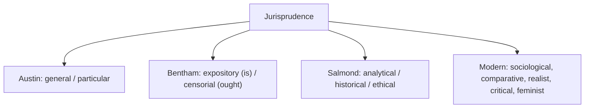

# Unit 1: Introduction to Jurisprudence

!!! abstract "In one line"
    Jurisprudence is the study of law itself: what law is, where it comes from and how it works. It is not about any one rule.

## Why it matters for the exam

- Asked as a **short note** in both papers we have: 2080 Q7(a) "scope and importance of jurisprudence" and 2078 Q7(c) "scope of jurisprudence".
- It can also come as a full 20-mark question. Two are written out in full under **Full 20-mark answers**. Learn the definitions here well, because you will reuse them in almost every Jurisprudence answer.

## Key terms

| Term | Nepali | Plain meaning |
|---|---|---|
| Jurisprudence | विधिशास्त्र | The study or theory of law |
| Law | कानून | Rules a society treats as binding and enforces |
| Positive law | — | Law laid down by a human authority, such as Parliament or a court |
| Natural law | प्राकृतिक कानून | Law said to come from reason, morality or nature, above man-made law |
| Jurist | कानूनविद् | A scholar who writes about law |
| Analytical jurisprudence | विश्लेषणात्मक विधिशास्त्र | Studies law as it is: its parts and structure |
| Historical jurisprudence | ऐतिहासिक विधिशास्त्र | Studies how law grew over time |
| Ethical jurisprudence | नैतिक विधिशास्त्र | Studies what law ought to be |
| Sociological jurisprudence | समाजशास्त्रीय विधिशास्त्र | Studies how law works in society |

## Start here: what is this subject?

Think of a car. One person learns to *drive* it: which pedal, which gear. Another learns *how a car works*: the engine, the brakes, why it moves at all.

Most law papers teach you to drive: what the Civil Code says about a contract, which court hears which case. **Jurisprudence teaches how the engine works.** It asks:

- What is law, and how is it different from morality or custom?
- Where does law come from: Parliament, judges, custom, religion, reason?
- Why do people obey law?
- What do basic words like *right*, *duty*, *person*, *property* and *possession* really mean?

These questions sit under every other paper. That is why jurisprudence is often called the foundation of legal study.

## 1.1 Meaning and definition of jurisprudence

### The word

"Jurisprudence" comes from the Latin word jurisprudentia:

- *juris* = of law
- *prudentia* = knowledge, skill or wisdom

So, word for word, jurisprudence means **"knowledge of law"** or **"skill in law"**.

### Why there is no single definition

Jurists define jurisprudence differently because they disagree about what law *is*. A jurist who thinks law is only the command of the state will define jurisprudence narrowly. A jurist who thinks law includes morality or social practice will define it widely. So learn the definitions **in groups**, and say which view each one belongs to.

### Definitions to learn

| Jurist | Definition | What it shows |
|---|---|---|
| **Ulpian** (Roman jurist, about 200 A.D.) | "Jurisprudence is the knowledge of things divine and human, the science of the just and the unjust." | The oldest, widest view. Law, religion and morality mixed together. |
| **John Austin** (English, 1790–1859) | "The science of jurisprudence is concerned with positive laws, or with laws strictly so called." Often summed up as **"the philosophy of positive law"**. | Narrow view. Only man-made law counts. Morality is left out. |
| **T.E. Holland** (English, 1835–1926) | "Jurisprudence is the formal science of positive law." | Follows Austin. "Formal" means it studies the *form* of legal relations, not the content of particular rules. |
| **John Salmond** (English-born New Zealand jurist, 1862–1924) | "Jurisprudence is the science of the first principles of the civil law." | By "civil law" Salmond means the law of the land, the law a state applies in its courts (see the box below). "First principles" means the basic ideas under all its rules. Like Austin, he looks only at state law. |
| **G.W. Keeton** | "The study and systematic arrangement of the general principles of law." | Jurisprudence as putting legal ideas in order. |
| **Roscoe Pound** (American, 1870–1964) | "The science of law, using the term law in the juridical sense, as denoting the body of principles recognized or enforced by public and regular tribunals in the administration of justice." | "Juridical sense" means law as courts actually apply it. Pound also stressed law as a tool for balancing social interests: social engineering. |
| **G.W. Paton** | "A particular method of study, not of the law of one country but of the general notion of law itself." | Jurisprudence is about law in general, not one country's law. |
| **Julius Stone** | "The lawyer's extraversion": the lawyer's study of law in the light of other subjects such as sociology, economics and ethics. | Modern, wide view. Law cannot be understood from inside law alone. |

!!! info "Three meanings of \"civil law\""
    You will meet the phrase "civil law" used in three ways. Watch which one is meant:

    1. **Salmond's sense:** the law of the land, the law of a state (from Latin *jus civile*, the law of a city-state).
    2. **Civil vs criminal:** law about private disputes (contracts, property, family), as opposed to crimes. This is the meaning in "Muluki Civil Code".
    3. **Civil-law countries:** countries such as France and Germany whose law is mainly in written codes, as opposed to "common-law" countries such as England where judge-made precedent is central.

!!! tip "Exam tip"
    In any answer, quote at least two definitions: one narrow (Austin or Holland) and one wide (Pound or Stone). Then write one line on why they differ. That one line shows the examiner you understand the subject, not only that you memorised it.

### Nature of jurisprudence

From these definitions, a few features follow. They are useful as headings when a question asks about the "nature" of jurisprudence.

1. **It studies law in general**, not the rules of one subject. It asks what is common to all law.
2. **It is a science** in the broad sense: a systematic, ordered study. It is not a science like physics; its conclusions are argued, not measured.
3. **It is also philosophy.** It asks "what is law?" and "what ought law to be?", which are philosophical questions.
4. **It has no fixed boundary.** What jurisprudence covers depends on how a jurist defines law (see 1.2).
5. **It links law to other fields:** ethics, history, sociology, economics, politics.
6. **It changes over time.** New schools and trends keep appearing (see Units 2 and 3).

## 1.2 Scope and importance of jurisprudence

### Scope: what does jurisprudence cover?

"Scope" means the area a subject covers. The scope of jurisprudence has **grown** over time.

**The narrow view (Austin).** Jurisprudence covers only positive law: law made by the state. Questions of morality, justice and "what law ought to be" belong to other subjects: ethics, or what Austin called the "science of legislation" (the study of how to make good laws).

**The wide, modern view.** Most later jurists reject Austin's limit. For them jurisprudence covers anything that helps us understand law, including:

| Area | Example questions | Unit in this paper |
|---|---|---|
| Nature and definition of law | What is law? How is it different from morality? | Unit 4 |
| Sources of law | Where do rules come from: legislation, precedent, custom? | Unit 4 |
| Schools of legal thought | How do natural, positivist, historical, sociological and realist jurists see law? | Unit 2 |
| Modern trends | What do critical legal studies, feminist jurisprudence and postmodernism add? | Unit 3 |
| Purpose of law | What is justice? What should law aim for? | Units 4, 5 |
| Basic legal concepts | Right, duty, person, property, obligation, liability, possession, ownership | Units 6–11 |
| Law and society | How does law shape society, and society shape law? | Unit 2 (sociological school) |

!!! tip "A memory trick"
    The scope of jurisprudence is almost the same as the list of units in this paper. If you can recall the 11 units, you can write the "scope" answer.

**Why the scope keeps growing.** Society changes. New problems such as gender inequality, technology and the environment raise new questions about what law is for. So new branches appear: feminist jurisprudence, law and economics, and others. Julius Stone's phrase "the lawyer's extraversion" captures this: the lawyer looks *outward*, to other subjects.

### Importance: why study jurisprudence?

A common objection is that jurisprudence is "too theoretical". Here is why it matters in practice:

1. **It explains the basic words of law.** Every paper uses words like right, duty, person, property and possession. Jurisprudence defines them exactly. Without it, a student learns rules without understanding the ideas behind them.
2. **It trains legal reasoning.** It teaches how to read a rule, find its purpose and argue from principles. These are the skills every lawyer and judge uses.
3. **It helps judges in hard cases.** When a written law is silent or unclear, a judge must reason from principles: justice, equity, the purpose of the law. Jurisprudence supplies those principles.
4. **It helps lawmakers and reformers.** To improve a law you must first ask what the law is *for*. Bentham's "censorial" jurisprudence (see 1.3) is exactly this.
5. **It connects law with society.** It shows that law is not only words in a book but a tool that affects people's lives: Pound's "social engineering".
6. **It helps understand other legal systems.** Comparing principles across countries is easier once you know the general ideas they share.
7. **It builds an independent, critical mind.** Schools such as critical legal studies and feminist jurisprudence teach students to ask *whose interests a law serves*.

Textbooks often call jurisprudence **"the eye of law"**: it lets the lawyer see what lies behind the rules.

### Why it matters in Nepal

Nepal's legal system mixes several traditions. That makes jurisprudence especially useful here:

- **Old Hindu-law tradition.** Nepal's first general code, the Muluki Ain of 1910 B.S. (1854 A.D.), drew heavily on Hindu religious law and custom.
- **Written codes.** The Muluki Ain of 2020 B.S. (1963 A.D.) was replaced by the Muluki Civil Code 2074 and the Muluki Criminal Code 2074, in force since 1 Bhadra 2075 (17 August 2018). Codes are the tradition of "civil law" countries such as France.
- **Binding court decisions.** Under Article 128(4) of the Constitution of Nepal (2015), an interpretation of law or legal principle laid down by the Supreme Court binds the Government of Nepal, all its offices and all courts. Binding precedent is the tradition of "common law" countries such as England and India.
- **A rights-based Constitution.** The Constitution's preamble commits Nepal to the rule of law and an independent judiciary, and Part 3 lists fundamental rights.

To understand how these sources fit together, and which one wins when they clash, you need jurisprudence. Unit 4 (sources of law) builds on this.

## 1.3 Kinds of jurisprudence

Different jurists divided jurisprudence in different ways. Learn the three classic divisions below, then the modern additions.

### Austin: general and particular

| | General jurisprudence | Particular jurisprudence |
|---|---|---|
| What it studies | Principles common to "the ampler and maturer systems" of law (Austin's phrase) | The law of one particular country |
| Example | What is a "right" in any legal system? | What rights does the Constitution of Nepal give? |

**Criticism:** Salmond objected that a principle does not need to be common to many systems before jurisprudence can study it. Holland called "particular jurisprudence" a contradiction: a science must be general, and only the *material* studied (one country's law) can be particular. And "particular jurisprudence" looks more like ordinary study of national law than jurisprudence.

### Bentham: expository and censorial

| | Expository jurisprudence | Censorial jurisprudence |
|---|---|---|
| Question it asks | What *is* the law? | What *ought* the law to be? |
| Role | Explains the law as it stands | Criticises the law and proposes reform |
| Who does it | The "expositor" | The "censor" |

Jeremy Bentham (English, 1748–1832) drew this line in *A Fragment on Government* (1776). Austin, his follower, kept jurisprudence to the expository side.

### Salmond: analytical, historical and ethical

Salmond used "jurisprudence" in two senses. In the *generic* sense it means the whole science of law. In the *specific* (narrower) sense it means the study of the first principles of law. He divided this specific sense into three branches.

| Branch | Studies | Key question | Typical jurists |
|---|---|---|---|
| analytical jurisprudence | The law as it is now: its basic concepts and structure | What does the law consist of? | Austin, Holland, Salmond, later H.L.A. Hart |
| historical jurisprudence | How law and legal ideas grew over time | Where did this law come from? | Savigny, Henry Maine |
| ethical jurisprudence | The law as it ought to be, judged by justice and morality | Is this law just? | Natural law thinkers |

### Modern additions

Later jurists added more kinds. These link directly to the schools in Unit 2:

- **Sociological jurisprudence:** law as a working part of society. *Example:* Pound's "social engineering".
- **Comparative jurisprudence:** comparing the laws of different countries to find shared ideas and better solutions.
- **Realist jurisprudence:** law is what courts actually do, not only what statutes say.
- **Critical and feminist jurisprudence:** asks whom the law favours and whom it leaves out (Unit 3).

Julius Stone's book *The Province and Function of Law* (1946) is subtitled "Law as Logic, Justice and Social Control". It groups the whole field into three parts: **analytical jurisprudence** (the logic of law), **sociological jurisprudence** (law in society), and **theories of justice** (what law ought to achieve).

## Compare

| Point | Narrow view (Austin, Holland) | Wide view (Pound, Stone, modern) |
|---|---|---|
| What counts as law | Only positive law made by the state | State law plus custom, social practice, values |
| Morality | Kept out | Part of the study |
| Scope | Basic concepts and structure of law | Concepts, sources, schools, justice, law and society |
| Method | Analysis of legal ideas | Analysis plus history, sociology, economics, ethics |
| Weakness | Ignores how law works in real life and whether it is just | Can become too broad to have a clear boundary |

## Model answers

??? question "2080 Q7(a): Write a note on scope and importance of jurisprudence. (short note)"
    **Meaning (2 lines).** Jurisprudence, from Latin *juris* (law) and *prudentia* (knowledge), is the study of law in general. Salmond calls it "the science of the first principles of the civil law".

    **Scope.**

    - Austin limited it to positive law, the law made by the state.
    - The modern view is wider. It covers the nature and sources of law, the schools of legal thought, justice, basic legal concepts (right, duty, person, property, possession, ownership), and the relation of law and society.
    - Julius Stone calls it "the lawyer's extraversion": law studied in the light of other subjects. Its scope keeps growing, for example with feminist jurisprudence.

    **Importance.**

    1. It explains basic legal concepts used in every branch of law.
    2. It trains legal reasoning.
    3. It guides judges where the law is silent or unclear.
    4. It guides law reform (Bentham's censorial jurisprudence).
    5. It links law to society (Pound's social engineering).

    **Nepal.** Nepal mixes codes (Muluki Codes 2074), binding Supreme Court precedent (Article 128(4) of the Constitution) and custom. Jurisprudence helps explain how these sources fit together.

    **Conclusion (1 line).** Jurisprudence is rightly called "the eye of law": it lets a lawyer see the principles behind the rules.

??? question "2078 Q7(c): Scope of jurisprudence. (short note)"
    **Meaning.** Jurisprudence is the study of the general principles of law. Keeton calls it "the study and systematic arrangement of the general principles of law".

    **The scope depends on how law is defined.**

    - **Narrow (Austin, Holland):** only positive law, its concepts and structure. Morality and "what law ought to be" are outside.
    - **Wide (Pound, Stone, modern):** also covers the sources of law, the schools of legal thought, justice, and how law works in society.

    **Main areas within the scope.**

    1. Nature and definition of law.
    2. Sources of law: legislation, precedent, custom.
    3. Schools and modern trends: natural, positivist, historical, sociological, realist; critical legal studies, feminist jurisprudence.
    4. Concept of justice.
    5. Legal concepts: rights and duties, person, property, obligation and liability, possession, ownership.

    **Conclusion.** The scope is not fixed; it widens as society raises new questions. Stone's phrase "the lawyer's extraversion" sums this up.

## Full 20-mark answers

These are written the way you would write them in the exam. Each takes about 35 minutes by hand. Learn the structure and the key sentences; you do not need to memorise every word.

??? example "Q1. Define jurisprudence. Discuss its nature, scope and importance. (20 marks)"
    **Introduction**

    Law touches almost every part of our lives. It tells us how to buy land, how to marry, what is a crime and how a court decides a dispute. Behind all these separate rules stands one question: *what is law itself?* The subject that studies this question is called jurisprudence.

    The word comes from the Latin *jurisprudentia*. *Juris* means "of law" and *prudentia* means "knowledge" or "skill". So jurisprudence literally means **knowledge of law**. It does not study one particular rule, such as the rule on contracts or theft. It studies law in general: its nature, its sources, its purpose and its basic ideas.

    **Definitions of jurisprudence**

    Jurists have defined jurisprudence in different ways, because they disagree about what law is. The main definitions are:

    1. **Ulpian**, the Roman jurist: "Jurisprudence is the knowledge of things divine and human, the science of the just and the unjust." This is the oldest and widest definition. It mixes law with religion and morality.
    2. **John Austin**: jurisprudence is concerned with "positive laws, or with laws strictly so called". It is often summed up as "the philosophy of positive law". For Austin, only law made by the state is law in the proper sense.
    3. **T.E. Holland**: "Jurisprudence is the formal science of positive law." It studies the form and structure of legal relations, not the content of particular rules.
    4. **John Salmond**: "Jurisprudence is the science of the first principles of the civil law." By civil law Salmond means the law of the land, the law a state applies in its courts.
    5. **Roscoe Pound**: jurisprudence is "the science of law, using the term law in the juridical sense, as denoting the body of principles recognized or enforced by public and regular tribunals in the administration of justice".
    6. **Julius Stone** calls jurisprudence "the lawyer's extraversion": the lawyer's study of law in the light of other disciplines such as sociology, economics and ethics.

    These definitions fall into two groups. Austin, Holland and Salmond take a **narrow view**: jurisprudence studies only the law laid down by the state. Ulpian, Pound and Stone take a **wider view**: jurisprudence also asks how law works in society and whether it is just. Putting them together, jurisprudence can be defined as *the systematic study of the nature, sources, purposes and basic concepts of law, and of its relation to society.*

    **Nature of jurisprudence**

    1. **A general study of law.** Jurisprudence is not about one branch of law. It looks for the ideas common to all branches, such as right, duty and person.
    2. **A science in the broad sense.** It is a systematic and ordered study, so Holland and Salmond call it a science. But it is not an exact science like physics; its conclusions are reached by argument, not by measurement.
    3. **A philosophy of law.** It asks basic questions, such as "what is law?" and "why should it be obeyed?". These are philosophical questions.
    4. **It studies both what law is and what law ought to be.** Bentham called the first "expository" and the second "censorial" jurisprudence. Austin kept only the first, but most modern jurists include both.
    5. **Interdisciplinary.** It draws on history, sociology, economics, politics and ethics, because law cannot be understood in isolation.
    6. **Dynamic, not fixed.** As society changes, new schools and trends appear, such as sociological jurisprudence, realism, critical legal studies and feminist jurisprudence. So its content keeps changing.

    **Scope of jurisprudence**

    The scope of a subject means the area it covers. There are two views on the scope of jurisprudence.

    *Narrow view.* Austin limited jurisprudence to positive law. Questions of morality and of what law ought to be belonged, in his view, to ethics or to the "science of legislation". This view gave jurisprudence a clear boundary. However, it was criticised for ignoring how law actually works and whether it is just.

    *Wide (modern) view.* Most modern jurists reject Austin's limit. Today the scope of jurisprudence includes:

    1. **Nature and definition of law**, and how law differs from morality and custom.
    2. **Sources of law**: legislation, precedent, custom, conventions, and juristic writings.
    3. **Schools of legal thought**: the natural, historical, analytical (positivist), sociological, realist and socialist schools.
    4. **Modern trends**: critical legal studies, feminist jurisprudence and postmodernism.
    5. **Purpose of law and the concept of justice**: criminal, civil, distributive and corrective justice.
    6. **Basic legal concepts**: rights and duties, person, property, obligation and liability, possession and ownership.
    7. **Law and society**: how law shapes society and how society shapes law. Pound described law as "social engineering", a tool for balancing competing interests.

    The scope is still widening. For example, feminist jurisprudence has led jurists to ask whether laws treat women and men equally. Nepal's Constitution reflects this concern by guaranteeing the rights of women in Article 38. Stone's phrase "the lawyer's extraversion" captures this outward growth.

    **Importance of jurisprudence**

    Jurisprudence is sometimes called too theoretical. In fact, it has great practical value:

    1. **It explains the basic concepts of law.** Words such as right, duty, person, property and possession are used in every branch of law. Jurisprudence gives them exact meaning. Without it, a student learns rules without understanding them.
    2. **It develops legal reasoning.** It teaches how to read a rule, find its purpose and argue from principles. These are the core skills of lawyers and judges.
    3. **It helps judges in hard cases.** When a statute is silent or unclear, the judge must decide on the basis of principles such as justice, equity and the purpose of the law. Jurisprudence supplies these principles.
    4. **It guides lawmakers and law reform.** To improve a law, one must first ask what the law is meant to achieve. This is Bentham's censorial jurisprudence.
    5. **It links law with society.** It shows that law is a social tool, not just words in a book, and that a law must be judged by its effect on people.
    6. **It helps in comparing legal systems.** Knowing the general principles of law makes it easier to understand and learn from foreign legal systems.
    7. **It builds a critical mind.** Modern schools such as critical legal studies and feminist jurisprudence teach lawyers to ask whose interests a law serves.

    For these reasons, textbooks often call jurisprudence "the eye of law".

    **Jurisprudence in the context of Nepal**

    Jurisprudence is especially useful in Nepal because Nepal's legal system draws on several traditions at once:

    - **Hindu-law tradition and custom.** The Muluki Ain of 1910 B.S. (1854 A.D.) was based largely on Hindu law and social custom.
    - **Codified law.** The Muluki Ain of 2020 B.S. was replaced by the Muluki Civil Code 2074 and the Muluki Criminal Code 2074, which came into force on 1 Bhadra 2075. Codes are typical of civil-law countries.
    - **Binding precedent.** Under Article 128(4) of the Constitution of Nepal (2015), an interpretation of law or a legal principle laid down by the Supreme Court binds the Government of Nepal, all its offices and all courts. Binding precedent is typical of common-law countries.
    - **A rights-based Constitution.** The preamble commits Nepal to the rule of law and an independent judiciary, and Part 3 guarantees fundamental rights.

    To understand how these sources fit together, and which one prevails when they conflict, a Nepali lawyer needs the tools of jurisprudence.

    **Critical view**

    Jurisprudence has been criticised as abstract, and as having no fixed boundary or agreed definition. These criticisms have some force. But the lack of a single definition reflects real disagreement about the nature of law, and the open scope allows jurisprudence to respond to new social problems. These are strengths rather than weaknesses.

    **Conclusion**

    Jurisprudence is the study of law in general: its nature, sources, purposes and basic concepts. It began as a narrow study of positive law with Austin and has grown into a wide, interdisciplinary subject. It explains the basic ideas used in every branch of law, trains legal reasoning, guides judges and lawmakers, and links law to society. In a mixed legal system like Nepal's, it is indispensable. It is rightly called the foundation, or "the eye", of law.

??? example "Q2. What is jurisprudence? Explain the various kinds (classifications) of jurisprudence given by different jurists. (20 marks)"
    **Introduction**

    Jurisprudence, from the Latin *juris* (of law) and *prudentia* (knowledge), is the study of law in general. Salmond defines it as "the science of the first principles of the civil law", that is, of the law of the land. Austin calls it the philosophy of positive law, while Julius Stone calls it "the lawyer's extraversion", the study of law in the light of other disciplines.

    Because jurists disagree about what law is and what jurisprudence should study, they have divided jurisprudence in different ways. The main classifications are those of Austin, Bentham, Salmond and Julius Stone, along with several kinds added by modern schools.

    **1. Austin: general and particular jurisprudence**

    John Austin divided jurisprudence into two kinds:

    - **General jurisprudence** studies the principles, notions and distinctions common to "the ampler and maturer systems" of law, in Austin's phrase. For example, it asks what a "right" or a "duty" means in any legal system.
    - **Particular jurisprudence** studies the law of one particular country. For example, it asks what rights the Constitution of Nepal gives its citizens.

    *Criticism.* Salmond objected that a principle does not need to be shared by many systems before jurisprudence can study it. Holland argued that "particular jurisprudence" is a contradiction in terms: a science must be general, and only the material studied (one country's law) can be particular. Moreover, "particular jurisprudence" looks like the ordinary study of national law rather than jurisprudence.

    **2. Bentham: expository and censorial jurisprudence**

    Jeremy Bentham, in *A Fragment on Government* (1776), distinguished:

    - **Expository jurisprudence**, which explains the law **as it is**. The person who does this is the "expositor".
    - **Censorial jurisprudence**, which examines the law **as it ought to be**, criticises it and suggests reforms. The person who does this is the "censor". In his *Introduction to the Principles of Morals and Legislation* (1789), Bentham describes censorial jurisprudence as the "art of legislation".

    Austin, Bentham's follower, confined jurisprudence to the expository side. Modern jurists accept both. In Nepal, for example, explaining what the Muluki Civil Code 2074 says about contracts is expository work, while the work of bodies such as the Nepal Law Commission in proposing reforms to laws is censorial in nature.

    **3. Salmond: analytical, historical and ethical jurisprudence**

    Salmond used jurisprudence in two senses. In the *generic* sense it means the whole science of law. In the *specific* sense it means the study of the first principles of law. He divided the specific sense into three branches:

    1. **Analytical jurisprudence** studies the law as it exists at present. It analyses the basic concepts of law, such as rights, duties, person, property, possession and ownership, and the structure of a legal system. Austin, Holland, Salmond himself and, later, H.L.A. Hart are its leading figures. Units 6 to 11 of this paper are largely analytical jurisprudence.
    2. **Historical jurisprudence** studies how law and legal ideas developed over time. Savigny argued that law grows from the spirit of a people (*Volksgeist*), and Henry Maine traced the movement of progressive societies "from status to contract". In Nepal, tracing the law from the Muluki Ain of 1910 B.S. to the Muluki Codes of 2074 is historical jurisprudence.
    3. **Ethical jurisprudence** studies the law as it ought to be, judged by justice and morality. It is close to natural-law thinking and to Bentham's censorial jurisprudence.

    **4. Julius Stone's threefold division**

    Julius Stone's *The Province and Function of Law* (1946) is subtitled "Law as Logic, Justice and Social Control". It divides jurisprudence into:

    1. **Analytical jurisprudence**: the logic and structure of law.
    2. **Theories of justice**: what law ought to achieve.
    3. **Sociological (functional) jurisprudence**: how law works as a means of social control.

    **5. Modern kinds of jurisprudence**

    Later schools of thought added further kinds:

    - **Sociological jurisprudence** treats law as a working part of society. Roscoe Pound saw law as "social engineering", balancing competing interests, and Eugen Ehrlich spoke of the "living law" found in society rather than in statute books.
    - **Realist jurisprudence** says law is what courts actually do. Justice Holmes wrote that "the prophecies of what the courts will do in fact, and nothing more pretentious, are what I mean by the law".
    - **Comparative jurisprudence** compares the laws of different countries to find common principles and better solutions.
    - **Critical and feminist jurisprudence** ask whose interests the law serves, and whether it treats groups such as women fairly.

    **Summary table**

    | Jurist | Kinds | Basis of division |
    |---|---|---|
    | Austin | General, particular | Whether the principles are common to many systems or belong to one |
    | Bentham | Expository, censorial | Law as it is vs law as it ought to be |
    | Salmond | Analytical, historical, ethical | Present structure, past growth, moral ideal |
    | Julius Stone | Analytical, theories of justice, sociological | Logic, justice, social control |
    | Modern schools | Sociological, realist, comparative, critical, feminist | How law works in society and whom it serves |

    **Relationship between the kinds**

    These kinds are not rivals; they complement each other. A full understanding of any legal rule needs all of them. Take Nepal's law on women's property rights. Analytical jurisprudence explains what the present rule says. Historical jurisprudence explains how it developed from the Muluki Ain. Ethical and feminist jurisprudence ask whether it is just, and sociological jurisprudence asks how it works in real life.

    **Critical view**

    No classification is perfect. Austin's division has been criticised as artificial, and Salmond's division leaves out the sociological and realist approaches that became important in the twentieth century. The many classifications show that jurisprudence has no fixed boundary. Each division reflects its author's view of what law is.

    **Conclusion**

    Jurisprudence has been classified in several ways: by Austin into general and particular, by Bentham into expository and censorial, by Salmond into analytical, historical and ethical, and by Julius Stone into analytical, justice-based and sociological. Modern schools have added sociological, realist, comparative, critical and feminist jurisprudence. Together, these kinds show that law must be studied as it is, as it grew, as it works in society, and as it ought to be.

## Test yourself

??? question "1. What do the two Latin parts of the word 'jurisprudence' mean?"
    *Juris* = of law; *prudentia* = knowledge or skill. Together: knowledge of law.

??? question "2. Why did Austin call jurisprudence 'the philosophy of positive law'?"
    Because for Austin only positive law, made by the state, is law "strictly so called". Morality and what law ought to be fall outside jurisprudence.

??? question "3. What does Salmond mean by 'civil law' in his definition?"
    The law of the land: the law a state applies in its courts. It does not mean civil law as opposed to criminal law.

??? question "4. Give Bentham's two kinds of jurisprudence and the question each asks."
    Expository asks "what is the law?". Censorial asks "what ought the law to be?".

??? question "5. Name Salmond's three branches of jurisprudence."
    Analytical (law as it is), historical (how law grew), ethical (law as it ought to be).

??? question "6. Which article of the Constitution of Nepal makes Supreme Court principles binding, and why does it matter for jurisprudence?"
    Article 128(4). It makes precedent a binding source of law in Nepal, alongside the Codes and custom. Jurisprudence explains how these sources relate.

??? question "7. What did Julius Stone mean by 'the lawyer's extraversion'?"
    That the lawyer must look outward: law is understood by studying it with other fields such as sociology, economics and ethics, not only from inside law.

## One-minute revision

- **Word:** *juris* (law) + *prudentia* (knowledge) = knowledge of law.
- **Narrow definitions:** Austin "philosophy of positive law"; Holland "formal science of positive law"; Salmond "science of the first principles of the civil law".
- **Wide definitions:** Ulpian "knowledge of things divine and human"; Pound "science of law"; Stone "the lawyer's extraversion".
- **Scope:** narrow (Austin: positive law only) → wide (sources, schools, justice, legal concepts, law and society). It keeps growing.
- **Importance:** concepts, reasoning, hard cases, reform, law and society, comparing systems, critical thinking. "The eye of law."
- **Kinds:** Austin general/particular; Bentham expository/censorial; Salmond analytical/historical/ethical; modern sociological, comparative, realist, critical, feminist.
- **Nepal:** a mixed system of Hindu-law roots, the Muluki Codes 2074 and binding precedent under Article 128(4).

## Sources

- Nomita Agrawal, *Jurisprudence (Legal Theory)*, Central Law Publications, Allahabad. Syllabus reading.
- P.J. Fitzgerald (ed.), *Salmond on Jurisprudence*, 12th edn, Sweet & Maxwell, 1966. Ch. 1.
- R.W.M. Dias, *Jurisprudence*, 5th edn, Butterworths, 1985. Ch. 1.
- G.W. Paton, *A Textbook of Jurisprudence*, 4th edn, Oxford, 1972. Ch. 1.
- John Austin, *The Province of Jurisprudence Determined*, 1832.
- Jeremy Bentham, *A Fragment on Government*, 1776; *An Introduction to the Principles of Morals and Legislation*, 1789, ch. XVII.
- H.S. Maine, *Ancient Law*, 1861, ch. V.
- O.W. Holmes, "The Path of the Law", 10 *Harvard Law Review* 457 (1897).
- Justinian, *Digest* 1.1.10 (Ulpian's definition).
- Julius Stone, *The Province and Function of Law*, 1946.
- Constitution of Nepal (2015), preamble, Part 3, Article 38 and Article 128(4). English text, Nepal Law Commission (lawcommission.gov.np).
- Muluki Civil Code 2074 and Muluki Criminal Code 2074; commencement 1 Bhadra 2075.
