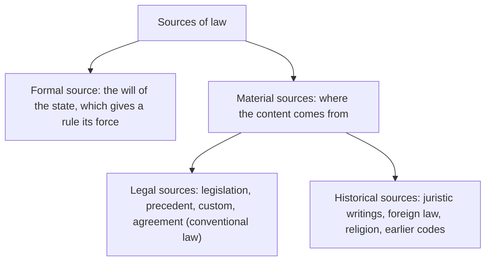
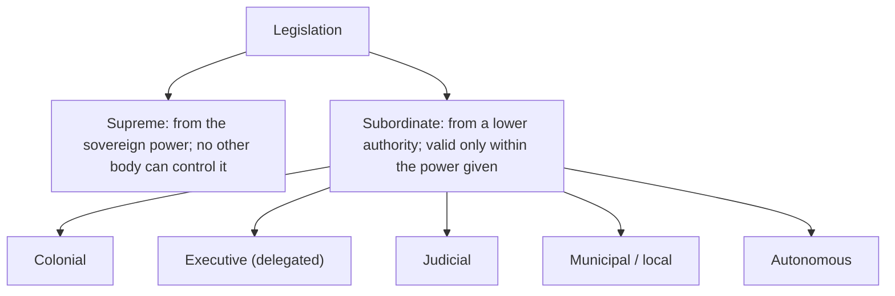
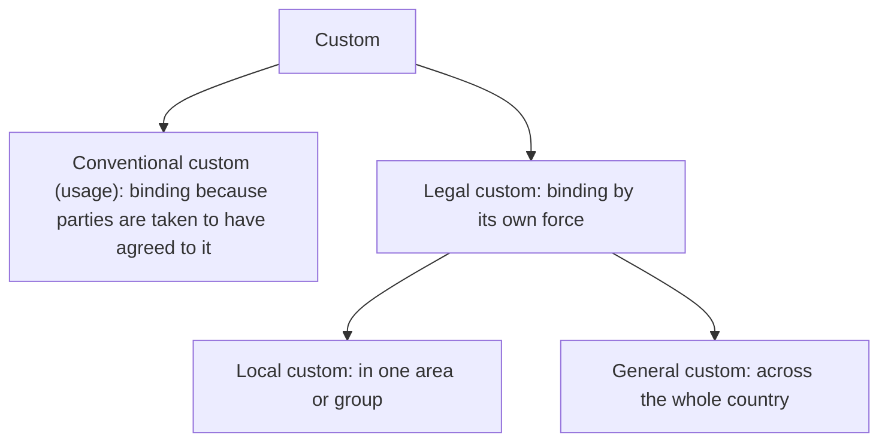

# Unit 4: Definition and Sources of Law

!!! abstract "In one line"
    This unit asks two questions: what is law (its definition, purpose, functions and kinds), and where does a legal rule come from (legislation, precedent, custom, conventions, and juristic writings, equity and justice).

## Why it matters for the exam

- **Asked as a full 20-mark question in both papers we have:** 2080 Q3 "Elaborate sources of law. Justify why legislation is the most important source of law." and 2078 Q2 "What are the main sources of law? Explain in detail 'legislation as a source of law'."
- **Asked as a short note:** 2078 Q7(d) "functions of law".
- Sources of law come up every year. Learn the three main sources (legislation, precedent, custom) well, with Nepal's position on each. Three full answers are written out below.

## Key terms

| Term | Nepali | Plain meaning |
|---|---|---|
| Law | कानून | Rules a state recognises and enforces |
| Source of law | कानूनको स्रोत | The place a legal rule comes from and gets its force |
| Legislation | विधायन | Law made by a law-making body, such as Parliament |
| Act | ऐन | A law passed by Parliament |
| Delegated legislation | प्रत्यायोजित विधायन | Rules made by the government or another body under power given by an Act |
| Ordinance | अध्यादेश | A temporary law issued by the President when Parliament is not in session |
| Precedent | नजिर | An earlier court decision that guides or binds later courts |
| Custom | प्रथा | A practice followed so long that people treat it as binding |
| Convention | — | (1) An unwritten rule of constitutional practice; (2) an international treaty |
| Equity | — | Fairness used to fill gaps or soften harsh rules |
| ratio decidendi | — | The legal principle on which a case is decided |
| obiter dicta | — | Remarks by a judge that are not needed for the decision |

## Start here: where do rules come from?

Think of a water tap. You see water come out, but the water comes from somewhere: a tank, a river, rain. Law is the same. A judge applies a rule. But where did that rule come from?

- Some rules were **written by Parliament**. For example, the Muluki Criminal Code 2074 makes theft a crime.
- Some rules were **made by judges** in earlier cases. The Supreme Court of Nepal decides a point once; every lower court must then follow it.
- Some rules **grew out of long practice** in society. People followed them for generations before any court enforced them.
- And where no rule exists at all, a judge decides by **reason, fairness and justice**.

These are the **sources of law**. This unit first asks what law is, then looks at each source in turn.

## 4.1 Definition of law

### Why "law" is hard to define

The word "law" is used in many senses: the law of gravity, the laws of cricket, moral law, the law of Nepal. Jurisprudence is concerned with the last one: the law of a state. Even here, jurists disagree, because each school of thought (Unit 2) sees law from a different angle. So learn the definitions in groups.

### Definitions to learn

| School | Jurist | Definition (standard textbook form) | What it stresses |
|---|---|---|---|
| Natural | **Cicero**, **Aquinas** | Aquinas: law is an ordinance of reason for the common good, made by whoever has care of the community, and promulgated. | Law must be reasonable and serve the common good |
| Analytical | **John Austin** | Law is the aggregate of rules set by men as politically superior, or sovereign, to men as politically subject. Often summed up as "a command of the sovereign backed by a sanction". | Law comes from the sovereign and is enforced by punishment |
| Analytical | **T.E. Holland** | "A law is a general rule of external human action enforced by a sovereign political authority." | Law governs outward conduct and is enforced by the state |
| Analytical | **Hans Kelsen** | Law is a system (hierarchy) of norms. Each norm gets its validity from a higher norm, up to the basic norm (Grundnorm). | Law as a structure of norms |
| Historical | **Savigny** | Law is not made; it is found. It grows from the common consciousness of the people (Volksgeist). | Law grows from society, not from the ruler |
| Sociological | **Roscoe Pound** | Law is a tool of social engineering: it balances competing interests in society. | What law does in society |
| Realist | **O.W. Holmes** | "The prophecies of what the courts will do in fact, and nothing more pretentious, are what I mean by the law." | Law is what courts actually do |
| Judicial (Salmond) | **John Salmond** | "Law may be defined as the body of principles recognised and applied by the state in the administration of justice." | Law is what courts apply |

!!! tip "Exam tip"
    Salmond's definition is the safest single definition to quote. Then add Austin (command of the sovereign) and Pound (social engineering) to show two different angles.

### Elements of law

From these definitions, a working definition can be built. Law is:

1. a body of **rules or principles**,
2. made or **recognised by the state**,
3. which governs **human conduct**,
4. **enforced** by the state through courts and sanctions,
5. aimed at **justice, order and the welfare** of society.

### Criticism of the main definitions

- **Austin's command theory** ignores custom, which is obeyed without any command. It does not fit international law or constitutional law well, and it treats law as only a threat of punishment.
- **Salmond's definition** puts the court first. But law exists before any court applies it. Critics say it confuses the end (justice) with the means (law).
- **Savigny** ignores the role of deliberate legislation in reforming society.
- **Holmes** describes how lawyers predict outcomes, but not what makes a rule valid.

## 4.2 Purpose of law

The purpose of law is the goal it aims at: *why* we have law at all. Textbooks list these purposes:

1. **Justice.** Salmond's definition itself ties law to "the administration of justice". Justice is the main end of law.
2. **Order and peace.** Without law, Hobbes said, life would be "solitary, poor, nasty, brutish, and short". Law keeps order so people can live safely.
3. **Protection of rights and freedoms.** Law protects life, liberty and property, and limits the power of the state.
4. **Welfare and the common good.** Bentham said law should aim at "the greatest happiness of the greatest number".
5. **Equality.** Law treats like cases alike and protects weaker groups.
6. **Social change.** Law is used to reform society: for example, to end untouchability or child marriage.
7. **Certainty and predictability.** People can plan their lives because they know the rules in advance.

!!! info "Nepal"
    The Preamble of the Constitution of Nepal (2015) sets out the purposes the state's law serves: rule of law, fundamental rights, an independent judiciary, and a socialism-oriented economy. Article 126(1) says the courts exercise justice "in accordance with the provisions of this Constitution, other laws and recognized principles of justice".

## 4.3 Functions of law

The **purpose** of law is its goal. The **functions** of law are the jobs it does to reach that goal. (The two overlap. In a short note, keep the focus on "jobs".)

### Main functions

1. **Maintaining order and security.** Criminal law punishes wrongdoers and deters others.
2. **Settling disputes.** Courts give a peaceful way to decide quarrels, instead of force.
3. **Social control.** Law guides behaviour. Pound saw law as the most specialised form of social control in a developed society.
4. **Social engineering.** Pound: law balances competing interests (individual, public and social) so that the most interests are met with the least friction.
5. **Protecting rights and liberties.** Constitutional and civil law protect the individual, including against the state.
6. **Allocating power.** Law says who may make laws, who may govern, and who may judge, and limits each.
7. **Facilitating private arrangements.** Law of contract, marriage, wills and companies lets people make their own binding arrangements.
8. **Bringing social change.** Law can push society forward, for example by banning harmful practices.
9. **Distributing resources fairly.** Tax law and welfare law share burdens and benefits (distributive justice, Unit 5).

### Llewellyn's "law-jobs"

Karl Llewellyn, the American realist, described the basic "law-jobs" every group must do:

1. disposing of **trouble cases** (settling disputes),
2. **preventive channelling** of conduct and expectations, so trouble does not arise,
3. **allocating authority** and setting procedures for decisions, and
4. organising the group as a whole to give it **direction and incentive**.

### Functions of law in Nepal

- **Order:** the Muluki Criminal Code 2074 defines crimes and punishments.
- **Disputes:** courts under Part 11 of the Constitution, and mediation.
- **Rights:** Part 3 of the Constitution lists fundamental rights; Article 133 lets the Supreme Court enforce them.
- **Allocation of power:** Schedules 5 to 9 of the Constitution divide law-making power between the federation, the provinces and local levels.
- **Social change:** Section 168(3) of the Muluki Criminal Code 2074 prohibits banishing a woman to a shed (*chhaupadi*) during menstruation or delivery. Section 168(4) punishes it with up to three months' jail, a fine up to Rs 3,000, or both. Here law is used against a harmful custom.

## 4.4 Kinds of law

### Salmond's eight kinds of law

Salmond listed the different things called "law" in ordinary speech:

| Kind | Meaning | Example |
|---|---|---|
| Imperative law | A rule of action imposed by an authority and enforced by force (Austin's idea) | A command of the sovereign |
| Physical or scientific law | A statement of how nature behaves; it is not obeyed but observed | The law of gravity |
| Natural or moral law | The principles of right and wrong | "Do not lie" |
| Conventional law | Rules agreed among people to govern their own dealings | Rules of a club; rules of cricket |
| Customary law | Rules from long-followed practice | Local customs on land use |
| Practical or technical law | Rules for reaching a practical end | Rules of grammar or architecture |
| International law | Rules governing relations between states | Treaties, customary international law |
| Civil law | The law of the land, applied by the state's courts | The Constitution, Acts, binding precedents of Nepal |

Jurisprudence mainly studies the last one: **civil law** in Salmond's sense (the law of the state).

### Classification of the law of a state

| Basis | Kind 1 | Kind 2 |
|---|---|---|
| Parties involved | **Public law**: the state is a party (constitutional, administrative, criminal law) | **Private law**: relations between private persons (contract, property, family) |
| Content | **Substantive law**: defines rights and duties (Muluki Civil Code 2074) | **Procedural law**: lays down how rights are enforced in court (Muluki Civil Procedure Code 2074) |
| Territory | **Municipal (national) law**: law within one state | **International law**: law between states |
| Wrong involved | **Criminal law**: wrongs against society, punished by the state | **Civil law**: private wrongs, remedied by compensation or other relief |
| Form | **Written (codified)**: in a code or statute | **Unwritten**: custom and judge-made law |
| Reach | **General law**: applies to everyone | **Special law**: applies to a special subject or group (e.g. the Companies Act 2063) |

## 4.5 Sources of law

### Meaning

A "source of law" is where a legal rule comes from. The phrase has several meanings, so jurists classify sources.

### Salmond's classification: formal and material sources

| | Formal source | Material source |
|---|---|---|
| Meaning | The source from which a rule gets its **force and validity** | The source from which a rule gets its **content (matter)** |
| Salmond's answer | The will and power of the state, shown in its courts | Legislation, precedent, custom, agreement (legal); juristic writings, religion, foreign law (historical) |
| Example | A rule is law in Nepal because the state's courts will enforce it | The rule itself was taken from an English case, a Hindu text or an Act |

Salmond also separates **legal sources** from **historical sources**:

| | Legal sources | Historical sources |
|---|---|---|
| Authority | Recognised by the law itself as giving rise to rules | Influence the law, but have no binding authority |
| Effect | The court **must** use them | The court **may** use them |
| Examples | Legislation, precedent, custom, agreement | Juristic writings, foreign law, religious texts |

Salmond's four **legal sources** are:

1. **Legislation**: produces enacted law (statute law).
2. **Precedent**: produces case law.
3. **Custom**: produces customary law.
4. **Agreement**: produces conventional law (law binding the parties because they agreed to it, such as a contract or a treaty).

Other jurists add conventions, juristic writings, equity, and justice and good conscience. These are covered in 4.5.4 and 4.5.5.

### Sources of law in Nepal at a glance

| Source | Where Nepal recognises it |
|---|---|
| Constitution | Article 1: the Constitution is the fundamental law; inconsistent laws are void to that extent |
| Legislation | Articles 109 (federal), 197 (provincial), 221 and 226 (local); Article 114 (ordinance) |
| Precedent | Article 128(4): Supreme Court interpretations and principles must be followed |
| Treaties | Nepal Treaty Act 2047, section 9 |
| Custom | Recognised where not contrary to law; the old Muluki Ain drew on custom and the shastras |
| Justice and equity | Article 126(1): courts act under the Constitution, laws "and recognized principles of justice" |

## 4.5.1 Legislation

### Meaning

The word comes from the Latin *legis* (law) and *latio* (making or setting). So legislation means **making law**.

- **Salmond:** "Legislation is that source of law which consists in the declaration of legal rules by a competent authority."
- **Gray:** legislation means the formal utterances of the legislative organs of society.
- **Austin:** law is the command of the sovereign; so for Austin all true law is, in the end, legislation.

Salmond uses "legislation" in three senses:

1. **Widest sense:** every way law is made, including judicial decisions and custom.
2. **Wide sense:** every expression of the will of the legislature, whether it makes law or not.
3. **Strict (proper) sense:** the making of law by an authority given power to do so, in the form of a written rule. This is the sense used in jurisprudence.

Law made by legislation is called **enacted law** or **statute law**. Its great feature is that it is made **deliberately** and in **written** form, unlike custom (which grows) or precedent (which comes out of a dispute).

### Kinds of legislation (Salmond)

**1. Supreme legislation.** Made by the sovereign power in the state. No other law-making authority can repeal or control it. Salmond's example is the British Parliament.

**2. Subordinate legislation.** Made by an authority other than the sovereign. It depends on a higher authority for its existence and can be repealed or controlled by it. Salmond's five kinds:

| Kind | Made by | Example |
|---|---|---|
| Colonial | The legislature of a colony, under the imperial power | Laws of British colonies (mostly historical now) |
| Executive (delegated) | The government, under power given by an Act | Rules (*niyamawali*) made by the Government of Nepal under an Act |
| Judicial | Courts, for their own procedure | Supreme Court Rules 2074 |
| Municipal (local) | Local bodies, for their area | Laws of a municipal or village assembly |
| Autonomous | Private bodies, for their own members | By-laws of a university or company |

### Delegated legislation

"Delegated legislation" means law made by a body other than the legislature, using power the legislature gave it. An Act sets out the main policy and says, for example, "the Government of Nepal may make rules to carry out the purposes of this Act". The government then makes **rules (niyamawali)**, and departments issue **directives** and **procedures**.

**Why it is needed:**

1. Parliament lacks time to settle every detail.
2. Technical matters need experts.
3. Rules can be changed quickly in an emergency or as conditions change.
4. It allows experiment and flexibility.

**Dangers:** the executive may grab law-making power, rules may go beyond the parent Act, and there is less public debate.

**Controls:**

- **Parliamentary control.** In Nepal a committee of the National Assembly examines delegated legislation and can ask for rules that conflict with the Constitution or the parent Act to be changed.
- **Judicial control.** A court can strike down a rule that goes beyond the power given by the Act (it is ultra vires, "beyond the powers"), or that conflicts with the Constitution. In Nepal, Article 133(1) lets any citizen ask the Supreme Court to declare a law void.

### Legislation in Nepal

Nepal's Constitution does not create one sovereign legislature in Salmond's sense. It is a federal system, and every legislature is under the Constitution. So in Nepal all legislation is, strictly, subject to the Constitution.

| Level | Constitution | What it says |
|---|---|---|
| Constitution itself | Article 1 | The Constitution is the fundamental law; laws inconsistent with it are void to the extent of the inconsistency |
| Federal | Article 109 | Federal Parliament's legislative powers are as listed in Schedule-5 (federal), Schedule-7 (federal-provincial concurrent) and Schedule-9 (concurrent for all three levels) |
| Federal procedure | Articles 110 and 113 | A Bill may be introduced in either House; it becomes an Act once the President certifies it (Article 113(5)) |
| Ordinance | Article 114 | When Parliament is not in session, the President may issue an Ordinance on the recommendation of the Council of Ministers. It is a temporary law |
| Provincial | Article 197 | Provincial Assembly's powers are as listed in Schedule-6, Schedule-7 and Schedule-9 |
| Provincial ordinance | Article 202 | The Head of Province may issue an ordinance; it lapses if not passed by the Assembly |
| Local | Articles 221 and 226 | Village and Municipal Assemblies make laws on matters in Schedule-8 and Schedule-9 |
| Old laws | Article 304(1) | Laws in force when the Constitution began continue until repealed or amended; inconsistent ones cease to operate one year after the first session of the federal legislature |
| Judicial review | Article 133(1) | The Supreme Court may declare any law void if it conflicts with the Constitution |

The biggest modern examples of legislation in Nepal are the Muluki Civil Code 2074 and the Muluki Criminal Code 2074, which replaced the Muluki Ain of 2020 B.S. and came into force on 1 Bhadra 2075.

### Merits of legislation

Salmond compared legislation with precedent and custom. These are the standard points, and they are also the answer to "why legislation is the most important source":

1. **Abrogative power.** Legislation can make new law **and repeal or change** old law. Precedent and custom can only build on what exists; they cannot easily abolish a bad rule.
2. **Efficiency and division of labour.** The legislature makes law; courts apply it. Each body does its own job well.
3. **Known in advance.** A statute is announced before it applies. Case law is made only after the dispute arises, so it acts backwards (retrospectively).
4. **Not dependent on a dispute.** Parliament can make law whenever it is needed. Judges must wait for a case to reach them.
5. **Clear, written and systematic.** Statutes are in precise, written form and can be arranged in codes. Case law is scattered across thousands of judgments.
6. **Can deal with new problems.** Cyber crime, climate change and new technology need new rules quickly. Only legislation can supply them in full.
7. **Democratic.** It is made by elected representatives after public debate.
8. **Superior authority.** In most modern states, a statute overrides custom and can override precedent.

### Demerits of legislation

1. **Rigid.** Words, once fixed, are hard to adapt to new facts. Courts must interpret.
2. **May be hasty or badly drafted.** Gaps and ambiguities lead to litigation.
3. **May not reflect society.** Savigny warned that law imposed from above, without regard to the people's spirit, may not work in practice.
4. **Can be misused** by a majority in power.

## 4.5.2 Precedent

### Meaning

"Precedent" means an earlier decision used as a guide or authority in a later similar case. In jurisprudence, it means a decision of a court that lays down a legal principle which later courts follow.

- **Gray:** a precedent covers everything said or done that furnishes a rule for later practice.
- **Salmond:** in a narrower sense, precedents are judicial decisions that contain in themselves a principle; that principle (the ratio decidendi) is the part that has authority.
- **Keeton:** a judicial precedent is a judicial decision to which authority has in some measure been attached.

### Stare decisis

The doctrine of precedent rests on the maxim *stare decisis et non quieta movere*: "stand by things decided and do not disturb settled points". In short, stare decisis. It means a court should follow earlier decisions on the same point of law, especially those of higher courts.

### Ratio decidendi and obiter dicta

| | ratio decidendi | obiter dicta |
|---|---|---|
| Literal meaning | "Reason for the decision" | "Things said by the way" |
| What it is | The legal principle needed to decide the case on its material facts | Remarks not needed for the decision: examples, side comments, views on points not in issue |
| Binding? | **Yes**, on lower courts | **No**, only persuasive (though a Supreme Court obiter carries weight) |

### Kinds of precedent (Salmond)

**1. Authoritative and persuasive**

| | Authoritative precedent | Persuasive precedent |
|---|---|---|
| Meaning | One the judge **must** follow, whether or not he agrees | One the judge **may** follow if convinced |
| Source | Decisions of higher courts in the same system | Decisions of foreign courts, lower or equal courts, obiter dicta, juristic writings |
| Force | Binding, a legal source of law | Not binding, a historical source |
| Nepal example | Supreme Court principles bind all lower courts (Article 128(4)) | Indian or English decisions cited in Nepali courts |

**2. Absolute and conditional (kinds of authoritative precedent)**

| | Absolutely authoritative | Conditionally authoritative |
|---|---|---|
| Meaning | Must be followed even if the later court thinks it wrong | Normally binding, but a court may depart from it in special circumstances, e.g. if clearly wrong or unreasonable |
| Example | Decisions of a higher court binding a lower court | Decisions of a court of equal standing; a larger bench reconsidering a smaller bench's ruling |

**3. Original and declaratory**

| | Original precedent | Declaratory precedent |
|---|---|---|
| Meaning | Creates and applies a **new** rule of law | Only declares and applies an **existing** rule |
| Importance | Develops the law | Shows the law is settled |
| Note | Salmond: only original precedents are a true source of new law. Most precedents are declaratory. | |

### When a precedent loses its binding force

1. It is **reversed** on appeal in the same case.
2. It is **overruled** by a higher court (or a larger bench) in a later case.
3. It was given **per incuriam**: in ignorance of a statute or a binding decision.
4. It conflicts with a decision of a higher court.
5. It was decided **sub silentio**: the point was not argued or considered.
6. A later **statute** changes the law.
7. It is **distinguished**: the later court finds the material facts are different.

### Merits and demerits of precedent

| Merits | Demerits |
|---|---|
| Certainty and consistency: like cases decided alike | Rigid: bad decisions can bind for years |
| Based on real facts, so practical | Made only when a dispute arises; acts retrospectively |
| Fills gaps left by legislation | Huge volume of case law is hard to find and use |
| Develops the law gradually to meet new conditions | Judges are not elected; judicial law-making can be undemocratic |
| Saves time: settled points need not be argued again | Hard to find the ratio in a long judgment |

Bentham attacked judge-made law as "dog law": the judge waits until the dog does wrong and then beats it, so people learn the rule only after they are punished.

### Precedent in Nepal

- **Article 128(4)** of the Constitution of Nepal (2015): "The interpretation of constitution and law or the legal principles propounded by the Supreme Court in relation to court cases must be followed by all." In plain words, the Supreme Court's interpretations and principles bind the government, its offices and all courts.
- **Article 128(2)** makes the Supreme Court a **Court of Record**: its decisions are recorded and can be cited as authority.
- Supreme Court decisions are published in the **Nepal Kanoon Patrika (NKP)**, the official law reports.
- **Within the Supreme Court**, a larger bench (for example a full bench) can reconsider and depart from a principle laid down by a smaller bench. So the Supreme Court is not absolutely bound by its own earlier decisions.
- **Persuasive use:** Nepali courts often cite Indian, English and other foreign decisions, and international human rights decisions, as persuasive authority.

So Nepal, though mainly a codified (civil-law style) system, follows binding precedent like a common-law country. Precedent has been especially important in Nepal for developing fundamental rights and public interest litigation.

## 4.5.3 Custom

### Meaning

A custom is a rule of conduct that people follow **so regularly and for so long** that they come to see it as binding.

- **Salmond:** custom is the embodiment of those principles which have commended themselves to the national conscience as principles of justice and public utility.
- **Holland:** custom is a generally observed course of conduct.
- **Keeton:** customary laws are rules of human action established by usage and regarded as legally binding by those to whom they apply, which courts adopt and apply.
- **Austin:** custom is not law in itself. It becomes law only when the sovereign or the courts adopt it. Until then it is only positive morality.
- **Savigny (historical school):** custom is the purest source of law, because it grows from the spirit of the people (Volksgeist). Legislation should only put custom into writing.

Custom is the **oldest source of law**. In early societies almost all law was customary. Hindu law, the early Muluki Ain of Nepal and English common law all drew heavily on custom.

### Kinds of custom (Salmond)

| Kind | Meaning | Example |
|---|---|---|
| **Conventional custom (usage)** | Binding only because the parties are taken to have included it in their agreement | A trade practice that goods are delivered within seven days |
| **Legal custom** | Binding by its own force, whether or not the parties agreed | A long-standing right of way across land |
| **Local custom** | A legal custom in a particular area, community or family | A custom of one community on inheritance |
| **General custom** | A legal custom across the whole country | English common law was said to rest on the general custom of the realm |

### Requisites (essentials) of a valid custom

A court will enforce a custom as law only if it passes these tests. This list is often asked on its own.

1. **Antiquity.** The custom must be very old. In England, a local custom must date from "time immemorial", fixed as 1189 A.D. (the start of the reign of Richard I). Other systems only require that it be long-established.
2. **Continuity.** It must have been followed without a break.
3. **Peaceable enjoyment.** It must have been followed openly and without dispute, not by force, secrecy or permission.
4. **Obligatory force.** People must follow it because they think they **must**, not just by choice (*opinio necessitatis*).
5. **Certainty.** Its content must be clear and definite.
6. **Reasonableness.** It must not be unreasonable or unjust. The burden is on the person attacking it to show it is unreasonable.
7. **Consistency.** It must not conflict with other customs in the same area.
8. **Conformity with statute.** It must not be contrary to a statute. A statute can abolish any custom.
9. **Not against public policy or morality.**

### Merits and demerits of custom

| Merits | Demerits |
|---|---|
| Grows from the people, so it is accepted and obeyed | Slow to change; cannot meet new problems |
| Reflects local conditions | Uncertain: hard to prove its content and age |
| Tested by long experience | May preserve harmful or discriminatory practices |
| Democratic in a broad sense | Varies from place to place, causing confusion |

### Custom in Nepal

- **Historical role.** Nepal's first general code, the Muluki Ain of 1910 B.S., was built largely on Hindu law (the shastras) and the customs of the time.
- **Today.** Custom is a source of law only where it does not conflict with the Constitution or a statute. Article 1 makes inconsistent laws void, and the same test applies to customs.
- **Harmful customs abolished by law.** The Constitution and statutes have ended customs such as untouchability. Section 168(3) of the Muluki Criminal Code 2074 prohibits chhaupadi, and section 168(4) punishes it. This shows legislation overriding custom.
- **Customs still respected.** Many community practices on religion, culture and local resource use (for example guthi, and community-managed irrigation and forests) continue, and courts respect them when they meet the tests above and do not conflict with law.

## 4.5.4 Conventions

"Convention" has two meanings in this syllabus. Explain both.

### (a) Constitutional conventions

Constitutional conventions are **unwritten rules of political practice** that govern how constitutional powers are used. Courts do not enforce them, but those in power follow them because breaking them would cause political crisis or loss of trust.

- **A.V. Dicey** separated "the law of the constitution" (rules enforced by courts) from "the conventions of the constitution": understandings, habits or practices that regulate the conduct of those holding power but are not enforced by the courts.
- **Examples from Britain:** the King or Queen gives assent to every Bill passed by Parliament; the leader of the majority party is appointed Prime Minister; a government that loses the confidence of the House of Commons resigns or seeks dissolution.
- **Why obeyed:** breach leads to political pressure, loss of office or a constitutional crisis.
- **Nepal:** Nepal has a long written Constitution, so conventions matter less. But practices still develop, such as how parties share chairs of parliamentary committees, or how the President acts on the Council of Ministers' advice.

### (b) International conventions (treaties)

A convention also means an **agreement between states**, such as the UN Convention on the Rights of the Child (CRC) or the Convention on the Elimination of All Forms of Discrimination against Women (CEDAW). These are a source of law under Salmond's head of **agreement** (conventional law).

**Nepal:**

- **Article 279** of the Constitution: ratification of, accession to, acceptance of or approval of treaties is governed by federal law. Treaties on peace and friendship, security and strategic alliance, the boundaries of Nepal, and natural resources and the distribution of their uses need a two-thirds majority of the total members of both Houses of the Federal Parliament.
- **Nepal Treaty Act 2047, section 9(1):** if a treaty to which Nepal is a party, ratified, acceded to, accepted or approved by Parliament, is inconsistent with prevailing law, the inconsistent law is void for the purpose of that treaty, and "the provisions of the treaty shall be enforceable as good as Nepalese laws".
- So a ratified treaty **prevails over an ordinary Nepali law** that conflicts with it. Nepal's Supreme Court has often relied on ratified human rights treaties to strike down or read down discriminatory laws.

## 4.5.5 Juristic writings, reason, equity, justice and good conscience

These are sources a court uses when legislation, precedent and custom do not give a clear answer. Most are **persuasive** or **historical** sources in Salmond's sense.

### Juristic writings (professional opinion)

The opinions of learned writers on law.

- **Roman law.** The opinions of jurists (*responsa prudentium*) had great authority. The Law of Citations (426 A.D.) made the opinions of five jurists binding: Papinian, Paul, Ulpian, Gaius and Modestinus.
- **English law.** "Books of authority" such as Glanvill, Bracton, Coke's *Institutes* and Blackstone's *Commentaries* are treated almost as law. Modern textbooks are only persuasive.
- **Hindu law.** The commentaries (for example the *Mitakshara* and *Dayabhaga*) shaped the law in practice. They influenced Nepal's traditional law too.
- **Nepal today.** Courts sometimes cite textbooks and research, but only as persuasive authority.

**Why useful:** writers analyse the law systematically, spot gaps and suggest reform. **Limit:** they have no binding authority; they show what the law ought to be or probably is.

### Reason

Where no rule exists, a judge must decide using reason: the logic of the legal system and common sense. Natural law thinkers saw reason as the basis of all law. Where there is no other law, the court must still decide, and it falls back on natural justice and reason. Many judge-made rules began as decisions based on reason.

### Equity

**Plain meaning:** fairness. Equity is used to **fill gaps** in the law or to **soften** a strict rule that would give an unjust result.

- **Aristotle:** equity is a correction of law where law is defective because of its generality.
- **England:** the Court of Chancery developed a separate body of rules ("equity") to give relief where the common law was too rigid. It created the trust, specific performance and the injunction. Its maxims include "he who seeks equity must do equity" and "equity follows the law".
- **Nepal:** Nepal has no separate equity courts. But courts use equitable ideas, such as fairness, reasonableness and natural justice, when the law is silent or harsh.

### Justice and good conscience

"Justice, equity and good conscience" was a formula used in British India and other common-law systems. Where no statute or custom applied, judges were told to decide according to justice, equity and good conscience. In practice, they often borrowed English rules that seemed fair.

**Nepal:** Article 126(1) of the Constitution says courts exercise powers relating to justice "in accordance with the provisions of this Constitution, other laws and recognized principles of justice". The phrase "recognized principles of justice" gives Nepali courts a constitutional basis to use justice, equity and natural justice when a statute is silent.

### Other sources sometimes listed

- **Religion:** Hindu dharmashastra shaped the old Muluki Ain; Islamic and Christian law shaped other systems.
- **Foreign law:** used as a model when drafting or interpreting law.
- **Agreement (contract):** binding between the parties.

## Compare

### Legislation, precedent and custom

| Point | Legislation | Precedent | Custom |
|---|---|---|---|
| Made by | Legislature (or delegated authority) | Judges | The people, through long practice |
| How made | Deliberately, in advance | In deciding a dispute | Grows slowly, unconsciously |
| Form | Written, precise | Written in judgments, but scattered | Mostly unwritten |
| Time of effect | Prospective (forward-looking) | Retrospective (applies to the case before it) | Already followed before courts recognise it |
| Can repeal old law? | **Yes** (abrogative power) | Limited (overruling) | No |
| Authority today | Highest, after the Constitution | Binding within the hierarchy of courts | Valid only if not contrary to statute |
| Jurist who stresses it | Austin, Bentham | Common-law tradition (Blackstone, Salmond) | Savigny, Maine |
| Nepal | Arts 109, 197, 221, 226 | Art 128(4) | Recognised if not contrary to law |

### Formal and material, legal and historical sources

| Point | Legal source | Historical source |
|---|---|---|
| Binding? | Yes | No |
| Court's duty | Must apply | May use for guidance |
| Examples | Legislation, authoritative precedent, valid custom, agreement | Juristic writings, foreign law, persuasive precedent, religion |

## Model answers

??? question "2078 Q7(d): Functions of law. (short note)"
    **Meaning (2 lines).** Salmond defines law as "the body of principles recognised and applied by the state in the administration of justice". The functions of law are the jobs law does to reach its ends of justice, order and welfare.

    **Main functions.**

    1. **Maintaining order and security:** criminal law punishes and deters.
    2. **Settling disputes peacefully:** through courts instead of force.
    3. **Social control:** guiding behaviour (Pound: law is the most specialised form of social control).
    4. **Social engineering:** balancing individual, public and social interests (Pound).
    5. **Protecting rights and liberties,** including against the state.
    6. **Allocating and limiting power** between organs and levels of government.
    7. **Facilitating private arrangements:** contracts, marriage, wills, companies.
    8. **Bringing social change** and distributing resources fairly.

    **Llewellyn's law-jobs.** Settling trouble cases; preventive channelling of conduct; allocating authority; giving the group direction and incentive.

    **Nepal.** The Muluki Criminal Code 2074 keeps order; Part 3 of the Constitution protects rights; Schedules 5 to 9 allocate power; section 168(3) of the Criminal Code uses law against the custom of chhaupadi.

    **Conclusion (1 line).** Law is not only a set of commands; it is a tool for order, justice and social progress.

??? question "Likely short note: Requisites of a valid custom"
    **Meaning.** Custom is a practice followed so long and so widely that it is treated as binding. Salmond: it embodies principles that have commended themselves to the national conscience as principles of justice and public utility.

    **Requisites.**

    1. Antiquity (in England, since 1189 A.D., "time immemorial").
    2. Continuity, without a break.
    3. Peaceable enjoyment: open, not by force or permission.
    4. Obligatory force: followed as a duty (*opinio necessitatis*).
    5. Certainty.
    6. Reasonableness.
    7. Consistency with other customs.
    8. Conformity with statute law.
    9. Not against public policy or morality.

    **Nepal.** Custom is valid only if not contrary to the Constitution or statute. Chhaupadi and untouchability have been made offences by law.

    **Conclusion.** These tests let courts keep useful customs and reject harmful ones.

??? question "Likely short note: ratio decidendi and obiter dicta"
    **Meaning.** In a precedent, only part of the judgment binds.

    - **ratio decidendi** ("reason for the decision"): the legal principle necessary to decide the case on its material facts. It binds lower courts.
    - **obiter dicta** ("things said by the way"): remarks not needed for the decision. They are only persuasive.

    **Finding the ratio.** Look at the material facts and the decision on them; ask what principle was necessary to reach that result.

    **Nepal.** Under Article 128(4), the "legal principles propounded by the Supreme Court" bind all. These principles are, in substance, the ratio of its decisions.

    **Conclusion.** The distinction keeps precedent flexible: only the core principle binds.

??? question "Likely short note: Delegated legislation"
    **Meaning.** Law made by a body other than the legislature (usually the government), under power given by an Act. In Nepal: rules (niyamawali), regulations, directives.

    **Reasons.** Lack of parliamentary time; technical matters; need for speed and flexibility; emergencies.

    **Dangers.** Excess of power by the executive; less debate; rules may go beyond the parent Act.

    **Controls.**

    - Parliamentary: in Nepal, a National Assembly committee scrutinises delegated legislation.
    - Judicial: the court may strike down rules that are ultra vires or unconstitutional (Article 133(1)).

    **Conclusion.** Delegated legislation is necessary in a modern state, but must stay within the limits set by the parent Act and the Constitution.

## Full 20-mark answers

These are written the way you would write them in the exam. Each takes about 35 minutes by hand. Learn the structure and the key sentences; you do not need to memorise every word.

??? example "Q1. Elaborate sources of law. Justify why legislation is the most important source of law. (2080 Q3, 20 marks)"
    **Introduction**

    Every legal rule has an origin. A judge who applies a rule must be able to say where it came from and why it is binding. The place from which a rule of law comes, and from which it gets its force, is called a **source of law**.

    Law itself is defined by Salmond as "the body of principles recognised and applied by the state in the administration of justice". Austin defined it as a command of the sovereign backed by a sanction. Whatever the definition, every legal system draws its rules from a limited number of sources: mainly legislation, precedent and custom, supported by conventions, juristic writings, equity and justice.

    **Classification of sources**

    Salmond divides sources into **formal** and **material** sources.

    - The **formal source** is the source from which a rule gets its force and validity. For Salmond, this is the will and power of the state, shown in its courts.
    - The **material sources** are those from which a rule gets its content. These are further divided into **legal** and **historical** sources.

    **Legal sources** are recognised by the law itself as binding. Courts must apply them. Salmond lists four: legislation, precedent, custom and agreement. **Historical sources**, such as juristic writings, foreign law and religion, influence the law but have no binding force. Courts may use them for guidance.

    **1. Legislation**

    Salmond defines legislation as "that source of law which consists in the declaration of legal rules by a competent authority". It is law made deliberately, in written form, by a body given the power to make law, such as Parliament. Salmond divides it into **supreme legislation**, made by the sovereign power, and **subordinate legislation**, made by lower authorities. Subordinate legislation includes colonial, executive (delegated), judicial, municipal and autonomous legislation.

    In Nepal, Article 109 of the Constitution gives the Federal Parliament legislative power over matters in Schedules 5, 7 and 9. Article 197 gives Provincial Assemblies power over Schedules 6, 7 and 9, and Articles 221 and 226 give local assemblies power over Schedules 8 and 9.

    **2. Precedent**

    A precedent is an earlier judicial decision that lays down a principle followed in later cases. It rests on the doctrine of *stare decisis*: stand by what has been decided. Only the **ratio decidendi**, the principle necessary for the decision, binds. **Obiter dicta**, remarks made by the way, are only persuasive. Salmond divides precedents into authoritative and persuasive, authoritative ones into absolute and conditional, and also distinguishes original from declaratory precedents.

    In Nepal, Article 128(4) of the Constitution provides that "the interpretation of constitution and law or the legal principles propounded by the Supreme Court in relation to court cases must be followed by all".

    **3. Custom**

    Custom is a practice followed so long and so widely that it is treated as binding. Salmond calls it the embodiment of principles that have commended themselves to the national conscience as principles of justice and public utility. Savigny considered it the purest source of law, because it grows from the spirit of the people (*Volksgeist*). Austin, however, held that custom becomes law only when adopted by the sovereign or the courts.

    A custom is valid only if it is ancient, continuous, peaceably enjoyed, obligatory, certain, reasonable, consistent and not contrary to statute or public policy. Custom may be conventional (usage) or legal, and legal custom may be local or general.

    **4. Conventions and agreement**

    Constitutional conventions are unwritten rules of political practice, which Dicey described as not enforced by courts but followed by those in power. International conventions, or treaties, are agreements between states. In Nepal, section 9(1) of the Nepal Treaty Act 2047 provides that a treaty ratified by Parliament prevails over inconsistent Nepali law and is "enforceable as good as Nepalese laws".

    **5. Juristic writings, equity, justice and good conscience**

    Opinions of learned writers were binding in Roman law under the Law of Citations, and books of authority such as Coke and Blackstone are respected in English law. Equity, developed in England by the Court of Chancery, fills gaps and softens harsh rules. Where no other rule applies, courts decide according to "justice, equity and good conscience". In Nepal, Article 126(1) directs courts to act according to the Constitution, other laws "and recognized principles of justice".

    **Why legislation is the most important source of law**

    In modern states, legislation has become the main and most important source of law. The reasons are these:

    1. **Abrogative power.** Legislation can not only create new law but also repeal or amend old law. Precedent and custom cannot easily abolish a bad rule. Salmond treats this as the chief advantage of legislation.
    2. **Efficiency.** Legislation separates the making of law from its application. Parliament makes the law; courts apply it. This division of labour produces better law.
    3. **Known in advance.** Legislation is declared before it is applied. Judge-made law is made after the facts, so it operates backwards. Bentham called it "dog law" for this reason.
    4. **Independent of disputes.** Parliament can legislate whenever society needs a rule. A judge must wait until a suitable case comes before the court.
    5. **Clear and systematic.** Statutes are written in precise words and can be arranged into codes. Case law is scattered across many judgments and is hard to find.
    6. **Meets new problems.** New issues such as cyber crime, data protection and climate change need complete new rules. Only legislation can supply them quickly.
    7. **Democratic legitimacy.** Legislation is made by elected representatives after public debate, so it reflects the will of the people.
    8. **Supremacy over other sources.** A statute overrides custom and can change the effect of precedent. Custom, for example, is valid only if it does not conflict with statute.

    **Nepal's position**

    Nepal shows the supremacy of legislation clearly. Article 1 of the Constitution makes the Constitution the fundamental law, so it stands at the top. Below it, Acts of the Federal Parliament (Article 109), provincial laws (Article 197) and local laws (Articles 221 and 226) are the main source of rules. A Bill becomes an Act when certified by the President (Article 113(5)). In urgent situations the President may issue an Ordinance (Article 114). The great codification of 2074, the Muluki Civil Code and the Muluki Criminal Code, replaced the old Muluki Ain and now governs most private and criminal law. Legislation has also been used to end harmful customs; section 168(3) of the Muluki Criminal Code 2074 makes chhaupadi an offence.

    At the same time, Nepal recognises precedent as binding (Article 128(4)), and ratified treaties prevail over inconsistent law (Treaty Act 2047, section 9). Custom remains valid only so far as it is consistent with law.

    **Critical view**

    Legislation is not perfect. It can be rigid, hastily drafted and out of touch with society. Savigny warned that law imposed from above without regard to the people's consciousness may fail. Legislation also needs courts to interpret it, and precedent fills its gaps. So the sources work together: legislation provides the main framework, precedent interprets and develops it, and custom and equity fill the remaining spaces.

    **Conclusion**

    The main sources of law are legislation, precedent and custom, supported by conventions, juristic writings, equity and justice. Of these, legislation is the most important in a modern state, because it alone can make and unmake law deliberately, clearly, in advance and with democratic authority. Nepal's federal Constitution and the Muluki Codes of 2074 show this. Still, legislation works best when supported by a strong system of precedent and respect for the reasonable customs of the people.

??? example "Q2. What are the main sources of law? Explain in detail 'legislation as a source of law'. (2078 Q2, 20 marks)"
    **Introduction**

    A source of law is the origin from which a legal rule comes and from which it gets its binding force. Salmond defines law as "the body of principles recognised and applied by the state in the administration of justice". The question "where do these principles come from?" is the question of sources.

    **Main sources of law**

    Salmond distinguishes the **formal source** of law, the will of the state that gives a rule its force, from **material sources**, from which a rule gets its content. Material sources are either **legal** (binding) or **historical** (persuasive only).

    The main sources are:

    1. **Legislation:** law declared by a competent authority, such as Parliament. It produces enacted or statute law.
    2. **Precedent:** earlier decisions of courts whose principle (ratio decidendi) binds later courts under the doctrine of stare decisis. In Nepal, Article 128(4) of the Constitution makes Supreme Court principles binding on all.
    3. **Custom:** practices followed so long that they are treated as binding. A valid custom must be ancient, continuous, certain, reasonable and not contrary to statute.
    4. **Agreement and conventions:** contracts and treaties bind the parties. Under section 9(1) of the Nepal Treaty Act 2047, a ratified treaty prevails over inconsistent Nepali law.
    5. **Juristic writings, equity, justice and good conscience:** persuasive sources used when the binding sources are silent. In Nepal, Article 126(1) refers to "recognized principles of justice".

    Of these, legislation is the most important in modern states, so it is explained in detail below.

    **Legislation: meaning**

    The word comes from Latin *legis* (law) and *latio* (making). Legislation therefore means the making of law. Salmond defines it as "that source of law which consists in the declaration of legal rules by a competent authority". Gray describes it as the formal utterances of the legislative organs of society. For Austin, all law is the command of the sovereign, so legislation is the true form of law.

    Salmond uses the word in three senses. In the widest sense, it includes every method of making law, including precedent and custom. In a wider sense, it includes every expression of the will of the legislature. In the strict and proper sense, used in jurisprudence, it means the making of law by a competent authority in the form of written rules.

    **Kinds of legislation**

    Salmond divides legislation into two main kinds.

    *(a) Supreme legislation.* This proceeds from the sovereign power in the state. No other authority can repeal, annul or control it. Salmond's example is the British Parliament, whose Acts no court can strike down.

    *(b) Subordinate legislation.* This proceeds from an authority other than the sovereign. It depends on the supreme authority and can be repealed or controlled by it. Salmond gives five kinds:

    1. **Colonial legislation:** made by colonial legislatures under an imperial power. It is mainly of historical interest now.
    2. **Executive legislation:** made by the executive under power delegated by the legislature. This is called **delegated legislation**. In Nepal, the Government makes rules (niyamawali) under Acts.
    3. **Judicial legislation:** rules made by courts to regulate their own procedure, such as the Supreme Court Rules 2074.
    4. **Municipal legislation:** laws and by-laws made by local authorities for their areas. In Nepal, Village and Municipal Assemblies make laws under Articles 221 and 226 of the Constitution.
    5. **Autonomous legislation:** rules made by private bodies such as universities and companies for their members.

    **Delegated legislation**

    Delegated legislation has grown rapidly in modern states. Parliament lacks time to deal with details, technical matters need experts, and rules must change quickly in emergencies. However, it carries the danger that the executive will take over the law-making function. It is therefore controlled in two ways. Parliament scrutinises it; in Nepal, a committee of the National Assembly examines delegated legislation. Courts review it, and may strike down a rule that goes beyond the parent Act (ultra vires) or conflicts with the Constitution. Article 133(1) of the Constitution allows any citizen to petition the Supreme Court to declare a law void.

    **Merits of legislation**

    1. **Abrogative power:** it can repeal and amend existing law, which precedent and custom cannot easily do.
    2. **Efficiency:** the separation of law-making from law-applying improves both.
    3. **Prior declaration:** it is announced before it is applied, while case law operates backwards.
    4. **No need to wait for a dispute:** law can be made whenever needed.
    5. **Clarity and form:** it is written, precise and can be codified.
    6. **Adaptability to new problems:** it can deal with new issues comprehensively.
    7. **Democratic:** it is made by elected representatives after debate.

    **Demerits of legislation**

    1. **Rigidity:** fixed words do not adjust easily to new facts.
    2. **Defective drafting:** haste and poor drafting create gaps and ambiguity.
    3. **Remoteness from society:** as Savigny warned, imposed law may not match the people's spirit.
    4. **Abuse of majority power:** a ruling majority may pass unjust laws.

    **Legislation compared with precedent and custom**

    | Point | Legislation | Precedent | Custom |
    |---|---|---|---|
    | Made by | Legislature | Judges | The people |
    | Effect | Prospective | Retrospective | Already followed |
    | Can repeal old law | Yes | Limited | No |
    | Form | Written, precise | Scattered in judgments | Mostly unwritten |

    **Legislation in Nepal**

    Article 1 of the Constitution of Nepal (2015) makes the Constitution the fundamental law; any law inconsistent with it is void to the extent of the inconsistency. Because Nepal is federal, legislative power is divided among three levels:

    - **Federal Parliament:** Article 109 gives it power over Schedule-5 (federal list), Schedule-7 (federal-provincial concurrent list) and Schedule-9 (concurrent list for all three levels). A Bill may be introduced in either House (Article 110) and becomes an Act once certified by the President (Article 113(5)).
    - **Provincial Assembly:** Article 197 gives it power over Schedules 6, 7 and 9.
    - **Local level:** Village and Municipal Assemblies make laws on matters in Schedules 8 and 9 (Articles 221 and 226).
    - **Ordinances:** when Parliament is not in session and immediate action is needed, the President may issue an Ordinance on the recommendation of the Council of Ministers (Article 114). The Head of a Province has a similar power (Article 202). Ordinances are temporary.
    - **Continuity of old laws:** under Article 304(1), laws in force at the start of the Constitution continue until repealed or amended.

    Since no legislature in Nepal stands above the Constitution, all Nepali legislation is, strictly speaking, subordinate to the Constitution, and the Supreme Court can declare it void under Article 133(1). The most important recent legislation is the Muluki Civil Code 2074 and the Muluki Criminal Code 2074, in force since 1 Bhadra 2075.

    **Critical view**

    Legislation is now the dominant source of law, but it cannot work alone. Courts must interpret statutes, and in Nepal their interpretations become binding under Article 128(4). Excessive delegated legislation can weaken parliamentary control. Frequent ordinances can bypass Parliament. The quality of legislation depends on careful drafting and public consultation.

    **Conclusion**

    The main sources of law are legislation, precedent, custom, agreement and conventions, and persuasive sources such as juristic writings, equity and justice. Among these, legislation is the most important in a modern state because it is deliberate, clear, prospective, democratic and able to repeal outdated law. Nepal's Constitution organises legislation across federal, provincial and local levels, all subject to the Constitution and judicial review. Legislation, supported by precedent and reasonable custom, is the backbone of Nepal's legal system.

??? example "Q3. Define precedent. Explain its kinds and its importance as a source of law in Nepal. (likely question, 20 marks)"
    **Introduction**

    In ordinary language, a precedent is an earlier event used as an example for later ones. In law, a precedent is an earlier judicial decision that lays down a legal principle which later courts follow in similar cases. Law made in this way is called case law or judge-made law.

    **Definitions**

    - **Gray:** a precedent covers everything said or done which furnishes a rule for subsequent practice.
    - **Salmond:** in the legal sense, precedents are judicial decisions that contain in themselves a principle. The underlying principle, which forms their authoritative element, is called the ratio decidendi.
    - **Keeton:** a judicial precedent is a judicial decision to which authority has in some measure been attached.

    Precedent is a source of law because courts must apply, in later cases, principles laid down in earlier ones. It is the main source of law in common-law countries such as England and India.

    **The doctrine of stare decisis**

    The doctrine of precedent rests on the maxim *stare decisis et non quieta movere*, "stand by what has been decided and do not disturb settled matters". It means that a court must follow earlier decisions of higher courts on the same point of law. It ensures that like cases are decided alike.

    **Ratio decidendi and obiter dicta**

    Not everything in a judgment binds. The **ratio decidendi** ("reason for the decision") is the legal principle necessary to decide the case on its material facts. It binds lower courts. **Obiter dicta** ("things said by the way") are remarks not necessary for the decision, such as general observations or views on hypothetical facts. They are only persuasive, although a Supreme Court's obiter carries great weight.

    **Kinds of precedent**

    *1. Authoritative and persuasive precedent.* An **authoritative precedent** is one that a judge must follow, whether or not he agrees with it. Decisions of higher courts in the same legal system are authoritative for lower courts. Authoritative precedents are legal sources of law. A **persuasive precedent** is one that a judge is not bound to follow but may follow if convinced. Decisions of foreign courts, lower courts and obiter dicta are persuasive. They are historical sources of law.

    *2. Absolutely and conditionally authoritative precedent.* An **absolutely authoritative precedent** must be followed even if the later judge thinks it wrong. Decisions of a higher court binding a lower court are of this kind. A **conditionally authoritative precedent** is normally binding, but may be disregarded in special circumstances, for instance where it is clearly wrong, unreasonable or given in ignorance of the law. Decisions of a bench of the same court are often of this kind; a larger bench may depart from them.

    *3. Original and declaratory precedent.* An **original precedent** creates and applies a new rule of law. A **declaratory precedent** merely applies an existing rule. Salmond notes that only original precedents are a true source of new law, though declaratory precedents are far more numerous.

    **When a precedent loses its authority**

    A precedent ceases to bind when it is reversed on appeal, overruled by a higher court or larger bench, or changed by statute. It may also be disregarded if it was given *per incuriam* (in ignorance of a statute or binding decision), decided *sub silentio* (without argument on the point), or conflicts with a higher court's decision. A later court may also "distinguish" a precedent by showing that its material facts differ.

    **Merits of precedent**

    1. **Certainty and consistency:** like cases are decided alike, so people can predict the law.
    2. **Practical:** rules are made from real disputes, not abstract theory.
    3. **Fills gaps:** where statutes are silent or unclear, precedent supplies the rule.
    4. **Flexible growth:** law develops step by step with social change.
    5. **Saves time:** settled points need not be argued again.

    **Demerits of precedent**

    1. **Rigidity:** a wrong decision may bind for many years.
    2. **Retrospective:** the rule is made after the facts. Bentham called it "dog law".
    3. **Bulk and complexity:** thousands of reported cases are hard to search.
    4. **Uncertainty:** the ratio of a long judgment may be hard to identify.
    5. **Democratic concern:** judges are not elected law-makers.

    **Importance of precedent as a source of law in Nepal**

    Nepal's legal system is mainly codified, in the civil-law tradition. Yet precedent has become a major and binding source of law.

    - **Constitutional basis.** Article 128(4) of the Constitution of Nepal (2015) provides that "the interpretation of constitution and law or the legal principles propounded by the Supreme Court in relation to court cases must be followed by all". This binds the government, its offices and all courts. Precedent in Nepal is therefore not only a practice but a constitutional rule.
    - **Court of Record.** Article 128(2) declares the Supreme Court a Court of Record, so its decisions are preserved and cited as authority.
    - **Law reports.** Supreme Court decisions are published in the Nepal Kanoon Patrika (NKP), which lawyers and judges cite.
    - **Hierarchy.** Decisions of the Supreme Court bind the High Courts and District Courts absolutely. Within the Supreme Court, a larger bench may reconsider and depart from the principle laid down by a smaller bench, so its own decisions are conditionally binding.
    - **Developing the law.** Through public interest litigation and constitutional cases, the Supreme Court has developed principles on fundamental rights, gender equality, environmental protection and good governance. Many of these principles were later adopted in legislation.
    - **Interpreting statutes.** When the Muluki Codes 2074 or other Acts are unclear, Supreme Court interpretations settle their meaning for all courts.
    - **Persuasive use of foreign precedent.** Nepali courts often cite Indian, English and international decisions as persuasive authority.

    **Critical view**

    Precedent in Nepal has strengthened rights and filled gaps in legislation. But there are problems. Reported decisions are numerous and sometimes inconsistent, and lower courts may not always follow the Supreme Court's principles. Identifying the binding principle in a long judgment is not always easy. Judicial law-making must also respect the role of the legislature. A clear system of reporting and indexing, and careful identification of the ratio, are needed for precedent to work well.

    **Conclusion**

    A precedent is a judicial decision containing a principle that binds or guides later courts. Precedents are authoritative or persuasive, absolute or conditional, and original or declaratory, and only the ratio decidendi binds. In Nepal, Article 128(4) of the Constitution has made the Supreme Court's principles binding on all. Precedent is therefore, after the Constitution and legislation, one of the most important sources of law in Nepal. It adds flexibility and growth to a codified system.

## Test yourself

??? question "1. Give Salmond's definition of law."
    "Law may be defined as the body of principles recognised and applied by the state in the administration of justice."

??? question "2. What is the difference between a formal source and a material source of law?"
    A formal source gives a rule its force and validity (for Salmond, the will of the state). A material source gives it its content (legislation, precedent, custom, or historical sources such as writings).

??? question "3. Name Salmond's five kinds of subordinate legislation."
    Colonial, executive (delegated), judicial, municipal and autonomous.

??? question "4. Which articles of the Constitution of Nepal give legislative power to the federal, provincial and local levels?"
    Article 109 (Federal Parliament: Schedules 5, 7, 9), Article 197 (Provincial Assembly: Schedules 6, 7, 9), Articles 221 and 226 (Village and Municipal Assemblies: Schedules 8, 9).

??? question "5. What is the difference between ratio decidendi and obiter dicta?"
    The ratio is the legal principle necessary for the decision; it binds. Obiter dicta are remarks made by the way; they only persuade.

??? question "6. Distinguish authoritative and persuasive precedents, with a Nepal example."
    Authoritative precedents must be followed (Supreme Court principles bind lower courts under Article 128(4)). Persuasive precedents may be followed if convincing (Indian or English decisions cited in Nepal).

??? question "7. List five requisites of a valid custom."
    Any five of: antiquity, continuity, peaceable enjoyment, obligatory force, certainty, reasonableness, consistency, conformity with statute, not against public policy.

??? question "8. What does section 9(1) of the Nepal Treaty Act 2047 provide?"
    If a treaty ratified by Parliament is inconsistent with prevailing law, the inconsistent law is void for that treaty's purpose and the treaty is enforceable as Nepali law.

## One-minute revision

- **Law:** Salmond "body of principles recognised and applied by the state in the administration of justice"; Austin, command of the sovereign; Pound, social engineering.
- **Purpose:** justice, order, rights, welfare, equality, social change, certainty. **Functions:** order, disputes, social control, social engineering, rights, allocating power, private arrangements, change. Llewellyn's law-jobs.
- **Kinds:** Salmond's eight (imperative, physical, natural, conventional, customary, practical, international, civil); public/private, substantive/procedural, municipal/international, criminal/civil.
- **Sources:** formal (will of the state) vs material; legal (legislation, precedent, custom, agreement) vs historical (writings, foreign law, religion).
- **Legislation:** Salmond "declaration of legal rules by a competent authority"; supreme vs subordinate (colonial, executive, judicial, municipal, autonomous). Most important: abrogative, efficient, prospective, clear, democratic. Nepal: Arts 1, 109, 113(5), 114, 197, 221, 226, 133(1).
- **Precedent:** stare decisis; ratio binds, obiter persuades; authoritative/persuasive, absolute/conditional, original/declaratory. Nepal: Art 128(4), Court of Record (128(2)), NKP.
- **Custom:** conventional vs legal (local, general); requisites: antiquity, continuity, peaceable, obligatory, certain, reasonable, consistent, not against statute or public policy.
- **Others:** conventions (Dicey; treaties under Treaty Act 2047 s.9), juristic writings (Law of Citations), equity, justice and good conscience (Art 126(1) "recognized principles of justice").

## Sources

- Nomita Agrawal, *Jurisprudence (Legal Theory)*, Central Law Publications. Syllabus reading.
- P.J. Fitzgerald (ed.), *Salmond on Jurisprudence*, 12th edn, Sweet & Maxwell, 1966. Chs. 2, 5-8 (law, sources, legislation, precedent, custom).
- G.W. Paton, *A Textbook of Jurisprudence*, 4th edn, Oxford, 1972. Chs. on sources.
- R.W.M. Dias, *Jurisprudence*, 5th edn, Butterworths, 1985.
- V.D. Mahajan, *Jurisprudence and Legal Theory*, Eastern Book Company.
- B.N. Mani Tripathi, *Jurisprudence (Legal Theory)*, Allahabad Law Agency.
- John Austin, *The Province of Jurisprudence Determined*, 1832. T.E. Holland, *The Elements of Jurisprudence*. J.C. Gray, *The Nature and Sources of the Law*, 1909.
- A.V. Dicey, *Introduction to the Study of the Law of the Constitution*, 1885.
- K.N. Llewellyn, "The Normative, the Legal, and the Law-Jobs", 49 *Yale Law Journal* 1355 (1940).
- O.W. Holmes, "The Path of the Law", 10 *Harvard Law Review* 457 (1897).
- Constitution of Nepal (2015): Articles 1, 109, 110, 113, 114, 126(1), 128(2), 128(4), 133(1), 197, 202, 221, 226, 279, 304(1); Schedules 5-9. English text: https://www.constituteproject.org/constitution/Nepal_2016
- Nepal Treaty Act 2047 (1990), section 9. English text: https://faolex.fao.org/docs/pdf/nep206152.pdf
- Muluki Criminal Code (National Penal Code) 2074, section 168: https://nepallaws.com/Laws/the-national-penal-code-act-2074/part-2-criminal-offences/chapter-10-offences-relating-to-discrimination-and-other-degrading-treatment/section-168-prohibition-of-degrading-or-inhuman-treatment/ ; Kathmandu Post, "New law criminalises chhaupadi custom", 10 August 2017: https://kathmandupost.com/national/2017/08/10/new-law-criminalises-chhaupadi-custom
- Supreme Court Rules 2074: https://narayanilawfirm.org.np/supreme-court-rules-2074-with-second-amendment-2078/
- National Assembly scrutiny of delegated legislation: https://myrepublica.nagariknetwork.com/news/by-laws-come-under-parliament-committee-scrutiny
