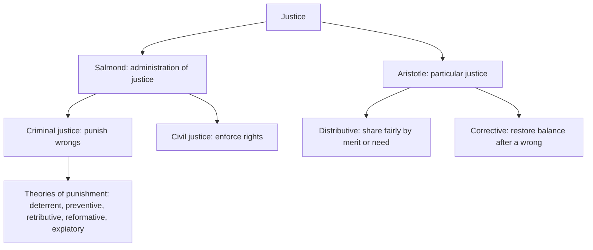

# Unit 5: Concept of Justice

!!! abstract "In one line"
    Justice means giving each person what is due to them. Law is the tool for doing it. Justice comes in kinds: criminal and civil (how courts do it), and distributive and corrective (Aristotle's two ways of being fair).

## Why it matters for the exam

- Asked as a **short note** in both papers we have: 2078 Q7(e) "criminal justice" and 2080 Q7(e) "distributive and corrective justice".
- No full 20-mark question on this unit has come yet in the papers we have. Two likely ones are written out in full below. The theories of punishment are the most likely long question.
- Justice also feeds other answers: purpose of law (Unit 4), natural school (Unit 2) and sources of law ("justice, equity and good conscience", Unit 4).

## Key terms

| Term | Nepali | Plain meaning |
|---|---|---|
| Justice | न्याय | Giving each person what is due to them |
| Administration of justice | न्याय प्रशासन | The state using courts and force to protect rights and punish wrongs |
| Criminal justice | फौजदारी न्याय | The state punishing a person who has committed a crime |
| Civil justice | देवानी न्याय | A court protecting a person's private right, or making good its breach |
| Distributive justice | वितरणात्मक न्याय | Fair sharing of wealth, posts, honours and burdens in society |
| Corrective justice | — | Putting right an unfair gain or loss between two people |
| Social justice | सामाजिक न्याय | Justice that lifts up weak and left-out groups |
| Punishment | सजाय | Pain or loss the state imposes on a wrongdoer |
| Compensation | क्षतिपूर्ति | Money paid to make good a harm |
| Natural justice | प्राकृतिक न्याय | Basic fair-hearing rules: no one judges their own case; hear both sides |

## Start here: what is "just"?

Two children share one cake. What is the fair way to cut it?

- **Equal halves.** Both are children, so both get the same.
- **By need.** One child has not eaten all day, so she gets more.
- **By work.** One child helped bake it, so he gets more.

Now suppose one child grabs the other's piece. Fairness now asks a different question. It does not ask who *deserves* more cake. It asks how to **give back** what was taken.

That small story holds the whole unit:

| Question | Name of the idea |
|---|---|
| How should the cake be shared out in the first place? | **Distributive justice** |
| How do we put things right after one person wrongs another? | **Corrective justice** |
| What does a court do when someone breaks a private right (a contract, a debt)? | **Civil justice** |
| What does the state do when someone commits a crime (theft, murder)? | **Criminal justice** |

## 5.1 Meaning of justice

### The word

"Justice" comes from the Latin *justitia*, from *jus*, meaning "right" or "law". In Nepali it is न्याय. In every language the core idea is the same: **fairness, giving each person their due, and treating like cases alike**.

### Why it is hard to define

Justice is an idea people *feel* strongly but describe differently. A rich man and a poor man, a victim and an accused, may all claim "justice" and want opposite things. So jurists give definitions from different angles. Learn them in groups.

### Definitions to learn

| Jurist | Definition or idea | What it shows |
|---|---|---|
| **Ulpian** (Roman jurist), repeated in Justinian's *Institutes* | Justice is "the constant and perpetual will to render to every man his due". In Latin: *suum cuique tribuere*, "to give each his own". | The classic definition. Justice is a steady habit of giving people what they are owed. |
| **Plato** (Greek, about 427–347 B.C.), *The Republic* | Justice is harmony: each person and each class does its own proper work and does not interfere with others. | Justice as social order and balance. |
| **Aristotle** (Greek, 384–322 B.C.), *Nicomachean Ethics*, Book V | Justice is a kind of equality: treat equals equally and unequals unequally, in proportion to the relevant difference. He divides particular justice into **distributive** and **corrective**. | The basis of 5.3.3 and 5.3.4. |
| **Herbert Spencer** (English, 1820–1903) | "Every man is free to do that which he wills, provided he infringes not the equal freedom of any other man." | Justice as equal freedom. |
| **John Salmond** | Justice is the end (aim) of law; law is the means. "The administration of justice may be defined as the maintenance of right within a political community by means of the physical force of the state." | Justice as something the state *does* through courts. |
| **Jeremy Bentham** and **J.S. Mill** (utilitarians) | A rule is just if it produces "the greatest happiness of the greatest number". Mill (*Utilitarianism*, 1863, ch. V) argues justice is the most important part of social utility. | Justice judged by its results. |
| **Roscoe Pound** (American) | Justice is the adjustment of relations and ordering of conduct so that people's wants are met as far as possible with the least friction and waste. | Justice as balancing interests: social engineering. |
| **John Rawls** (American, 1921–2002), *A Theory of Justice* (1971) | "Justice is the first virtue of social institutions, as truth is of systems of thought." Justice is **fairness**. | The leading modern theory. See below. |
| **Hans Kelsen** (Austrian) | Absolute justice is an irrational ideal. Science can only study law as it is; "just" is a value judgment. | The positivist doubt: justice is outside pure legal science. |

!!! tip "Exam tip"
    Open every justice answer with Ulpian's "to render to every man his due". Then add Aristotle (equality) and Rawls (fairness). Close the definition part with Kelsen's doubt in one line. That covers old, classical, modern and critical views.

### Rawls: justice as fairness

Rawls is now a standard part of this unit. Learn it in four steps.

1. **Original position.** Imagine people meeting to choose the basic rules of their society.
2. **Veil of ignorance.** They do not know who they will be: rich or poor, man or woman, high caste or Dalit, healthy or disabled. So no one can choose rules that favour themselves.
3. **Two principles they would choose:**
    - **First principle (liberty):** each person has an equal right to the widest basic liberties compatible with the same liberties for all (speech, vote, conscience, person).
    - **Second principle (inequality):** social and economic inequalities are allowed only if (a) they are to the greatest benefit of the **least advantaged** (the **difference principle**), and (b) they are attached to posts open to all under **fair equality of opportunity**.
4. **Priority.** The first principle comes first. Liberty cannot be traded away for economic gain.

*Criticism.* Robert Nozick (*Anarchy, State, and Utopia*, 1974) replied that justice is about **how** property was acquired (by fair acquisition and free transfer), not about a pattern of sharing. Taxing the rich to help the poor, he argued, forces people to work for others. Utilitarians object that Rawls ignores total welfare. Marxists say Rawls accepts the capitalist market.

### Utilitarian theory of justice

- **Bentham:** law and justice are judged by one test: do they increase pleasure and reduce pain for the greatest number?
- **Mill:** the feeling of justice comes from the natural wish to hit back at harm, made moral by concern for society. Justice covers the most important social rules, so it ranks above other kinds of utility.
- *Weakness:* it can justify sacrificing a minority if the majority gains. Rawls's main point against it is that it "does not take seriously the distinction between persons".

### Other ways to divide justice

| Pair | First | Second |
|---|---|---|
| Natural vs legal | **Natural (moral) justice**: what is right by reason and conscience | **Legal justice**: justice according to law, as declared by the state and courts |
| Formal vs substantive | **Formal**: like cases treated alike, rules applied without bias | **Substantive**: the content of the rule itself is fair |
| Procedural vs substantive | **Procedural**: fair process, such as a hearing and an unbiased judge | **Substantive**: a fair result |

Salmond stresses that courts give **justice according to law**, not each judge's private idea of justice. This makes justice certain, uniform and free from personal bias. The cost is that the law may sometimes be rigid. Equity and "justice, equity and good conscience" fill that gap (Unit 4).

## 5.2 Importance of justice

Why does justice matter? Think of it as the reason law exists.

1. **It is the end (aim) of law.** Salmond treats law as the instrument and justice as the end. A law that never delivers justice loses its point.
2. **It replaces private revenge.** Without courts, wronged people would take revenge themselves. Salmond explains that the state's force replaces the private violence of self-help. This keeps peace and order.
3. **It protects rights.** Rights on paper are worthless unless a court can enforce them. Justice turns rights into reality.
4. **It gives law legitimacy.** People obey willingly when they see law as fair. Unfair law breeds resistance and revolt.
5. **It ensures equality.** Justice means equal treatment before the law, whatever a person's wealth, caste or gender.
6. **It protects the weak.** Distributive and social justice protect those who cannot protect themselves: the poor, women, Dalits, people with disabilities.
7. **It guides lawmakers and judges.** When the law is silent, judges decide by "principles of justice". Lawmakers use justice to test whether a law is good.
8. **It supports democracy and development.** Fair courts build trust in the state and attract investment. An unfair system breeds corruption and conflict.

### Nepal angle

The Constitution of Nepal (2015) puts justice at its centre:

- **Preamble:** commits Nepal to building an egalitarian society on proportional, inclusive and participatory principles, to ensure economic equality, prosperity and social justice. It also commits to an independent judiciary and the rule of law.
- **Article 126(1):** powers relating to justice in Nepal are exercised by courts and other judicial bodies, in accordance with the Constitution, other laws and "recognized principles of justice". Article 126(2): everyone must obey court orders and verdicts.
- **Article 18(1):** all citizens are equal before law, and no person shall be denied the equal protection of law.
- **Article 20:** the right relating to justice (details in 5.3.1).
- **Article 42:** the right to social justice (details in 5.3.3).
- **Article 51(k)(1):** a state policy to make the administration of justice speedy, competent, accessible, economical, impartial, effective and accountable.
- **National Civil Procedure Code 2074, Section 12:** a judge may not refuse to decide a case because the law is unclear or inadequate; the judge must decide on "the recognized principles of law and justice".

## 5.3 Kinds of justice

Two classic divisions are used in this unit:

| Division | By whom | Kinds | Based on |
|---|---|---|---|
| By **how the state administers** justice | Salmond | Civil and criminal | Whether the court enforces a right or punishes a wrong |
| By **what fairness requires** | Aristotle | Distributive and corrective | Whether we share out goods or put right a wrong |

Salmond says both civil and criminal justice deal with wrongs. The difference lies in the **remedy**: civil justice enforces rights (mainly by making good the loss), criminal justice punishes the wrongdoer. The same act can lead to both. If A beats B, the state can prosecute A for the crime, and B can also claim compensation.

## 5.3.1 Criminal justice

### Meaning

Criminal justice is the part of the administration of justice by which the **state punishes people who commit crimes**. A crime is a wrong that harms not only the victim but **society as a whole**. So the state, not just the victim, takes action. In Nepal, most criminal cases ("state cases") are filed in the name of the Government of Nepal.

The criminal justice system is the whole chain: **police** (investigation) → **prosecution** (government attorney) → **courts** (trial and sentencing) → **prisons and probation** (carrying out the sentence and reform).

### Features

1. **Wrong against society.** The state is the main party.
2. **Aim is punishment** (and, today, reform and victim relief).
3. **Guilt must be proved beyond reasonable doubt**, a high standard, because liberty is at stake.
4. **Usually needs a guilty mind**: intention or negligence, called mens rea, along with the guilty act, called actus reus. Some "strict liability" offences need no guilty mind.
5. **Strong safeguards for the accused**: presumption of innocence, no double punishment, no forced confession, fair trial.
6. **Most cases cannot be settled privately**, because the wrong is against society.

### Theories of punishment

Punishment is the pain or loss the state imposes on an offender. **Why** should the state punish? Each theory gives a different answer. Learn all five.

#### 1. Deterrent theory

- **Idea:** punish the offender so harshly that *he* will not repeat the crime, and *others* will be afraid to copy him. It looks **forward** to preventing future crime.
- **Supporters:** Bentham (people weigh pleasure against pain; make the pain of punishment outweigh the pleasure of crime). Salmond backs this view: "Punishment is before all things deterrent, and the chief end of the law of crime is to make the evil-doer an example and a warning to all that are like-minded with him."
- **Criticism:**
    - It can lead to cruel, excessive punishment just to set an example.
    - It fails for crimes of passion, which are not calculated, and for habitual criminals who stop fearing jail.
    - Certainty of being caught deters more than harshness of the sentence.

#### 2. Preventive theory

- **Idea:** stop the offender from committing crime again by **taking away his ability to do it**. Locking him up, or cancelling a driving licence, prevents the next crime. Also called the disabling theory.
- **Examples:** imprisonment, (in other countries) death penalty, forfeiture of a licence, removal from office.
- **Criticism:** it treats people as dangers to be stored away. It does nothing to change the offender. Long jail terms can turn small offenders into hardened ones.

#### 3. Retributive theory

- **Idea:** the offender **deserves** to suffer because he did wrong. Punishment is a moral debt he must pay. It looks **backward** to the crime. Its oldest form is *lex talionis*: "an eye for an eye, a tooth for a tooth".
- **Supporters:** Kant (punishment must be imposed *because* a crime was committed, never only as a means to some other goal) and Hegel (punishment cancels the wrong and respects the offender as a rational person).
- **Strength:** punishment must be **in proportion** to the crime. This protects the offender from excessive punishment.
- **Criticism:** it can become vengeance in legal dress. Two wrongs do not make a right. It ignores the causes of crime and the future.

#### 4. Reformative theory

- **Idea:** crime is often caused by poverty, bad company, lack of education or mental illness. The offender should be treated like a **patient** and **reformed** into a good citizen. Punishment should cure, not hurt. Mahatma Gandhi's saying "hate the sin, not the sinner" captures the spirit.
- **Methods:** probation (release under supervision instead of jail), parole (early release under conditions), open prisons, community service, education and skill training in prison, separate reform homes for children.
- **Supporters:** the modern positive school of criminology and penal reformers.
- **Criticism:** Salmond warns that it fails with hardened, habitual criminals. If prisons become too comfortable, they may not deter at all. It also neglects the victim's sense of justice. So it should be **combined** with deterrence, not used alone.

#### 5. Expiatory theory

- **Idea:** the offender must **wash away (expiate) his guilt** through suffering or penance. Once he has suffered, he is purified and can return to society. It is close to the retributive theory but focuses on the offender's own moral cleansing, not society's revenge.
- **Example:** ancient Hindu law prescribed prayaschitta (penance) for sins; religious codes everywhere had similar ideas.
- **Criticism:** it mixes law with religion and morality. The state cannot measure inner guilt or repentance.

#### Compensatory (restorative) idea

Modern law adds one more aim: the **victim** should get compensation, and the offender should accept the harm done and repair it. This is not one of the five classic theories, but Nepal's law now gives it a central place (see below).

!!! info "Which theory is right?"
    None alone. Modern systems use a **mixed approach**. Deterrence and prevention protect society. Retribution keeps punishment proportionate. Reform gives the offender a second chance. Compensation looks after the victim. Nepal's Sentencing Act Section 13 is a clear example of this mix.

### Nepal: criminal justice

**Constitution of Nepal (2015)**

| Article | What it says, in plain words |
|---|---|
| 16(2) | No law may provide for capital punishment (death penalty) |
| 20(1) | An arrested person must be told the grounds of arrest |
| 20(2) | Right to consult a lawyer of choice from the time of arrest |
| 20(3) | Must be produced before a judicial authority within 24 hours of arrest, excluding travel time |
| 20(4) | No punishment for an act that was not an offence when done; no heavier punishment than the law then allowed |
| 20(5) | Presumed innocent until proved guilty |
| 20(6) | Not prosecuted or punished more than once for the same offence |
| 20(7) | Not compelled to be a witness against oneself |
| 20(8) | Right to be informed of the proceedings of one's trial |
| 20(9) | Right to a fair trial by an independent, impartial and competent court |
| 20(10) | Free legal aid for the poor (indigent), as provided by law |
| 21 | Victims of crime: right to information about the investigation and case; right to justice including social rehabilitation and compensation |
| 22 | No physical or mental torture, or cruel, inhuman or degrading treatment, of a person in detention; such acts are punishable and the victim gets compensation |

**National Penal Code 2074** (Muluki Criminal Code; official English title "National Penal (Code) Act, 2017"; in force 1 Bhadra 2075 / 17 August 2018)

- Chapter 2 is headed **"General Principles of Criminal Justice"**. It repeats the constitutional safeguards: Section 7 (no punishment except under law), Section 9 (no punishment twice for the same offence), Section 10 (fair trial), Section 11 (no compulsion to testify against oneself), Section 12 (presumption of innocence). Section 13: no act by a child below ten years is an offence.
- **Section 32:** a victim of crime has the right to information about the case, and to justice with social rehabilitation and compensation.
- **Section 40, types of punishment:** imprisonment for life, imprisonment, fine, imprisonment and fine, compensation, imprisonment for failure to pay a fine or compensation, and **community service in lieu of imprisonment**. Section 40(2) ends the old punishment of confiscation of property.
- **Section 41:** for the gravest murders (for example, murder with cruelty or torture, by hijacking an aircraft, by poisoning public food, murder with rape, and genocide), life imprisonment means the whole of the offender's natural life. **Section 42:** otherwise life imprisonment is computed as 25 years.
- **Section 48:** the court may order the accused to pay **interim compensation** or medical costs to the victim at once. This is corrective justice inside the criminal process.

!!! warning "Unverified: later amendments"
    The Penal Code sections above were checked against the English text as enacted in 2017. The Code has since been amended. Check the current text before quoting the list in Section 41.

**Criminal Offences (Sentencing and Execution) Act 2074** (official English title "Criminal Offenses (Sentencing and Execution) Act, 2017 (2074)")

**Section 13** lists the purposes a court must consider when it sentences. It reads almost like a list of the theories of punishment:

| Section 13 clause | Purpose | Theory it matches |
|---|---|---|
| (a) | To deter the offender or others from committing the offence | Deterrent |
| (b) | To protect society or the community | Preventive |
| (c) | To deliver justice, with compensation, to the victim | Compensatory / corrective |
| (d) | To help rehabilitate the offender in society, or to reform the offender | Reformative |
| (e) | To isolate the offender from society | Preventive |
| (f) | To make the offender regret the offence and accept that harm was done to the victim or community | Expiatory / restorative |
| (g) | To denounce conduct prohibited by law | Retributive (society's condemnation) |

The Act also builds in reformative tools: a **separate sentencing hearing** after conviction (Section 9) held in open court (Section 10), **community service** (Section 22), **suspended sentence** (Section 24), sending an offender to a **reform home** (Section 25) or rehabilitation centre (Section 26), **open prison** (Section 28) and **parole** (Section 29). It also sets up Probation and Parole Boards (Section 38).

!!! warning "Unverified: commencement"
    Section 1(2) of the Sentencing Act says Sections 22, 25 to 31 and some others come into force only on a date the Government fixes by notice in the Nepal Gazette. The parole provisions (Sections 17(f), 29 and 49) were brought into force from 18 October 2023 (The Himalayan Times, 5 October 2023). We could not confirm whether, or when, the others (community service, reform home, open prison) have been brought into force. In the exam, say Nepal's law "provides for" community service, open prison and parole.

**Nepal's position in one line.** Nepal has moved from a harsh, deterrent-and-retributive system (the old Muluki Ain) towards a **mixed, rights-based and reformative** system: no death penalty, strong rights for the accused, rights and compensation for victims, and alternatives to jail.

## 5.3.2 Civil justice

### Meaning

Civil justice is the part of the administration of justice by which a court **enforces a person's private rights** or gives a remedy when those rights are broken. Examples: recovering a debt, getting back land, enforcing a contract, divorce, partition of family property, claiming damages for harm.

Salmond explains civil justice through rights. A **primary right** is the right itself, such as the right to be paid under a contract. When it is broken, a **sanctioning right** arises: the right to a remedy.

### Remedies in civil justice

| Remedy | What it does | Example |
|---|---|---|
| **Specific enforcement** | The court makes the defendant do exactly what he was bound to do | Order to hand over land sold; order to repay a loan; injunction to stop a nuisance |
| **Restitution** | Return what was wrongly taken or received | Return of goods or money |
| **Damages / compensation** | Money to make good a loss that cannot be undone | Compensation for injury in a road accident |
| **Declaration** | The court states the parties' legal position | Declaring who is the true owner |

### Civil vs criminal justice

| Point | Civil justice | Criminal justice |
|---|---|---|
| Nature of wrong | Private wrong, against a person | Public wrong, against society |
| Who starts the case | The injured person (plaintiff) | The state (in Nepal, most cases run in the name of the Government of Nepal) |
| Aim | Enforce a right; make good the loss | Punish, deter, reform; protect society |
| Result | Decree: specific enforcement or compensation | Sentence: imprisonment, fine, community service |
| Standard of proof | Balance of probabilities (which side is more likely right) | Beyond reasonable doubt |
| Settlement | Parties can settle or mediate | Most offences cannot be settled privately |
| Nepal's main laws | National Civil Code 2074, Civil Procedure Code 2074 | National Penal Code 2074, Criminal Procedure Code 2074, Sentencing Act 2074 |

### Nepal: civil justice

The **National Civil Procedure Code 2074** (official English title "National Civil Procedure (Code) Act, 2017"; in force 17 August 2018), Chapter 2, "General Principles of Civil Procedural Law":

- **Section 5:** hearings in open court, unless law or the court provides otherwise.
- **Section 9:** the parties have equal status and must be treated equally; even the Government of Nepal gets no special privilege as a party unless law provides.
- **Section 10:** the plaintiff must show locus standi (a lawful interest in the claim).
- **Section 12:** no judge may avoid deciding a case because the law is inadequate or unclear; he must decide on recognized principles of law and justice.
- **Section 13:** before judgment, the court must give the parties a chance to settle by compromise or mediation.
- **Section 14:** res judicata: the same matter between the same parties is not decided twice.
- **Section 15:** right of appeal.

These are the "fair process" side of civil justice.

## 5.3.3 Distributive justice

### Meaning

Distributive justice is about **how a society shares out its benefits and burdens** among its members: wealth, land, jobs, public offices, honours, education, and also taxes and duties.

### Aristotle's view

In *Nicomachean Ethics*, Book V, Aristotle says distributive justice shares things **in proportion to merit (worth)**. He calls this **geometrical proportion**: if A is twice as deserving as B, A gets twice as much. Equal people get equal shares; unequal people get unequal shares. Injustice arises when equals get unequal shares, or unequals get equal shares.

*Example:* a government scholarship given to the top students by marks is distributive justice by merit.

### What counts as "merit"? Different answers

| View | Basis of sharing | Thinker |
|---|---|---|
| Aristotle | Merit or worth (which each society defines differently) | Aristotle |
| Utilitarian | Whatever sharing produces the greatest happiness of the greatest number | Bentham, Mill |
| Socialist | Need: "From each according to his ability, to each according to his needs" | Karl Marx, *Critique of the Gotha Programme* (1875) |
| Liberal egalitarian | Inequality is just only if it helps the least advantaged (difference principle) | Rawls |
| Libertarian | No pattern at all: whatever results from fair acquisition and free exchange | Nozick |

### Who does it

Mainly the **legislature and the executive**, through taxes, budgets, land reform, reservations and welfare. Courts play a smaller part, mainly by checking that such laws are not arbitrary.

### Nepal: social justice as distributive justice

- **Preamble:** an egalitarian society on proportional, inclusive and participatory principles, to ensure economic equality, prosperity and social justice.
- **Article 42, right to social justice:**
    - (1) economically, socially or educationally backward groups, including women, Dalits, indigenous nationalities, Madhesi, Tharu and Muslims, have the right to take part in state bodies on the basis of **proportional inclusion**;
    - (2) poor citizens and endangered communities get special opportunities in education, health, housing, employment, food and social security;
    - (3) persons with disabilities have the right to live with dignity and equal access to services;
    - (4) farmers have the right of access to land for farming, and to choose and protect local seeds and crop varieties;
    - (5) families of martyrs, the disappeared, conflict victims, displaced and injured persons get priority in education, health, employment, housing and social security.

This is distributive justice by **need and historical disadvantage**, close to Rawls's difference principle. Reservations in public service, for example, share public posts so that groups left out in the past now get a fair place.

## 5.3.4 Corrective justice

### Meaning

Corrective justice (also called **rectificatory** or remedial justice) **puts right a wrong done by one person to another**. It restores the balance that existed before the wrong. The wrongdoer gave up the unfair gain; the victim gets back the loss.

### Aristotle's view

Aristotle says corrective justice works by **arithmetical proportion**, not geometrical. It **ignores who the parties are**. It does not matter whether a good man cheated a bad man or the reverse. The law looks only at the harm and treats the parties as equals. The judge takes away the wrongdoer's gain and restores the victim's loss, so that both are back to equal.

Aristotle applies it to two kinds of transactions:

| Kind | Meaning | Examples |
|---|---|---|
| **Voluntary** | Both parties agreed to the dealing | Sale, loan, deposit, hire (contracts) |
| **Involuntary** | One party did not agree | Theft, assault, robbery, false witness, murder (torts and crimes) |

He says that going to a judge is going to justice, because the judge is meant to be a kind of living justice: a middle person who restores the mean.

### Who does it

Mainly **courts**, through damages, restitution, compensation and, in crimes, through victim compensation.

### Nepal: corrective justice

- **Constitution, Article 21(2):** victims of crime have a right to justice including social rehabilitation and compensation. **Article 22(2):** a victim of torture gets compensation.
- **National Penal Code, Section 40:** compensation is one of the listed punishments; **Section 48:** interim compensation to the victim during the case.
- **Sentencing Act, Section 13(c):** delivering justice, with compensation, to the victim is a purpose of sentencing. Section 19: a fine must not be fixed so high that the offender cannot pay the victim's compensation.
- **Civil cases:** damages and restitution under the National Civil Code 2074 and decrees under the Civil Procedure Code 2074.

## Compare

### Distributive vs corrective justice

| Point | Distributive justice | Corrective justice |
|---|---|---|
| Question | How should goods and burdens be shared? | How do we put right a wrong between two people? |
| Proportion (Aristotle) | Geometrical: in proportion to merit | Arithmetical: equal, regardless of merit |
| Looks at the person? | Yes: merit, need, status matter | No: parties treated as equals |
| Time | Before: shares out what society has | After: repairs a wrong that has happened |
| Done by | Mainly legislature and executive | Mainly courts |
| Tools | Taxes, welfare, reservations, land reform | Damages, restitution, compensation, punishment |
| Nepal | Article 42 social justice; inclusion; reservations | Article 21 victim compensation; Penal Code ss. 40, 48; civil damages |

### Theories of punishment at a glance

| Theory | Key question | Looks | Main supporter | Main weakness | Nepal (Sentencing Act s. 13) |
|---|---|---|---|---|---|
| Deterrent | Will it frighten others? | Forward | Bentham, Salmond | Cruelty; fails for crimes of passion | (a) |
| Preventive | Will it stop *him*? | Forward | — | No reform; prisons breed criminals | (b), (e) |
| Retributive | Does he deserve it? | Backward | Kant, Hegel | Vengeance | (g) |
| Reformative | Will it change him? | Forward | Penal reformers; Gandhi's spirit | Fails for hardened criminals | (d) |
| Expiatory | Has he washed away his guilt? | Backward | Religious law (prayaschitta) | Mixes law and religion | (f) |

## Model answers

??? question "2078 Q7(e): Criminal justice. (short note)"
    **Meaning.** Criminal justice is the part of the administration of justice by which the state punishes those who commit crimes. Salmond defines the administration of justice as "the maintenance of right within a political community by means of the physical force of the state". Civil justice enforces rights; criminal justice punishes wrongs.

    **Features.**

    1. A crime is a wrong against society, so the state prosecutes.
    2. Guilt must be proved beyond reasonable doubt.
    3. It usually needs a guilty act and a guilty mind.
    4. The accused has strong safeguards: presumption of innocence, fair trial, no double jeopardy.

    **Theories of punishment.** Deterrent (frighten the offender and others; Bentham, Salmond), preventive (disable the offender), retributive (he deserves it; Kant), reformative (cure and rehabilitate; "hate the sin, not the sinner"), expiatory (wash away guilt). Modern law mixes them.

    **Nepal.**

    - Constitution Article 20: rights relating to justice (grounds of arrest, lawyer, 24 hours to court, no retrospective punishment, presumption of innocence, no double punishment, no self-incrimination, fair trial, free legal aid). Article 16(2): no death penalty. Article 21: victims' rights.
    - National Penal Code 2074, Chapter 2 "General Principles of Criminal Justice"; Section 40 lists punishments, including compensation and community service.
    - Sentencing Act 2074, Section 13: purposes of sentencing are deterrence, protecting society, compensating the victim, reform, isolation, remorse and denunciation.

    **Conclusion.** Nepal's criminal justice has moved from harsh deterrence towards a mixed, rights-based and reformative system that also cares for victims.

??? question "2080 Q7(e): Distributive and corrective justice. (short note)"
    **Introduction.** Aristotle, in *Nicomachean Ethics* Book V, divided particular justice into distributive and corrective. Both rest on equality, but of different kinds.

    **Distributive justice.**

    - Fair sharing of wealth, offices, honours and burdens among members of society.
    - Based on **geometrical proportion**: shares in proportion to merit. Equals get equal shares, unequals unequal.
    - Done mainly by the legislature and executive: taxes, welfare, reservations.
    - Modern versions: Marx (according to need), Rawls (difference principle: inequality only if it helps the least advantaged).

    **Corrective justice.**

    - Putting right a wrong done by one person to another, by taking away the wrongdoer's gain and restoring the victim's loss.
    - Based on **arithmetical proportion**: the parties are treated as equals, whatever their merit or status.
    - Covers voluntary transactions (contracts) and involuntary ones (theft, assault).
    - Done mainly by courts: damages, restitution, compensation.

    **Difference in one line.** Distributive justice asks "who should get what?"; corrective justice asks "how do we undo this wrong?".

    **Nepal.** Distributive: Constitution preamble (social justice) and Article 42 (proportional inclusion, special opportunities for the poor, Dalits, women, persons with disabilities, farmers). Corrective: Article 21 (victim compensation), Penal Code Sections 40 and 48 (compensation, interim compensation), civil damages.

    **Conclusion.** A just society needs both: fair shares to begin with, and a fair remedy when someone takes more than their share.

??? question "Likely short note: Reformative theory of punishment"
    **Meaning.** Crime is often caused by poverty, bad company, lack of education or illness. The offender should be treated like a patient and reformed into a useful citizen. Gandhi's "hate the sin, not the sinner" sums it up.

    **Methods.** Probation, parole, open prison, community service, education and vocational training in prison, reform homes for children.

    **Merits.** Humane; respects dignity; reduces repeat crime; returns a working person to the family and society.

    **Criticism.** Salmond warns it fails for hardened, habitual offenders; comfortable prisons may lose deterrent effect; it can neglect the victim. So it should be combined with deterrence.

    **Nepal.** Constitution Article 16(2) bans the death penalty. Penal Code Section 40 includes community service in lieu of imprisonment. Sentencing Act 2074, Section 13(d) makes reform a purpose of sentencing, and the Act provides for community service (s. 22), suspended sentence (s. 24), reform homes (s. 25), open prison (s. 28) and parole (s. 29).

??? question "Likely short note: Rawls's theory of justice"
    **Book.** John Rawls, *A Theory of Justice* (1971). "Justice is the first virtue of social institutions." Justice is **fairness**.

    **Method.** People in an **original position** choose rules behind a **veil of ignorance**: they do not know their class, caste, sex, talent or wealth. So they choose fair rules.

    **Two principles.**

    1. Equal basic liberties for all (has priority).
    2. Inequalities are allowed only if (a) they benefit the least advantaged most (**difference principle**) and (b) offices are open to all under fair equality of opportunity.

    **Criticism.** Nozick: justice depends on fair acquisition and transfer, not on a pattern; redistribution violates liberty. Utilitarians: ignores total welfare.

    **Nepal.** Article 42 (social justice, proportional inclusion) and reservation policies reflect the difference principle.

??? question "Likely short note: Civil justice"
    **Meaning.** The part of the administration of justice by which a court enforces a person's private rights or gives a remedy for their breach (Salmond). The injured person starts the case.

    **Remedies.** Specific enforcement (do what you promised; injunction), restitution, damages or compensation, declaration.

    **Differs from criminal justice:** private vs public wrong; plaintiff vs state; compensation vs punishment; balance of probabilities vs beyond reasonable doubt; settlement allowed vs mostly not.

    **Nepal.** National Civil Code 2074 sets out rights; National Civil Procedure Code 2074, Chapter 2 sets out principles: open hearing (s. 5), equal status of parties (s. 9), locus standi (s. 10), duty to decide on principles of justice when law is unclear (s. 12), compromise or mediation (s. 13), res judicata (s. 14), right of appeal (s. 15).

## Full 20-mark answers

These are written the way you would write them in the exam. Each takes about 35 minutes by hand. Learn the structure and the key sentences; you do not need to memorise every word. No long question on this unit has appeared in the papers we have, so both below are likely questions.

??? example "Q1. Define justice. Discuss its kinds. (likely question, 20 marks)"
    **Introduction**

    Justice is the oldest and most debated idea in law. Every legal system claims to do justice, and every person who goes to court asks for it. Yet people often disagree about what it requires. The word comes from the Latin *justitia*, from *jus*, meaning right or law. In simple words, justice means **fairness**: giving each person what is due to them and treating like cases alike.

    **Definitions of justice**

    1. **Ulpian**, the Roman jurist, gave the classic definition, repeated in Justinian's *Institutes*: justice is "the constant and perpetual will to render to every man his due" (*suum cuique tribuere*).
    2. **Plato**, in *The Republic*, saw justice as harmony, where each person and each class does its own proper work without interfering with others.
    3. **Aristotle**, in *Nicomachean Ethics* Book V, saw justice as a kind of equality: equals must be treated equally and unequals unequally, in proportion to their difference.
    4. **Herbert Spencer** defined justice as equal freedom: "Every man is free to do that which he wills, provided he infringes not the equal freedom of any other man."
    5. **Salmond** treats justice as the end of law and law as its instrument. He defines the administration of justice as "the maintenance of right within a political community by means of the physical force of the state".
    6. **Bentham and Mill**, the utilitarians, judge justice by results: a just rule promotes the greatest happiness of the greatest number.
    7. **John Rawls**, in *A Theory of Justice* (1971), wrote: "Justice is the first virtue of social institutions, as truth is of systems of thought." For him justice is fairness. Rational people behind a "veil of ignorance", not knowing their own place in society, would choose two principles: equal basic liberties for all, and inequalities allowed only if they benefit the least advantaged and offices are open to all.
    8. **Hans Kelsen**, a positivist, doubted all this. For him absolute justice is an irrational ideal; legal science can only study law as it is.

    From these, justice may be defined as *the fair allocation of rights, benefits and burdens, and the fair correction of wrongs, which law exists to secure.*

    **Importance of justice**

    Justice is the end of law. It replaces private revenge with the impartial force of the state, protects rights, ensures equality, protects the weak and gives law its legitimacy. When the law is silent, judges decide on "principles of justice". In Nepal, Article 126 of the Constitution says powers relating to justice are exercised by courts in accordance with the Constitution, law and "recognized principles of justice".

    **Kinds of justice**

    Justice is classified in two main ways. Salmond divides the **administration of justice** into civil and criminal. Aristotle divides **particular justice** into distributive and corrective.

    **1. Criminal justice**

    Criminal justice is the process by which the state punishes those who commit crimes. A crime is a wrong against society, so the state prosecutes; in Nepal, most criminal cases run in the name of the Government of Nepal. Guilt must be proved beyond reasonable doubt, and the accused has strong safeguards.

    The aim of punishment is explained by five theories: **deterrent** (frighten the offender and others; Bentham and Salmond), **preventive** (disable the offender), **retributive** (the offender deserves to suffer; Kant), **reformative** (treat and rehabilitate the offender) and **expiatory** (the offender washes away guilt through suffering). Modern law combines them.

    In Nepal, Article 20 of the Constitution guarantees the rights relating to justice, including presumption of innocence, fair trial and free legal aid, and Article 16(2) bans the death penalty. The National Penal Code 2074 lists punishments in Section 40, including compensation and community service. Section 13 of the Criminal Offences (Sentencing and Execution) Act 2074 lists the purposes of sentencing: deterrence, protecting society, compensating the victim, reforming the offender, isolation, remorse and denunciation.

    **2. Civil justice**

    Civil justice enforces private rights. When a person's primary right (for example, to be paid a debt) is broken, a sanctioning right to a remedy arises. Civil remedies include specific enforcement (an order to perform, or an injunction), restitution, compensation (damages) and declaration. The injured person brings the case, the standard of proof is the balance of probabilities, and parties may settle.

    In Nepal, the National Civil Code 2074 sets out civil rights, and the National Civil Procedure Code 2074 sets out principles of civil justice: open hearing (Section 5), equal status of parties (Section 9), the duty to decide on recognized principles of law and justice when the law is unclear (Section 12), compromise and mediation (Section 13), res judicata (Section 14) and the right of appeal (Section 15).

    | Point | Civil justice | Criminal justice |
    |---|---|---|
    | Wrong | Private | Public |
    | Party | Injured person | State |
    | Aim | Remedy, compensation | Punishment, reform |
    | Proof | Balance of probabilities | Beyond reasonable doubt |

    **3. Distributive justice**

    Distributive justice concerns the fair sharing of wealth, offices, honours and burdens in society. Aristotle said it follows **geometrical proportion**: shares are given in proportion to merit, so equals get equal shares and unequals unequal shares. Later thinkers changed the basis: Marx argued for sharing "to each according to his needs", and Rawls's difference principle allows inequality only if it helps the least advantaged. Nozick, by contrast, argued that any distribution is just if it came from fair acquisition and free exchange.

    Distributive justice is carried out mainly by the legislature and executive through taxes, welfare, land reform and reservations. In Nepal, the preamble of the Constitution commits the state to social justice and an egalitarian society. Article 42 (right to social justice) gives backward groups, including women, Dalits, indigenous nationalities, Madhesi and persons with disabilities, the right to take part in state bodies on the basis of proportional inclusion. It also gives special opportunities to poor citizens, land access to farmers, and priority to families of martyrs and conflict victims.

    **4. Corrective justice**

    Corrective justice puts right a wrong between two persons. Aristotle said it follows **arithmetical proportion**: it ignores the status or merit of the parties and treats them as equals. The judge takes away the wrongdoer's unfair gain and restores the victim's loss. It applies to voluntary transactions such as sale and loan, and involuntary ones such as theft and assault. It is done mainly by courts through damages, restitution and compensation.

    In Nepal, Article 21 of the Constitution gives victims of crime a right to compensation and social rehabilitation. The Penal Code makes compensation a punishment (Section 40) and lets the court order interim compensation (Section 48). Civil courts award damages under the Civil Code.

    | Point | Distributive | Corrective |
    |---|---|---|
    | Asks | Who gets what? | How to undo a wrong? |
    | Proportion | Geometrical (by merit) | Arithmetical (parties equal) |
    | Done by | Legislature, executive | Courts |

    **Critical view**

    These classifications overlap. A criminal court that orders compensation is doing corrective justice inside criminal justice. Distributive justice raises hard questions: what counts as merit, and should need count more than effort? Rawls and Nozick give opposite answers. Kelsen warns that "justice" can mean whatever the speaker values. Yet without some idea of justice, law would be only force. The best view is that each kind of justice answers a different question, and a legal system needs all four.

    **Conclusion**

    Justice means giving each person their due. Salmond divides its administration into civil justice, which enforces rights, and criminal justice, which punishes wrongs. Aristotle divides it into distributive justice, which shares out goods fairly, and corrective justice, which restores balance after a wrong. Nepal's Constitution reflects all four: Article 20 for criminal justice, the Civil Procedure Code for civil justice, Article 42 for distributive (social) justice, and Article 21 for corrective justice. Justice is rightly called the end, and law the means.

??? example "Q2. Explain criminal justice and the theories of punishment with reference to Nepal. (likely question, 20 marks)"
    **Introduction**

    Every society faces crime: theft, assault, murder, fraud. A crime harms not only the victim but the whole society, because it breaks the peace and security everyone depends on. So the state takes responsibility for punishing it. This is criminal justice.

    Salmond defines the administration of justice as "the maintenance of right within a political community by means of the physical force of the state". He divides it into civil and criminal justice. Civil justice enforces rights; **criminal justice punishes wrongs**. Thus criminal justice may be defined as *the process by which the state investigates, tries and punishes those who commit crimes, in order to protect society, while protecting the rights of the accused and the victim.*

    **Features of criminal justice**

    1. **Public wrong.** A crime is a wrong against society, so the state is the prosecuting party. In Nepal, most criminal cases are filed in the name of the Government of Nepal.
    2. **Guilty act and guilty mind.** Normally the prosecution must prove both the act (actus reus) and the intention or negligence (mens rea).
    3. **High standard of proof.** Guilt must be proved beyond reasonable doubt, because liberty is at stake.
    4. **Rights of the accused.** Presumption of innocence, fair trial, no double punishment and no forced confession.
    5. **No private settlement** in most cases, because the wrong is against society.
    6. **A system of institutions.** Police, government attorneys, courts, prisons and probation officers work as one chain.

    **Theories of punishment**

    Punishment is the pain or loss the state imposes on an offender. Why should the state punish? Five main theories answer this.

    *1. Deterrent theory.* Punishment should frighten the offender from repeating the crime and warn others not to copy it. Bentham argued that people weigh pleasure against pain, so the pain of punishment must outweigh the pleasure of crime. Salmond wrote: "Punishment is before all things deterrent, and the chief end of the law of crime is to make the evil-doer an example and a warning to all that are like-minded with him." *Criticism:* it can justify cruel punishment just to set an example, and it fails against crimes of passion and habitual criminals. Certainty of being caught deters more than severity.

    *2. Preventive theory.* Punishment should disable the offender from committing crime again, for example by imprisonment or by cancelling a licence. *Criticism:* it stores people away without changing them, and prison can turn first offenders into hardened ones.

    *3. Retributive theory.* The offender deserves to suffer because he did wrong. Its oldest form is *lex talionis*, "an eye for an eye". Kant held that punishment must be imposed because a crime was committed, not as a means to another goal. Hegel saw punishment as cancelling the wrong. *Merit:* punishment must be proportionate to the crime. *Criticism:* it can become legalised revenge and ignores the causes of crime.

    *4. Reformative theory.* Crime often comes from poverty, ignorance, bad company or illness. The offender should be treated like a patient and reformed. Gandhi's "hate the sin, not the sinner" expresses this. Its methods are probation, parole, open prisons, community service, education and skills training. *Criticism:* Salmond warns it fails for hardened criminals, and if prisons become comfortable they stop deterring. It may also neglect the victim.

    *5. Expiatory theory.* The offender must wash away his guilt through suffering or penance, after which he is morally cleansed and can rejoin society. Ancient Hindu law knew this as prayaschitta. *Criticism:* it mixes law with religion, and the state cannot measure inner guilt.

    *Modern mixed approach.* No single theory is enough. Modern systems combine them: deterrence and prevention protect society, retribution keeps punishment proportionate, reform gives the offender a second chance, and compensation restores the victim.

    **Nepal's position**

    *Constitution of Nepal (2015).* Article 16(2) says no law shall provide for the death penalty. Article 20, the right relating to justice, provides that an arrested person must be told the grounds of arrest (20(1)), may consult a lawyer (20(2)) and must be produced before a judicial authority within 24 hours (20(3)). No one may be punished for an act that was not an offence when done, or more heavily than the law then provided (20(4)). The accused is presumed innocent (20(5)), cannot be punished twice for the same offence (20(6)), cannot be forced to testify against himself (20(7)), has the right to know the proceedings (20(8)) and to a fair trial by an independent, impartial and competent court (20(9)), and the poor get free legal aid (20(10)). Article 21 gives victims of crime the right to information and to justice including compensation and social rehabilitation. Article 22 bans torture in detention.

    *National Penal Code 2074.* Chapter 2, "General Principles of Criminal Justice", repeats these safeguards: no punishment except under law (Section 7), no double punishment (Section 9), fair trial (Section 10), no self-incrimination (Section 11) and presumption of innocence (Section 12). Section 40 lists the punishments: life imprisonment, imprisonment, fine, imprisonment and fine, compensation, imprisonment for failure to pay a fine or compensation, and community service in lieu of imprisonment. It also abolished confiscation of property as a punishment. Section 48 allows interim compensation to the victim.

    *Criminal Offences (Sentencing and Execution) Act 2074.* Section 13 tells the court to consider these purposes of sentencing:

    | Clause | Purpose | Theory |
    |---|---|---|
    | (a) | Deter the offender or others | Deterrent |
    | (b), (e) | Protect society; isolate the offender | Preventive |
    | (c) | Justice and compensation for the victim | Compensatory |
    | (d) | Rehabilitate or reform the offender | Reformative |
    | (f) | Make the offender regret the harm done | Expiatory / restorative |
    | (g) | Denounce prohibited conduct | Retributive |

    So Nepal's law expressly follows the mixed approach. The Act also provides for a separate sentencing hearing after conviction, community service, suspended sentences, reform homes, open prisons and parole, supervised by Probation and Parole Boards. These are reformative tools.

    **Critical view**

    Nepal's law on paper is modern and humane. In practice, problems remain. Investigations depend heavily on confessions. Many accused wait long in custody before trial. Prisons are overcrowded, and several reformative tools in the Sentencing Act depend on government notice and resources before they can work fully. Victims often struggle to actually receive compensation. Criminal justice will be real only when these gaps close.

    **Conclusion**

    Criminal justice is the state's response to crime. The theories of punishment explain its aims: deterrence, prevention, retribution, reform and expiation. Each has merit, and each fails alone. Nepal has moved from the harsh, deterrent model of the old Muluki Ain to a mixed, rights-based system. The Constitution protects the accused and the victim, the Penal Code abolishes cruel punishments, and the Sentencing Act makes reform and victim compensation part of every sentence. The challenge now is to make these promises work in practice.

## Test yourself

??? question "1. Give Ulpian's definition of justice."
    Justice is "the constant and perpetual will to render to every man his due" (*suum cuique tribuere*).

??? question "2. How does Salmond define the administration of justice, and how does he divide it?"
    "The maintenance of right within a political community by means of the physical force of the state." Into civil justice (enforces rights) and criminal justice (punishes wrongs).

??? question "3. What is the difference between geometrical and arithmetical proportion in Aristotle?"
    Geometrical (distributive): shares in proportion to merit. Arithmetical (corrective): parties treated as equals; the wrongdoer's gain is taken back and the victim's loss restored.

??? question "4. What is the veil of ignorance?"
    Rawls's device: people choose the rules of society without knowing their own position (class, sex, caste, talent). So they choose fair rules.

??? question "5. Which theory of punishment did Salmond favour, and what did he say against the reformative theory?"
    Deterrent: "Punishment is before all things deterrent". He warned that reform alone fails for hardened criminals and that comfortable prisons stop deterring.

??? question "6. Which Nepali provision lists the purposes of sentencing?"
    Section 13 of the Criminal Offences (Sentencing and Execution) Act 2074: deter; protect society; justice and compensation to the victim; reform; isolate; remorse; denounce.

??? question "7. Name the types of punishment in Section 40 of the National Penal Code 2074."
    Life imprisonment, imprisonment, fine, imprisonment and fine, compensation, imprisonment for failure to pay fine or compensation, community service in lieu of imprisonment.

??? question "8. Which article of the Constitution of Nepal gives the right to social justice, and which kind of justice does it reflect?"
    Article 42. It reflects distributive justice (by need and past disadvantage), close to Rawls's difference principle.

## One-minute revision

- **Meaning:** Ulpian "render to every man his due"; Aristotle equality; Rawls "first virtue of social institutions", justice as fairness; Kelsen: an irrational ideal.
- **Salmond:** administration of justice = "maintenance of right ... by means of the physical force of the state". Civil enforces rights; criminal punishes wrongs.
- **Aristotle:** distributive (geometrical, by merit, legislature) vs corrective (arithmetical, parties equal, courts).
- **Rawls:** original position, veil of ignorance; equal liberty first; difference principle. Nozick replies with entitlement.
- **Punishment:** deterrent (Bentham, Salmond), preventive, retributive (Kant), reformative (Gandhi's spirit), expiatory (prayaschitta). Modern law mixes them.
- **Nepal criminal:** Art. 16(2) no death penalty; Art. 20(1)-(10) rights; Art. 21 victims; Penal Code ss. 7-12, 40, 48; Sentencing Act s. 13.
- **Nepal civil:** Civil Procedure Code ss. 5, 9, 12, 13, 14, 15.
- **Nepal distributive:** preamble social justice; Art. 42 proportional inclusion.

## Sources

- Nomita Agrawal, *Jurisprudence (Legal Theory)*, Central Law Publications. Syllabus reading.
- P.J. Fitzgerald (ed.), *Salmond on Jurisprudence*, 12th edn, Sweet & Maxwell, 1966. Chapter on the administration of justice.
- R.W.M. Dias, *Jurisprudence*, 5th edn, Butterworths, 1985. Chapter on justice.
- G.W. Paton, *A Textbook of Jurisprudence*, 4th edn, Oxford, 1972.
- V.D. Mahajan, *Jurisprudence and Legal Theory*, Eastern Book Company.
- Aristotle, *Nicomachean Ethics*, Book V. Plato, *The Republic*. Justinian, *Institutes* 1.1; *Digest* 1.1.10 (Ulpian).
- J.S. Mill, *Utilitarianism* (1863), ch. V. Jeremy Bentham, *An Introduction to the Principles of Morals and Legislation* (1789).
- John Rawls, *A Theory of Justice* (1971). Robert Nozick, *Anarchy, State, and Utopia* (1974). Karl Marx, *Critique of the Gotha Programme* (1875).
- Constitution of Nepal (2015): preamble; Articles 16, 18(1), 20, 21, 22, 42, 51(k), 126. English text: https://www.constituteproject.org/constitution/Nepal_2016 (checked November 2026).
- National Penal (Code) Act, 2017 (Muluki Criminal Code 2074), as enacted: Sections 1, 7, 9-13, 32, 40, 41, 42, 48. English text: https://lpr.adb.org/sites/default/files/resource/%5Bnid%5D/36-nepal-106060-english.pdf
- Criminal Offenses (Sentencing and Execution) Act, 2017 (2074): Sections 1(2), 9, 10, 13, 19, 22, 24-26, 28, 29, 38. English text: https://lpr.adb.org/sites/default/files/resource/%5Bnid%5D/nepal-act-for-determination-and-execution-of-sentences-for-criminal-offences-english.pdf
- National Civil Procedure (Code) Act, 2017 (2074): Sections 1, 5, 9, 10, 12, 13, 14, 15. English text: https://www.lahurnip.org/uploads/resource/file/civil-procedure-code.pdf
