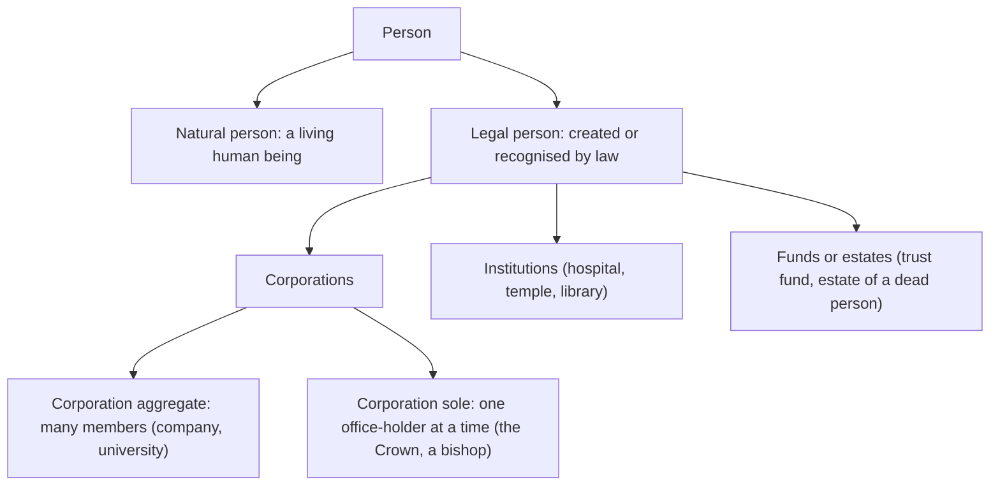

# Unit 7: Person

!!! abstract "In one line"
    In law, a "person" is anyone or anything the law treats as able to hold rights and owe duties. That includes every human being, and also bodies such as companies, the State and temples.

## Why it matters for the exam

- **Asked as a full 20-mark question:** 2078 Q4 "What do you understand by legal personality? Examine the concept of corporate personality." It is written out in full under **Full 20-mark answers**.
- Two other long questions are likely: the legal status of dead persons, unborn persons and animals; and the theories of corporate personality. Both are written out below.
- Short notes can come on: legal person, corporation sole and aggregate, double personality, the fiction theory, the realist theory, *Salomon v Salomon*, lifting the corporate veil.

## Key terms

| Term | Nepali | Plain meaning |
|---|---|---|
| Person | व्यक्ति | Any being the law treats as able to hold rights and owe duties |
| Legal personality | — | The status of being a person in law |
| Natural person | प्राकृतिक व्यक्ति | A living human being |
| Legal person | कानूनी व्यक्ति | A person created or recognised by law that is not a human being, such as a company |
| Corporation / body corporate | संगठित संस्था | A group or office that the law treats as one person, separate from its members |
| Perpetual succession | अविच्छिन्न उत्तराधिकार | The company goes on existing even when its members change or die |
| Corporate personality | — | The separate legal personality of a company or other corporation |
| Coparcener | अंशियार | A family member entitled to a share when family property is divided |
| Abortion | गर्भपतन | Ending a pregnancy so the foetus does not survive |

## Start here: who counts as a "person"?

In everyday English, "person" means a human being. In law it means something narrower and wider at the same time.

Think of a cricket team. Players come and go, but "the team" stays. It can own a ground, sign a sponsor and be fined by the board. In law we ask: who is the owner, the contracting party, the one fined? If the answer is "the team itself", then the law treats the team as a **person**.

So in law:

- **A person is whoever can have rights and duties.** Every living human being qualifies.
- **Some non-humans also qualify.** A company, a bank, a university, the State, even a temple can own property, make contracts and sue or be sued.
- **Some things that seem close to humans do not qualify, or only partly.** A dead body, a child not yet born and an animal each get *some* legal protection, but they are not full persons.

This unit explains why, and what jurists have said about it.

## 7.1 Meaning of person and personality

### The word

"Person" comes from the Latin persona. In Roman theatre a persona was the **mask** an actor wore to play a role. Later it came to mean the role itself, and then a being who plays a role in law: one who has rights and duties.

The idea is useful. A "person" in law is like a role or a seat, not a body. Anyone or anything the law puts in that seat is a person.

### Definitions to learn

| Jurist | Definition | What it shows |
|---|---|---|
| **John Salmond** | "A person is any being whom the law regards as capable of rights or duties. Any being that is so capable is a person, whether a human being or not, and no being that is not so capable is a person, even though he be a man." | The test is capacity for rights or duties, not being human. A slave in Roman law was a man but not a person. A company is not a man but is a person. |
| **J.C. Gray** | "The technical legal meaning of a 'person' is a subject of legal rights and duties." | Same idea: a person is the "subject" (holder) of rights and duties. |
| **G.W. Paton** (paraphrase) | Legal personality is the device by which the law creates or recognises units to which it gives certain powers and capacities. | Personality is a legal tool. The law decides which units get it. |
| **Hans Kelsen** (paraphrase) | A person is only a name for a bundle of rights and duties fixed by legal norms. | There is no "thing" behind the label; the person is just the sum of norms about it. |
| **Savigny** (paraphrase) | Personality belongs, in principle, only to human beings. Other "persons" are fictions created by law. | This is the root of the fiction theory (see 7.5). |

!!! tip "Exam tip"
    Always quote Salmond's definition first. Then make one point from it: being a "person" in law depends on the law, not on biology. That one line shows you understand the unit.

### Personality

**Legal personality** means the *status* of being a person in law. It is a bundle of capacities:

1. to own property;
2. to make contracts;
3. to sue and be sued in one's own name;
4. to be held liable for wrongs (and, for humans, for crimes).

The law decides who gets this status and how much of it. A child has personality but limited capacity to make contracts. A company has personality but cannot marry or vote.

### History in brief

- **Roman law:** slaves were human but were treated as things, not persons. A *paterfamilias* (head of family) had full personality; others under his power had less.
- **Medieval Europe:** animals were sometimes put on trial for harm they caused. Modern law rejects this.
- **Modern law:** every human being is a person from birth. Many fundamental rights in Part 3 of the Constitution of Nepal belong to every person. Article 16(1) says: "Each person shall have the right to live with dignity." Nepal's Civil Code says every person must recognise another person's personality (see the Nepal box below).

!!! info "Nepal: the National (Muluki) Civil Code 2074 on persons"
    - **Section 2(c):** "person" means a natural person, and includes a legal person.
    - **Section 12:** every person shall recognise another person's personality.
    - **Part 2 (Law relating to persons):** Chapter 1 (Sections 30-41) deals with natural persons; Chapter 2 (Sections 42-53) deals with legal persons.

## 7.2 Kinds of person

Salmond divides persons into two kinds:

### 7.2.1 Natural person

A **natural person** is a living human being. Salmond says natural persons are human beings, capable of rights and duties.

Points to note:

- **Personality begins at birth and ends at death.** Before birth and after death, the law gives limited protection only (see 7.4).
- **All human beings today are persons.** Slavery, which denied personality to some humans, is abolished. In Nepal, the Muluki Criminal Code 2074 prohibits slavery (Section 163) and serfdom or bonded labour (Section 164).
- **Capacity can be limited.** A minor or a person of unsound mind is a person, but the law limits what they can do alone. Nepal's Civil Code deals with competency, incompetency and quasi-competency in Sections 32-35.

!!! info "Nepal: natural persons"
    **Civil Code Section 30:** every person shall, immediately after birth, be recognised as a person and be entitled to exercise rights under law "until he or she survives" (that is, for life).

    So in Nepal, personality starts at **birth**, not at conception.

### 7.2.2 Legal person

A **legal person** (also called an *artificial*, *juristic*, *juridical* or *fictitious* person) is a being other than a human that the law treats as a person. It can own property, make contracts and sue or be sued in its own name.

**Salmond's three classes of legal persons:**

| Class | Meaning | Examples |
|---|---|---|
| **Corporations** | A group or an office given personality | Company, bank, municipality, university |
| **Institutions** | A place or establishment that serves a purpose | Hospital, temple, library, school |
| **Funds or estates** | Property set aside for a purpose | Trust fund, charitable endowment, estate of a dead person or a bankrupt |

Salmond adds that in English law, only corporations are recognised as legal persons; institutions and funds get personality only by being turned into corporations. Other systems, including Indian and Nepali law, recognise some institutions directly, such as a temple or a Hindu idol.

**Corporation aggregate and corporation sole**

| Point | Corporation aggregate | Corporation sole |
|---|---|---|
| Members | Many people at one time | One person at a time, holding an office |
| Examples | A company, a university, a municipality | The Crown in England; a bishop; in some systems a public office such as Postmaster-General |
| Continuity | Members change; the corporation stays | Office-holders die or retire; the office stays |
| Common? | Very common | Rare |

**Main features of a corporation (legal person):**

1. **Separate personality.** It is distinct from its members. It owns its own property and owes its own debts. *Salomon v Salomon* (1897) is the leading case (see 7.5 and the full answers).
2. **Perpetual succession.** It continues even when members change or die.
3. **Common seal.** It acts through a seal and its agents.
4. **Sues and is sued in its own name.**
5. **Limited liability** (for most companies). Members lose only what they put in.
6. **Acts only through humans.** Directors, officers and employees act for it.
7. **Limits.** It cannot marry, vote or be imprisoned. It can do only what its constitution and the law allow (the *ultra vires* rule).

**Idol as a juristic person.** In Hindu law, an idol is treated as a juristic person that can own property dedicated to it. The Privy Council accepted this in *Pramatha Nath Mullick v Pradyumna Kumar Mullick* (1925). The Indian Supreme Court treated the Guru Granth Sahib as a juristic person in *Shiromani Gurdwara Prabandhak Committee v Som Nath Dass* (2000).

!!! info "Nepal: legal persons"
    **Civil Code Section 42:** a body corporate incorporated under law obtains legal personality once registered. It has a corporate personality and a separate seal (s. 42(5)). It is "an autonomous body corporate with perpetual succession" and may own and sell property, make contracts, frame byelaws, appoint staff, open branches and bank accounts (s. 42(6)). It may sue and be sued in its own name (s. 42(7)).

    **Section 43:** on incorporation it gets competency for civil and commercial acts, which lasts until it is liquidated, dissolved or wound up.

    **Section 44:** certain bodies are legal persons automatically (*ipso facto*), including the State of Nepal, the Government of Nepal, the Federal Parliament, courts and constitutional bodies, ministries, Provinces, local governments, statutory corporations, community schools and universities, and old public-purpose institutions holding property, such as a temple, shrine, monastery, mosque, church, public rest house or graveyard.

    **Section 51:** a legal person is liable for loss caused by those acting on its behalf. But if the act was beyond its objectives or competency, or dishonest, the director or person who did it is personally liable.

    **Companies Act 2063, Section 7:** a company incorporated under the Act is an autonomous body corporate with perpetual succession. It can acquire, hold and transfer property, sue and be sued in its own name, and make contracts.

## 7.3 Double capacity and double personality

These two ideas are easy to mix up. Learn the difference.

### Double capacity

**One person, two roles.** The same person can act in two different legal capacities, and the law treats the two roles separately.

Examples:

- A man is a **trustee** of a trust and also one of its **beneficiaries**. As trustee he manages the property for others; as beneficiary he receives benefits. His duties as trustee do not disappear because he also benefits.
- A shareholder of a company is also its **employee** or **creditor**. In *Lee v Lee's Air Farming Ltd* (1961), the Privy Council held that Mr Lee could be both the controlling shareholder and director of a company and its employee (a pilot). So his widow could claim workers' compensation.
- A minister signs a contract **for the Government of Nepal** (a legal person under Civil Code s. 44) and also owns private land in **his own name**. The two capacities are kept apart.

There is still only **one** person; that person wears two hats.

### Double personality

**Two persons in one human.** Here the law recognises two separate *persons* attached to the same human being.

The classic example is the **corporation sole**. The English monarch is a natural person (a human being) and also the **Crown**, a corporation sole. When the human dies, the natural person ends, but the Crown continues. A bishop is a natural person and, as holder of the office, a corporation sole.

| Point | Double capacity | Double personality |
|---|---|---|
| Number of persons | One | Two (a natural person and a legal person) |
| What is doubled | The roles or capacities | The personality itself |
| Example | Trustee who is also a beneficiary; Mr Lee as shareholder and employee | The King as a human and as the Crown (corporation sole) |
| On death | All roles end with the person | The natural person ends; the corporation sole continues |

!!! tip "Memory line"
    Double **capacity** = one person, two hats. Double **personality** = two persons, one body.

## 7.4 Legal status of dead person, unborn person and animal

None of these three is a full legal person today. But the law protects each one in certain ways. The exam question usually asks: "are they persons, and if not, what protection do they get?"

### 7.4.1 Dead person

**General rule.** Personality ends at death. A dead person cannot own property, make a contract or sue. Salmond says dead persons are not persons in law.

**But the law still respects three things connected to a dead person** (Salmond's three interests):

1. **The body (corpse).** The law requires decent burial or cremation and punishes indignities to a corpse.
2. **Reputation.** Some legal systems punish defaming the dead. Under Explanation 1 to Section 499 of the Indian Penal Code 1860 (now replaced by the Bharatiya Nyaya Sanhita 2023), imputing something to a deceased person can be defamation if it would harm his reputation if living and is meant to hurt his family's feelings.
3. **Estate and will.** A person's last wishes about property (a will) are carried out after death. The estate is managed for heirs and creditors.

Strictly, these are rights of the **living**: the family, the heirs and society. The dead person's wishes are honoured because the living have an interest in it.

!!! info "Nepal: dead persons"
    - **Civil Code Section 37:** a person may, while alive, specify the manner of his or her cremation, obsequies rites or funeral acts. The successor must follow it. If none is specified, the successor follows custom and tradition.
    - **Section 38:** a person may express in writing a will to donate his or her corpse or an organ after death. The successor must respect it.
    - **Section 40 (presumed death):** a person missing without news for twelve consecutive years is presumed dead, unless there is evidence he or she is alive. Shorter periods apply: five years for a person aged eighty or over; four years after a war ends for a soldier sent to war; three years after an aircraft, ship or vehicle accident. A court can make a judicial declaration of death, and can annul it if the person returns.
    - Succession and wills are dealt with elsewhere in the Civil Code (Part 3, family law).

### 7.4.2 Unborn person

**General rule.** A child in the mother's womb (a foetus) is not yet a person. Personality begins at **birth**.

**But the law treats the unborn child as already born whenever this benefits the child.** This is an old Roman rule: *nasciturus pro iam nato habetur, quotiens de commodo eius agitur* ("a child to be born is treated as already born whenever its benefit is concerned"). English law uses the phrase *en ventre sa mère* (in the mother's womb) for such a child.

Common protections:

1. **Property.** Property can be given or left for the benefit of a child not yet born. The Indian Transfer of Property Act 1882 allows this, subject to conditions.
2. **Inheritance and partition.** A share can be set aside for a child in the womb.
3. **Criminal law.** Causing abortion or harming a foetus is a crime in most systems.
4. **Injury before birth.** Many systems let a child born alive sue for injuries suffered before birth.

**Condition: the child must be born alive.** If the child is not born alive, the rights never take effect. Salmond adds that the unborn child's "personality" is really a legal fiction; it is anticipation of a future person.

!!! info "Nepal: unborn persons"
    - **Civil Code Section 30:** personality begins **immediately after birth**.
    - **Civil Code Section 206(2):** if a woman coparcener is pregnant at the time of partition and the baby will be a coparcener, partition must treat the would-be-born baby as a coparcener and set aside his or her share first.
    - **Section 206(3):** if she does not deliver a live baby, that share is divided equally among the other coparceners. (This is the "born alive" condition in Nepali law.)
    - **Muluki Criminal Code 2074, Section 188:** abortion is an offence except in cases allowed by Section 189. Punishment rises with the length of pregnancy: up to 1 year (up to 12 weeks), up to 3 years (12-25 weeks), up to 5 years (over 25 weeks). Sex identification of a foetus with intent to abort is a separate offence (s. 188(7)).
    - **Section 189:** abortion by a licensed health worker is not an offence when, with the woman's consent: the pregnancy is up to 12 weeks; a licensed doctor says her life or health is at risk or a handicapped child will be born; the pregnancy is up to 18 weeks and results from rape or incest; or she has HIV or a similar incurable disease.

    So Nepali law protects the foetus but balances that against the woman's life, health and choice. The foetus is protected, but it is not a "person".

### 7.4.3 Animal

**General rule.** Animals are not legal persons. They cannot hold rights or owe duties. In law they are **things** (property) owned by persons.

**Older law was different.** In ancient and medieval times, animals were sometimes tried and punished for causing harm. Modern law has given this up.

**Why are animals still protected?** Laws against cruelty exist. Salmond's view is that these laws protect the feelings and interests of **society**, not rights belonging to the animal. A duty not to be cruel to animals is a duty owed to the State or the public, not to the animal.

**Modern trend.** Some courts and writers now argue that animals have rights of their own. In *Animal Welfare Board of India v A. Nagaraja* (2014), the Indian Supreme Court held that animals have a right to live with dignity and banned bull-taming sports such as *jallikattu* (later changed by legislation). Animal-rights thinkers such as Peter Singer argue that the capacity to suffer, not reason, should decide moral status.

!!! info "Nepal: animals"
    The Muluki Criminal Code 2074, Chapter 27 ("Offences relating to animals and birds"):

    - **Section 289:** prohibits killing or beating cows or oxen.
    - **Section 290:** no person shall treat an animal or bird cruelly: beating it, making it carry loads beyond its capacity, working it when ill or wounded, feeding it harmful substances, or abandoning it publicly because it is ill or old. Minimum force to train it is allowed. Punishment: up to three months' imprisonment, or a fine up to five thousand rupees, or both.
    - **Section 291:** prohibits killing animals or birds in public places.

    These are duties placed on human beings. They protect animals, but they do not make animals persons.

**Summary table**

| Point | Dead person | Unborn person | Animal |
|---|---|---|---|
| Legal person? | No (personality ends at death) | No (personality begins at birth) | No (a thing, property) |
| What is protected | Body, reputation, estate and will | Property, inheritance share, life of foetus | Freedom from cruelty |
| Whose interest, strictly | Family, heirs, society | The future child (if born alive) | Society; modern view: the animal itself |
| Nepal | Civil Code ss. 37, 38, 40 | Civil Code ss. 30, 206(2)-(3); Criminal Code ss. 188-189 | Criminal Code ss. 289-291 |

## 7.5 Theories of corporate personality

**The question.** A company has rights and duties. But a company has no body or mind of its own. So *what is* a corporation, and *why* does the law treat it as a person? Jurists answer this in different ways. Each answer is a theory.

### 1. Fiction theory

**Supporters:** Savigny, Salmond, Holland. The idea of a *persona ficta* (fictitious person) is usually traced to Pope Innocent IV in the 13th century.

**Idea:** Only human beings are real persons. A corporation is a person only because the law **pretends** it is one. Its personality is a fiction, an "as if", invented for convenience.

**Merits:**

- Explains why a corporation needs human agents to act.
- Explains why a corporation cannot marry or be imprisoned.

**Criticism:**

- It does not explain *why* the law chooses the fiction or what lies behind it.
- If a corporation is fictitious, how can it commit wrongs or crimes and be punished? Modern law holds companies liable.
- A corporation has real social effects: it owns land, employs thousands and pays taxes.

### 2. Concession theory

**Supporters:** linked with the fiction theory: Savigny, Dicey, Salmond.

**Idea:** A corporation has personality only because the **State grants (concedes)** it. Without State recognition, a group is just a collection of individuals. The theory is about the *source* of personality: the State.

**Merits:**

- Matches modern practice: a company becomes a person only on registration. In Nepal, a body gets legal personality on registration under Civil Code s. 42 or the Companies Act 2063.

**Criticism:**

- It gives the State too much power. The State can refuse or withdraw personality from groups it dislikes, for example trade unions or political parties.
- Groups such as families, clubs and religious communities exist in fact before the State recognises them.

### 3. Realist (organic) theory

**Supporters:** Otto von Gierke (German), F.W. Maitland (who translated part of Gierke's work into English in 1900).

**Idea:** A corporation is a **real** person, not a fiction. It has a real collective will, separate from the wills of its members. Like the human body is more than its cells, a group is more than its members. The law does not create the group's personality; it only **recognises** what already exists.

**Merits:**

- Explains why groups act, take decisions and can be held liable for wrongs and crimes.
- Explains how a group has a "will" through its organs (board, general meeting).

**Criticism:**

- A "group will" is a metaphor. In fact, only human beings think and decide.
- It gives groups something like a soul, which is mystical.
- It was misused to support the idea of the State as a super-person above individuals.

### 4. Bracket (symbolist) theory

**Supporter:** Rudolf von Ihering.

**Idea:** The real holders of corporate rights and duties are its **members**. The corporate name is like a **bracket** put around the members, for convenience. It is a symbol or shorthand. When necessary, the law can remove the bracket and look at the members behind it.

**Merits:**

- Explains **lifting (piercing) the corporate veil**: courts can look behind the company to its members when it is used for fraud.

**Criticism:**

- It ignores the separate personality of the company. *Salomon v Salomon* shows that the company and its members are different persons.
- It cannot explain corporations without members in the usual sense, such as a corporation sole or a charitable foundation.

### 5. Purpose theory

**Supporters:** Alois Brinz, E.I. Bekker (German jurists).

**Idea:** Only human beings are persons. Corporate property does not really belong to anyone. It is property **dedicated to a purpose** (German: *Zweckvermögen*, "purpose-property"). The law protects it as if it belonged to a person, because the purpose needs protection.

**Merits:**

- Fits charitable foundations, trusts and religious endowments well: for example, property dedicated to a temple or a guthi.

**Criticism:**

- It does not explain trading companies well; their purpose is the profit of members.
- Property without an owner is a strange idea for the law; someone must hold rights and duties.

### 6. Hohfeld's theory

**Supporter:** Wesley Newcomb Hohfeld (American jurist, 1879-1918).

**Idea:** Only human beings have rights and duties. "Corporate" rights and duties are really the rights and duties of individual human beings (members, directors, officers), arranged in a special way. The corporation is a **procedural device**: a convenient way of working out the legal relations of many individuals at once.

**Merits:**

- Realistic: every corporate act is in the end done by a human.

**Criticism:**

- Like the bracket theory, it does not fully explain separate personality and perpetual succession.

### Kelsen's view (sometimes added)

Kelsen says every person, natural or legal, is a **personification of a set of legal norms**. A company is just the name for the norms that govern a group's conduct. This avoids the "is it real or fictional?" debate.

!!! tip "Which theory is right?"
    No single theory explains everything. The fiction and concession theories explain the **legal form** (registration, capacity given by law). The realist theory explains the **social reality** (groups act and are liable). The bracket and Hohfeld theories explain **lifting the veil**. The purpose theory explains **foundations and endowments**. Say this in your conclusion: each theory explains one side, and modern law borrows from all.

### Lifting the corporate veil

Separate personality is the rule, but it has limits. Courts and statutes sometimes **lift the veil** and hold the people behind the company responsible, for example:

- when the company is a sham used for fraud;
- to stop tax evasion;
- in wartime, to find whether a company is controlled by enemies;
- where a statute says so.

In Nepal, Civil Code s. 51 makes directors personally liable for acts beyond the company's objectives or competency, or done dishonestly. Criminal Code s. 30 says that when a firm, company or body corporate commits an offence, the person who committed it is liable; if that person cannot be identified, the director, managing director or general manager responsible is liable, and failing them, the chief executive.

## Compare

**Natural vs legal person**

| Point | Natural person | Legal person |
|---|---|---|
| What it is | A living human being | A body created or recognised by law |
| Begins | At birth (Civil Code s. 30) | On incorporation or registration (s. 42), or by law (s. 44) |
| Ends | At death | On liquidation, dissolution or winding up (s. 43(2)) |
| Acts through | Itself | Human agents (directors, officers) |
| Rights | All human rights, including family and political rights | Only property, contract and similar rights its law allows |
| Punishment | Imprisonment, fine | Fine, dissolution; humans behind it may be punished |
| Examples | You and me | Company, bank, university, State, temple |

**Theories of corporate personality**

| Theory | Main supporters | Corporation is... | Main weakness |
|---|---|---|---|
| Fiction | Savigny, Salmond, Holland | A legal fiction | Cannot explain corporate liability |
| Concession | Savigny, Dicey | A grant of the State | Too much State power |
| Realist / organic | Gierke, Maitland | A real group person with its own will | "Group will" is a metaphor |
| Bracket / symbolist | Ihering | A bracket around the members | Ignores separate personality |
| Purpose | Brinz, Bekker | Property dedicated to a purpose | Does not fit trading companies |
| Hohfeld | Hohfeld | A procedural device for individuals' rights | Ignores perpetual succession |

## Model answers

??? question "2078 Q4 (short version): Legal personality"
    - **Meaning:** from Latin *persona*, "mask". A person in law is one who has rights and duties.
    - **Salmond:** "A person is any being whom the law regards as capable of rights or duties ... whether a human being or not."
    - **Gray:** a person is "a subject of legal rights and duties".
    - **Kinds:** natural (human) and legal (company, State, institution, fund).
    - **Capacities:** to own property, contract, sue and be sued, be liable.
    - **Nepal:** Civil Code s. 2(c) "person" includes legal person; s. 30 personality from birth; s. 42 legal personality on registration; s. 44 State, Government, temples etc. are legal persons *ipso facto*.
    - **Conclusion:** personality is a legal status the law gives, not a fact of biology.

??? question "Likely short note: Double capacity and double personality"
    - **Double capacity:** one person acting in two legal roles, kept separate by law. Examples: a trustee who is also a beneficiary; in *Lee v Lee's Air Farming Ltd* (1961), Mr Lee was both controlling director and employee of his company.
    - **Double personality:** two legal persons in one human. Example: the King as a human and as the Crown, a corporation sole. The natural person dies; the corporation sole continues.
    - **Difference:** capacity doubles the role; personality doubles the person.

??? question "Likely short note: Corporation sole and corporation aggregate"
    - Both are legal persons (corporations).
    - **Aggregate:** many members at once, e.g. a company, university, municipality. Members change; it continues (perpetual succession).
    - **Sole:** one office-holder at a time, e.g. the Crown, a bishop. The office continues after the holder dies.
    - Most corporations, including companies under Nepal's Companies Act 2063, are corporations aggregate.

??? question "Likely short note: Salomon v Salomon & Co Ltd (1897)"
    - **Facts:** Aron Salomon, a leather boot maker, turned his business into a company in 1892. He held 20,001 of the 20,007 shares; his wife and five children held one each. He also held debentures (secured loans) of £10,000. The company went into liquidation.
    - **Issue:** could Salomon, as a secured creditor, be paid before the unsecured creditors, or was the company just his agent?
    - **Court of Appeal:** the company was a sham, a trustee for Salomon.
    - **House of Lords:** reversed unanimously. A properly registered company is a separate person. Lord Macnaghten: "The company is at law a different person altogether from the subscribers to the memorandum."
    - **Importance:** foundation of separate corporate personality and limited liability.
    - **Nepal:** Companies Act 2063 s. 7 and Civil Code s. 42 adopt the same principle.

??? question "Likely short note: Fiction theory of corporate personality"
    - **Supporters:** Savigny, Salmond, Holland; *persona ficta* traced to Pope Innocent IV.
    - **Idea:** only humans are real persons; a corporation is a person only by legal fiction.
    - **Merits:** explains why it acts through agents and cannot marry or be jailed.
    - **Criticism:** cannot explain corporate liability for wrongs and crimes; ignores the real social life of groups.
    - **Linked to concession theory:** the fiction exists because the State grants it.

## Full 20-mark answers

These are written the way you would write them in the exam. Each takes about 35 minutes by hand. Learn the structure and the key sentences; you do not need to memorise every word.

??? example "Q1. What do you understand by legal personality? Examine the concept of corporate personality. (2078 Q4, 20 marks)"
    **Introduction**

    Law is a system of rights and duties. Every right must belong to someone, and every duty must be owed by someone. The one who holds rights and owes duties is called a **person** in law. The status of being such a person is called **legal personality**.

    The word "person" comes from the Latin *persona*, the mask worn by an actor in Roman theatre. It came to mean the role a being plays in law. In legal language, therefore, "person" does not simply mean "human being".

    **Meaning of legal personality: definitions**

    1. **Salmond**: "A person is any being whom the law regards as capable of rights or duties. Any being that is so capable is a person, whether a human being or not, and no being that is not so capable is a person, even though he be a man."
    2. **J.C. Gray**: "The technical legal meaning of a 'person' is a subject of legal rights and duties."
    3. **Paton** describes legal personality as the device by which the law creates or recognises units to which it gives certain powers and capacities.
    4. **Kelsen** treats a person as a personification of a set of legal norms: the name for the rights and duties the law attaches to it.

    These definitions agree on one point: legal personality is a **status given by law**, not a fact of biology. Roman law treated slaves as things, not persons, though they were human. Modern law treats a company as a person, though it is not human.

    **Elements of legal personality**

    A being with legal personality has the capacity:

    1. to own and transfer property;
    2. to make contracts;
    3. to sue and be sued in its own name;
    4. to be held liable for wrongs and, in many cases, crimes.

    The amount of capacity can vary. A minor is a person but cannot make most contracts alone. A company is a person but cannot marry or vote.

    **Kinds of persons**

    Persons are of two kinds:

    - **Natural persons** are living human beings. Personality begins at birth and ends at death.
    - **Legal persons** (also called artificial or juristic persons) are beings other than humans that the law treats as persons. Salmond divides them into corporations, institutions and funds or estates.

    **Concept of corporate personality**

    A **corporation** is a body of persons, or an office, that the law treats as one person, separate from the human beings who make it up. **Corporate personality** is this separate personality. There are two types of corporation:

    - **Corporation aggregate:** many members at one time, such as a company, university or municipality.
    - **Corporation sole:** one office-holder at a time, such as the Crown or a bishop. The office continues when the holder dies.

    **Features of corporate personality**

    1. **Separate legal entity.** The corporation is a person distinct from its members. It owns its property and owes its debts.
    2. **Perpetual succession.** Members may change or die; the corporation continues.
    3. **Common seal.** It acts through a seal and authorised agents.
    4. **Capacity to sue and be sued** in its own name.
    5. **Limited liability.** In a limited company, members lose only what they invested.
    6. **Acts through human agents.** It has no body or mind of its own; directors and officers act for it.
    7. **Limited capacity.** It can only do what its constitution and the law allow (the *ultra vires* rule).

    **Leading case: Salomon v Salomon & Co Ltd (1897)**

    Aron Salomon, a leather boot maker, converted his business into a company in 1892. He held 20,001 of the 20,007 shares; his wife and five children held one share each. He also held debentures (secured loans) of £10,000. When the company went into liquidation, unsecured creditors argued the company was only Salomon's agent. The Court of Appeal agreed. The House of Lords reversed this unanimously. Lord Macnaghten said: "The company is at law a different person altogether from the subscribers to the memorandum." So Salomon, as a secured creditor, was paid first. This case is the foundation of corporate personality.

    Another example is *Lee v Lee's Air Farming Ltd* (1961), where the Privy Council held that a man could be the controlling director of a company and also its employee, because the company was a separate person.

    **Theories of corporate personality (in brief)**

    1. **Fiction theory** (Savigny, Salmond): a corporation is a person only by legal fiction.
    2. **Concession theory** (Savigny, Dicey): personality is granted by the State.
    3. **Realist theory** (Gierke, Maitland): a corporation is a real group person with its own will; the law only recognises it.
    4. **Bracket theory** (Ihering): the corporate name is a bracket around the members, who are the real holders of rights.
    5. **Purpose theory** (Brinz, Bekker): corporate property is property dedicated to a purpose.
    6. **Hohfeld**: corporate rights are really the rights of individuals, arranged through a procedural device.

    **Nepal's position**

    Nepal recognises both natural and legal persons in clear terms.

    - **Muluki Civil Code 2074, Section 2(c):** "person" means a natural person and includes a legal person. **Section 12:** every person shall recognise another person's personality.
    - **Section 30:** every person is recognised as a person immediately after birth and may exercise rights under law for life.
    - **Section 42:** a body corporate obtains legal personality on registration. It has a corporate personality and separate seal, is an autonomous body corporate with perpetual succession, can own property, make contracts, appoint staff, and sue and be sued in its own name.
    - **Section 43:** its competency lasts until it is liquidated, dissolved or wound up.
    - **Section 44:** some bodies are legal persons *ipso facto*: the State of Nepal, the Government, the Federal Parliament, courts, Provinces, local governments, statutory corporations, community schools and universities, and old public-purpose institutions holding property, such as temples, monasteries, mosques and churches.
    - **Companies Act 2063, Section 7:** a company is an autonomous body corporate with perpetual succession, able to hold property, contract, and sue and be sued in its own name.

    Nepal also limits the separate personality. **Civil Code s. 51** makes a legal person liable for acts of its agents, but makes the director personally liable for acts beyond the objective or competency of the legal person, or done dishonestly. **Criminal Code s. 30** places criminal liability for offences by a company on the person who committed them, or failing that on the responsible director or chief executive. These are forms of lifting the corporate veil.

    **Critical view**

    Corporate personality is one of the law's most useful inventions. It allows people to pool capital, limit risk and run enterprises that outlive their founders. But it can be abused: people hide behind a company to escape debts or crimes. That is why courts lift the veil in cases of fraud, and why statutes such as Civil Code s. 51 and Criminal Code s. 30 make individuals answer for misuse. The theories also show that no single explanation is complete: the fiction and concession theories explain the legal form, while the realist theory explains why corporations are held liable.

    **Conclusion**

    Legal personality is the capacity to have rights and duties, given by law. It belongs to every human being and to bodies the law chooses to recognise. Corporate personality treats a group or office as one person, separate from its members, with perpetual succession and its own property and liabilities. *Salomon v Salomon* established the principle, and Nepal's Civil Code 2074 and Companies Act 2063 adopt it, while limiting it to prevent abuse.

??? example "Q2. Explain the legal status of dead persons, unborn persons and animals. (likely question, 20 marks)"
    **Introduction**

    A person in law is a being capable of rights and duties. Salmond says: "A person is any being whom the law regards as capable of rights or duties ... whether a human being or not." Gray calls a person "a subject of legal rights and duties".

    Normally, a human being's personality begins at birth and ends at death. Animals are not persons at all. But the law does not ignore the dead, the unborn or animals. It gives each of them some protection. The question is whether this protection makes them persons. Most jurists answer no: they are protected, but they are not persons.

    **1. Legal status of a dead person**

    *General rule.* Personality ends at death. A dead person cannot own property, make a contract, or sue. Salmond says dead persons are not persons in law.

    *Interests still protected.* Salmond identifies three things the law continues to protect:

    1. **The corpse.** The law requires decent burial or cremation and punishes indignity to a dead body.
    2. **Reputation.** Some systems punish defaming the dead. Under Explanation 1 to Section 499 of the Indian Penal Code 1860 (now replaced by the Bharatiya Nyaya Sanhita 2023), imputing something to a deceased person may be defamation if it would harm his reputation if living and is meant to hurt the feelings of his family.
    3. **The estate and will.** A person's will is carried out after death. His estate is managed to pay creditors and pass property to heirs.

    *Analysis.* These protections are really rights of the living: the family, heirs, creditors and society. The dead person's wishes are honoured because living people have an interest in it.

    *Nepal.* The Muluki Civil Code 2074 contains several provisions:

    - **Section 37:** a person may, while alive, specify the manner of his or her cremation, obsequies rites or funeral acts; the successor must follow it, or otherwise follow custom and tradition.
    - **Section 38:** a person may express in writing a will to donate his or her corpse or an organ after death, and the successor must respect it.
    - **Section 40:** a person missing without news for twelve consecutive years is presumed dead unless there is evidence that he or she is alive. Shorter periods apply to a person aged eighty or more (five years), a soldier sent to war (four years after the war ends) and a passenger in an accident (three years). A court may declare a person dead, and may annul the declaration if the person returns alive.

    **2. Legal status of an unborn person**

    *General rule.* A child in the womb is not yet a person. Personality begins at birth.

    *Exception: legal fiction for the child's benefit.* Roman law treated a child in the womb as already born whenever this was for its benefit: *nasciturus pro iam nato habetur, quotiens de commodo eius agitur*. English law calls such a child *en ventre sa mère*. Common protections are:

    1. **Property.** Property may be transferred or left for the benefit of a child not yet born. The Indian Transfer of Property Act 1882 allows this, subject to conditions.
    2. **Inheritance and partition.** A share may be reserved for a child in the womb.
    3. **Criminal law.** Causing abortion or injuring a foetus is a crime.
    4. **Injury before birth.** In many systems, a child born alive can sue for injury suffered in the womb.

    *Condition.* All these rights depend on the child being **born alive**. If not, the rights never take effect. Salmond treats the unborn child's personality as a fiction: the law anticipates a future person.

    *Nepal.*

    - **Civil Code Section 30:** a person is recognised as a person **immediately after birth**.
    - **Civil Code Section 206(2):** if a woman coparcener is pregnant at the time of partition and the child will be a coparcener, partition must treat the would-be-born baby as a coparcener and set aside its share first. **Section 206(3):** if a live baby is not born, that share is divided equally among the other coparceners.
    - **Muluki Criminal Code 2074, Section 188:** abortion is an offence, with punishment rising with the length of pregnancy, from up to one year (up to 12 weeks) to up to five years (over 25 weeks). Identifying the sex of a foetus in order to abort it is a separate offence.
    - **Section 189:** abortion by a licensed health worker is lawful with the woman's consent up to 12 weeks; on a licensed doctor's opinion that her life or health is at risk or a handicapped child will be born; up to 18 weeks if the pregnancy results from rape or incest; or where she has HIV or a similar incurable disease.

    So Nepal protects the foetus but does not make it a person, and it balances the foetus's protection against the woman's life, health and choice.

    **3. Legal status of animals**

    *General rule.* Animals are not legal persons. They cannot hold rights or owe duties. In law they are things, the property of their owners.

    *History.* In ancient and medieval times, animals were sometimes tried and punished for causing harm. Modern law has abandoned this, because animals cannot understand duties.

    *Protection against cruelty.* Modern laws punish cruelty to animals. Salmond's view is that such laws protect the feelings and interests of society, not rights of the animal. The duty is owed to the State or the public.

    *Modern trend.* This view is being challenged. Peter Singer argues that the capacity to suffer should decide moral status. In *Animal Welfare Board of India v A. Nagaraja* (2014), the Indian Supreme Court held that animals have a right to live with dignity and banned bull-taming sports such as *jallikattu*.

    *Nepal.* Chapter 27 of the Muluki Criminal Code 2074 deals with offences relating to animals and birds. **Section 289** prohibits killing or beating cows or oxen. **Section 290** prohibits cruel treatment, such as beating an animal, overloading it, working it when ill or wounded, feeding it harmful substances, or abandoning it when old or ill. It allows minimum force for training. The punishment is up to three months' imprisonment, a fine up to five thousand rupees, or both. **Section 291** prohibits killing animals or birds in public places. These are duties on humans. They protect animals but do not make them persons.

    **Comparison**

    | Point | Dead person | Unborn person | Animal |
    |---|---|---|---|
    | Legal person? | No | No (until born alive) | No |
    | Protected interests | Body, reputation, estate | Property, inheritance share, life | Freedom from cruelty |
    | Nepal | Civil Code ss. 37, 38, 40 | Civil Code ss. 30, 206; Criminal Code ss. 188-189 | Criminal Code ss. 289-291 |

    **Critical view**

    The law's approach is practical rather than logical. It denies personality to the dead, the unborn and animals, yet gives each of them protections that look like rights. Salmond explains this by saying the protected interests really belong to living persons or to society. This is neat for the dead. It is less convincing for the unborn child, whose own future interests are clearly at stake, and for animals, whose suffering is real. The abortion debate shows how hard it is to fix the moment personality begins. Nepal's choice of birth (Civil Code s. 30), with graded protection for the foetus, is a reasonable balance.

    **Conclusion**

    Dead persons, unborn persons and animals are not legal persons. Yet the law protects the dignity and wishes of the dead, the future interests of the unborn child, and the welfare of animals. Nepal's Civil Code 2074 and Criminal Code 2074 reflect this approach: personality begins at birth, the unborn child's share and life are protected, the dead person's wishes on cremation and organ donation are respected, and cruelty to animals is punished.

??? example "Q3. Critically examine the theories of corporate personality. (likely question, 20 marks)"
    **Introduction**

    A person in law is any being capable of rights and duties. Salmond says: "A person is any being whom the law regards as capable of rights or duties ... whether a human being or not." Besides human beings, the law recognises **legal persons**, the most important of which is the **corporation**: a group or office treated as one person, separate from its members.

    A corporation can own property, make contracts and sue or be sued. This was settled in *Salomon v Salomon & Co Ltd* (1897), where Lord Macnaghten said: "The company is at law a different person altogether from the subscribers to the memorandum." But a corporation has no body or mind. So jurists ask: what is a corporation, and why is it a person? Their answers are the theories of corporate personality.

    **1. Fiction theory**

    *Supporters:* Savigny, Salmond, Holland. The idea of the *persona ficta* is usually traced to Pope Innocent IV.

    *Idea:* Only human beings are real persons. A corporation is a person only because the law pretends it is one. Its personality is a fiction created for convenience.

    *Merits:* It explains why a corporation must act through human agents, and why it cannot marry, vote or be imprisoned.

    *Criticism:* It does not explain why corporations can be liable for wrongs and crimes. If the corporation is imaginary, how can it be punished? It also ignores the real social existence of groups.

    **2. Concession theory**

    *Supporters:* Savigny, Dicey; closely tied to the fiction theory.

    *Idea:* A corporation is a person only because the State grants (concedes) personality to it. The theory is about the *source* of personality.

    *Merits:* It matches practice. A company becomes a person only on registration.

    *Criticism:* It gives the State too much control. A State can refuse personality to groups it dislikes, such as trade unions. And many groups, such as families and religious communities, exist in fact before any grant.

    **3. Realist (organic) theory**

    *Supporters:* Otto von Gierke; introduced to English readers by F.W. Maitland.

    *Idea:* A corporation is a real person, not a fiction. It has a real group will, separate from its members, expressed through its organs such as the board and general meeting. The law does not create this personality; it only recognises it.

    *Merits:* It explains why corporations take decisions and why they can be held liable for torts and crimes.

    *Criticism:* A "group will" is a metaphor; only humans think. The theory is mystical, and it was used to glorify the State as a super-person above individuals.

    **4. Bracket (symbolist) theory**

    *Supporter:* Rudolf von Ihering.

    *Idea:* The real holders of a corporation's rights and duties are its members. The corporate name is a bracket around them, used for convenience. When needed, the bracket can be removed.

    *Merits:* It explains **lifting the corporate veil**: courts look behind the company at its members in cases of fraud.

    *Criticism:* It ignores separate personality, which *Salomon* firmly established. It cannot explain a corporation sole or a charitable foundation with no members.

    **5. Purpose theory**

    *Supporters:* Brinz and Bekker.

    *Idea:* Only humans are persons. Corporate property belongs to no one; it is property dedicated to a purpose (*Zweckvermögen*). The law protects it as if it belonged to a person.

    *Merits:* It fits charitable trusts, foundations and religious endowments, such as property dedicated to a temple.

    *Criticism:* It does not fit trading companies, whose purpose is profit for members. And ownerless property is an odd idea in law.

    **6. Hohfeld's theory**

    *Supporter:* W.N. Hohfeld.

    *Idea:* Only human beings have rights and duties. Corporate rights and duties are really those of individual members, directors and officers, grouped together. The corporation is a procedural device for dealing with many individuals' legal relations at once.

    *Merits:* It is realistic: every corporate act is done by a human.

    *Criticism:* It cannot explain perpetual succession or the separation of company property from members' property.

    **7. Kelsen's view**

    Kelsen treats every person, natural or legal, as a personification of legal norms. A corporation is simply the name for the norms that regulate a group's conduct. This avoids the debate between fiction and reality, but it is very abstract.

    **Comparison of theories**

    | Theory | Corporation is... | Best explains | Main weakness |
    |---|---|---|---|
    | Fiction | A legal fiction | Acting through agents | Corporate liability |
    | Concession | A State grant | Registration | Too much State power |
    | Realist | A real group person | Liability, group decisions | "Group will" is a metaphor |
    | Bracket | A bracket around members | Lifting the veil | Separate personality |
    | Purpose | Property for a purpose | Foundations, endowments | Trading companies |
    | Hohfeld | A procedural device | Human agency | Perpetual succession |

    **Nepal's position**

    Nepali law does not adopt one theory expressly, but it draws on several:

    - **Concession and fiction:** under **Civil Code s. 42**, a body corporate obtains legal personality on registration under law, and has a corporate personality, a separate seal and perpetual succession. **Companies Act 2063, s. 7** also makes a company an autonomous body corporate with perpetual succession. Personality comes from the law.
    - **Realist:** **Civil Code s. 51** makes a legal person itself liable for loss caused by those acting on its behalf, treating it as a real actor.
    - **Bracket (lifting the veil):** the proviso to **s. 51** makes the director personally liable for acts beyond the objective or competency of the legal person, or done dishonestly. **Criminal Code s. 30** places criminal liability for a company's offence on the person who committed it, or the responsible director or chief executive.
    - **Purpose:** **Civil Code s. 44(l)** makes old public-purpose institutions holding property, such as temples, shrines, monasteries, mosques and churches, legal persons *ipso facto*. This fits the purpose theory.

    **Critical view**

    Each theory explains one side of corporate personality and fails on another. The fiction and concession theories explain the legal form but not liability. The realist theory explains liability but rests on a metaphor. The bracket and Hohfeld theories explain lifting the veil but deny separate personality. The purpose theory fits foundations but not companies. Modern law is pragmatic: it treats corporate personality as a legal tool, recognised for useful purposes and set aside when abused.

    **Conclusion**

    The theories of corporate personality try to explain how a non-human body can have rights and duties. None is complete on its own. Together they show that a corporation is a legal construction (fiction and concession), a social reality (realist), a convenient grouping of individuals (bracket and Hohfeld) and, for some bodies, property devoted to a purpose. Nepal's Civil Code 2074 and Companies Act 2063 reflect this mixed approach.

## Test yourself

??? question "1. Give Salmond's definition of a person."
    "A person is any being whom the law regards as capable of rights or duties. Any being that is so capable is a person, whether a human being or not, and no being that is not so capable is a person, even though he be a man."

??? question "2. What are Salmond's three classes of legal persons?"
    Corporations, institutions, and funds or estates.

??? question "3. What is the difference between a corporation sole and a corporation aggregate?"
    A corporation sole has one office-holder at a time (the Crown, a bishop). A corporation aggregate has many members at once (a company, a university).

??? question "4. What is the difference between double capacity and double personality?"
    Double capacity is one person in two roles (a trustee who is also a beneficiary). Double personality is two persons in one human (the King as a human and as the Crown).

??? question "5. When does personality begin under Nepali law, and how is an unborn child protected in partition?"
    Immediately after birth (Civil Code s. 30). Under s. 206(2), a share is set aside for a child in the womb of a pregnant coparcener; under s. 206(3), if no live baby is born, the share goes to the other coparceners.

??? question "6. Which Nepali provisions protect a dead person's wishes?"
    Civil Code s. 37 (manner of cremation and funeral rites) and s. 38 (donation of corpse or organ). Section 40 deals with presumed death after twelve years' disappearance.

??? question "7. Who held that a corporation is a real person with its own will?"
    Otto von Gierke (realist or organic theory), supported by Maitland.

??? question "8. What did Salomon v Salomon decide?"
    That a properly registered company is a separate legal person from its members, even if one person holds almost all the shares. Lord Macnaghten: "The company is at law a different person altogether from the subscribers to the memorandum."

## One-minute revision

- **Person:** Latin *persona* (mask). Salmond: any being capable of rights or duties, human or not. Gray: "subject of legal rights and duties".
- **Kinds:** natural (human) and legal. Salmond's legal persons: corporations, institutions, funds. Corporation aggregate vs sole.
- **Double capacity** = one person, two roles (*Lee v Lee's Air Farming*). **Double personality** = two persons, one human (Crown as corporation sole).
- **Dead:** not a person; body, reputation, estate protected. Nepal: Civil Code ss. 37, 38, 40.
- **Unborn:** treated as born when for its benefit, if born alive. Nepal: Civil Code ss. 30, 206(2)-(3); Criminal Code ss. 188-189.
- **Animal:** not a person; protected from cruelty. Nepal: Criminal Code ss. 289-291.
- **Theories:** fiction (Savigny), concession (State grant), realist (Gierke), bracket (Ihering), purpose (Brinz), Hohfeld (procedural device).
- **Corporate personality in Nepal:** Civil Code ss. 2(c), 42-44, 51; Companies Act 2063 s. 7; Criminal Code s. 30. *Salomon v Salomon* (1897).

## Sources

- Nomita Agrawal, *Jurisprudence (Legal Theory)*, Central Law Publications, Allahabad. Syllabus reading.
- P.J. Fitzgerald (ed.), *Salmond on Jurisprudence*, 12th edn, Sweet & Maxwell, 1966. Ch. 10 (Persons).
- G.W. Paton, *A Textbook of Jurisprudence*, 4th edn, Oxford, 1972. Ch. on legal personality.
- R.W.M. Dias, *Jurisprudence*, 5th edn, Butterworths, 1985. Ch. on persons.
- J.C. Gray, *The Nature and Sources of the Law*, 2nd edn, 1921. Ch. II.
- O. von Gierke, *Political Theories of the Middle Age*, trans. F.W. Maitland, 1900.
- W.N. Hohfeld, *Fundamental Legal Conceptions as Applied in Judicial Reasoning*, 1919.
- *Salomon v A Salomon & Co Ltd* [1897] AC 22 (HL). Facts checked at https://en.wikipedia.org/wiki/Salomon_v_A_Salomon_%26_Co_Ltd
- *Lee v Lee's Air Farming Ltd* [1961] AC 12 (PC).
- *Pramatha Nath Mullick v Pradyumna Kumar Mullick* (1925) 52 IA 245 (PC).
- *Shiromani Gurdwara Prabandhak Committee v Som Nath Dass* (2000) 4 SCC 146.
- *Animal Welfare Board of India v A. Nagaraja* (2014) 7 SCC 547.
- Muluki (National) Civil Code 2074, English text at nepallaws.com (checked November 2026):
    - s. 2(c): https://nepallaws.com/Laws/the-national-civil-code-act-2074/part-1-preliminary/chapter-1-general-provisions/section-2-definitions/
    - s. 12: https://nepallaws.com/Laws/the-national-civil-code-act-2074/part-1-preliminary/chapter-2-general-principles-of-civil-law/personality-to-be-recognized/
    - s. 30: https://nepallaws.com/Laws/the-national-civil-code-act-2074/part-2-law-relating-to-persons/chapter-1-provisions-relating-to-natural-persons/to-be-recognized-as-person/
    - s. 37: https://nepallaws.com/Laws/the-national-civil-code-act-2074/part-2-law-relating-to-persons/chapter-1-provisions-relating-to-natural-persons/power-to-specify-method-of-ones-cremation-obsequies-rites-or-funeral-acts/
    - s. 38: https://nepallaws.com/Laws/the-national-civil-code-act-2074/part-2-law-relating-to-persons/chapter-1-provisions-relating-to-natural-persons/power-to-donate-corpse-or-organ/
    - s. 40: https://nepallaws.com/Laws/the-national-civil-code-act-2074/part-2-law-relating-to-persons/chapter-1-provisions-relating-to-natural-persons/presumed-to-be-dead/
    - s. 42: https://nepallaws.com/Laws/the-national-civil-code-act-2074/part-2-law-relating-to-persons/chapter-2-provisions-relating-to-legal-persons/legal-person-to-acquire-competency/
    - s. 43: https://nepallaws.com/Laws/the-national-civil-code-act-2074/part-2-law-relating-to-persons/chapter-2-provisions-relating-to-legal-persons/to-obtain-legal-competency-upon-incorporation/
    - s. 44: https://nepallaws.com/Laws/the-national-civil-code-act-2074/part-2-law-relating-to-persons/chapter-2-provisions-relating-to-legal-persons/legal-competency-deemed-to-be-acquired-ipso-facto/
    - s. 51: https://nepallaws.com/Laws/the-national-civil-code-act-2074/part-2-law-relating-to-persons/chapter-2-provisions-relating-to-legal-persons/legal-person-to-be-liable/
    - s. 206: https://nepallaws.com/Laws/the-national-civil-code-act-2074/part-3-family-law/chapter-10-provisions-relating-to-partition/section-206-equal-entitlement-to-partition-share/
- Muluki (National) Penal/Criminal Code 2074, English text at nepallaws.com (checked November 2026):
    - s. 30: https://nepallaws.com/Laws/the-national-penal-code-act-2074/part-1-general-provisions/chapter-2-general-principles-of-criminal-justice/section-30-criminal-liability-for-offence-committed-by-body-corporate-to-be-vested-on-one-who-commits-or-causes-the-commission-of-the-act/
    - ss. 163, 164 and 289, 291 (section titles from the code's table of contents on the pages below).
    - s. 188: https://nepallaws.com/Laws/the-national-penal-code-act-2074/part-2-criminal-offences/chapter-13-offences-against-protection-of-pregnancy/section-188-prohibition-of-abortion/
    - s. 189: https://nepallaws.com/Laws/the-national-penal-code-act-2074/part-2-criminal-offences/chapter-13-offences-against-protection-of-pregnancy/section-189-when-abortion-can-be-made/
    - s. 290: https://nepallaws.com/Laws/the-national-penal-code-act-2074/part-2-criminal-offences/chapter-27-offences-relating-to-animals-and-birds/section-290-prohibition-of-cruel-treatment-to-animals-and-birds/
- Constitution of Nepal (2015), Article 16(1). English text at https://www.constituteproject.org/constitution/Nepal_2016
- Companies Act 2063, s. 7: https://nepallaws.com/Laws/companies-act-2063-2006/chapter-2-incorporation-of-company-2255/company-to-be-a-body-corporate-2512/
