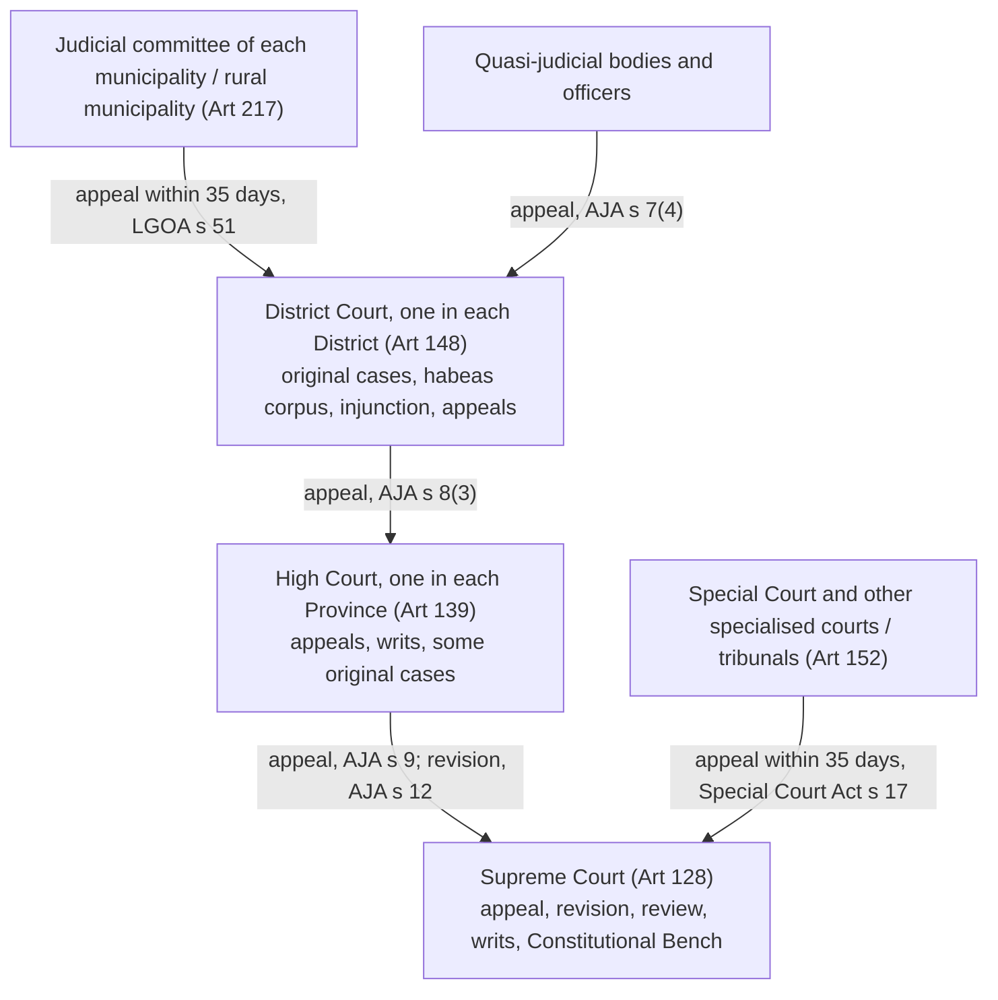

# Unit 3: Jurisdiction

!!! abstract "In one line"
    Jurisdiction is a court's legal power to hear and decide a case. This unit explains what jurisdiction is and its kinds. It then sets out which body in Nepal may hear what: the judicial committees of local governments, the District Court, the High Court, the Supreme Court, the Special Court and quasi-judicial bodies.

## Why it matters for the exam

- **Asked as a full 20-mark question in both new-course papers that have it:**
    - 2077 Q1 "What do you mean by jurisdiction of court? Describe about the jurisdiction of district court."
    - 2079 Q2 "Define jurisdiction. Discuss nature and kinds of jurisdiction."
- **Old course (Law 322):** 2075 Q2 "Discuss the jurisdiction of the Supreme Court of Nepal in brief." 2075 Q4 "Highlight the jurisdiction of the special court and discuss the important features of the jurisdiction of special court in brief."
- **Case link:** [Parshuram Banjade v Durgadas Shrestha](cases/9-1-parshuram-banjade.md) (9.1, asked 2079 Q5) turns on jurisdiction. The officer who jailed the petitioner chaired a Special Court, but had no jurisdiction over the case.
- Jurisdiction is asked about every other year. Learn the meaning and kinds well (they open every answer). Then learn the District Court and the Supreme Court in detail. Four full answers are written out below.

## Key terms

| Term | Nepali | Plain meaning |
|---|---|---|
| Jurisdiction | अधिकारक्षेत्र | The power, given by law, to hear and decide a case |
| Original jurisdiction | शुरु कारबाही र किनारा गर्ने अधिकार | Power to hear a case first, from filing to judgment |
| Appellate jurisdiction | पुनरावेदन सुन्ने अधिकार | Power to hear an appeal against a lower body's decision |
| Extraordinary jurisdiction | असाधारण अधिकारक्षेत्र | Power to issue writs and orders to protect rights where ordinary remedies fail |
| Revision | मुद्दा दोहोर्‍याउने | A higher court looking again at a lower court's final decision on limited grounds |
| Review | पुनरावलोकन | A court looking again at its own final decision on limited grounds |
| Confirmation (reference) | साधक जाँच्ने | A higher court checking a heavy sentence even if no one appeals |
| Territorial jurisdiction | प्रादेशिक अधिकारक्षेत्र | The area within which a court may act |
| Contempt of court | अदालतको अवहेलना | Obstructing a court or disobeying its order or judgment |
| Judicial committee | न्यायिक समिति | The three-member body of a municipality or rural municipality that settles listed local disputes |
| Specialised court | विशिष्टीकृत अदालत | A court set up by federal law for specific types of cases |
| Tribunal | न्यायाधिकरण | A body, other than a regular court, set up to decide a class of disputes |
| Special Court | विशेष अदालत | The court formed under the Special Court Act 2059 for cases the government lists by notice |
| Quasi-judicial body | अर्धन्यायिक निकाय | A body that is not a court, but decides rights or punishes like one |
| Return of a document | दरपीठ | Refusing to register a plaint and handing it back with written reasons |

## Start here: which court can hear my case?

Suppose a man in Jhapa has not been paid his wages. Who should he go to?

- He cannot go straight to the Supreme Court. It mostly hears appeals and writs.
- He cannot go to the District Court of Kathmandu. That court acts only in Kathmandu district.
- He may go to the **judicial committee** of his own municipality. Unpaid wages are on its list of disputes.

Each body has a **field of power**. The field is drawn by the Constitution and Acts. It covers the **kind** of case, the **place**, sometimes the **amount**, and the **stage** (first hearing or appeal). A decision made outside that field is void. Nepal's Civil Procedure Code says so in plain words (section 16(2)).

So jurisdiction answers one question before any other: **does this body have legal power to decide this case at all?**

## 3.1 Meaning, nature and kinds of jurisdiction

### Meaning

The word comes from the Latin *jus* (law, genitive *juris*) and *dicere* (to say). *Jurisdictio* meant "saying the law": declaring what the law is in a dispute. Today it means the **authority of a court to hear and decide a case**.

- **Black's Law Dictionary** defines it, in substance, as a court's power to decide a case or issue a decree. It also uses the word for the area within which a court's power runs.
- **In Nepal's Codes**, jurisdiction is the power to "proceed, hear and adjudicate" (कारबाही, सुनुवाई र किनारा) a case. It includes the power to hear appeals, revise and review, as the law provides (Civil Procedure Code ss 16(1) and 17).
- **In plain words:** jurisdiction is the power, given by law, to hear and decide a matter. That is how the brief of [Parshuram Banjade v Durgadas Shrestha](cases/9-1-parshuram-banjade.md) explains the court's first issue.

Jurisdiction is wider than the courts. A judicial committee, a tribunal and a quasi-judicial officer each have a jurisdiction too. Article 126(1) of the Constitution says powers relating to justice are exercised "by courts and other judicial institutions" under the Constitution, other laws and recognized principles of justice.

### Nature (features) of jurisdiction

1. **It comes only from the Constitution or law.** No court may hear a case unless law gives it jurisdiction (Civil Procedure Code s 16(1)). A title or office does not give it. In *Banjade*, Durgadas Shrestha chaired a Special Court, but his power over this case came only from a gazette notice. That notice did not cover student organisations.
2. **Parties cannot create it by consent.** If a court has no power, the parties cannot give it power by agreeing or by keeping silent. This is standard doctrine. There is one narrow exception: where several courts are competent, the law may let the parties pick one. For example, a contract may name a particular District Court in Nepal (Civil Procedure Code s 20(2)).
3. **Without it, everything is void.** Any proceeding, hearing, order or decision by a court without jurisdiction is void (बदर) (Civil Procedure Code s 16(2)). The court must state in its judgment under which law it has jurisdiction (s 16(3)).
4. **It is decided first.** A defendant may object that the court lacks jurisdiction. The court must settle that objection in a preliminary hearing before going into the merits (Civil Procedure Code ss 131-133; Criminal Procedure Code s 51(1)).
5. **There is no gap.** For every case, the law names some court or officer with jurisdiction (Civil Procedure Code s 11). If none is named, the District Court has it (s 25(1)).
6. **It is divided.** It is divided upward (District Court, High Court, Supreme Court) and sideways (by district, province, subject and value).
7. **It is used through benches.** A District Court acts through the bench of a district judge. A High Court acts through a single judge or a joint bench (Administration of Justice Act 2073 s 16). The Supreme Court has five kinds of bench (Supreme Court Rules 2074 r 21).
8. **It is a duty as well as a power.** A judge may not refuse to decide a case because the law is unclear or inadequate (Civil Procedure Code s 12(1)).
9. **The higher court wins.** If a case within both a lower and a higher court's jurisdiction is filed in both, the higher court hears it (Civil Procedure Code s 22; Criminal Procedure Code s 49). If it is filed in both a court and another judicial body, the regular court hears it (Civil Procedure Code s 23). In criminal cases, a court prevails over a quasi-judicial body (Criminal Procedure Code s 48(2)).

### Kinds of jurisdiction

Textbooks classify jurisdiction in several ways. Each way answers a different question.

| Basis | Kinds | Nepal example |
|---|---|---|
| Stage of the case | Original, appellate | District Court tries cases first (AJA s 7(1)); High Court hears appeals (AJA s 8(3)) |
| Further correction | Revision, review, confirmation | Supreme Court revision (AJA s 12), review (AJA s 11), confirmation of life sentences (AJA s 10(2)) |
| Kind of remedy | Ordinary, extraordinary | Writs under Arts 133(2)-(3) and 144 |
| Place | Territorial (local) | Civil Procedure Code ss 18-19; Criminal Procedure Code s 45 |
| Subject | Subject-matter (civil, criminal, constitutional, commercial) | Constitutional Bench (Art 137(2)); High Court commercial bench (High Court Rules r 66) |
| Money | Pecuniary | Judicial committee: house-rent disputes up to Rs 25 lakh a year (LGOA s 47(1)(ज)) |
| Person | Personal | Suits by or against a public servant in his official capacity (Civil Procedure Code s 24) |
| Sharing | Exclusive, concurrent | Only the Constitutional Bench hears Art 133(1) petitions (Art 137(2)); both the Supreme Court and High Courts issue writs |
| Range | General, special (limited) | District Court: "any type of case" (AJA s 7(1)); Special Court: only listed cases (Special Court Act s 6(1)) |
| Control | Supervisory, contempt | Art 128(3), AJA s 21 (inspection); AJA s 17 (contempt) |
| Reach outside Nepal | Extra-territorial, universal | Criminal Procedure Code s 47 (offences outside Nepal); s 46(ट) (universal jurisdiction) |

**1. Original jurisdiction.** The power to hear a case from the start: take the plaint or charge sheet, record evidence and give the first judgment. The District Court has general original jurisdiction. The High Court and Supreme Court have it only where law says so (Arts 133(4) and 144(3)).

**2. Appellate jurisdiction.** The power to hear an appeal (पुनरावेदन) against a lower body's decision. The appeal court may uphold the decision, reverse it in whole or part, or decide what the lower body should have decided (AJA s 14(1)).

**3. Revisional jurisdiction.** A higher court's power to look again at a lower court's final decision where no appeal lies, on narrow grounds. In Nepal, the Supreme Court revises High Court decisions under AJA s 12 (Unit 7).

**4. Review jurisdiction.** A court's power to look again at its own final decision, on narrow grounds. Only the Supreme Court has it, under AJA s 11 (Unit 7).

**5. Confirmation (reference) jurisdiction.** Some heavy sentences go to a higher court for checking even if no one appeals. This is साधक. Only a life sentence given by a High Court goes to the Supreme Court for confirmation (AJA s 10(2)).

**6. Extraordinary (writ) jurisdiction.** The power to issue a writ or other order to enforce fundamental rights, or other legal rights with no adequate remedy. It also settles legal questions in disputes of public interest. It is called extraordinary jurisdiction because it is used where ordinary remedies fail (Arts 133(2) and 144(1)).

**7. Territorial jurisdiction.** The area within which a court may act. A District Court acts within its district (AJA s 7). A High Court acts within its province (AJA s 8(3)).

**8. Subject-matter jurisdiction.** The kinds of case a court may hear. For example, only the Constitutional Bench hears disputes over jurisdiction between the federation, provinces and local levels (Art 137(2)(a)).

**9. Pecuniary jurisdiction.** Limits set by the money involved. AJA s 7(1) sets no money limit on a District Court's first hearings. Money matters for appeals: whether a High Court or Supreme Court hears an appeal can depend on the fine or claim (AJA ss 8(3)(ग) and 9(1)(ग)). It also limits the judicial committee (LGOA s 47(1)(ज)).

**10. Personal jurisdiction.** Power over particular persons. For example, a case against a public servant in his official capacity is filed where he serves or where the plaintiff lives (Civil Procedure Code s 24(1)).

**11. Exclusive and concurrent jurisdiction.** Exclusive: only one body may hear the matter. Concurrent: more than one may. Writs are concurrent: both the Supreme Court and the High Courts may issue them.

**12. General and special (limited) jurisdiction.** A court of general jurisdiction hears every case not given to someone else. A court of special or limited jurisdiction hears only the cases its law lists. The District Court is general (Civil Procedure Code s 25). The Special Court is special.

**13. Supervisory and contempt jurisdiction.** Higher courts inspect and direct lower courts and bodies (Art 128(3); AJA s 21). Courts punish contempt of themselves and of courts below them (AJA s 17).

**14. Extra-territorial and universal jurisdiction.** Nepal's courts may try some offences committed outside Nepal or on Nepali aircraft and ships (Criminal Procedure Code s 47). For universal jurisdiction (विश्वव्यापी अधिकारक्षेत्र) under a treaty or law, the government names the court (s 46(ट)).

**15. Advisory jurisdiction.** In some countries the head of state may ask the highest court for its opinion on a legal question. We found no article giving the Supreme Court of Nepal this power in the Constitution of Nepal 2015.

### Without jurisdiction, in excess of it, and errors within it

These three ideas explain when a decision can be attacked.

| | Meaning | Effect |
|---|---|---|
| **Lack of jurisdiction** | The body had no power at all over the case | Void. A writ lies at once, even if an appeal is available |
| **Excess of jurisdiction** | The body had power, but went beyond its limits (ultra vires) | Void to the extent of the excess |
| **Error within jurisdiction** | The body had power, but made a mistake of fact or law | Valid until set aside. The party must use the appeal or other remedy the law gives |

Two prescribed cases show the line:

- In [Parshuram Banjade v Durgadas Shrestha](cases/9-1-parshuram-banjade.md), the officer had no jurisdiction over a student organisation. So the jail sentence was unlawful, and habeas corpus issued. The court did not first require the order to be quashed by certiorari, even though it was on the file.
- In [Pradip Kumar Agrawal v Tax Office, Morang](cases/9-3-pradip-kumar-agrawal.md), the Supreme Court said a judicial or quasi-judicial decision made within jurisdiction stands until set aside. The party must first use the legal remedy. But a decision made without jurisdiction, by a body with no power, under an unconstitutional law, or without a hearing, is as good as void. Then the court can and must help at once.

### Nepal's general rules on jurisdiction

**Civil cases (Muluki Civil Procedure Code 2074, Chapter 3):**

| Section | Rule |
|---|---|
| s 11 | Jurisdiction is never empty: law names some court or officer for every case |
| s 16 | A court must have jurisdiction under law; acts without it are void; the judgment must say which law gives it |
| s 17 | Original hearing, appeal, revision and review belong to the court the law names |
| s 18 | Cases on land, houses and other immovable property go to the District Court where the property is. A partition case may be filed where the plaintiff or the defendant lives (s 18(3)) |
| s 19 | Other cases go to the District Court where the defendant lives or where the act was done. For a transaction outside both parties' home districts, the transaction district or either party's home district may hear it (s 19(2)). With more than two defendants, file where the largest group lives; if groups are tied, any tied district may hear it (s 19(3)) |
| s 20 | Transactions abroad: where the plaintiff or defendant lives, if the deed allows a case in Nepal. A deed may name a particular District Court |
| s 21 | Transactions on a Nepali aircraft or ship abroad: Nepal's courts have jurisdiction |
| s 22 | If filed in both a lower and a higher court, the higher court hears it |
| s 23 | If filed in both a court and another judicial body, the regular court hears it |
| s 24 | Public servant suing or sued in official capacity: where he serves or where the plaintiff lives |
| s 25 | No court named, or the named body not yet formed: the District Court hears it |
| s 26 | Same plaint in several courts: keep one, by agreement; failing that, the first-filed |
| s 27 | The appeal court of the court that decided hears the appeal |

A plaint filed in a court without jurisdiction is returned (दरपीठ) (s 128(1)). The plaintiff then has 15 days, not counting travel time, to file it in the right court, if the limitation period had not run out by the day of return (s 128(2)). Time spent in a court without jurisdiction may also be saved (s 57).

**Criminal cases (Muluki Criminal Procedure Code 2074):**

- **s 45:** a case is heard by the court of the area where the offence happened. By proviso, the government may set up a separate criminal court or bench in a district under law.
- **s 46:** where an offence touches several areas, any of those courts may hear it. Examples: part of the act in one area and part in another; kidnapping (where the victim was taken or kept); offences by letter or electronic message (where sent or received).
- **s 47:** offences outside Nepal, or on Nepali aircraft or ships: the District Court where the accused is found, or else where he permanently lives.
- **s 48:** if a case is filed in two courts, the first-filed one hears it. If it is filed in a court and a quasi-judicial body, the court hears it (s 48(2)).
- **s 50:** a charge sheet or complaint outside the court's jurisdiction is returned (दरपीठ).
- **s 51:** an objection to jurisdiction must be decided before the case goes further. That decision may be challenged in the appeal court within 30 days.

### Nepal's court system at a glance

Article 127(1) names three courts: the Supreme Court, High Courts and District Courts. Article 127(2) adds judicial bodies at the local level and other bodies for alternative dispute resolution. Article 152(1) allows specialised courts, judicial bodies and tribunals under federal law. All courts and judicial bodies are under the Supreme Court, except as the Constitution provides (Art 128(2)).

## 3.2 Jurisdiction of local judicial bodies

### The constitutional base

Every rural municipality (गाउँपालिका) and municipality (नगरपालिका) has a **judicial committee (न्यायिक समिति)** (Constitution Art 217(1); Local Government Operation Act 2074 (LGOA) s 46).

- **Members:** three. The coordinator is the vice-chairperson of a rural municipality or the deputy mayor of a municipality. The other two are elected by the assembly from among its own members (Art 217(1)-(2)).
- **Purpose:** to settle disputes within its jurisdiction "in accordance with law" (Art 217(1)).
- **Place in the system:** local judicial bodies are subordinate to the District Court. The District Court may inspect, supervise and direct them (Art 148(2)). Appeals from them go to the District Court (Art 151(1); AJA s 7(4)).

### What the committee may decide: LGOA s 47(1)

The committee may **decide** these disputes itself:

1. sharing and use of field boundaries (आलीधुर), dams, canals and watering places;
2. damage to another person's crops;
3. pasture, grass and firewood;
4. unpaid wages (ज्याला मजुरी);
5. lost or found domestic animals and birds;
6. failure to care for and look after senior citizens;
7. failure to give food, clothing or education to minor children or a spouse in line with one's means;
8. house rent and house-rent facilities, where the claim (बिगो) is up to Rs 25 lakh a year;
9. planting trees that harm another's house, land or property;
10. letting water fall from one's house or balcony onto another's house, land or a public road;
11. building a house with windows toward a neighbour's land without leaving the gap the law requires;
12. blocking public use of a road, cattle track, pasture, canal, pond, rest-house, cremation ground, religious place or other public place, even if privately owned, that the public has used from old times;
13. other disputes that federal or provincial law gives to the local level.

### What it may settle only by mediation: LGOA s 47(2)

For these disputes the committee may act **only through mediation (मेलमिलाप)**. It cannot impose a decision:

1. one person's land pressed, encroached or taken by another (not government, public or community land);
2. a house or structure built on another's land (not government, public or community land);
3. divorce. But mediation may not end the marriage (proviso to s 47(2)(ग));
4. assault punishable with up to one year's jail, not involving maiming;
5. defamation (गाली बेइज्जती);
6. looting and beating (लुटपिट);
7. letting animals loose, or carelessness in keeping them, that harms others;
8. unauthorised entry into another's home;
9. cultivating or using land held by another;
10. disturbing neighbours by noise or dumping waste;
11. other civil disputes, and criminal disputes punishable with up to one year's jail, that can be settled by mediation and are filed by a private person.

For these mediation-only disputes, a party may go straight to court if it wishes (s 47(3)).

### Time limit

A dispute must reach the committee within the limitation period set by law for it. If no limit is set, it must reach the committee within 35 days of the act (s 47(4)). For this chapter, "application" (निवेदन) includes a complaint or a plaint.

### How it exercises jurisdiction: LGOA ss 48-53

- **Collective decision (s 48(1)):** the coordinator and members act together; the majority view is the decision.
- **Quorum (s 48(2)-(4)):** the coordinator and one member may hear and decide. Two members without the coordinator may take other steps but not decide. If the coordinator's post is vacant, the other two may decide only if they agree.
- **No one judges his own cause (s 48(5)-(7)):** a coordinator or member with a personal interest, or whose relative is a party, may not hear the dispute. If all three are barred, the assembly names three members for that dispute. This is the rule against bias (nemo judex in causa sua), written into the Act.
- **Mediation first (s 49(2)-(4)):** the committee must try to get the parties to a settlement (milapatra, मिलापत्र) through its listed mediators. For s 47(2) disputes, if mediation fails within three months after both parties appear, it sends the file to the court and tells the parties.
- **Interim relief (s 49(6)-(8)):** it may ask a bank or office to freeze the defendant's account or stop transfer of his land. In spouse and senior-citizen disputes, it may give interim protection orders: letting the victim live in the home, giving food, medical care or separate living, and stopping abuse.
- **Appearance (s 49(9)):** the defendant must appear within the time the law sets, or within 15 days.
- **Copy of decision (s 50):** a certified copy within 35 days.
- **Appeal (s 51):** a dissatisfied party may appeal to the District Court within 35 days of learning of the decision.
- **Execution (s 52):** the municipal or rural municipal executive carries out the settlement or decision at once.
- **Records (s 53):** the local level keeps the records; the committee reports yearly to the assembly.

### Critical view

- **Justice near home.** Small disputes over water, boundaries, wages and family care are settled cheaply and fast, close to the people. Mediation comes first, which suits such disputes.
- **Members are politicians, not trained judges.** The coordinator and members are elected representatives. The Act gives them the power to decide rights but requires no legal training.
- **A drafting mismatch.** Article 151(1) and AJA s 7(4) speak of local judicial bodies "formed under the provincial law". But the judicial committee is formed under Article 217 and a federal Act, the LGOA. The District Court still hears its appeals under LGOA s 51.
- **Separation of powers.** The same elected people sit in the executive and the judicial committee. The bar on hearing one's own cause (s 48(5)) helps, but does not remove the concern.

## 3.3 Jurisdiction of District Court

### Structure

- There is a District Court in each district (Art 148(1); AJA s 3(1)), normally at the district headquarters (AJA s 3(2)).
- Each has one district judge. The Chief Justice may add judges on the Judicial Council's recommendation where the workload is heavy (AJA s 4(1)-(2)). The senior-most district judge heads the court (s 4(4)).
- Its jurisdiction is exercised through the bench of a district judge (AJA s 16(1)).

### Constitutional jurisdiction: Article 151

Except as federal law provides otherwise, a District Court has power to:

1. **hear first and decide** all cases within its jurisdiction;
2. **hear petitions under law**, including **habeas corpus** and **injunction** (निषेधाज्ञा);
3. **hear appeals** against decisions of **quasi-judicial bodies**, as the law provides;
4. **hear appeals** against decisions of **local-level judicial bodies**;
5. **punish contempt** of itself and of courts below it, under federal law.

Other details are left to federal law (Art 151(2)). The District Court also supervises local judicial bodies (Art 148(2)).

### Statutory jurisdiction: AJA s 7

| Sub-section | Power |
|---|---|
| 7(1) | Original hearing and decision of **any type of case** within its district, except as law provides otherwise. Also cases a High Court sends to it under Art 145(2) |
| 7(2) | **Habeas corpus** (बन्दीप्रत्यक्षीकरण) where anyone unlawfully detains a person within its district |
| 7(3) | **Injunction** (निषेधाज्ञा) where a person or body harms, or threatens to harm, someone's legal right within its district |
| 7(4) | **Appeals** against final decisions or orders of quasi-judicial bodies or officers under federal law, and of local judicial bodies under provincial law, except as law provides otherwise |

### Other powers

- **Contempt (AJA s 17(3)-(4)):** it may punish contempt of itself and of a court or judicial body below it. The penalty is up to one year's jail, up to Rs 10,000 fine, both, or another suitable order. If the contemnor apologises before judgment, the court may hold the case (s 17(5)).
- **Holiday habeas corpus (AJA s 26(1)(ग)):** where the court is closed for three days or more, a district judge is named to hear habeas corpus petitions. (In Kathmandu Valley and in districts with a High Court, a Supreme Court or High Court judge is named instead.)
- **Residual jurisdiction (Civil Procedure Code s 25):** it hears every case the law gives to no other body. It also hears cases given to a body not yet formed, until that body is formed.
- **Territorial rules:** for civil cases, Civil Procedure Code ss 18-21 and 24 (see 3.1). For criminal cases, Criminal Procedure Code ss 45-47.
- **Special Court judgments:** the District Court carries them out, unless the judgment names another body (Special Court Act s 18).

### Appeals from the District Court

- Its original decisions go on appeal to the High Court of its province (AJA s 8(3)(क)).
- Where it decided an appeal from a judicial or quasi-judicial body and set that decision aside in whole or part, a further appeal lies to the High Court (s 8(3)(ख)).
- Where it decided an appeal involving government or public property, imprisonment, a fine over Rs 1 lakh, or a claim over Rs 5 lakh, a further appeal lies to the High Court (s 8(3)(ग)).

!!! tip "Exam tip"
    For 2077 Q1, use a four-part frame: (1) original jurisdiction, (2) petitions (habeas corpus, injunction), (3) appellate jurisdiction (quasi-judicial bodies, judicial committees), (4) contempt and supervision. Cite Art 151 and AJA s 7 for each part, then add the Code rules on place.

### Critical view

- The District Court is the **workhorse**: almost every civil and criminal case starts here. Delay and backlog are the main complaints.
- Its **habeas corpus and injunction** powers bring quick remedies close to people.
- Appeals from both judicial committees and quasi-judicial bodies add to its load.

## 3.4 Jurisdiction of High Court

### Structure

- There is a High Court in each province (Art 139(1)), at the provincial capital (AJA s 5(1)). The government, after consulting the Judicial Council, may set up temporary benches elsewhere in the province, each with its own territorial area (AJA s 5(3)-(4), (7)).
- The old Appellate Courts were dissolved when the AJA came into force (AJA s 30). Laws that still say "Appellate Court" are read as "High Court" (AJA s 37(क)).

### Jurisdiction

**1. Extraordinary (writ) jurisdiction (Art 144(1)-(2); AJA s 8(1)).** The High Court may issue necessary and appropriate orders:

- to enforce fundamental rights;
- to enforce any other legal right with no remedy, or with a remedy that is inadequate or ineffective;
- to settle any legal question in a dispute of public interest or concern.

It may issue habeas corpus, mandamus, certiorari, prohibition and quo warranto. It may not interfere in the internal proceedings of the Federal Parliament or a Provincial Assembly, or their privilege proceedings, except for lack of jurisdiction (proviso to Art 144(2)).

**2. Original jurisdiction (Art 144(3); AJA s 8(2)).**

- cases that federal law says the High Court tries first;
- cases it withdraws from a court below under Art 145(1). That article lets a High Court take up a case involving a question of provincial law, decide it or only the question, and send it back.

Example: the government, with the Supreme Court's consent, may form a separate commercial bench (वाणिज्य इजलास) in a High Court. Cases under the Insolvency Act 2063 s 40(2)(ज) start in that bench (High Court Rules 2073 r 66(1), (8)).

**3. Appellate jurisdiction (AJA s 8(3)).** The High Court hears appeals against:

1. original decisions of District Courts in its province;
2. District Court appeal decisions that set aside, in whole or part, a judicial or quasi-judicial body's decision;
3. District Court appeal decisions involving government or public property, imprisonment, a fine over Rs 1 lakh, or a claim over Rs 5 lakh;
4. original decisions of any judicial body in its province, unless federal law says otherwise.

Some Acts send appeals straight to the High Court. Example: decisions under the Lands Act 2021 by a District Court or a prescribed officer, committee or institution go to the High Court within 35 days (Lands Act s 55(1)).

**4. Confirmation (Art 144(3); AJA ss 8(4) and 10(1)).** It checks sentences that federal law sends for confirmation (साधक).

**5. Interim orders.** A party dissatisfied with an interim order of a court, body or officer may apply to the court one tier above it (AJA s 15(1)).

**6. Transfer (Art 145(2); AJA s 20(2)).** Where a District Court's impartiality may be questioned, the High Court may move a case to another District Court in the province.

**7. Contempt (Art 139(2); AJA s 17(2)).** It punishes contempt of itself and of District Courts and judicial bodies below it.

**8. Supervision (Art 147; AJA s 21).** The Chief Judge is responsible for justice in the courts and bodies below. The High Court inspects lower courts and judicial and quasi-judicial bodies at least once a year.

### Benches

- A High Court sits as a single judge or a joint bench (AJA s 16(2)).
- A joint bench hears appeals, confirmation cases, writ petitions after a show-cause order, withdrawn cases, cases started in the High Court under federal law, and contempt cases (High Court Rules r 10).
- A single judge hears writ petitions before a written reply is called for, interim-order petitions and other applications (r 11).
- If a joint bench is split, the case goes to a third judge. If there is still no majority, the file goes to the Supreme Court (AJA s 16(3); High Court Rules r 12).

## 3.5 Jurisdiction of Supreme Court

### Status

- The Supreme Court is the highest court. It is a **Court of Record**. All courts and judicial bodies are under it, except as the Constitution provides. It has the **final authority to interpret** the Constitution and laws (Art 128(2)).
- Its interpretations and legal principles bind everyone (Art 128(4)).
- It has a Chief Justice and up to 20 other Justices (Art 129(1)).

### Jurisdiction under the Constitution

**1. Constitutional (extraordinary) jurisdiction to strike down laws (Art 133(1)).** Any Nepali citizen may petition to have a law declared void because it:

- conflicts with the Constitution, for example by putting unreasonable restrictions on a fundamental right;
- is a provincial law that conflicts with a federal law; or
- is a municipal or rural municipal law that conflicts with a federal or provincial law.

The Court may declare it void from the start (ab initio) or from the date of its decision. The **Constitutional Bench** hears these petitions (Art 137(2)).

**2. Writ (extraordinary) jurisdiction (Art 133(2)-(3)).** The Court may issue orders and give remedies:

- to enforce fundamental rights;
- to enforce other legal rights with no remedy, or with an inadequate or ineffective one;
- to settle any **constitutional or legal question** in a dispute of public interest or concern (the basis of public interest litigation, PIL).

It may issue habeas corpus, mandamus, certiorari, prohibition and quo warranto, and other appropriate orders. It may not interfere with the internal proceedings or privilege proceedings of Parliament or a Provincial Assembly, except for lack of jurisdiction (proviso to Art 133(3)).

The writ jurisdiction is not a substitute for appeal. In [Kallu Chaudhary v Appellate Court, Dipayal](cases/9-6-kallu-chaudhary.md), the Court said the route against an Appellate Court judgment was appeal or revision under the Administration of Justice Act. It was "not a matter for the writ jurisdiction at all".

**3. Ordinary jurisdiction under federal law (Art 133(4)).** Subject to the Constitution, and as federal law provides, the Court may:

- try cases first (original);
- hear appeals;
- check sentences sent for confirmation;
- revise cases (मुद्दा दोहोर्‍याउने);
- hear petitions;
- review its own judgments and final orders. Justices other than those who gave the first judgment must hear the review.

**4. Appeals and references from High Courts (Art 133(5)).** It settles appeals from cases the High Court tried first. It also settles matters of public importance involving interpretation of the Constitution and law, and cases a High Court sends up with its opinion that the Supreme Court should decide them.

**5. Withdrawal and transfer (Art 134; AJA ss 19-20(1)).** If substantially the same question of public importance is pending in the Supreme Court and a High Court, it may withdraw the cases and decide them together. Where a High Court's impartiality may be questioned, it may move a case to another High Court.

**6. Constitutional Bench (Art 137).** The Chief Justice and four Justices he designates on the Judicial Council's recommendation. Besides Art 133(1) petitions, it hears first:

- disputes about jurisdiction between the federation and a province, between provinces, between a province and a local level, and between local levels;
- disputes about elections to the Federal Parliament or a Provincial Assembly, and about disqualification of their members.

The Chief Justice may also send it any pending case involving serious constitutional interpretation (Art 137(3)).

**7. Supervision and contempt (Arts 128(3)-(4), 136).** The Court may inspect, supervise and direct itself and the courts and bodies under it. It may punish contempt of itself and of courts below it. The Chief Justice has the ultimate responsibility to make the administration of justice effective.

### Jurisdiction under the Administration of Justice Act 2073

**Appeal (s 9(1)).** The Supreme Court hears appeals in:

1. cases the High Court tried first under s 8(2);
2. cases where the High Court's judgment imposes 10 years' jail or more;
3. cases involving more than 3 years' jail, a fine over Rs 5 lakh or a claim over Rs 25 lakh, where the High Court on appeal set aside the first decision in whole or part;
4. other cases where federal law allows an appeal.

It also hears appeals in confirmation cases before it (s 9(2)).

**Confirmation (s 10(2)).** Only cases where a High Court has given a life sentence go to the Supreme Court for confirmation.

**Review (s 11).** A court may not review its own final decision (s 11(1)). The Supreme Court is the exception. It may review its judgment or final order where:

- (a) evidence that materially affects the decision became known to the party only after the case ended; or
- (b) the decision goes against a precedent or legal principle laid down by the Supreme Court.

Review is barred after one review, after a Larger Full Bench or Constitutional Bench decision, and after revision judgments under the pre-Act law. It is also barred in s 12 proceedings where the High Court was affirmed or leave to revise was refused (s 11(3)). The petition must come within 60 days of signing and certification by the Supreme Court justices (s 11(4)). Leave is given by other Justices, and a different bench hears it (s 11(5)-(6)).

**Revision (s 12).** In cases with no appeal to the Supreme Court, it may revise a High Court judgment or final order where:

- (a) there is a serious constitutional or legal error;
- (b) a Supreme Court precedent or legal principle was not followed, or was wrongly interpreted;
- (c) government or public property was lost or damaged because evidence was not properly weighed; or
- (d) a child, woman, person with disability, mentally ill person or person aged 75 or more was not properly represented, and this materially affected justice.

Revision is barred after one revision and for High Court appeal decisions under s 8(3)(ख) (s 12(2)). The petition is filed within 45 days of learning of the judgment (s 12(3)). A Joint Bench decides leave (s 12(5)). Details of review and revision are in Unit 7.

**Contempt (s 17(1), (4)).** It punishes contempt of itself, High Courts and District Courts: up to one year's jail, a fine up to Rs 10,000, or both.

**Special Court splits.** If a two-member Special Court bench stays split, the case goes to a single Justice of the Supreme Court, whose decision counts as the Special Court's (Special Court Act s 6(5)-(7); Supreme Court Rules r 25(2)(ग)).

### Benches of the Supreme Court (Supreme Court Rules 2074)

| Bench | Members | Hears (examples) | Rule |
|---|---|---|---|
| Constitutional Bench | Chief Justice and four Justices | Art 133(1) petitions; Art 137(2) disputes | Art 137; r 21(2) |
| Larger Full Bench (वृहत् पूर्ण इजलास) | Five or more | Questions a Full Bench sends up; conflicts between two Full Benches | r 22 |
| Full Bench (पूर्ण इजलास) | Three | Splits in a Joint Bench; conflicts between Joint Benches; complex legal questions | r 23 |
| Joint Bench (संयुक्त इजलास) | Two | Appeals, confirmation, writs after a show-cause order, revision leave, withdrawn cases | r 24 |
| Single Bench (एक न्यायाधीशको इजलास) | One | First hearing of writ petitions; habeas corpus during closures; Special Court splits; interim-order petitions | r 25 |

!!! info "Then and now"
    *Banjade* was decided by a Division Bench of two Justices (2027 B.S.). Today a two-Justice bench is called a Joint Bench (Supreme Court Rules r 24).

### Critical view

- **Strengths.** Its writ power, standing for public interest litigation and binding precedents make it the guardian of the Constitution and of rights. Separate benches let larger benches settle conflicting decisions.
- **Weaknesses.** It carries a heavy backlog. Some say it reaches too freely into policy through PIL. The line between writ and appeal is sometimes blurred, which is why cases like *Kallu Chaudhary* insist on the alternative remedy.
- **No advisory role.** It has no general advisory jurisdiction under the 2015 Constitution.

## 3.6 Jurisdiction of Special Court

### What a specialised court is

A **specialised court** hears only a particular type of case. The Constitution allows "other specialized courts, judicial institutions or tribunals" for specific types and nature of cases, but only under **federal law**. None may be formed **for any specific case** (Art 152(1) and proviso). An offence punishable with more than one year in jail may be tried only by a court, specialised court, military court or judicial institution (Art 152(2)).

Two examples: the **Special Court** (Special Court Act 2059) and the **Revenue Tribunal** (Revenue Tribunal Act 2031, mentioned in Supreme Court Rules r 24(2)(घ)).

### The Special Court Act 2059

The Act was made to have "specific types of cases" heard quickly, fairly and effectively (Preamble). It replaced the Special Court Act 2031 (s 24(1)). Cases pending under the old Act moved to the new court (s 25).

**Formation (s 3).**

- The **Government of Nepal**, by notice in the Nepal Gazette and after **consulting the Judicial Council**, may form a Special Court with the members it needs (s 3(1)).
- If it has more than three members, it sits in benches of three (s 3(1क)).
- The government designates the **chair and members from among Appellate Court judges**, after consulting the Judicial Council (s 3(2)). Today this is read as High Court judges (AJA s 37).
- The notice must fix the court's territorial jurisdiction and seat (s 3(3)). The government may also set temporary seats elsewhere (s 3(4)).

**Which cases (ss 2(ख), 4 and 6(1)).** "Specific types of cases" (खास किसिमका मुद्दा) are those the government lists by gazette notice (s 2(ख)). The government may add to or cut the list by notice (s 4). The Special Court tries those cases first and decides them (s 6(1)). Notices under the Act must be laid before the Federal Parliament (s 19).

!!! warning "Unverified"
    Which cases the current gazette notice gives the Special Court (for example, corruption cases filed by the Commission for the Investigation of Abuse of Authority) was not checked. The Constitution says only that the Commission files corruption cases "in the competent court" (Art 239(3)).

### Features of its jurisdiction

1. **Original only.** It tries cases first (s 6(1)); it hears no appeals.
2. **Special, not general.** It hears only the listed types of case. Other cases stay with ordinary courts.
3. **Collective decision (s 6(2)-(3)).** All members on the bench exercise its jurisdiction together. A one-member bench may take steps other than detention decisions. A two-member bench may decide detention (थुनछेक) and the case. On a three-member bench, a unanimous or majority view is the decision.
4. **Split benches (s 6(4)-(7)).** On a split two-member bench, the chair's (or senior member's) view governs steps in the case. For a judgment, the file goes to the member who was absent. If there is still no majority, a single Justice of the Supreme Court decides, and that decision counts as the Special Court's.
5. **Strong powers (ss 7-9).** It may examine any person or evidence besides the parties' witnesses. It may issue warrants against absent defendants or witnesses. It may keep parties on tarikh. It may ask for a deposit (dharauti) or guarantee. It may **detain the accused** despite anything in other law, where there is enough reason (s 7(ङ)). It may freeze property and passports (s 8). It may let the government lawyer add charges or accused (s 9).
6. **Short time limits (ss 10-11).** Summons give 15 days within Nepal and 30 days abroad, not counting travel time; witnesses get 7 days (s 10(1), (5)). Process servers must serve within two days (s 10(7)). A time limit may be extended only once, by up to 15 days (s 11).
7. **District Court powers for the rest (s 12).** On matters the Act does not cover, it has the same powers and procedure as a District Court.
8. **Contempt (s 14).** It may punish contempt of itself: up to Rs 5,000 fine, up to six months' jail, or both.
9. **Speed (s 16).** It should "ordinarily" (सामान्यतया) decide within six months of filing. The Supreme Court should ordinarily decide an appeal within three months of receiving the file.
10. **One appeal, to the Supreme Court (s 17).** A dissatisfied party may appeal within 35 days of the judgment or final order.
11. **Execution (s 18).** The body named in the judgment carries it out; if none is named, the District Court does.
12. **Dissolution (s 20).** The government may dissolve the court by notice. Pending cases then go to the Appellate Court (now the High Court) with territorial jurisdiction.
13. **Oath (s 13).** The chair and members take an oath before the Chief Justice.

### The Banjade case: a Special Court of its time

In [Parshuram Banjade v Durgadas Shrestha](cases/9-1-parshuram-banjade.md) (NKP 2027), the respondent Durgadas Shrestha was **chairman of the Bagmati Special Court**.

- By a gazette notice of 2027/1/22, the government delegated to him its powers under section 6 of the National Guidance Act 2018. He could fine up to Rs 500, jail up to six months, or both.
- On 2027/2/9 he sentenced Yagyamurti Banjade to one month and 15 days in jail and a Rs 15 fine, for opening the Nepal Students' Union without government approval.
- A member of the Special Court, Sher Bahadur Thapa, replied that the Special Court itself had taken no action. The order was its chairman's.
- The judgment does not say what cases the Bagmati Special Court normally heard, or under what law it was set up.

The Supreme Court held that the 2024 amendment had removed "student organisation" from the Act. So the case was **outside his jurisdiction**, and habeas corpus issued (2027/3/16).

**Lesson for 3.6:** jurisdiction comes from the law, not from a title. Durgadas Shrestha headed a Special Court. But here he acted only as the officer named in the gazette notice, and that notice did not reach student organisations. Today Article 152(1) adds two safeguards: a specialised court must rest on federal law, and none may be formed for a particular case.

### Critical view

- **For:** expert judges, fast procedure, strong powers and one appeal suit complex cases that ordinary courts handle slowly.
- **Against:** the **executive** forms the court, picks its judges (after consulting the Judicial Council), decides which cases it hears, and may dissolve it (ss 3, 4, 20). This sits uneasily with judicial independence.
- The power to detain "despite anything in other law" (s 7(ङ)) needs careful use, given the right to liberty.
- The six-month and three-month limits are "ordinary" targets, not binding deadlines.

## 3.7 Jurisdiction of quasi-judicial bodies

### Meaning

A **quasi-judicial body (अर्धन्यायिक निकाय)** is a body or officer that is not a court, but has power to decide rights or punish. It must decide like a court. Most are administrative offices given a judicial job by an Act: a tax officer assessing tax, a land office deciding a tenancy claim, or an officer given power to fine.

In *Banjade* the Supreme Court drew the line this way (headnote, paragraph 16):

| Decision by | Kind | Approach |
|---|---|---|
| A judge | Judicial | Judicial |
| An administrative officer deciding a dispute or punishing | **Quasi-judicial** | Must be made with a judicial approach |
| An administrative officer on administration, with more discretion (तजबिज) | Administrative | Discretion within the law |

The name of the office does not decide which it is; the power does. Anyone who can fine or jail decides quasi-judicially.

### Features

1. **Power from statute.** A quasi-judicial body has only the jurisdiction its Act gives. Outside it, the decision is void (*Banjade*).
2. **A dispute or charge.** There is a claim and an answer, or a charge and a defence.
3. **Duty to act judicially.** It must hear both sides, weigh evidence, give reasons and be unbiased. In *Banjade*, a hurried hearing at night, with no lawyer, was unfair: "Justice is not done merely because one has power."
4. **Not bound by full court procedure.** It need not follow every rule of evidence and procedure, unless its Act says so.
5. **Its decision binds until set aside.** A decision within jurisdiction is final until a higher authority sets it aside. The party must use the remedy the law gives ([Pradip Kumar Agrawal](cases/9-3-pradip-kumar-agrawal.md)).
6. **Subject to appeal and writ.** An appeal lies as its Act provides. A writ lies against it for lack of jurisdiction, an unconstitutional law, or no hearing.

### Nepal's law

- **Appeals to the District Court:** a District Court hears appeals against final decisions of quasi-judicial bodies or officers under federal law, unless law says otherwise (Art 151(1); AJA s 7(4)).
- **Further appeal:** if the District Court sets aside the quasi-judicial decision in whole or part, the High Court hears a further appeal (AJA s 8(3)(ख)).
- **Other routes:** some Acts send appeals elsewhere. Decisions of a prescribed officer, committee or institution under the Lands Act 2021 go to the High Court within 35 days (s 55(1)). Some decisions under that Act allow no appeal to any court (s 26च).
- **Limit on punishment:** no criminal offence with more than one year's jail may be given to a body other than a court, specialised court, military court or judicial institution (Art 152(2)).
- **Court first:** if the same case is filed in a court and a quasi-judicial body, the court hears it (Criminal Procedure Code s 48(2); for civil cases, Civil Procedure Code s 23 speaks of "other judicial body").
- **Inspection:** appeal courts inspect quasi-judicial bodies at least once a year (AJA s 21(1)).
- **Fair trial:** everyone has the right to a fair trial by an independent, impartial and competent court or judicial body (Art 20(9)).
- **Writs:** certiorari issues against a judicial or quasi-judicial officer (*Banjade*, headnote point 10). Today it issues under Arts 133(3) and 144(2).

### Examples from the prescribed cases

- **The officer under the National Guidance Act** ([Banjade](cases/9-1-parshuram-banjade.md), 2027): quasi-judicial; had to act judicially; no jurisdiction over students' unions.
- **The tax officer** ([Pradip Kumar Agrawal](cases/9-3-pradip-kumar-agrawal.md), 2052): the Court treated the tax assessment as a judicial or quasi-judicial decision. The taxpayer had to use the tax law's remedies, which then included an appeal to the Revenue Tribunal.
- **The Land Reform Office** ([Kallu Chaudhary](cases/9-6-kallu-chaudhary.md), 2060): it decided a request to divide land. Lands Act s 26(च) allowed no appeal against that kind of decision.

### Critical view

- Quasi-judicial bodies give quick, expert decisions in technical fields such as tax and land.
- But the decision-maker is often part of the government that is a party. *Banjade* applied the rule that no one may be a judge in his own cause to the government itself.
- Article 152(2) keeps serious offences for courts. That would not cover a six-month offence like the one in *Banjade*.

## Compare

**Original and appellate jurisdiction**

| Point | Original | Appellate |
|---|---|---|
| Stage | First hearing | Second look at a decision |
| Starts with | Plaint, charge sheet or petition | Appeal against a decision |
| Evidence | Recorded fresh | Mostly the lower court's record; may take more (AJA s 14(1)(ग)) |
| Main court | District Court (AJA s 7(1)) | High Court (AJA s 8(3)); Supreme Court (AJA s 9) |

**The three regular courts**

| Point | District Court | High Court | Supreme Court |
|---|---|---|---|
| Constitution | Arts 148, 151 | Arts 139, 144, 145 | Arts 128, 133, 134, 137 |
| Statute | AJA ss 3, 4, 7 | AJA ss 5, 6, 8 | AJA ss 9-12 |
| Number | One per district | One per province | One |
| Original | All cases in its district | Only under federal law, or withdrawn (Art 145(1)) | Under federal law; Constitutional Bench matters |
| Appeals from | Judicial committees, quasi-judicial bodies | District Courts, judicial bodies | High Courts, Special Court |
| Writs | Habeas corpus and injunction only | All five writs | All five writs, plus striking down laws (Art 133(1)) |
| Review | No | No | Yes (AJA s 11) |
| Revision | No | No | Yes (AJA s 12) |
| Contempt | AJA s 17(3) | AJA s 17(2) | AJA s 17(1) |

**Special Court and District Court**

| Point | Special Court | District Court |
|---|---|---|
| Base | Special Court Act 2059; Art 152 | Constitution Arts 148, 151; AJA s 7 |
| Formed by | Government notice, after consulting the Judicial Council | The Constitution and Act |
| Judges | High Court judges designated by the government | District judges |
| Cases | Only those listed by notice | Any case in its district |
| Bench | Benches of three; collective decision | Single district judge |
| Appeal | Supreme Court, within 35 days | High Court |

**Judicial committee and District Court**

| Point | Judicial committee | District Court |
|---|---|---|
| Base | Art 217; LGOA ss 46-53 | Arts 148, 151; AJA s 7 |
| Members | Deputy mayor or vice-chairperson and two elected members | Trained district judges |
| Cases | Listed local disputes (s 47(1)); mediation only for others (s 47(2)) | Any case in the district |
| Main method | Mediation first | Trial |
| Appeal | To District Court within 35 days | To High Court |

## Model answers

??? question "2079 Q2: Define jurisdiction. Discuss nature and kinds of jurisdiction."
    Full answer below (Q1). Outline:

    1. **Meaning:** Latin *jus dicere*; Black's (power to decide a case); Civil Procedure Code ss 16-17.
    2. **Nature:** from law only; not by consent; void without it (s 16(2)); decided first (ss 131-133); no gap (ss 11, 25); divided; exercised by benches; a duty (s 12); higher court and regular court prevail (ss 22-23).
    3. **Kinds:** original, appellate, revisional, review, confirmation, extraordinary, territorial, subject-matter, pecuniary, personal, exclusive/concurrent, general/special, supervisory/contempt, extra-territorial/universal.
    4. **Lack, excess and error within jurisdiction;** *Banjade*.
    5. **Conclusion.**

??? question "2077 Q1: What do you mean by jurisdiction of court? Describe about the jurisdiction of district court."
    Full answer below (Q2). Outline:

    1. **Meaning of jurisdiction** and its main kinds in brief.
    2. **District Court:** Art 148 (one per district; supervises local judicial bodies); Art 151(1) five powers; AJA s 7(1)-(4).
    3. **Place rules:** Civil Procedure Code ss 18-21, 24-25; Criminal Procedure Code ss 45-47.
    4. **Other powers:** contempt (AJA s 17(3)); holiday habeas corpus (s 26); bench (s 16(1)).
    5. **Appeals from it:** AJA s 8(3).
    6. **Critical view and conclusion.**

??? question "2075 Q2 (old course): Discuss the jurisdiction of the Supreme Court of Nepal in brief."
    Full answer below (Q3). Outline: status (Art 128); constitutional (Art 133(1), 137); writ (133(2)-(3)); ordinary under federal law (133(4)); appeals (133(5), AJA s 9); confirmation (s 10(2)); review (s 11); revision (s 12); transfer (Art 134); supervision and contempt (Art 128(3)-(4), AJA s 17(1)); benches (Supreme Court Rules rr 21-25).

??? question "2075 Q4 (old course): Highlight the jurisdiction of the special court and discuss the important features of the jurisdiction of special court in brief."
    Full answer below (Q4). Outline: Art 152; Special Court Act 2059 s 3 (formation), ss 2(ख), 4, 6(1) (listed cases), s 6(2)-(7) (bench), ss 7-9 (powers), ss 10-11 (time), s 12 (District Court powers), s 14 (contempt), s 16 (six months), s 17 (appeal), s 18 (execution), s 20 (dissolution); *Banjade*; critical view.

??? question "Likely short note: Judicial committee"
    - **Base:** Constitution Art 217; LGOA s 46. Three members: deputy mayor or vice-chairperson as coordinator, and two assembly members.
    - **Decides (s 47(1)):** water and boundary sharing, crop damage, pasture, unpaid wages, lost animals, care of senior citizens, maintenance of children or spouse, house rent up to Rs 25 lakh a year, nuisance by trees, water or windows, blocking public places.
    - **Mediation only (s 47(2)):** encroachment, divorce (no divorce by mediation), minor assault, defamation, trespass, noise and waste, minor civil and criminal disputes.
    - **Procedure:** collective, majority (s 48); no hearing one's own cause (s 48(5)); mediation first, three months (s 49); interim protection (s 49(8)).
    - **Appeal:** District Court within 35 days (s 51). Executive carries out decisions (s 52). Subordinate to the District Court (Art 148(2)).

??? question "Likely short note: Quasi-judicial body"
    - Not a court, but decides rights or punishes; must act judicially.
    - *Banjade*: judicial, quasi-judicial and administrative decisions; a quasi-judicial decision needs a judicial approach.
    - Features: power from statute; dispute; natural justice; binding until set aside (*Pradip Kumar Agrawal*); appeal and writ.
    - Law: Art 151(1), AJA s 7(4) (appeal to the District Court); s 8(3)(ख); Art 152(2); AJA s 21; Criminal Procedure Code s 48(2).

??? question "Likely short note: Jurisdiction of the High Court"
    - Art 139 (one per province); AJA s 5 (provincial capital, temporary benches).
    - Writs: Art 144(1)-(2); AJA s 8(1).
    - Original: Art 144(3); AJA s 8(2); commercial bench (High Court Rules r 66).
    - Appeals: AJA s 8(3)(क)-(घ).
    - Confirmation: s 8(4), s 10(1). Transfer: Art 145(2). Withdrawal: Art 145(1). Contempt: Art 139(2), AJA s 17(2). Inspection: AJA s 21.
    - Benches: AJA s 16(2)-(3); High Court Rules rr 10-12.

??? question "Likely short note: Original and appellate jurisdiction"
    Original jurisdiction is the power to hear a case first (District Court, AJA s 7(1)). Appellate jurisdiction is the power to hear an appeal (High Court, AJA s 8(3); Supreme Court, AJA s 9). Give the Compare table above, and the powers of an appeal court (AJA s 14).

## Full 20-mark answers

These are written the way you would write them in the exam. Each takes about 35 minutes by hand. Learn the structure and the key sentences; you do not need to memorise every word.

??? example "Q1. Define jurisdiction. Discuss nature and kinds of jurisdiction. (2079 Q2, 20 marks)"
    **Introduction**

    A court cannot hear every case that comes to it. It may hear only the cases the law gives it. This legal power is called **jurisdiction (अधिकारक्षेत्र)**. It is the first question in every case: before asking who is right, a court must ask whether it has power to decide at all.

    **Definition**

    The word comes from the Latin *jus* (law) and *dicere* (to say). *Jurisdictio* meant "saying the law" in a dispute.

    - **Black's Law Dictionary** defines jurisdiction, in substance, as a court's power to decide a case or issue a decree. It also uses the word for the area over which that power runs.
    - **The Muluki Civil Procedure Code 2074** describes it as the power to "proceed, hear and adjudicate" a case. This includes the power to hear appeals, revise and review, as the law provides (ss 16(1) and 17).
    - **In simple words,** jurisdiction is the power, given by law, to hear and decide a matter.

    Jurisdiction is not limited to courts. Article 126(1) of the Constitution of Nepal says that powers relating to justice are exercised by courts and other judicial institutions. So judicial committees, tribunals and quasi-judicial officers also have jurisdiction.

    **Nature of jurisdiction**

    1. *Created by law only.* Jurisdiction comes from the Constitution or a statute (Civil Procedure Code s 16(1)). An office or title does not give it. In *Parshuram Banjade v Durgadas Shrestha* (NKP 2027), the respondent chaired the Bagmati Special Court. Yet he had no jurisdiction over a student organisation, because the law under which he acted did not cover it.
    2. *Not created by consent.* Parties cannot give a court power it does not have, by agreement or by silence. The law allows only a choice among competent courts. For example, a contract may name a particular District Court (s 20(2)).
    3. *Its absence makes a decision void.* Any proceeding, order or decision by a court without jurisdiction is void (s 16(2)). The judgment must state the law that gives jurisdiction (s 16(3)).
    4. *A preliminary question.* An objection to jurisdiction is decided first, in a preliminary hearing (Civil Procedure Code ss 131-133; Criminal Procedure Code s 51).
    5. *No vacuum.* The law names a court or officer for every case (s 11). Where none is named, the District Court has jurisdiction (s 25).
    6. *Divided vertically and horizontally.* It is divided among the Supreme Court, High Courts and District Courts. It is also divided by area, subject and value.
    7. *A duty as well as a power.* A judge may not refuse to decide because the law is unclear (s 12(1)).
    8. *Rules for conflicts.* A higher court prevails over a lower one (s 22). A regular court prevails over another judicial body (s 23).

    **Kinds of jurisdiction**

    1. *Original:* power to hear a case first. The District Court has it for any case in its district (Administration of Justice Act 2073 (AJA) s 7(1)).
    2. *Appellate:* power to hear an appeal. The High Court hears appeals from District Courts (AJA s 8(3)); the Supreme Court from High Courts (s 9).
    3. *Revisional:* a higher court looks again at a lower court's decision on narrow grounds where no appeal lies (AJA s 12).
    4. *Review:* a court looks again at its own decision on narrow grounds. Only the Supreme Court has it (AJA s 11).
    5. *Confirmation (साधक):* a higher court checks heavy sentences even without appeal. Life sentences by a High Court go to the Supreme Court (AJA s 10(2)).
    6. *Extraordinary (writ):* power to issue habeas corpus, mandamus, certiorari, prohibition and quo warranto. It protects rights where ordinary remedies fail (Constitution Arts 133(2)-(3), 144).
    7. *Territorial:* the area of a court's power. Land cases go where the land is (Civil Procedure Code s 18); criminal cases where the offence happened (Criminal Procedure Code s 45).
    8. *Subject-matter:* the kind of case. The Constitutional Bench alone hears disputes between levels of government (Art 137(2)).
    9. *Pecuniary:* limits by money value. A judicial committee hears house-rent disputes only up to Rs 25 lakh a year (Local Government Operation Act 2074 s 47(1)(ज)). Appeal routes depend on fines and claims (AJA ss 8(3)(ग), 9(1)(ग)).
    10. *Personal:* power over certain persons, such as public servants sued in their official capacity (Civil Procedure Code s 24).
    11. *Exclusive and concurrent:* one body only, or several. Writs are concurrent between the Supreme Court and High Courts.
    12. *General and special:* the District Court hears everything not given elsewhere; the Special Court hears only cases listed by notice (Special Court Act 2059 s 6(1)).
    13. *Supervisory and contempt:* higher courts inspect and direct lower courts and bodies (Art 128(3); AJA s 21) and punish contempt (AJA s 17).
    14. *Extra-territorial and universal:* offences abroad (Criminal Procedure Code s 47); offences under universal jurisdiction, in a court the government names (s 46(ट)).

    **Defects of jurisdiction**

    A decision may be made **without jurisdiction** (no power at all), **in excess of jurisdiction** (beyond the limits), or with an **error within jurisdiction** (a mistake inside the power). The first two make it void. The third makes it valid until set aside on appeal. In *Banjade*, an order made without jurisdiction could not keep anyone in jail, so habeas corpus issued. In *Pradip Kumar Agrawal v Tax Office, Morang*, a decision within jurisdiction stood until set aside, so the party had to use the legal remedy first.

    **Critical view**

    Clear rules on jurisdiction protect parties from being dragged to a distant or wrong forum. They also stop officials from punishing without legal power, as *Banjade* shows. But overlapping jurisdictions cause problems: the same dispute may suit a judicial committee, a quasi-judicial office and a court. The Codes reduce this by making the higher court and the regular court prevail. Delay in deciding jurisdiction objections can also stall a case. The Codes answer this by requiring a preliminary hearing.

    **Conclusion**

    Jurisdiction is the foundation of a valid decision. It comes from law, cannot be created by consent, and must be settled first. Its main kinds are original, appellate, revisional, review, confirmation and extraordinary, measured by place, subject, value and person. Nepal's Constitution, the Administration of Justice Act 2073 and the Codes of 2074 set these limits carefully. As *Banjade* teaches, power must come from law, and a decision outside it is void.

??? example "Q2. What do you mean by jurisdiction of court? Describe about the jurisdiction of district court. (2077 Q1, 20 marks)"
    **Introduction**

    **Jurisdiction (अधिकारक्षेत्र)** is a court's legal power to hear and decide a case. The word comes from the Latin *jus* (law) and *dicere* (to say). Black's Law Dictionary describes it, in substance, as a court's power to decide a case or issue a decree. Nepal's Civil Procedure Code 2074 calls it the power to "proceed, hear and adjudicate" a case, and to hear appeals, revise and review, as law provides (ss 16-17). A court without jurisdiction acts in vain: its proceedings and decisions are void (s 16(2)).

    **Main kinds of jurisdiction**

    Jurisdiction may be original or appellate; ordinary or extraordinary (writ); territorial, subject-matter, pecuniary or personal; exclusive or concurrent; general or special. Higher courts also have revision, review, confirmation, supervision and contempt powers.

    Three rules from the Civil Procedure Code show its nature. It comes only from law (s 16(1)). The judgment must state which law gives it (s 16(3)). And an objection to it is decided first, in a preliminary hearing, before the merits (ss 131-133). In *Parshuram Banjade v Durgadas Shrestha* (NKP 2027), the Supreme Court freed a student jailed by an officer who had no jurisdiction over his case. An order made without jurisdiction could not justify the detention.

    **The District Court in Nepal's court system**

    Article 127(1) of the Constitution of Nepal names three tiers: the Supreme Court, High Courts and District Courts. There is a District Court in each district (Art 148(1); Administration of Justice Act 2073 (AJA) s 3(1)). It sits at the district headquarters (s 3(2)). It has one district judge, and more if the workload needs (s 4). Its jurisdiction is exercised by the bench of a district judge (s 16(1)). It is the court of first instance for almost every case.

    **Constitutional jurisdiction (Article 151)**

    Except as federal law provides otherwise, a District Court has power to:

    1. hear first and decide all cases within its jurisdiction;
    2. hear petitions under law, including habeas corpus and injunction;
    3. hear appeals against decisions of quasi-judicial bodies, under law;
    4. hear appeals against decisions of local-level judicial bodies;
    5. punish contempt of itself and of courts below it, under federal law.

    Article 148(2) adds that local judicial bodies are subordinate to it. It may inspect, supervise and direct them.

    **Statutory jurisdiction (AJA section 7)**

    1. *Original jurisdiction (s 7(1)).* It tries and decides **any type of case** within its district, except as law provides otherwise. It also hears cases sent to it by a High Court under Art 145(2).
    2. *Habeas corpus (s 7(2)).* It may order the release of anyone unlawfully detained within its district.
    3. *Injunction (s 7(3)).* It may issue an injunction (निषेधाज्ञा) where a person or body harms, or threatens to harm, someone's legal right within its district.
    4. *Appellate jurisdiction (s 7(4)).* It hears appeals against final decisions or orders of quasi-judicial bodies or officers under federal law, and of local judicial bodies. The Local Government Operation Act 2074 s 51 gives a party 35 days to appeal a judicial committee's decision to it.

    **Territorial rules in the Codes**

    - *Civil cases.* Cases on land, houses and immovable property go to the District Court where the property is (Civil Procedure Code s 18(1)-(2)). A partition case may be filed where the plaintiff or the defendant lives (s 18(3)). Other cases go where the defendant lives or where the act was done (s 19). Special rules cover transactions abroad (s 20), on Nepali aircraft and ships (s 21) and public servants (s 24).
    - *Residual jurisdiction.* If no court is named, or the named body is not yet formed, the District Court hears the case (s 25).
    - *Criminal cases.* The court of the area where the offence happened hears it (Criminal Procedure Code s 45). Where an offence touches several areas, any of them may (s 46). Offences abroad go to the District Court where the accused is found, or else where he permanently lives (s 47).
    - *Wrong court.* A plaint outside its jurisdiction is returned (दरपीठ). The plaintiff gets 15 days to file in the right court if the limitation period was still running on the day of return (Civil Procedure Code s 128).

    **Other powers**

    - *Contempt (AJA s 17(3)-(4)):* up to one year's jail, up to Rs 10,000 fine, or both.
    - *Holiday habeas corpus (AJA s 26):* when the court is closed three days or more, a district judge is named to hear habeas corpus petitions in most districts.
    - *Execution of Special Court judgments* where no other body is named (Special Court Act 2059 s 18).
    - *Supervision of judicial committees* (Art 148(2)). A judicial committee has three members: the deputy mayor or vice-chairperson and two assembly members (Art 217). Its decisions on local disputes, such as boundaries, wages and maintenance, come to the District Court on appeal (Local Government Operation Act 2074 ss 47 and 51).
    - *Conflicts of jurisdiction.* If a case is filed in both a lower and a higher court, the higher court hears it (Civil Procedure Code s 22). If it is filed in a court and another judicial body, the court hears it (s 23).

    **Appeals from the District Court**

    Its original decisions go to the High Court of its province (AJA s 8(3)(क)). Some of its appeal decisions may go further to the High Court. These are decisions that set aside a judicial or quasi-judicial decision (s 8(3)(ख)). They are also decisions involving public property, imprisonment, a fine over Rs 1 lakh or a claim over Rs 5 lakh (s 8(3)(ग)).

    **Critical view**

    The District Court is the base of Nepal's judiciary. Under the 2015 Constitution it has real remedial power: habeas corpus and injunction lie at the district level, close to people. It also supervises the new judicial committees. But this widening has costs. District Courts already carry most of the caseload, and appeals from local and quasi-judicial bodies add more. The Constitution and the AJA speak of local judicial bodies formed "under provincial law", while judicial committees are formed under a federal Act. Wide jurisdiction needs more judges, staff and training to work in practice.

    **Conclusion**

    Jurisdiction is the legal power to hear and decide, and nothing done without it stands. The District Court has the widest original jurisdiction in Nepal: any case in its district. It also hears habeas corpus and injunction petitions, appeals from quasi-judicial bodies and judicial committees, and contempt cases. Its powers rest on Articles 148 and 151 of the Constitution and section 7 of the Administration of Justice Act 2073. The Codes of 2074 decide which district's court hears a case.

??? example "Q3. Discuss the jurisdiction of the Supreme Court of Nepal. (2075 Q2, old course, 20 marks)"
    **Introduction**

    **Jurisdiction (अधिकारक्षेत्र)** is the legal power of a court to hear and decide a case. The Supreme Court of Nepal is the apex court. It is a **Court of Record**, and all courts and judicial bodies are under it, except as the Constitution provides. It is the final interpreter of the Constitution and laws (Constitution of Nepal 2015, Art 128(1)-(2)). It has a Chief Justice and up to 20 other Justices (Art 129(1)). Its jurisdiction comes from Articles 128 and 133-137 of the Constitution and from the Administration of Justice Act 2073 (AJA).

    **1. Constitutional jurisdiction (Art 133(1))**

    Any citizen may ask the Court to declare a law void. The grounds are: conflict with the Constitution (for example, unreasonable restriction on a fundamental right); a provincial law conflicting with a federal law; or a local law conflicting with a federal or provincial law. The Court may declare the law void from the start or from the date of its decision. This is called an "extraordinary power". The Constitutional Bench hears these petitions (Art 137(2)).

    **2. Extraordinary (writ) jurisdiction (Art 133(2)-(3))**

    The Court may issue necessary and appropriate orders:

    - to enforce fundamental rights;
    - to enforce other legal rights with no remedy, or an inadequate or ineffective one;
    - to settle any constitutional or legal question in a dispute of public interest or concern.

    It may issue habeas corpus, mandamus, certiorari, prohibition, quo warranto and other orders. It may not interfere with the internal or privilege proceedings of Parliament or a Provincial Assembly, except for lack of jurisdiction. In *Parshuram Banjade v Durgadas Shrestha* (NKP 2027), the Court issued habeas corpus because an officer jailed a student without jurisdiction. In *Kallu Chaudhary v Appellate Court, Dipayal* (NKP 2060), it held that a writ is not a substitute for appeal or revision.

    **3. Constitutional Bench (Art 137)**

    It has the Chief Justice and four Justices designated on the Judicial Council's recommendation. Besides Art 133(1) petitions, it hears first: disputes over jurisdiction between the federation, provinces and local levels; and disputes over elections to, and disqualification from, the Federal Parliament and Provincial Assemblies. The Chief Justice may send it pending cases with serious constitutional questions.

    **4. Ordinary jurisdiction (Art 133(4)-(5))**

    As federal law provides, the Court may try cases first, hear appeals, check confirmation cases, revise cases, hear petitions and review its own judgments. It also settles appeals from cases first heard by a High Court. It decides matters of public importance on constitutional or legal interpretation, and cases a High Court recommends with its opinion.

    **5. Appellate jurisdiction (AJA s 9)**

    It hears appeals in:

    1. cases the High Court tried first;
    2. cases where the High Court imposes 10 years' jail or more;
    3. cases involving more than 3 years' jail, a fine over Rs 5 lakh, or a claim over Rs 25 lakh, where the High Court on appeal reversed the first decision in whole or part;
    4. other cases under federal law.

    It also hears appeals from the Special Court, within 35 days (Special Court Act 2059 s 17).

    **6. Confirmation (AJA s 10(2))**

    Only High Court judgments imposing life imprisonment come to the Supreme Court for confirmation (साधक).

    **7. Review (AJA s 11)**

    It may review its own judgment where new material evidence came to light only after the case ended, or where the judgment is contrary to its own precedent. A judgment may be reviewed only once. Decisions of the Larger Full Bench and the Constitutional Bench cannot be reviewed. The petition comes within 60 days. Different Justices give leave and hear it.

    **8. Revision (AJA s 12)**

    Where no appeal lies, it may revise a High Court judgment within 45 days. The grounds are: serious constitutional or legal error; failure to follow its precedent; loss of public property through improper weighing of evidence; or lack of proper representation of children, women, persons with disability, the mentally ill or persons aged 75 or more. A Joint Bench decides leave.

    **9. Transfer and withdrawal (Art 134; AJA ss 19-20)**

    It may withdraw and decide together cases on the same question of public importance. It may move a case from one High Court to another where impartiality may be questioned.

    **10. Supervision, precedent and contempt (Arts 128(3)-(4), 136; AJA s 17(1))**

    It may inspect, supervise and direct courts and judicial bodies under it. Its interpretations and principles bind everyone. It may punish contempt of itself and of lower courts, with up to one year's jail, a Rs 10,000 fine, or both.

    **Benches**

    Under the Supreme Court Rules 2074, it sits as a Constitutional Bench, a Larger Full Bench (five or more), a Full Bench (three), a Joint Bench (two) or a Single Bench (rr 21-25). A Joint Bench hears appeals, confirmation cases and writ petitions after a show-cause order (r 24). A Full Bench settles splits in a Joint Bench and conflicts between Joint Benches (r 23). A Larger Full Bench settles conflicts between Full Benches (r 22). A Single Bench gives the first hearing to writ petitions (r 25). A Single Bench also decides Special Court cases where the bench there is split (r 25(2)(ग)).

    **Limits on its jurisdiction**

    The Court's power is wide but not unlimited. It acts "subject to this Constitution" and "as provided for in the federal law" (Art 133(4), (6)). It will not use the writ power to bypass an appeal or other effective remedy. In *Pradip Kumar Agrawal v Tax Office, Morang* (NKP 2052), a bench of seven Justices held that a quasi-judicial decision within jurisdiction stands until set aside. The taxpayer had to use the remedies in the tax law. But it said the Court can and must help at once where a decision is void: made without jurisdiction, under an unconstitutional law, or without a hearing.

    **Critical view**

    The Court's wide powers make it the guardian of the Constitution and of rights. Its writ power and public interest jurisdiction have opened its doors to ordinary people. But it faces a large backlog. Critics say PIL sometimes takes it into policy questions. The line between writ and appeal has needed constant guarding. Review and revision exist to correct serious errors. But the limits in AJA ss 11-12 are needed to keep finality (Unit 7). The 2015 Constitution gives it no advisory jurisdiction.

    **Conclusion**

    The Supreme Court of Nepal has constitutional, extraordinary, original, appellate, confirmation, review, revisional, transfer, supervisory and contempt jurisdiction. Its foundation is Articles 128 and 133-137 of the Constitution and sections 9-12 and 17 of the Administration of Justice Act 2073. It sits at the top of the judicial system and has the last word on the meaning of the law.

??? example "Q4. Highlight the jurisdiction of the Special Court and discuss the important features of its jurisdiction. (2075 Q4, old course, 20 marks)"
    **Introduction**

    **Jurisdiction (अधिकारक्षेत्र)** is the legal power to hear and decide a case. Ordinary courts have general jurisdiction. Some cases are complex or sensitive and need speed and expertise. For these, the state sets up **specialised courts**. The Constitution of Nepal 2015 allows "other specialized courts, judicial institutions or tribunals" for specific types of cases, but only under **federal law**. None may be formed **for any specific case** (Art 152(1)). Nepal's main specialised criminal court is the **Special Court (विशेष अदालत)**, under the Special Court Act 2059. The Act aims at quick, fair and effective decisions in specific types of cases (Preamble).

    **Formation (s 3)**

    - The Government of Nepal forms the Special Court by notice in the Nepal Gazette, after consulting the Judicial Council (s 3(1)).
    - With more than three members, it sits in benches of three (s 3(1क)).
    - The chair and members are designated from among Appellate Court judges, now High Court judges (s 3(2); AJA s 37).
    - The notice fixes its territorial jurisdiction and seat (s 3(3)); temporary seats may be set (s 3(4)).

    **Jurisdiction**

    - The Special Court tries first and decides "specific types of cases" (s 6(1)).
    - These are the cases the government lists by notice in the Nepal Gazette (s 2(ख)). The government may add to or cut the list by notice (s 4).
    - Such notices must be laid before the Federal Parliament (s 19).

    So its jurisdiction is **original** and **special (limited)**. It hears no appeals, and no case outside the notified list. It is also **territorial**: it acts within the area fixed in its notice (s 3(3)).

    **Nature of the Special Court compared with ordinary courts**

    | Point | Special Court | District Court |
    |---|---|---|
    | Base | Special Court Act 2059; Art 152 | Arts 148, 151; AJA s 7 |
    | Cases | Only those listed by notice | Any case in its district |
    | Judges | High Court judges, designated by the government | District judges |
    | Bench | Collective benches | Single district judge |
    | Appeal | Supreme Court, 35 days | High Court |

    **Important features of its jurisdiction**

    1. *Collective exercise (s 6(2)-(3)).* All members on the bench decide together. On a three-member bench, the unanimous or majority view is the court's decision. A one-member bench may take steps other than detention decisions. A two-member bench may decide detention and the case.
    2. *Split benches (s 6(4)-(7)).* If two members differ on a judgment, the absent member is consulted. If there is still no majority, a single Justice of the Supreme Court decides, and that decision counts as the Special Court's (also Supreme Court Rules r 25(2)(ग)).
    3. *Wide powers (s 7).* It may examine any person or evidence, issue warrants, keep parties on tarikh, take deposit (dharauti) or guarantee, and detain the accused despite anything in other law where there is sufficient reason.
    4. *Freezing property and passports (s 8)* and *additional charges (s 9).*
    5. *Short time limits (ss 10-11).* Defendants get 15 days within Nepal and 30 days abroad; witnesses 7 days. A time limit may be extended only once, by up to 15 days.
    6. *District Court powers on other matters (s 12).* On matters the Act does not cover, it uses the powers and procedure of a District Court.
    7. *Duty of offices to help (s 15).* Any office must send the files, documents or replies the court asks for. The court may fine an office head or employee up to Rs 500 each time for failing without good reason.
    8. *Contempt (s 14):* up to Rs 5,000 fine, six months' jail, or both; it may forgive on apology.
    9. *Speedy decision (s 16):* ordinarily within six months of filing. The Supreme Court should ordinarily decide an appeal within three months.
    10. *Single appeal (s 17):* to the Supreme Court within 35 days.
    11. *Execution (s 18):* by the body named in the judgment, or the District Court.
    12. *Dissolution (s 20):* by government notice; pending cases go to the High Court.
    13. *Parliamentary check (s 19):* every notice under the Act must be laid before the Federal Parliament.

    **Case illustration**

    In *Parshuram Banjade v Durgadas Shrestha* (NKP 2027), the respondent was chairman of the Bagmati Special Court. The government had delegated to him, by gazette notice, its power to punish under the National Guidance Act 2018. He jailed a student for opening the Nepal Students' Union. A member of that Special Court replied that the court itself had taken no action. The Supreme Court held the case outside his jurisdiction, because an amendment had removed "student organisation" from the Act. It issued habeas corpus. The lesson is that jurisdiction comes from the law, not from the office. Today a specialised court must rest on federal law and cannot be formed for one case (Art 152(1)).

    **Critical view**

    The Special Court brings expert High Court judges, speed and strong powers to complex cases. One appeal to the Supreme Court keeps cases short. But the executive forms it, designates its judges (after consulting the Judicial Council), chooses its cases and may dissolve it (ss 3, 4, 20). This is a concern for judicial independence and the separation of powers. The power to detain despite other law (s 7(ङ)) touches personal liberty under Article 17. The time limits are only "ordinary" targets. Reform could put the list of cases in the Act itself and leave the choice of judges to the Judicial Council.

    **Conclusion**

    The Special Court is a court of special, original jurisdiction. It is formed by government notice under the Special Court Act 2059 and Article 152 of the Constitution. Its main features are a notified list of cases, collective benches of High Court judges, strong powers, short time limits and a single appeal to the Supreme Court. Used within the law, it delivers speedy justice. *Banjade* reminds us that no title can create jurisdiction that the law has not given.

## Test yourself

??? question "1. What is jurisdiction? Give its Latin root."
    The legal power of a court or body to hear and decide a case. From *jus* (law) and *dicere* (to say): "saying the law".

??? question "2. Which section of the Civil Procedure Code makes a decision without jurisdiction void?"
    Section 16(2): any proceeding, hearing, order or decision by a court without jurisdiction is void.

??? question "3. If no law names a court for a civil case, who hears it?"
    The District Court concerned (Civil Procedure Code s 25(1)).

??? question "4. Name the five powers of a District Court under Article 151(1)."
    Original hearing of all cases in its jurisdiction; petitions including habeas corpus and injunction; appeals from quasi-judicial bodies; appeals from local judicial bodies; contempt.

??? question "5. Who sits on a judicial committee, and where does its appeal go?"
    The deputy mayor or vice-chairperson as coordinator, and two members elected by the assembly (Art 217). Appeal to the District Court within 35 days (LGOA s 51).

??? question "6. Name three disputes a judicial committee may settle only by mediation."
    Any three of: encroachment on land, building on another's land, divorce, minor assault, defamation, trespass, noise or waste nuisance (LGOA s 47(2)).

??? question "7. When does a High Court judgment go to the Supreme Court for confirmation?"
    Only when the High Court has given a life sentence (AJA s 10(2)).

??? question "8. Who forms the Special Court, and where does its appeal go?"
    The Government of Nepal, by gazette notice after consulting the Judicial Council (Special Court Act s 3(1)). Appeal to the Supreme Court within 35 days (s 17).

??? question "9. What did Banjade say about quasi-judicial decisions?"
    An administrative officer who decides disputes or punishes makes a quasi-judicial decision. He must use a judicial approach. A decision without jurisdiction is void, so detention under it is unlawful.

??? question "10. Which bench of the Supreme Court hears disputes about jurisdiction between a province and a local level?"
    The Constitutional Bench (Art 137(2)(a)).

## One-minute revision

- **Jurisdiction:** legal power to hear and decide; *jus dicere*; Civil Procedure Code ss 16-17. From law only; not by consent; void without it (s 16(2)); decided first (ss 131-133; Criminal Procedure Code s 51); never empty (ss 11, 25).
- **Kinds:** original, appellate, revisional, review, confirmation, extraordinary; territorial, subject, pecuniary, personal; exclusive/concurrent; general/special; supervisory, contempt; extra-territorial, universal.
- **Judicial committee:** Art 217; LGOA ss 46-53. Decides s 47(1) disputes; mediates s 47(2) disputes; appeal to District Court in 35 days (s 51).
- **District Court:** Arts 148, 151; AJA s 7. Any case in district, habeas corpus, injunction, appeals from quasi-judicial bodies and judicial committees, contempt. Place: Civil Procedure Code ss 18-25; Criminal Procedure Code ss 45-47.
- **High Court:** Arts 139, 144, 145; AJA s 8. Writs, some original cases, appeals, confirmation, transfer, contempt.
- **Supreme Court:** Arts 128, 133-137; AJA ss 9-12, 17. Strike down laws, writs, Constitutional Bench, appeals, life-sentence confirmation, review (60 days), revision (45 days), transfer, contempt. Five benches (SC Rules rr 21-25).
- **Special Court:** Art 152; Special Court Act 2059. Government notice and list of cases (ss 2(ख), 3, 4); original only (s 6(1)); High Court judges; strong powers (ss 7-9); six months (s 16); appeal to SC in 35 days (s 17).
- **Quasi-judicial:** not a court but decides like one; must act judicially (*Banjade*); valid within jurisdiction until set aside (*Pradip Kumar Agrawal*); appeal to District Court (AJA s 7(4)); more than one year's jail only by courts (Art 152(2)).

## Sources

- **Constitution of Nepal 2015**, Arts 20(9), 126-129, 133, 134, 136, 137, 139, 144, 145, 147, 148, 151, 152, 217 and 239(3). Nepali text and the Law Commission's English text (PDFs dated 2024-09-18 and 2024-09-29, with both amendments), checked 2026-11-12.
- **Administration of Justice Act 2073**, ss 3-5, 7-12, 14-21, 26, 30 and 37. Nepali text, as amended to 2082-04-14 (PDF dated 2026-01-27), checked 2026-11-12.
- **Muluki Civil Procedure Code 2074**, ss 11, 12, 16-27, 57, 128 and 131-133. Nepali text, amended 2076-01-02 and 2080-04-12 (PDF dated 2023-10-20), checked 2026-11-12. English wording from the 2017 LAHURNIP translation.
- **Muluki Criminal Procedure Code 2074**, ss 45-51. Nepali text (PDF dated 2025-04-15), checked 2026-11-12.
- **Local Government Operation Act 2074**, ss 46-53. Nepali text (PDF dated 2025-04-15), checked 2026-11-12.
- **Special Court Act 2059**, Preamble and ss 2-4, 6-20, 24 and 25. Nepali text, as amended to 2082-04-14 (PDF dated 2025-10-07), checked 2026-11-12.
- **Supreme Court Rules 2074**, rr 21-25. Nepali text (PDF dated 2026-04-15), checked 2026-11-12.
- **High Court Rules 2073**, rr 10-12 and 66. Nepali text (PDF dated 2026-10-08), checked 2026-11-12.
- **Lands Act 2021**, ss 26च and 55. Nepali text (PDF dated 2024-08-05), checked 2026-11-12.
- **Case briefs:** [9.1 Parshuram Banjade v Durgadas Shrestha](cases/9-1-parshuram-banjade.md); [9.3 Pradip Kumar Agrawal v Tax Office, Morang](cases/9-3-pradip-kumar-agrawal.md); [9.6 Kallu Chaudhary v Appellate Court, Dipayal](cases/9-6-kallu-chaudhary.md).
- **Black's Law Dictionary**, entry "jurisdiction" (paraphrased).
