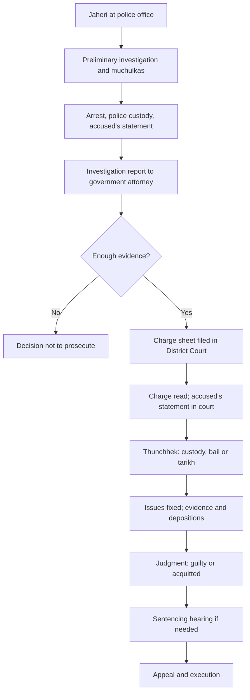

# Unit 4B: Criminal Proceedings and Kinds of Hearing

!!! abstract "In one line"
    This unit follows a criminal case from the first report of a crime (jaheri) to the judgment. On the way it covers investigation, the charge sheet, the accused's statement, custody and bail, notices and warrants, evidence, withdrawal and compromise. It also explains the three kinds of hearing: preliminary, merit (final) and sentencing.

## Why it matters for the exam

- **Asked as full 20-mark questions:** 2079 Q3 "Explain about the stages of hearing in criminal proceeding in details." and 2080 Q5 "Discuss the legal provisions related to jail and bail in detail."
- **Asked as a short note:** 2080 Q7(d) "sentencing hearing".
- A question from this unit came in both of the last two new-course papers. Learn the order of the stages, and the section numbers for custody and bail (Criminal Procedure Code ss 67-80). The civil side of Unit 4 is on a separate page, Unit 4A.
- Three full answers are written out below: the stages of hearing, jail and bail, and the road from jaheri to charge sheet.

## Key terms

| Term | Nepali | Plain meaning |
|---|---|---|
| First information report (jaheri) | जाहेरी दरखास्त | The first report of a crime, made to the police |
| Accused | अभियुक्त | The person charged with an offence |
| Investigating officer | अनुसन्धान अधिकारी | The police officer (or other officer) who investigates the offence |
| Government attorney | सरकारी वकिल | The state's lawyer, who decides whether to prosecute and argues the case |
| Police custody | हिरासत | Holding an arrested person during the investigation |
| Custody pending trial (thuna) | थुना | Holding the accused in jail while the court tries the case |
| Imprisonment | कैद | Jail as a punishment after conviction |
| Muchulka | मुचुल्का | A signed record of what was found at a scene, search or inspection |
| Statement | बयान | What the accused (or a party) says, recorded by the police or the court |
| Deposition | बकपत्र | A witness's evidence given in court |
| Charge sheet | अभियोगपत्र | The government attorney's document that starts a criminal case in court |
| Complaint | उजुरी | A case filed in court; it includes a charge sheet |
| Thunchhek | थुनछेक | The court's decision to hold the accused in custody or let him go on bail or on a date |
| Cash deposit (dharauti) | धरौट / धरौटी | Money deposited with the court as security that the accused will appear |
| Security (jamanat) | जमानत | Property, or a bank guarantee, pledged as security for appearance |
| Arrest warrant | पक्राउ पुर्जी | A written order to arrest a person and bring him to court |
| Summons | समाह्वान | A court notice telling a person to appear within a time limit |
| Trial | पुर्पक्ष | The court's handling of the case until judgment |
| Postponement (multavi) | मुलतबी | Putting a case on hold until something happens |
| Compromise (milapatra) | मिलापत्र | A written settlement made in court that ends the case |
| Judgment | फैसला | The court's reasoned final decision on the case |
| Final order | अन्तिम आदेश | An order that ends the case in that court without a full decision on the merits |
| Sentencing | सजाय निर्धारण | Fixing the punishment after a person is found guilty |

## Start here: what happens after a crime?

Imagine Hari's motorbike is stolen in Kathmandu. Here is what the law makes happen, step by step.

1. **Hari reports it.** He goes to the nearest police office and files a jaheri. The police register it and give him a receipt.
2. **The police investigate.** They visit the scene and record a muchulka. They search, collect evidence and question people. They arrest Ram, a suspect, and must bring him before a judge within 24 hours.
3. **The police take Ram's statement**, in front of a government attorney.
4. **The government attorney decides** whether there is enough evidence. If there is, he files a charge sheet in the District Court.
5. **The court hears Ram.** It reads the charge to him and records his statement. Then it decides the thunchhek question: should Ram stay in custody, give a deposit or security, or go home and come back on a fixed date (tarikh)?
6. **The court takes evidence.** Witnesses for each side give depositions, and the documents are checked.
7. **The court gives its judgment.** If Ram is guilty, it fixes his punishment, sometimes after a separate sentencing hearing.
8. **The losing side may appeal** to the High Court (Unit 6). The punishment is then carried out (Unit 8).

Each step has its own sections in the **Muluki Criminal Procedure Code 2074** (मुलुकी फौजदारी कार्यविधि संहिता, २०७४), which we call "the Code" on this page. It came into force on 1 Bhadra 2075, except s 192 (s 1(2)). The **Muluki Criminal Procedure Rules 2075**, made by the Supreme Court, fill in the details. Sentencing is governed by the **Criminal Offences (Sentencing and Execution) Act 2074**, which we call "the Sentencing Act".

!!! note "Which cases follow which route?"
    The Code sorts offences into four schedules (अनुसूची).

    - **Schedule 1:** offences under the Muluki Criminal Code 2074 that the police investigate and the Government of Nepal prosecutes, such as murder, theft and rape.
    - **Schedule 2:** other government cases, investigated by an officer named in another law or by the Chief District Officer (s 8(7)).
    - **Schedule 3:** cases that a government office, constitutional body, court or public official brings by complaint or report (s 43(1)(b)).
    - **Schedule 4:** cases a private person brings by a plaint (फिरादपत्र), such as incest (हाडनाता करणी) and other offences not in Schedules 1-3 (s 43(1)(c)).

    Schedule 1 and 2 cases are filed by the government attorney as a charge sheet (s 43(1)(a)). No one can prosecute them without a charge sheet (s 52(5)). The Government of Nepal is the plaintiff (वादी) in them (s 56). Most of this page is about these government cases.

The Code also sorts offences by seriousness, and many rules depend on it (s 2):

- a **serious offence** (गम्भीर कसूर) carries more than 3 and up to 10 years' imprisonment (s 2(g));
- a **heinous offence** (जघन्य कसूर) carries life imprisonment or more than 10 years (s 2(h)).

## 4.1 Kinds of hearing

### Meaning of "hearing"

A hearing (सुनुवाइ) is a sitting of the court where it listens to the parties before deciding something. Hearing both sides is the heart of natural justice: audi alteram partem, "hear the other side" (Unit 2). A criminal case is not heard at one sitting. It passes through several hearings, each with a different job.

The syllabus names three kinds: the **preliminary hearing**, the **merit (final) hearing** and the **sentencing hearing**. The Code itself names the first two among the tasks a judge must do personally: "holding the preliminary and pre-hearing discussion of the case" (मुद्दाको प्रारम्भिक र पूर्व सुनुवाइ छलफल गराउने, s 177(1)(h)). The judge must also personally hear the case (s 177(1)(g)) and give the judgment or final order (s 177(1)(j)). The Criminal Procedure Rules 2075 list the same stages in the calendar (कार्यतालिका) the court must draw up for every case (r 36(1)):

- issuing and serving warrants, summons and notices;
- the preliminary hearing (प्रारम्भिक सुनुवाइ);
- the pre-hearing discussion between plaintiff and defendant (वादी प्रतिवादीबीच पूर्व सुनुवाइ छलफल);
- taking witnesses and evidence;
- other proceedings; and
- the judgment.

The sentencing hearing comes from the Sentencing Act (s 9) and r 67 of the Rules.

### 4.1.1 Preliminary hearing

**Plain words.** The preliminary hearing is the first stage once the accused is before the court. The court does not yet decide guilt. It deals with the things that must be settled before a trial can go ahead.

The Code does not define "preliminary hearing" in one section. Reading the Code and Rules together, the early hearing covers these jobs.

1. **Checking and registering the charge sheet.** The registering officer checks that it has the contents the law requires, the listed evidence, and the accused (if in custody). He registers it only if the case is within the court's jurisdiction and time limit (Rules r 12).
2. **Reading the charge to the accused** and explaining the evidence and the possible punishment (s 121).
3. **Recording the accused's statement** (बयान) on the charge (s 122).
4. **Acting on a confession.** If the accused fully confesses and the confession is believable, the court may decide the case at once (s 123(1)). If the confession looks untrue, the court orders more evidence (s 123(1) proviso (a)).
5. **Deciding preliminary objections.** If the accused (in his statement) or the defendant (in his reply) says the court has no jurisdiction, the plaintiff has no standing (हकदैया), or the case is out of time (हदम्याद), the court must decide that first. Only then may the case go on (s 51(1)). An appeal against that decision lies within 30 days (s 51(2)).
6. **The thunchhek order.** The court decides whether the accused stays in custody for the trial (पुर्पक्षको लागि थुना), gives a deposit or security, or is released on a date (ss 67-69). This is explained under 4.3.6.

The District Court Rules 2075 add a short-cut (r 66, "disposal at the preliminary hearing stage"). A case may be finished on the day it first comes before the bench. This applies if it is out of time, the plaintiff has no standing or the court has no jurisdiction. It also applies if no more evidence needs to be taken.

!!! tip "Exam tip"
    In a criminal case the most important preliminary decision is the **thunchhek** order. It decides whether the accused spends the trial in jail or at home. Write ss 67-69 of the Code whenever you discuss the preliminary hearing.

In civil cases, the Muluki Civil Procedure Code 2074 has a separate chapter on the preliminary hearing (Ch 11, ss 131-133). There it deals only with standing, limitation and jurisdiction raised in the defendant's reply. See Unit 4A.

### 4.1.2 Merit (final) hearing

**Plain words.** The merit hearing (also called the final hearing) is where the court decides the real question: did the accused commit the offence? It is the trial in the full sense (पुर्पक्ष).

It has these steps under the Code:

1. **Pre-hearing discussion to fix the issues.** If the accused denies the charge, the court may order a discussion between the plaintiff and the defendant. Each side presents its claim, its defence and its evidence. From these, the court fixes the points it must decide (ठहर गर्नु पर्ने कुरा) (s 124).
2. **A date to take evidence.** The court records the issues and fixes a date to take evidence (s 125(1)). It should allow enough time for witnesses to come, but take the evidence as soon as possible (s 125(2)). If the prosecution asked for time to bring more evidence under s 123(2), the date is normally within two months of filing (s 125(3)). All the evidence should be taken at one time if possible (s 125(4)).
3. **Taking evidence in order.** Unless the court orders otherwise, the plaintiff's witnesses and evidence come first, then the defendant's (s 127(1)). The judge rules at once on any objection that evidence is inadmissible or irrelevant (s 127(2)). Irrelevant evidence is not allowed (s 127(3)).
4. **Open court.** The trial must be held in open court (खुला इजलास) (s 129). The exceptions are heard in camera (बन्द इजलास): espionage, human trafficking, sexual offences, cases with a child accused or victim, violence against women, rape, incest, cases between husband and wife, and any other case the court orders (s 129 proviso).
5. **A lawyer for the accused.** The accused may appoint a lawyer of his choice (s 130(1)). In an offence carrying life imprisonment or 10 years or more, if he has no lawyer, the court may order his defence by a lawyer it appoints (s 130(2)).
6. **Arguments and judgment.** The lawyers argue; the judgment must record the main points of their arguments (s 131(3)(b)). The judge normally gives judgment within one month after the evidence ends (s 131(1)).

For cases in a schedule to the Rules, once all the defendants are present (or their time to appear has run out), the court hears the case **continuously** (लगातार) until it is decided (Rules r 96). This is one of the recent trends in Unit 2.

### 4.1.3 Sentencing hearing

**Plain words.** Deciding that a person is guilty and deciding his punishment are two different jobs. For most offences, Nepal's law now makes them two different hearings. First the court convicts. Then, at a separate sentencing hearing, it hears both sides on the right punishment.

**Nepal's law: the Sentencing Act 2074.**

- **Sentence only after conviction** (s 8(1)). The court fixes a punishment only after the person has been found guilty according to law.
- **Exceptions** (s 8(1) proviso). The court fixes the sentence at the time of conviction for:
    - (a) an offence whose punishment the law fixes as a definite amount;
    - (b) an offence punishable by up to 3 years' imprisonment or a fine of up to Rs 30,000;
    - (c) an offence carrying life imprisonment where the judge, on a confession, proposes a lower punishment under s 145(1a) of the Code.
- **Time limit** (s 8(2)). The sentence must be fixed within 30 days of the conviction.
- **A separate hearing** (s 9(1)). The court fixes the sentence after a separate hearing (छुट्टै सुनुवाइ). No separate hearing is needed for the exceptions in s 8(1) proviso.
- **The same judge** (s 9(2)). The judge who convicted must hold the sentencing hearing. The only exceptions are that he has died, retired, been appointed to a higher court, is unable to work, has left office, or is seriously ill.
- **Open court, offender present** (s 10). Except in cases heard in camera, sentencing is in open court (s 10(1)). The offender or his lawyer must be present (s 10(2)). But sentencing may go ahead if security or public interest prevents bringing the offender, if he refuses to come, if he has absconded, or if his lawyer does not appear (s 10(3)). He may attend by video conference (s 10(4)).
- **A separate sentence for each offence** (s 11(1)). Where one act is an offence under different Acts, only the heavier Act's punishment is carried out, but a sentence must still be fixed for each offence (s 11(3)). Compare [Samir Khan v Kathmandu District Court](cases/9-8-samir-khan.md), where prison terms on three counts from one charge sheet were wrongly added up.
- **Pre-sentence report** (s 12). For an offence carrying more than 3 years' imprisonment or a fine of more than Rs 30,000, the court may order a probation or parole officer to prepare a pre-sentence report (सजाय पूर्वको प्रतिवेदन). It covers the offender's personal, social and cultural background, the circumstances of the offence, his past conduct and his age (s 12(2)). The government attorney, the offender and his lawyer get a copy and may comment (s 12(4)-(5)). If no such officer has been appointed, the court orders the two sides' lawyers to prepare it (s 12(6)).
- **Purposes of punishment** (s 13). The court considers any or all of these: deterring the offender and others; protecting society; justice and compensation for the victim; reforming and rehabilitating the offender; separating him from society; making him feel remorse; and condemning conduct the law forbids.
- **Principles** (s 14). The punishment must not be more than proportionate to the gravity of the offence and the offender's blame. It must not be harsher than needed. It must not be out of line with sentences given to others in similar cases. The total for several offences must stay fair. And prison is not to be used if another punishment is enough.
- **Factors** (s 15(1)). The gravity of the offence and the degree of blame; the circumstances; things that make the offence more or less serious (aggravating and mitigating circumstances); the offender's conduct and past; and the purposes in s 13.
- **Children** (s 16). The child's best interests and reform come first. A child under 16 may not be sent to prison except for a heinous or serious offence or repeated offending (s 16(2)).
- **Reasons** (s 17). The judgment or order must state why the punishment is given, and give details such as how and when a fine is to be paid.

**The Rules' procedure (r 67).**

- When the court convicts, it records the finding of guilt in the opinion book (राय किताब) (r 67(1)).
- If a separate sentencing hearing is needed under s 9 of the Sentencing Act, the court fixes another date within 30 days (r 67(2)).
- It writes a short summary of the conviction in the form in Schedule 22 and gives it to the government attorney's office, and to the accused if he is in custody (r 67(3)-(4)).
- The sentence is written in a separate opinion book (r 67(5)). The case is struck off the court's list only after the sentence is fixed (r 67(7)).
- Take an accused who was on bail or on a date during the trial. If he is convicted of an offence carrying more than 3 years, and a separate sentencing hearing is to be held, he is kept in custody until then (r 67(8)).

The Code connects to this. Where the judge announces only the decision first, "announcing the decision" means announcing it with the sentence fixed (s 131(6) explanation). Under the District Court Rules, a case listed for sentencing after conviction cannot be postponed (r 65(3)).

**Non-custodial punishments.** The Sentencing Act lets the court order community service instead of a prison term of up to six months (s 22). It may suspend a prison term of less than one year for a first offender (s 24). Section 29 allows parole after part of a term is served. But these sections, with ss 25-28, 30 and 31, come into force only from a date the Government of Nepal fixes by notice in the Nepal Gazette (s 1(2)).

!!! warning "Unverified"
    We did not check whether the Government has published the Gazette notice that brings ss 22 and 24-31 of the Sentencing Act into force.

**Why a separate sentencing hearing?** It lets the court look at the offender as a person, not only at the act. Evidence about his background, family, remorse and harm to the victim is often irrelevant to guilt, but central to punishment. A separate hearing also keeps such material from influencing the decision on guilt. Its weakness is delay: the convicted person may wait up to 30 days, and in serious cases he waits in custody (r 67(8)).

## 4.3 Criminal proceedings

The steps below follow the order in the syllabus. Each one gives the plain idea first, then today's law.

## 4.3.1 First information report (jaheri)

**Plain words.** A jaheri is the first report of a crime to the police. It is the starting point of almost every government criminal case. The person who gives it is the informant (जाहेरवाला).

**Duty to report** (s 4(1)). Anyone who learns that a Schedule 1 offence has been committed, is being committed, or is about to be committed must report it to the nearest police office as soon as possible. He must give the evidence he has or knows of. The report may be a written jaheri, oral information, or electronic information, in the form in Schedule 5.

**What the form asks** (Schedule 5). The informant's name, address and phone number; the law or offence concerned; the name, address and parents of the person who committed the offence; his description; the details of the offence; and a declaration that the contents are true.

**Recording and receipt.**

- If the report is oral or not in the right form, the police officer writes it into the Schedule 5 form, reads it out to the informant and has him sign it (s 4(2)).
- The police office registers the report and gives a receipt in the Schedule 6 form. If it came electronically, the police confirm receipt the same way (s 4(3)).
- If the police doubt a report sent by post or electronically, they may call the sender to confirm who he is (s 4(3a)).
- If the police learn of a Schedule 1 offence from another source or themselves, they must write a report with the Schedule 5 details (s 4(4)).
- Every jaheri, information or report is entered in a register in the Schedule 7 form (s 4(5)).

**Schedule 2 offences.** The information goes to the office or officer empowered to investigate (s 4(7)). If that is not possible at once, it may be given at the nearest police office, which must send it on within three days (s 4(9)-(10)).

**If the police refuse to register it** (s 5). The informant may complain to the District Government Attorney Office or to a higher police office (s 5(1)). That office keeps a record and sends the jaheri to the police office for action, which must then register it (s 5(2)-(3)). For a Schedule 2 offence, the complaint goes to the Chief District Officer, or to the Ministry of Home Affairs if the CDO is himself the investigator. They decide within three days (s 5(4)-(5)).

**What happens next.**

- The police must act at once to stop the offence, keep evidence from being destroyed, and stop the offender from escaping (s 6(1)).
- They must start a **preliminary investigation** at once and send its report to the District Government Attorney Office within three days (s 10(1)-(2)). "Preliminary investigation" means the scene report, the muchulkas of the scene, search or recovery, the corpse examination in a death case, and similar reports (s 10 explanation).
- If, after asking the informant and others, the report looks misleading, false or imaginary, the police report this to the government attorney's office, normally within three days (s 11(1)). The office may shelve it (तामेलीमा राख्ने) until more evidence appears, or order further investigation (s 11(2)).

**No punishment for honest reporting.** No one is punished just for reporting or complaining in Schedule 1-3 cases (s 44(1)). But a witness who gives false evidence may be punished, and may have to compensate an acquitted defendant (s 44(2)).

**Why it matters.** The jaheri fixes the first account of the crime, made when memories are fresh. Courts compare later statements with it. A delayed or changed jaheri can weaken the prosecution. In [Pasang Dawa Tamang v HMG](cases/9-5-pasang-dawa-tamang.md), the jaheri of 2047/6/20 described events that began on 2042/1/1, before the trafficking Act of 2043 came into force. So the courts later had to decide which law applied.

## 4.3.2 Statement of the accused (to the police)

### Arrest and police custody

Before the accused gives a statement, he is usually arrested and held.

- **Arrest.** The police or investigating officer may arrest a person connected with the offence who is found, or caught in the act (s 9(1)). To arrest someone during the investigation, they must ask the case-hearing authority (मुद्दा हेर्ने अधिकारी) for permission to issue an arrest warrant, giving reasons (s 9(2)-(3)). If the person may escape or destroy evidence, they may issue an urgent warrant (जरुरी पक्राउ पुर्जी), arrest him, and then seek approval (s 9(6)). Before arresting, they must explain the reason and ask him to surrender (s 9(9)). A woman should, as far as possible, be arrested by a policewoman (s 9(11)).
- **Holding in custody (हिरासत).** An arrested person is held only after he is given a detention slip in the Schedule 10 form, stating where he was arrested and why he is held (s 13(2)). If he wants to consult a lawyer, he must be allowed to (s 13(6)).
- **24 hours.** He must be brought before the case-hearing authority as soon as possible, within 24 hours of arrest (s 14(1)). Travel time is not counted (s 14 explanation). The case-hearing authority includes the court nearest to the place where he is held (s 2(n)).
- **Longer custody.** To keep him longer, the investigating officer must apply through the government attorney's office, giving reasons (s 14(3)-(4)). If satisfied, the authority may allow custody for up to 25 days in all, at one time or in instalments (s 14(6)). For some grave offences, such as an attack on the President, espionage, offences with explosives, kidnapping and hostage-taking, it may allow up to 15 more days (s 14(7)-(8)). But no one may be held longer than the maximum prison term for the offence charged (s 14(8) proviso).
- **Release during investigation.** If custody is not needed, the investigating officer may release the person on a deposit or security, on a guarantee (jamani) by a responsible person (हाजिर जमानी), or on a date, with the government attorney's consent (s 15(1)). A guarantor who fails to produce him may be fined up to Rs 50,000 (s 15(4)).
- **The Constitution.** Article 20 of the Constitution of Nepal 2015 gives the same protection at a higher level. An arrested person must be told why (Art 20(1)), may consult a lawyer from the time of arrest (Art 20(2)), and must be produced before the adjudicating authority within 24 hours (Art 20(3)). No one may be tortured in custody (Art 22(1)).

### The statement itself

**Plain words.** The statement (बयान) is the accused's own account of the charge, recorded during the investigation.

- **Before the government attorney.** For Schedule 1 and 2 offences, the investigating officer takes the accused's statement in front of the government attorney (सरकारी वकिल समक्ष) (s 16(1)). The government attorney may ask questions needed to bring out the facts (s 16(2)).
- **Others may be questioned.** The officer may question anyone believed to know something important (s 16(3)), and record it in the Schedule 11 form (s 16(4)). Children or persons with a physical disability are questioned where they live, with a guardian present (s 16(3) proviso, (5)). Statements may be taken by video conference if the person is ill or unsafe (s 16(6)).
- **Duty to answer, but no self-incrimination.** Everyone must answer questions as far as he knows and cooperate (s 17). But no one can be forced to give an answer that could lead to a charge against himself (s 17 proviso). The Constitution says the same: no accused shall be compelled to testify against himself (Art 20(7)).

**How much is it worth in court?** A statement the accused made outside court can be used as evidence against him only if the court finds three things (Evidence Act 2031 s 9(2)(a)):

1. he was conscious and able to understand what he said and did;
2. he was not forced, tortured or threatened with torture, or put in a position to speak against his will; and
3. no public officer had made threats or promises that made a false statement likely.

So a confession to the police is never automatically proof. In court the accused may say something different. If he does, the prosecution may ask to investigate again and bring more evidence (s 123(2)). The judgment cannot be given until that evidence is in (s 123(3)).

**Reduced punishment for cooperation** (s 33). An accused who helps the investigation may be offered a lighter sentence. The government attorney may file the charge sheet proposing:

- up to **25% off** the punishment if the accused fully admits the offence before the investigating officer or government attorney (s 33(3)(a));
- up to **50% off** if he also helps catch the other offenders or the ringleader, reveals the details, or helps recover the vehicles, tools or weapons used (s 33(3)(b)).

The offer is not available to someone who has used it once before, who finished a prison term less than three years ago, or who was punished before for the same offence (s 33(5)). If the accused later changes his story in court, denies the offence, or does not cooperate, he loses the benefit, and the government attorney asks for a higher punishment (s 33(6)-(7)). If the reduction stands and he is convicted, the court must give it (Rules r 19). This is the nearest thing in Nepal to plea bargaining.

## 4.3.3 Spot investigation report and muchulka

**Plain words.** A muchulka is a written record of what officials saw or found, signed by local people who were present. The most important is the **spot muchulka** (घटनास्थल मुचुल्का), the record of the crime scene.

**Securing the scene.** When the police find evidence at the scene, they take it into custody in front of people present who saw the offence, and draw up a muchulka (s 6(7)). Until the muchulka is complete, the place must be kept as it is (s 6(8)).

**Contents of the spot muchulka** (s 8(2)). As far as possible, it must give a true picture of the offence and the place, including:

- (a) the date and time of the offence;
- (b) the address and description of the place, with a sketch map;
- (c) the condition of the place and its link with the offence or offender; and
- (d) the evidence seen or found there or nearby, and anything else important.

**Photos and fingerprints.** The officer may cordon off the place and photograph fingerprints, footprints, marks and other evidence (s 8(3)). If the offender or suspect is present, his fingerprints must be taken (s 8(4)). Evidence found is taken into custody, and a receipt given (s 8(5)-(6)).

**Who must be present** (s 19). When preparing a spot muchulka, a search muchulka, a corpse examination muchulka or any other muchulka, the officer must have present:

- at least two local people;
- one member of the local level (a rural municipality or municipality), or if none is available, one government employee; and
- the accused and the informant, if found.

A muchulka is not invalid only because the accused or informant was not present (s 19(2) proviso). The owner or occupier must be present at a search of his place, if available (s 19(3)).

**Other kinds of muchulka.**

| Muchulka | Section | What it records |
|---|---|---|
| Search (खानतलासी) | s 18(3), (6) | The search of a person or place, in the Schedule 13 form; two copies, one to the person searched |
| Recovery (बरामदी) | s 9(7) proviso | Things found when an arrested person or his place is searched at once |
| Corpse examination (लाश जाँच) | s 20(2) | The body's identity, position, wounds and other signs, with photos, in the Schedule 14 form |
| Identification (सनाखत) | s 24(5) | Identification of exhibits or objects by witnesses |

**Other evidence at this stage.** The body goes for a post-mortem at government cost (s 20(3)). Blood, semen, hair, DNA and other physical evidence go to a laboratory (s 21). Injuries are examined by a government doctor (s 22). Experts may be consulted (s 23). An identification parade uses at least four people who look like the suspect (s 24(2)). The officer keeps a case diary (अनुसन्धान डायरी) of every step (s 25).

**Why it matters.** Muchulkas are the record of the investigation. Because ordinary local people sign them, they are meant to be hard to fake. In [Pasang Dawa Tamang v HMG](cases/9-5-pasang-dawa-tamang.md), a muchulka of a local inquiry (सर्जमिन मुचुल्का) recorded what local people said. Another muchulka, of 2048/12/11, recorded the absent accused's property. That was under the old Muluki Ain.

## 4.3.4 Filing of charge sheets and complaints

### The investigation report

When the investigation is complete, the investigating officer sends an investigation report (अनुसन्धान प्रतिवेदन) to the government attorney's office in the Schedule 19 form (s 31(1)). It says either that there is enough evidence against named persons, and under which law, or that no offence was found or the offender is unknown. It comes with the original file and the evidence.

- **Timing** (s 31(2)). If no one is in custody, it goes at least 15 days before the limitation period (हदम्याद) for the offence runs out. If someone is in custody, it goes normally at least three days before the case is to be filed.
- **Deciding whether to prosecute** (s 31(3)). The government attorney studies the file and sends it to the Attorney General (महान्यायाधिवक्ता) for the decision, or decides himself if that power has been delegated to him.
- **Further investigation** (s 31(4)-(5)). The government attorney may order more evidence or more questioning. The officer must finish it within 15 days.
- **New evidence later** (s 31(8)). If the case was dropped for lack of evidence and important evidence turns up later, the matter may be reinvestigated and a charge sheet filed.

### The charge sheet

If there is enough evidence, the government attorney prepares a charge sheet (अभियोगपत्र) in the Schedule 20 form and files it in the court within the time limit (s 32(1)). It must state, among other things:

- the accused's full name, address, description, age and occupation, and his parents' or spouse's names (s 32(1)(a)-(c));
- identity details, a photo, copies of his citizenship or other papers, and his fingerprints (s 32(1)(d)-(e));
- the information about the offence and the details of the offence (s 32(1)(g)-(h));
- the evidence that proves it (s 32(1)(i));
- the charge, its grounds and reasons (s 32(1)(j));
- the property and details of an absconding accused (s 32(1)(j1));
- the law to be applied, and the punishment sought with reasons (s 32(1)(k)-(l)); and
- any compensation for the victim (s 32(1)(m)).

The evidence, exhibits and the accused (if in custody) are presented with it, and in a rape case the victim too, as far as possible (s 32(2)). If the victim is present, her deposition is taken at once and the defendant may cross-examine (s 32(2a)). The offence must be named as the law names it, or clearly enough for the accused to understand (s 32(3)-(4)). Earlier convictions that may raise the punishment must be stated (s 32(5)).

The court's registering officer checks the charge sheet against these rules before registering it (Rules r 12). The government attorney must give a copy of the charge sheet, or of the decision not to prosecute, to the investigating officer and the accused (s 40(1)).

### After filing

- **Additional claim** (s 35). If new evidence shows that others were involved, or the accused committed more, the government attorney may file an additional claim after further investigation.
- **Amending the charge sheet** (s 36). With the Attorney General's approval, the government attorney may apply to amend the claim, but the court's order must come before its judgment.
- **Minor errors** (s 37). Spelling, typing or printing errors in the accused's name, age or address may be corrected by the court's order.

### Decision not to prosecute

- The informant or victim must be told the decision and the reasons (s 41).
- If the offence involved loss of private property, the victim is told, and may file a case as if it were a Schedule 4 case (s 32(6)-(7)).
- **Petty offences** (s 34). For first-time pickpocketing of up to Rs 1,000, first-time begging, and other first offences carrying up to Rs 3,000 fine or one month's prison, the government attorney may decide not to prosecute, with the Attorney General's approval (s 34(1), (3)). The accused gives an undertaking not to repeat it (s 34(2)), and what was taken is confiscated (s 34(4)). A victim unhappy with that decision may file the case himself (s 34(7)).

### Complaints in other cases

- **Schedule 3 cases** are filed as a complaint or report by the Government, a constitutional body, a court or a public official (s 43(1)(b)). The bench orders whether to register it as a case and, if so, summons the accused to give a statement or a written reply within up to 15 days plus travel time (Rules r 25(1)-(4)).
- **Schedule 4 cases** are filed by a person with standing (s 53(1)). Examples are the victim, a close relative of a public servant posted away, and a guardian of a child or of a person unable to act. The head of an organisation that suffered loss may also file. The complaint gives the defendant's details, each charge with its evidence, the law, the punishment sought and any compensation, in the Schedule 21 form (s 53(2)). Copies go with it for each defendant (s 53(3)).
- **Compensation complaint.** Even in a government case, the victim and certain others may file a separate complaint for compensation within the time s 52(6) allows after the charge sheet is filed.

**Jurisdiction and defects.** The case is heard by the court of the area where the offence happened (s 45), with special rules for offences spread over several areas (s 46). If the court lacks jurisdiction, or the document is not in proper form, the court returns it with a note (दरपीठ) (s 50(1)). If returned for lack of jurisdiction, and the limitation period had not run out on the day it was returned, it may be filed in the right court within 15 days, plus travel time (s 50(2)).

## 4.3.5 Statement of the accused in court

**Plain words.** The accused's statement in court is his answer to the charge, given to the judge personally. It is the most important early step in the trial.

**The charge is read first** (s 121). When the accused appears, the court explains the charge, the facts, the evidence filed to prove it, and the punishment he may get. It reads out the claim in the charge sheet (s 121(1)). If he wants to see the evidence or get copies, he must be allowed to (s 121(2)).

**Recording the statement** (s 122).

- The court records what the accused says about the charge (s 122(1)).
- Before that, he may consult a lawyer if he wants (s 122(2)).
- The court must tell him that he cannot be forced to give a statement against himself, and that what he says may be used as evidence against him (s 122(3)).
- If the government attorney has proposed a reduced punishment under s 33, the court tells him that too (s 122(4)).
- Each question and answer is written down; a video-conference statement is recorded (s 122(5)). The accused signs it, and so does the judge (s 122(6)).
- If something was missed, the court may call him for a supplementary statement (तत्तिम्बा बयान) (s 122(7)).
- Only the judge may take the statement (s 177(1)(a)). If the judge is absent, the most senior employee present may take it, but the judge must review it on his return (s 177(2)(b)).
- In a Schedule 4 case, the defendant files a written reply (प्रतिउत्तरपत्र) in the Schedule 42 form within the time in the summons (s 122(8)).

**Co-accused.** If one accused blames another (पोल), the court reads that part to the other before his own statement (Rules r 55). The other may cross-examine on it (s 103; Rules r 56).

**What happens after the statement.**

| The accused... | The court... |
|---|---|
| fully confesses (साबिती), and it is believable | may decide the case at once (s 123(1)) |
| confesses, but the evidence suggests the confession is untrue | orders more evidence (s 123(1) proviso (a)) |
| confesses but claims a lighter punishment | records his statement and takes evidence on that claim (s 123(1) proviso (b)) |
| confesses in part | takes evidence on the part denied (s 123(4)) |
| says something different from his statement to the police | may let the prosecution bring more evidence (s 123(2)) |
| denies the charge, or refuses to give a statement | orders the pre-hearing discussion and fixes a date for evidence (ss 124-125) |

Then the court decides the thunchhek question (4.3.6).

## 4.3.6 Bail application and the court's order (thunchhek)

**Plain words.** After the accused's statement, the court must decide where he will be during the trial. There are three possibilities:

1. **custody (thuna)** for the trial (पुर्पक्षको लागि थुना);
2. release on **bail**: a cash deposit (dharauti, धरौट), security in property (जमानत), or a bank guarantee (बैङ्क जमानत); or
3. release **on a date (tarikh)**, with no money, promising to come back on each fixed date.

This decision is called **thunchhek** (थुनछेक), literally "custody or release". Chapter 7 of the Code, ss 67-80, is headed "Thunchhek, deposit and security" (थुनछेक, धरौट तथा जमानत सम्बन्धी व्यवस्था). The Code does not use the English word "bail", and there is no formal "bail application" form in the Code. The accused or his lawyer argues the point at the thunchhek hearing, and may apply later under ss 71-73.

### When custody is the rule (s 67(1))

The court **must** hold the accused in custody for the trial, giving reasons, if the evidence then available shows him guilty, or there is reasonable ground to believe he is guilty, of:

- (a) an offence carrying life imprisonment;
- (b) a Schedule 1 or 2 offence carrying more than 3 years' imprisonment; or
- (c) an attempt, abetment or conspiracy to commit those offences, or being an accomplice in them.

### When custody is allowed (s 67(2))

For any offence punishable with imprisonment, the court **may** hold the accused in custody if:

- (a) he has confessed in court and, on the facts and evidence, custody looks proper;
- (b) the offence carries one year or more, he has no permanent home in Nepal, and he may run away and not be caught again;
- (c) he was arrested on a warrant after not appearing in time, and cannot give a good reason; or
- (d) he was sentenced to prison for another offence within the three years before this charge.

### Humanitarian exception (s 67(3))

Some accused may be released on a deposit or security: a child, a person incapacitated by physical or mental illness, a woman more than seven months pregnant, or a person over 75. This does not apply to offences carrying more than 10 years.

### Bail in other cases (ss 68-69)

- Outside s 67, if there is reasonable ground that the charge may be proved, the court may take a **deposit, security or bank guarantee** and release the accused on a date (s 68(1)). A bank guarantee must be unconditional and renewable for the period the court fixes (s 68(1) proviso).
- If he does not give it, he is held in custody (s 68(2)). If he later gives it, he must be released at once and kept on a date (Rules r 31).
- In all other cases, the accused is simply **released on a date** (तारिखमा राख्ने) for the trial (s 69).

### How much? (s 72)

The court fixes the amount reasonably, considering (s 72(1)):

- the nature and gravity of the offence;
- the accused's financial and family situation;
- his age and physical condition;
- whether he has been convicted before;
- whether he committed several offences in one incident;
- the punishment and compensation he may face;
- the consequences of the offence;
- whether he has confessed; and
- whether the accused is a helpless or disabled person, or a pregnant woman or a woman with a breast-feeding child.

### The papers (s 74)

- For a deposit, the accused signs a deed (Schedule 29) agreeing that the deposit is forfeited if he does not appear (s 74(1)).
- For security, the court fixes the amount and takes property of that value (s 74(2)). The giver signs a deed (Schedule 30) allowing recovery from that or his other property (s 74(3)). A third person who pledges his property signs a deed in the Schedule 31 form (s 74(4)). If the property loses value, the giver must top it up (s 74(5)).
- For this chapter, "security" (jamanat) includes a bank guarantee (s 74 explanation).

### Changing the order

- **At any stage** the court may order custody or ask for bail as the evidence develops. Not having done so at the start is no bar (s 71(1)).
- If grounds appear that the accused may be innocent, the court may release him from custody after a hearing, at any stage (s 71(2)).
- If the amount proves too little, the court may ask for more; if he cannot give it, he may be held (s 70).
- **Appeal against the order** (s 73). A party unhappy with a thunchhek order or the amount may apply to the court that hears appeals, one level up. For offences carrying life or 10 years or more, he may go one level further on the question whether the thunchhek order was irregular (s 73 proviso). The appeal court may raise, lower or change the amount (s 72(2)).

### Limits on custody pending trial

- **One-year rule** (s 77(1)). If the case is not decided within one year of the first date fixed for evidence, the accused held in custody may be released on a deposit or security. This does not apply to an accused held under s 67 for an offence carrying life or 10 years or more. A repeat offender may be kept in custody if the court thinks fit. The court must tell the appeal court within three days of such a release (s 77(2)).
- **Never longer than the punishment** (s 78). No accused may be held longer than the maximum prison term for the offence charged.
- **Reasoned order** (s 79). Every order to hold, release, take bail, or change bail must be a written order with reasons.
- **Detention slip** (s 80). Anyone held must be given a detention slip in the Schedule 32 form, stating the legal ground and reason.
- **Judge personally** (s 177(1)(c)). Only the judge orders custody or bail, except in his absence (s 177(2)(b)).

### Forfeiture and refund

- If the accused does not appear on the fixed date, the deposit is forfeited (s 75(1)). If it was immovable property, enough is sold to recover the amount, and the rest returned (s 75(2)).
- If the court later orders custody, the earlier deposit or security is released first (s 76(1)).
- If the accused is acquitted (सफाइ), the deposit or security is returned at once (s 76(2)).

!!! tip "Exam tip"
    Make the three-way table: s 67 (custody), s 68 (deposit, security or bank guarantee), s 69 (tarikh). Then add s 72 (amount), s 73 (appeal), s 77 (one-year rule), s 78 (maximum). That alone earns most of the marks on bail.

## 4.3.7 Notice to the defendant and the accused

**Plain words.** No one may be tried without being told. A notice tells the accused or defendant that a case has been filed and when to come. This is the "hear the other side" rule of natural justice in practice. The Constitution says every person has the right to be informed of proceedings against him (Art 20(8)).

**Two kinds of process** (s 57). After a complaint is filed, the court brings an absent accused by an **arrest warrant** (पक्राउ पुर्जी) or a **summons** (समाह्वान).

- A warrant must be issued for a heinous or serious offence, or an attempt, abetment, conspiracy or accomplice in one, or for hiding such an accused (s 57(2)).
- For other offences, a summons is issued (s 57(3)). But the court may issue a warrant if he may run away or did not appear within the summons period (s 57(3) proviso).
- With either, the court sends a notice that sets out the complaint, in the Schedule 22 form (s 57(7)).
- The Rules require the order to issue it on the day the charge sheet or plaint is registered, and the papers to go for service within three days (Rules r 26(1)-(2)).

**Summons** (s 59).

- A summons gives 21 days, plus travel time, to appear (s 59(1)). Schedule 26 is the form for most cases, Schedule 27 for Schedule 4 cases (s 59(2)).
- If the person could not come in time, the court may extend it once by up to 15 days (s 59(3)). If he does not appear, a warrant may follow (s 59(5)).
- If something beyond his control stopped him, the court may extend it by up to 15 days. The Code lists what counts: a death in the family, childbirth, floods, landslides or curfew, an earthquake, kidnapping, or being in hospital (s 59(5) explanation).

**Serving the summons** (ss 61-62).

- It is served by police, a court employee or another government office, with three copies (s 61(1)).
- It is given to the person himself if possible (s 61(2)), or to an adult (at least 18) of his household (s 61(3)).
- If no one is found or no one accepts it, it is pasted on his door in front of a ward member and two local people. A copy goes to the ward office, which pastes it on its notice board (s 61(4)-(5)).
- If it still cannot be served, the court may publish it in a national daily owned by the Government, or broadcast it, and it then counts as properly served (s 62).
- A summons may also be served in court on someone who is there anyway, such as a party on another date, a lawyer or a witness (s 66).

**In Schedule 4 cases** the defendant is summoned and must file a written reply (प्रतिउत्तरपत्र) within the time given (s 122(8)). Witnesses are summoned in the Schedule 28 form (s 60).

**Notice of the judgment** (s 132). An accused who did not take part from the start, who is in custody, or whose case was heard ex parte gets a notice of the judgment in the Schedule 44 form (s 132(1)). It is served like a summons, or published in a national daily (s 132(2)). The government attorney's office is told of the judgment in Schedule 1-3 cases (s 132(4)). The time to appeal runs from the day the party learns of the judgment (s 134(1)).

## 4.3.8 Collection of evidence

**Plain words.** Evidence is collected twice: first by the investigator before the case is filed, then by the court during the trial. The court decides only on evidence that has been properly put before it.

**The burden of proof.** In a criminal case, the burden of proving the accused's offence lies on the plaintiff (वादी), that is, the prosecution (Evidence Act 2031 s 25). The accused is presumed innocent until proved guilty (Constitution Art 20(5)). Some special Acts reverse this. In [Pasang Dawa Tamang v HMG](cases/9-5-pasang-dawa-tamang.md), the accused had to disprove the victim's statement under s 7 of the old trafficking Act of 2043. Today s 9 of the Human Trafficking and Transportation (Control) Act 2064 keeps a reverse burden (see the case brief).

**During investigation** (Chapter 2 of the Code). The investigating officer must collect evidence (s 8(1)), prepare muchulkas (ss 8, 19), search (s 18), examine bodies (s 20), test physical evidence (s 21), have injuries examined (s 22), consult experts (s 23), and hold identification parades (s 24). All investigation into one incident must be done together (s 8(9)). The evidence and the accused stay under the officer's control and go to court when the government attorney says (s 38(1)). Evidence found after filing goes to court through the government attorney's office (s 38(2)).

**In court** (Chapter 11 of the Code).

- **Everything up front** (s 99). The plaintiff must list all his witnesses, documents and exhibits in the complaint, the accused in his statement, and the defendant in his reply (s 99(1)). Documents in his possession must be filed with them (s 99(2)). The accused or defendant may get one more date, up to one month, for evidence he could not produce at once (s 99(3)(a)). New evidence to support or rebut a new fact may be filed with the court's leave (s 99(3)(c)).
- **Original documents** are checked against copies and returned (s 100).
- **Witnesses** are brought by the party on the date the court fixes (s 101(1)). In Schedule 1 and 2 cases, the investigating officer brings the government's witnesses through the government attorney's office (s 101(3)).
- **Genuine or forged?** Each side is shown the other's documents and must say whether each is genuine or forged (सद्दे, किर्ते वा जालसाजी). The court may send a disputed document to an expert (s 104).
- **Witnesses far away** may be examined by written questions sent to another court (बन्दसवाल) (s 107), by the judge visiting a witness who cannot travel (s 108(1) proviso), or by video conference (s 109). Witnesses abroad are examined under the mutual legal assistance law (s 115).
- **An essential witness who does not come** may be summoned for up to 15 days (s 112(2)). If he still does not come, the court may fine him up to Rs 2,000 and issue a warrant (s 112(4)).
- **Experts** who cannot be examined may be replaced by an equal or higher expert (s 102).

## 4.3.9 Statements of parties and witnesses

**Plain words.** In a criminal trial, two kinds of oral evidence matter most: the **statements** (बयान) of the accused and parties, and the **depositions** (बकपत्र) of witnesses.

**Statements of parties.** The accused's statement is covered in 4.3.5. A party may also give a statement when he says whether a document is genuine or forged (s 104(1), (4)-(5)). The court may record any party's answers on a point it needs to ask about (Rules r 89).

**Depositions of witnesses.**

- **All on the day.** On the date fixed, the court takes the deposition of every witness present. If time runs out, the rest are heard the next day the court sits (s 106(1); Rules r 54(2)-(4)).
- **Oath.** Before deposing, the witness declares aloud that he will speak only the truth, in the Schedule 37 form (s 106(2)). The deposition is recorded in the Schedule 38 form (s 106(3)).
- **Before the judge.** Depositions are taken in the judge's bench (इजलास) (s 108(1)). Only the judge takes them and administers the oath (s 177(1)(a)-(b)), although a senior employee may write them down under his direction (s 177(2)(a)).
- **Cross-examination** (जिरह). The other side may cross-examine (see, for example, ss 101(7), 107(5) and 109(4)). A co-accused blamed by another accused may cross-examine him (s 103).
- **Demeanour.** The judge may note how the witness behaved: whether he was agitated, stammered or looked afraid, and whether his face suggested truth or lies. The judge signs the note, and it may be used in weighing the evidence (s 110).
- **Fair questioning.** The court must stop improper, irrelevant, insulting or confusing questions (Rules r 54(6)). If a witness is under pressure because the accused is present, the court may keep the accused out of sight, with his lawyer present (Rules r 54(7)).
- **No second turn.** A witness who has deposed is not examined again, unless the judge orders it, giving reasons, because something essential was missed (s 111).
- **Witness protection.** A witness who fears for his safety may ask the court for protection, and the court may order it (s 114(1)-(2)). The police must protect a victim or witness who reports threats (s 114(5)). The identity of a victim or witness may be kept secret (s 183).
- **Witness costs.** Government witnesses get daily and travel allowances, and security (s 113).

## 4.3.10 Warrant, notice and postponement

### Arrest warrant (पक्राउ पुर्जी)

**Issue** (s 58(1)-(3)). The warrant states the person's full name, address and the reason for arrest. The form is Schedule 23 for an accused and Schedule 24 for a witness or other person. It is signed and sealed, and normally addressed to the police of the area where the person lives, or to a court employee.

**Execution.**

- The warrant stays valid until it is executed or cancelled (s 58(4)).
- The person arrested is shown the warrant and given the notice of the complaint (s 58(5)), and brought to court within 24 hours, plus travel time (s 58(6)).
- If the police cannot find him within seven days, they leave a 35-day warrant (पैँतीस दिने पक्राउ पुर्जी) with an adult of his household (s 58(7)). If no one takes it, it is pasted on his door before witnesses and a copy left with the ward office (s 58(8)-(10)).
- If he comes to court himself before he is caught, the court hears whether he should be held, and cancels the warrant (s 58(11)).
- If he absconds, the court may publish a notice with his description in a national daily owned by the Government (s 58(13)). He is then taken to have been properly notified, and any police officer may arrest him at any time (s 58(14)). The court may then freeze his property (s 58(15)), which is released when he appears (s 58(19)).

**An absconding accused** (s 65). From the day after the 35-day period ends, until he appears:

- if he holds a public post, he is automatically suspended;
- his immovable property is frozen;
- renewals of his firms and licences stop;
- his securities, salary, pension and royalties are frozen;
- his bank account may be frozen; and
- he cannot get a citizenship certificate, passport or land ownership certificate.

If he is abroad, extradition may be sought (s 65(1)(i)).

**Warrants for absent parties** (s 87). An accused who misses a fixed date may be arrested on a warrant, and his property frozen.

### Notice and tarikh

Notices are covered in 4.3.7. Once the accused is in court and not in custody, he is kept on **tarikh**: a fixed date to come back (ss 81-88).

- The court fixes each date for a stated purpose and writes it in the date slip (तारिख पर्चा) (s 81(1), s 83). If the work cannot be done on that day, it records why and fixes another date (s 81(2) proviso).
- The court keeps a date book, and the parties sign a date receipt (तारिख भरपाई) (s 82(1)-(2)). In cases where the Government of Nepal is the plaintiff, it need not attend on dates (s 82(4)).
- Dates should suit the parties and follow the case calendar (s 84).
- A party must appear on the fixed date (s 85(1)). If something beyond his control stopped him, the court may restore the missed date, for up to 21 days, at most twice (s 85(1) proviso). A party held in another case informs the court through the prison, and the time is not counted against him (s 85(2)-(3)).
- If a party misses the date and the next one, the court decides the case on the evidence on file (s 86(3)). Once the accused has given his statement, the court may decide the case even if he stops coming (s 86(4)).
- After the evidence is taken, a party may ask to be excused from attending dates (s 88).

### Postponement (multavi)

**Plain words.** Multavi is putting a case on hold. The Code allows it in three situations.

1. **A linked case** (s 97). If one case cannot or should not be decided before another case in a different court, because the result of one will materially affect the other, the court may postpone it, giving reasons (s 97(1)). It tells the parties and the other court (s 97(2)). When the other case is decided, that court sends a copy of the judgment within 30 days, and the postponed case is revived (s 97(3)). If the reason for postponing ends, the case is revived at once (s 97(3a)). Disputes between two courts go to the appeal court, or to the Supreme Court if they have different appeal courts (s 97(5)-(8)).
2. **An absent accused** (s 98). If an accused for whom a warrant was issued under s 57 does not appear within 35 days of the warrant, the court postpones the case against him. It decides the case against the other accused (s 98(1)). But there is no postponement:
    - if the absent accused had already given his statement or reply (s 98(1) proviso (a)); or
    - if the offence carries 3 years or less; the court decides the case against him too (s 98(1) proviso (b)).

    If he appears before the case ends, it is revived (s 98(3)). If he has not appeared within three years, the court revives the case and decides it anyway (s 98(4)). If he is convicted, his frozen property may be auctioned to pay the fine, compensation or claimed amount (s 98(5)). If he shows he never knew of the case, his property is released after costs (s 98(6)).
3. **Unsound mind** (s 128(2)). If a medical examination shows the accused cannot defend himself because of mental illness, the case against him is postponed until he recovers (s 128(7)).

The Rules set out how postponed cases are recorded and revived (Rules r 39).

!!! note "Case: Pasang Dawa Tamang (old law)"
    In [Pasang Dawa Tamang v HMG](cases/9-5-pasang-dawa-tamang.md), the police asked the court for a warrant under Adalati Bandobasta No. 94 because the accused had run away. A warrant was served, but he did not appear. On 2048/8/16 the court froze his share of the family property and put the case on hold (multavi) under No. 190 until he appeared. Today the warrant is under s 57 of the Code. The hold is under s 98, and the freeze under s 58(15).

## 4.3.11 Withdrawal of cases and compromise

### Withdrawal by the Government (s 116)

- **General rule.** A Schedule 1 or 2 case, once filed, cannot be withdrawn (s 116(1)).
- **Exception.** The Government of Nepal may withdraw other cases (s 116(2)). But it may never withdraw cases of the kinds listed, including:
    - fake passports or citizenship, corruption, human trafficking, drug trafficking, illegal hunting of wildlife, money laundering and ancient monuments;
    - murder by poison, or in a cruel or inhuman way;
    - offences under listed sections of the Criminal Code; and
    - cases where withdrawal would harm someone's property rights without his consent (s 116(2)(a)-(c)).
- **Procedure.** The Government makes a directive with criteria (s 116(3)). It decides after consulting the Attorney General (s 116(4)). The Attorney General or a government attorney files an application with reasons (s 116(5)). The court must hold a hearing (s 116(6)), and orders withdrawal only if it thinks it proper, giving reasons (s 116(7)).
- **Not on appeal.** A case pending on appeal, confirmation (साधक), review or rehearing cannot be withdrawn (s 116(8)).
- **Effect.** Once a case is withdrawn, the accused cannot be prosecuted again for that offence (s 119(1)).

### Withdrawal of a claim in other cases (s 116a)

In cases where the Government is not the plaintiff, a party may withdraw his complaint, appeal or petition at any time before judgment (s 116a(1)). The court must allow it and strike the case off its list (s 116a(2)-(3)). He cannot complain again on the same matter against the same person (s 116a(4)).

### Compromise (milapatra) (ss 117-119)

- **Which cases.** Cases on Schedule 3 and 4 offences may be compromised at any stage, with the parties' consent (s 117(1)).
- **Special list.** In some government cases, the accused and the victim may jointly apply to the government attorney. These are cases of public fraud, improper transactions, loss or damage to members of the public's property, banking offences from dishonoured cheques, criminal breach of trust or criminal gain, and foreign employment. The Attorney General may then order a compromise at any level, even during execution of the judgment (s 117(2)). The records of punishment, fine or fee in the judgment are then cancelled (s 117(3)).
- **Procedure** (s 118). Both parties sign a joint application, keeping within the plaintiff's claim (s 118(1)). The court reads it out and asks whether they want to compromise freely (राजीखुसी) (s 118(2)). If they say yes, a compromise deed is drawn up and signed by the parties and the judge (s 118(3)). An agent needs express authority, or a consent letter (s 118(4)). The Rules require three copies: one for the file and one each for the parties (Rules r 66(1)).
- **Effect** (s 119(2)). No further case lies between the same parties on the same matter. But a party may complain if the other breaks a condition of the compromise (s 119(2) proviso).

### Mediation (melmilap) (s 120)

In Schedule 4 cases, with the parties' consent or where the court thinks fit, the court may send the case to mediation at any time. The parties choose a mediator, or the court appoints one (s 120(1)). If they agree, the mediator prepares the compromise deed, and the court certifies it (s 120(3)-(4)). Mediation is covered in Unit 5.

| Point | Withdrawal (s 116) | Compromise (s 117) |
|---|---|---|
| Who acts | The Government of Nepal | The parties together |
| Which cases | Government cases outside the banned list | Schedule 3 and 4 cases; listed economic offences with the Attorney General's order |
| Court's role | Hears and orders, if proper | Checks free consent and signs the deed |
| Effect | No second prosecution for that offence (s 119(1)) | No further case between those parties on that matter (s 119(2)) |

## 4.3.12 Judgment

### Giving the judgment

- **Time limit** (s 131(1)). The judge normally gives the judgment within one month after the evidence ends. If he cannot, he tells the appeal court why (s 131(2)).
- **Contents** (s 131(3)), in the Schedule 43 form:
    - (a) a summary of the case;
    - (b) the main points of the lawyers' arguments;
    - (c) the evidence of each side, how reliable it is, and whether it is enough;
    - (d) any legal question raised;
    - (e) the grounds and reasons for finding the offence proved or not;
    - (f) whether an appeal lies, and to which court; and
    - (g) other necessary matters.
- **Decision first, full text later** (s 131(4)-(6)). If the full text is not ready, the judge may announce only the decision (निर्णय). He writes a short summary in the opinion book, signs it, and has the parties present sign (s 131(5)). He must then write the full judgment within 21 working days (s 131(6)). "Announcing the decision" means announcing it with the sentence fixed (s 131(6) explanation). The judgment states the dates of decision and of writing, and the judge signs it (s 131(6a)).
- **If it is late** (s 131(7)-(8)). A party may complain to the chief judge of the High Court (or the Chief Justice, for the Supreme Court) within three days. The judge is then directed to finish within a week.
- **Publicity** (s 131(9)-(10)). Decisions go on the court's website, and every week a list of authenticated judgments goes on the notice board and website.
- **The Rules** (r 67-70). The judgment finds the accused guilty or not, and if guilty records the punishment in the opinion book (r 67(1)). No judgment may leave part of the work on the same file to be decided later, except in postponed cases (r 68). Clerical errors may be corrected on application (r 69). After signature, no one may alter the judgment (r 70).
- **Death of the accused** (s 133). If the accused dies, the case is dismissed (खारेज) (s 133(1)). If there are other accused, the case is not dismissed just because one has died (s 133(1) proviso). A claim for a sum or compensation may still be decided (s 133(2)).

### Decision, judgment, final order and interlocutory order

| Term | Nepali | Meaning | Example |
|---|---|---|---|
| Decision | निर्णय | The court's operative ruling, announced in court and written briefly in the opinion book (s 131(4)-(5)) | "Accused guilty of theft; 2 years' imprisonment" |
| Judgment | फैसला | The full, reasoned decision on the merits, with the contents in s 131(3) | The written judgment, signed within 21 working days |
| Final order | अन्तिम आदेश | An order that ends the case in that court without deciding guilt on the evidence | Order allowing withdrawal (s 116(7)); striking off after withdrawal of a claim (s 116a(3)); dismissal on death (s 133) |
| Interlocutory order | अन्तरकालीन आदेश | An order made during the case that does not end it | A thunchhek order; an order to take evidence; an order to postpone |

**Decision and final order: the difference.**

- A **decision or judgment** (फैसला) settles the merits. It answers whether the accused committed the offence and, if so, the punishment. It comes after the evidence is weighed.
- A **final order** (अन्तिम आदेश) ends the proceedings in that court on some other ground, without a finding on guilt. Examples: the case is withdrawn, or the accused has died. The court has no jurisdiction, or the case is out of time (District Court Rules r 66 allows disposal at the preliminary stage).
- **Both end the case** in that court, so both may be appealed. Section 134(1) of the Code gives an appeal "against a judgment or final order" (फैसला वा अन्तिम आदेश). The judge must make both personally (s 177(1)(j)). The Supreme Court Rules 2074 define "judgment" to include a final order of any court or judicial body (r 2(i)). The District Court Rules deal with them together (r 67, "judgment and final order").
- An **interlocutory order** is different again. It is made along the way and does not end the case. A decision on jurisdiction or limitation under s 51 may be challenged within 30 days and not raised again on appeal, but that bar does not apply to interlocutory orders (s 51(3) proviso).

### Types of decision

1. **Conviction** (कसूरदार ठहर): the offence is proved, and a sentence follows, at once or after a sentencing hearing (Sentencing Act ss 8-9).
2. **Acquittal** (सफाइ): the offence is not proved. Any deposit or security is returned at once (s 76(2)).
3. **Partial conviction:** guilty on some charges or of some accused, not others.
4. **Judgment on confession:** given at once after a believable confession (s 123(1)).
5. **Judgment in the accused's absence:** where he gave his statement and then stopped appearing (ss 86(4), 98(1) proviso (a)), or the offence carries 3 years or less (s 98(1) proviso (b)).
6. **Judgment with a reduced sentence:** where the government attorney proposed a reduction under s 33 (Rules r 19), or the judge proposes less than life imprisonment on a confession (s 145(1a)). In the second case the file goes to the appeal court for confirmation within 35 days (s 145(1a)).
7. **Final orders** ending the case without a finding: withdrawal, compromise, dismissal on death, or dismissal for want of jurisdiction, standing or time.

**After the judgment.** The parties get notice (s 132). The losing side may appeal within the time in s 134 (Unit 6). A sentence of 20 years or more, or life imprisonment, goes to the appeal court for confirmation (साधक) even without an appeal (s 145(1)). Execution follows (Unit 8): the prisoner gets a prison slip (s 154), and the time already spent in custody is deducted from the prison term (s 161(1)).

## Nepal's law at a glance

| Stage | Muluki Criminal Procedure Code 2074 | Other law |
|---|---|---|
| Jaheri | ss 4, 5, 10, 11 | — |
| Arrest and police custody | ss 9, 13, 14, 15 | Constitution Art 20(1)-(3) |
| Statement to police | ss 16, 17, 33 | Constitution Art 20(7); Evidence Act s 9(2)(a) |
| Muchulka and investigation | ss 6, 8, 18-25 | — |
| Investigation report, charge sheet | ss 31, 32, 34-37, 40, 41, 43 | Rules r 12 |
| Complaint (Schedules 3 and 4) | ss 43, 52, 53 | Rules r 25 |
| Notice, summons, warrant | ss 57-66 | Rules r 26 |
| Accused's statement in court | ss 121-123 | Rules r 55 |
| Thunchhek and bail | ss 67-80 | Rules r 31 |
| Tarikh | ss 81-88 | Rules rr 32-36 |
| Multavi | ss 97, 98, 128 | Rules r 39 |
| Evidence and depositions | ss 99-115, 124-127 | Evidence Act s 25; Rules r 54 |
| Withdrawal, compromise, mediation | ss 116-120 | Rules r 66 |
| Merit hearing | ss 124-130 | Rules r 96 (continuous hearing) |
| Judgment | ss 131-133 | Rules rr 67-70; District Court Rules r 67 |
| Sentencing hearing | s 131(6) | Sentencing Act ss 8-17; Rules r 67 |

## Compare

### The three kinds of hearing

| Point | Preliminary hearing | Merit (final) hearing | Sentencing hearing |
|---|---|---|---|
| When | When the accused first comes before the court | After the issues are fixed | After conviction, within 30 days |
| Main question | Can the case go on, and where will the accused be meanwhile? | Is the accused guilty? | What punishment fits? |
| Main law | Code ss 51, 121-123, 67-69; District Court Rules r 66 | Code ss 124-131; Rules r 96 | Sentencing Act ss 8-17; Rules r 67 |
| Typical result | Thunchhek order; decision on objections; judgment on confession | Conviction or acquittal | Sentence with reasons |

### Police custody, custody pending trial and imprisonment

| Point | Police custody (हिरासत) | Custody pending trial (थुना) | Imprisonment (कैद) |
|---|---|---|---|
| Stage | Investigation | Trial | After conviction |
| Ordered by | Police, with the case-hearing authority's permission beyond 24 hours | The trial court | The judgment |
| Limit | 25 days (40 for listed offences), never more than the maximum punishment (s 14) | Never more than the maximum punishment (s 78); release after one year in some cases (s 77) | The term in the judgment, less time already held (s 161) |
| Paper | Detention slip, Schedule 10 (s 13(2)) | Detention slip, Schedule 32 (s 80) | Prison slip (s 154) |

### Forms of release

| Form | Nepali | What is given | Section |
|---|---|---|---|
| Cash deposit | धरौट / धरौटी | Money deposited in court | ss 68, 74(1), 75 |
| Security | जमानत | Property pledged, by the accused or a third person | ss 68, 74(2)-(5) |
| Bank guarantee | बैङ्क जमानत | An unconditional, renewable bank guarantee | s 68(1) proviso |
| Personal guarantee | हाजिर जमानी | A responsible person promises to produce him (investigation stage) | s 15(1), (3)-(4) |
| Release on a date | तारिखमा राख्ने | Only a promise to attend each date | ss 15(1), 69 |

### Warrant and summons

| Point | Arrest warrant (पक्राउ पुर्जी) | Summons (समाह्वान) |
|---|---|---|
| Effect | The person is arrested and brought to court | The person is told to come by himself |
| Used for | Heinous and serious offences; anyone likely to abscond or who ignored a summons | Other offences |
| Time | Produced within 24 hours of arrest; 35-day warrant if not found | 21 days plus travel time |
| Section | ss 57(2), 58, 63 | ss 57(3), 59, 61, 62 |

### Jaheri and charge sheet

| Point | Jaheri | Charge sheet |
|---|---|---|
| Made by | Anyone who knows of the offence | The government attorney |
| Made to | The police (or the empowered office) | The court |
| Stage | The start of the investigation | The start of the trial |
| Contents | What happened and who did it, as the informant knows it | The full charge, evidence, law and punishment sought |
| Section | s 4, Schedule 5 | s 32, Schedule 20 |

## Model answers

??? question "2080 Q7(d): Sentencing hearing. (short note)"
    **Meaning.** A sentencing hearing is a separate hearing, held after a person is found guilty, to decide his punishment. It separates "is he guilty?" from "what should he get?".

    **Law.** Criminal Offences (Sentencing and Execution) Act 2074.

    - s 8(1): sentence only after conviction. Exceptions: fixed punishments, offences up to 3 years or Rs 30,000 fine, and life-imprisonment cases where a lower sentence is proposed on a confession (Code s 145(1a)).
    - s 8(2): sentence within 30 days of conviction.
    - s 9(1): a separate hearing, except in the s 8 exceptions. s 9(2): by the judge who convicted.
    - s 10: open court (unless an in-camera case); offender or lawyer present; video conference allowed.
    - s 12: pre-sentence report by a probation or parole officer for offences over 3 years or Rs 30,000.
    - ss 13-15: purposes (deterrence, protection, compensation, reform, denunciation), principles (proportionality, no harsher than needed, parity, prison as last resort) and factors (gravity, blame, aggravating and mitigating circumstances).
    - s 17: reasons in the judgment.

    **Procedure.** Criminal Procedure Rules 2075 r 67: next date within 30 days; separate opinion book; accused convicted of an offence over 3 years kept in custody until the hearing (r 67(8)).

    **Merits.** Individual punishment; the offender is heard on sentence; consistency; reasons.

    **Weakness.** Delay and custody while waiting; few probation officers, so lawyers may have to prepare the report (s 12(6)).

    **Conclusion.** The sentencing hearing makes punishment a reasoned, separate decision, as modern criminal justice expects.

??? question "Likely short note: Preliminary hearing / thunchhek"
    **Meaning.** The first hearing after the accused comes before the court, before the trial on guilt. The Code names it among the judge's personal tasks (s 177(1)(h)); the Rules list it in the case calendar (r 36(1)).

    **Jobs.**

    1. Charge sheet checked and registered (Rules r 12).
    2. Charge read and explained (s 121).
    3. Accused's statement recorded, with his rights explained (s 122).
    4. Confession: judgment at once if believable (s 123).
    5. Objections on jurisdiction, standing and limitation decided first (s 51).
    6. Thunchhek: custody (s 67), deposit, security or bank guarantee (s 68), or tarikh (s 69), by a reasoned order (s 79).

    **Short-cut.** District Court Rules r 66: a case may be disposed of on the first day if out of time, without standing or jurisdiction, or needing no more evidence.

    **Conclusion.** It filters cases early and decides the accused's liberty during the trial.

??? question "Likely short note: Muchulka"
    **Meaning.** A written record of what is found at a crime scene, search or inspection, signed by local people present.

    **Kinds.** Spot (घटनास्थल) muchulka (s 8(2)); search muchulka (s 18(3), Schedule 13); recovery muchulka (s 9(7) proviso); corpse examination muchulka (s 20(2), Schedule 14); identification muchulka (s 24(5)).

    **Contents of a spot muchulka.** Date and time; place with sketch map; condition of the place and its link to the offence; evidence found (s 8(2)). Photos and the suspect's fingerprints (s 8(3)-(4)).

    **Witnesses.** At least two local people, a local-level member (or a government employee), and the accused and informant if found (s 19(2)). Not invalid only because the accused or informant was absent.

    **Value.** A preliminary investigation includes the muchulkas (s 10 explanation). They are the record the court later relies on.

??? question "Likely short note: First information report (jaheri)"
    **Meaning.** The first report of a crime to the police.

    **Law.** Code s 4: anyone who knows of a Schedule 1 offence must report it to the nearest police office at once, in writing, orally or electronically, in the Schedule 5 form. Police write down oral reports and get them signed (s 4(2)), register them and give a receipt in the Schedule 6 form (s 4(3)). Register in the Schedule 7 form (s 4(5)).

    **Refusal.** Complaint to the District Government Attorney Office or a higher police office (s 5).

    **Next.** Preliminary investigation at once; report to the government attorney within three days (s 10). False reports may be shelved (s 11).

    **Importance.** Fixes the first account of the crime; starts the investigation; protects the victim's right to be informed (Constitution Art 21(1)).

??? question "Likely short note: Multavi in criminal cases"
    **Meaning.** Putting a case on hold.

    **Grounds.**

    1. A linked case in another court must be decided first (s 97).
    2. The accused does not appear within 35 days of the warrant (s 98(1)). Not if he already gave his statement, or the offence carries 3 years or less. Revived when he appears, or after three years anyway (s 98(3)-(4)).
    3. Accused of unsound mind (s 128(2)).

    **Effect.** Proceedings stop against that person (s 98(2)); others are tried. Frozen property may be auctioned if he is later convicted (s 98(5)).

    **Case.** Pasang Dawa Tamang: multavi under old Adalati Bandobasta No. 190 when the accused absconded; now s 98.

??? question "Likely short note: Difference between decision and final order"
    **Decision / judgment (फैसला).** Decides the merits after evidence: guilty or not, and the sentence. Contents in s 131(3). The decision (निर्णय) may be announced first, and the full judgment written within 21 working days (s 131(4)-(6)).

    **Final order (अन्तिम आदेश).** Ends the case in that court without deciding guilt: withdrawal (s 116(7)), withdrawal of a claim (s 116a), dismissal on death (s 133), disposal for lack of jurisdiction, standing or time (District Court Rules r 66).

    **Common features.** Both end the case; both are appealable (s 134(1)); both made by the judge personally (s 177(1)(j)). Supreme Court Rules 2074 r 2(i): "judgment" includes a final order.

    **Contrast with an interlocutory order**, which is made during the case and does not end it.

## Full 20-mark answers

These are written the way you would write them in the exam. Each takes about 35 minutes by hand. Learn the structure and the key sentences; you do not need to memorise every word.

??? example "Q1. Explain about the stages of hearing in criminal proceeding in details. (2079 Q3, 20 marks)"
    **Introduction**

    A criminal proceeding is the process by which the state brings a person accused of an offence before a court, proves the charge and punishes him if guilty. A hearing (सुनुवाइ) is a sitting where the court listens to the parties before deciding something. The right to be heard is the core of natural justice, summed up in the maxim audi alteram partem.

    A criminal case is not heard at one sitting. It moves through stages, each with its own hearing. The syllabus names three kinds: the preliminary hearing, the merit (final) hearing and the sentencing hearing. In Nepal they are governed by the Muluki Criminal Procedure Code 2074 ("the Code"), the Muluki Criminal Procedure Rules 2075 and the Criminal Offences (Sentencing and Execution) Act 2074. The Code makes the judge personally responsible for the "preliminary and pre-hearing discussion", the hearing, and the judgment (s 177(1)). The Rules list these stages in the calendar the court draws up for each case (r 36(1)).

    **Stage before the hearings: filing the case**

    A government case begins with a jaheri to the police (s 4). After investigation, the government attorney files a charge sheet in the District Court (s 32). The court checks and registers it (Rules r 12). It then brings the absent accused by a warrant or summons (s 57). For heinous and serious offences a warrant is compulsory (s 57(2)).

    **1. Preliminary hearing**

    This is the first hearing once the accused is before the court. It does not decide guilt. It settles what must be settled before trial.

    - *Charge read out.* The court explains the charge, the facts, the evidence and the possible punishment (s 121).
    - *Statement of the accused.* The court records his answer to the charge (s 122). Before that he may consult a lawyer. He is told that he cannot be forced to speak against himself, and that his statement may be used against him (s 122(2)-(3)). The Constitution guarantees this (Art 20(7)).
    - *Confession.* If he fully and believably confesses, the court may decide the case at once (s 123(1)). If he confesses only in part, evidence is taken on the rest (s 123(4)).
    - *Preliminary objections.* If he says the court lacks jurisdiction, the plaintiff lacks standing, or the case is out of time, the court decides that first (s 51(1)). The District Court Rules allow a case to be disposed of on its first day before the bench on such grounds (r 66).
    - *Thunchhek.* The court decides whether he stays in custody for the trial (s 67), is released on a deposit, security or bank guarantee (s 68), or goes home on a date (s 69). The order must give reasons (s 79).

    **2. Pre-hearing discussion**

    If the accused denies the charge, the court may order a discussion between the plaintiff and the defendant to fix the points to be decided (s 124(1)). Each side presents its claim, defence and evidence, and the court fixes the issues (s 124(3)-(4)). This keeps the trial focused.

    **3. Merit (final) hearing**

    This is the trial on guilt (पुर्पक्ष).

    - *Date for evidence.* The court records the issues and fixes a date to take evidence, as soon as possible (s 125(1)-(2)). All evidence should be taken at one time if possible (s 125(4)).
    - *Order of evidence.* The plaintiff's evidence comes first, then the defendant's (s 127(1)). The judge rules at once on objections to evidence (s 127(2)).
    - *Depositions.* Witnesses take an oath and depose before the judge (ss 106, 108). The other side may cross-examine (for example, ss 101(7), 109(4)). The judge may note a witness's demeanour (s 110).
    - *Open court.* The hearing is in open court, except in-camera cases such as sexual offences, trafficking and cases with children (s 129).
    - *Defence lawyer.* The accused may appoint a lawyer (s 130(1)). In offences carrying life imprisonment or 10 years or more, the court may appoint one (s 130(2)).
    - *Continuous hearing.* In cases listed in the Rules, the court hears the case day after day once the defendants are present (Rules r 96).
    - *Judgment.* After arguments, the judge gives judgment, normally within one month of the end of the evidence (s 131(1)). It must give the evidence, the reasons and whether an appeal lies (s 131(3)). If only the decision is announced, the full judgment follows within 21 working days (s 131(6)).

    **4. Sentencing hearing**

    If the accused is convicted, the punishment is usually fixed at a separate hearing.

    - *Sentence after conviction.* The Sentencing Act requires the court to fix the punishment only after conviction (s 8(1)), within 30 days (s 8(2)), after a separate hearing (s 9(1)). The exceptions are fixed punishments and offences up to 3 years or Rs 30,000 fine (s 8(1) proviso).
    - *Same judge, open court.* The judge who convicted holds the hearing (s 9(2)), in open court, with the offender or his lawyer present (s 10).
    - *Pre-sentence report.* For offences over 3 years or Rs 30,000, a probation or parole officer may report on the offender's background and conduct (s 12).
    - *Principles.* The court weighs the purposes of punishment (s 13), proportionality and restraint (s 14), and the gravity, circumstances and record of the offender (s 15). It must give reasons (s 17).
    - *Rules.* The court fixes the sentencing date within 30 days (r 67(2)). An accused convicted of an offence over 3 years who was on bail is held in custody until the hearing (r 67(8)).

    **Nepal's position**

    Nepal's law gives a clear, staged structure. Before 2075 these matters were governed by the Adalati Bandobasta chapter of the Muluki Ain. The 2074 Codes and the Sentencing Act now provide the separate sentencing hearing, the pre-hearing discussion, time limits for judgment, continuous hearing and video conferencing. The Constitution adds the rights to a fair trial by a competent court (Art 20(9)), to be informed of proceedings (Art 20(8)) and to be presumed innocent (Art 20(5)).

    **Critical view**

    The stages are sound on paper, but practice lags behind.

    - Courts carry heavy case loads, so evidence dates are often put off, and the one-month limit for judgment is often missed.
    - The pre-hearing discussion under s 124 is optional ("may"), and is not always used to narrow the issues.
    - Sentencing hearings need probation officers. Where none is appointed, the parties' lawyers must write the report (Sentencing Act s 12(6)), which risks bias.
    - The Sentencing Act's non-custodial options start only on a Gazette notice (s 1(2)).
    - Long custody before trial remains a problem, although s 77 offers release after one year in many cases.

    **Conclusion**

    A criminal case in Nepal passes through a preliminary hearing (statement, objections and thunchhek), a pre-hearing discussion, a merit hearing on evidence and a sentencing hearing. Each stage protects a different interest: the accused's liberty, a focused trial, a fair finding of guilt and a fair punishment. If courts follow the time limits and use the tools the law gives them, these stages can deliver justice that is both fair and quick.

??? example "Q2. Discuss the legal provisions related to jail and bail in detail. (2080 Q5, 20 marks)"
    **Introduction**

    Personal liberty is a basic right. But when a person is accused of a crime, the state also needs to make sure he comes to trial, does not destroy evidence and does not harm others. The law on jail and bail balances these interests.

    "Jail" here means holding a person in custody. Nepal's law uses three words for it. Police custody (हिरासत) applies during investigation. Custody pending trial (थुना) applies while the court tries the case. Imprisonment (कैद) is punishment after conviction. "Bail" means releasing the accused on security that he will appear. The Code speaks of a cash deposit (धरौट), security of property (जमानत), a bank guarantee (बैङ्क जमानत) and release on a date (तारिख). The main law is Chapter 7 of the Muluki Criminal Procedure Code 2074 (ss 67-80), headed "Thunchhek, deposit and security". The thunchhek order is the court's decision to hold or release the accused.

    **Constitutional basis**

    The Constitution of Nepal 2015, Article 20:

    - no one may be held without being told why he was arrested (Art 20(1));
    - an arrested person may consult a lawyer from the time of arrest (Art 20(2));
    - he must be produced before the adjudicating authority within 24 hours, excluding travel time, and held only on its order (Art 20(3));
    - an accused is presumed innocent until proved guilty (Art 20(5)).

    No detained person may be tortured (Art 22(1)).

    **1. Jail during investigation (police custody)**

    - *Arrest.* The police may arrest a person caught in the act (s 9(1)). Otherwise they need the case-hearing authority's permission for an arrest warrant (s 9(2)-(3)), or may issue an urgent warrant and then seek approval (s 9(6)).
    - *Detention slip.* An arrested person is held only on a detention slip stating the place of arrest and the reason (s 13(2)). He may consult a lawyer (s 13(6)).
    - *24 hours.* He must be produced before the case-hearing authority within 24 hours (s 14(1)).
    - *Extension.* The authority may allow custody for up to 25 days in all (s 14(6)), plus 15 days for listed grave offences (s 14(7)-(8)). It may never exceed the maximum punishment for the offence (s 14(8) proviso). A child, a woman more than seven months pregnant, or a person over 75 may be investigated on tarikh instead (s 14(10)).
    - *Release.* The investigating officer, with the government attorney's consent, may release the person on a deposit, security, a personal guarantee (हाजिर जमानी) or a date (s 15(1)).

    **2. Jail during trial (thuna)**

    After the accused's statement in court, the court makes the thunchhek order.

    - *Compulsory custody (s 67(1)).* Where the evidence shows the accused guilty, or there is reasonable ground to believe so, he is held for: (a) an offence carrying life imprisonment; (b) a Schedule 1 or 2 offence carrying more than 3 years; or (c) an attempt, abetment, conspiracy or complicity in those.
    - *Discretionary custody (s 67(2)).* The court may hold him if he has confessed and custody looks proper; if he has no permanent home in Nepal and may abscond; if he ignored a warrant without good reason; or if he was sentenced to prison within the last three years.
    - *Humanitarian release (s 67(3)).* Except for offences over 10 years, a child, a person incapacitated by physical or mental illness, a woman over seven months pregnant, or a person over 75 may be released on deposit or security.

    **3. Bail during trial**

    - *Deposit, security or bank guarantee (s 68).* Outside s 67, where the charge may be proved, the court may take a deposit, security or an unconditional, renewable bank guarantee and release him on a date. If he cannot give it, he is held (s 68(2)).
    - *Release on a date (s 69).* In all other cases he simply attends on fixed dates.
    - *Amount (s 72(1)).* The court considers the gravity of the offence, his means and family, age and health, record, multiple offences, likely punishment and compensation, consequences, confession, and whether the accused is helpless or a pregnant or nursing woman.
    - *Papers (s 74).* Deeds in Schedules 29-31; property of the required value; top-up if its value falls.
    - *Forfeiture and refund.* Absence on a fixed date forfeits the deposit (s 75). Acquittal brings an immediate refund (s 76(2)).

    **4. Review of the order**

    - The court may change its order at any stage as the evidence develops (s 71(1)). It may release a person held if grounds of innocence appear (s 71(2)), and ask for more security (s 70).
    - A party may apply to the appeal court, one level up, against the thunchhek order or the amount. For offences carrying life or 10 years or more, he may go one more level on the question of irregularity (s 73).
    - Every such order must be written with reasons (s 79), and a detention slip given (s 80).

    **5. Limits on custody**

    - *One-year rule (s 77).* If the case is not decided within a year of the first evidence date, the accused may be released on deposit or security. Those held under s 67 for offences carrying life or 10 years or more are excluded, and repeat offenders may be kept in.
    - *Maximum (s 78).* No one may be held longer than the maximum prison term for the offence.

    **6. Jail after conviction (kaid) and bail pending appeal**

    - An accused on bail convicted of an offence over 3 years, whose sentencing hearing is separate, is held until that hearing (Rules r 67(8)).
    - The prison holds a convicted person on a prison slip (s 154). Time already spent in police custody or custody pending trial is deducted from the term (s 161(1)).
    - A first offender sentenced to one year or less may pay money instead of serving the term, after giving a good-conduct undertaking (s 155).
    - Some must appeal from prison: those sentenced to life or more than 10 years, among others (s 137(1)). Others may appeal on bail, adding 15% to the bail given at trial (s 137(4)). If an appellant who could not give that bail and appealed from prison does not get a decision within a year, he may be released on a date (s 137(6)).

    **7. Remedy against unlawful detention**

    If a person is held unlawfully, he may seek habeas corpus (Unit 7). In [Parshuram Banjade v Durgadas Shrestha](cases/9-1-parshuram-banjade.md), the petitioner complained that the detention slip did not name the law and that he was produced after more than 24 hours. The Supreme Court held that an order made without jurisdiction makes the detention unlawful, even if it is on file, and issued habeas corpus.

    **Critical view**

    - The law is detailed and protective on paper, but custody is the rule for most serious offences (s 67(1)). Prisons are therefore crowded with people not yet convicted.
    - The test in s 67(1), "reasonable ground to believe he is guilty", is applied early, on the prosecution's file, which sits uneasily with the presumption of innocence.
    - Fixing bail by means (s 72) helps the poor, but large amounts still keep poor accused in jail.
    - The one-year rule excludes the very cases, life and 10-year offences, where trials take longest.
    - Bank guarantees and humanitarian release (s 67(3)) are welcome modern additions.

    **Conclusion**

    Nepal's law treats jail as a necessary limit on liberty, not a punishment before trial. Police custody is short and supervised by the court (s 14). Custody pending trial is compulsory only for grave offences (s 67), and release on deposit, security, bank guarantee or tarikh is the rule for the rest (ss 68-69). Reasoned orders, appeal, a one-year limit and a maximum period guard against abuse. If courts apply these provisions faithfully, the system can protect both society and the accused's liberty.

??? example "Q3. Describe the procedure of a criminal case from the first information report to the filing of the charge sheet. (likely question, 20 marks)"
    **Introduction**

    A criminal case does not start in court. It starts with a report of a crime and a police investigation. Only when the evidence is gathered does the government attorney bring the case to court by a charge sheet. This pre-trial stage decides what evidence the court will see, and whether the accused's rights are respected.

    In Nepal it is governed by Chapters 2 and 3 of the Muluki Criminal Procedure Code 2074 ("the Code"), read with the Constitution of Nepal 2015 and the Evidence Act 2031. The Code applies mainly to offences in Schedules 1 and 2, which the Government of Nepal prosecutes (s 56).

    **1. First information report (jaheri)**

    A jaheri is the first report of a crime to the police. Anyone who knows that a Schedule 1 offence has been, is being or is about to be committed must report it to the nearest police office at once (s 4(1)). It may be written, oral or electronic, in the Schedule 5 form, with whatever evidence the informant has.

    The police write down oral reports, read them out and have them signed (s 4(2)). They register the report and give a receipt in the Schedule 6 form (s 4(3)), and enter it in the Schedule 7 register (s 4(5)). The police may also report an offence on their own information (s 4(4)). If the police refuse to register it, the informant may complain to the District Government Attorney Office or a higher police office (s 5).

    **2. Immediate action and preliminary investigation**

    On learning of the offence, the police must stop it, protect the evidence and prevent the offender's escape (s 6(1)). They may go into another police area if needed (s 6(2)). Evidence at the scene is taken over in front of eyewitnesses and recorded in a muchulka, and the scene is kept as it is (s 6(7)-(8)).

    The officer must start a preliminary investigation at once, and send its report to the District Government Attorney Office within three days (s 10(1)-(2)). The preliminary investigation includes the scene report and muchulkas (s 10 explanation). The government attorney may direct further investigation (s 10(3)). A report that turns out false or imaginary may be shelved (s 11).

    **3. Investigating officer and investigation**

    The police office appoints an investigating officer of at least the rank of police sub-inspector (प्रहरी नायब निरीक्षक), or inspector for listed grave offences (s 8(1)). It informs the government attorney's office. For serious cases a special team may be formed (s 12).

    The investigating officer:

    - prepares a spot muchulka with the date, time, place, sketch map and evidence found (s 8(2)), takes photos and fingerprints (s 8(3)-(4)), and takes evidence into custody against a receipt (s 8(5)-(6));
    - has at least two local people and a local-level member present at every muchulka (s 19(2));
    - searches persons and places on reasonable suspicion, after written notice and with a search muchulka (s 18);
    - examines any dead body and sends it for post-mortem (s 20);
    - sends blood, DNA and other physical evidence to a laboratory (s 21), has injuries examined (s 22) and consults experts (s 23);
    - holds identification parades (s 24); and
    - keeps a case diary of every step (s 25).

    The government attorney may advise and direct him (s 26), and the Attorney General may direct any investigation (s 27).

    **4. Arrest and custody**

    The officer may arrest a person caught in the act (s 9(1)). Otherwise he needs the case-hearing authority's permission for an arrest warrant (s 9(2)-(3)), or he issues an urgent warrant and seeks approval (s 9(6)). The arrested person gets a detention slip (s 13(2)) and may consult a lawyer (s 13(6); Constitution Art 20(2)).

    He must be produced before the case-hearing authority within 24 hours (s 14(1); Art 20(3)). Custody may be extended to 25 days in all (s 14(6)), plus 15 days for listed grave offences (s 14(7)-(8)), but never beyond the maximum punishment. If custody is not needed, the officer may release him on deposit, security, a personal guarantee or a date (s 15).

    **5. Statement of the accused**

    For Schedule 1 and 2 offences, the officer takes the accused's statement in front of the government attorney, who may ask questions (s 16(1)-(2)). Others may be questioned too (s 16(3)). Everyone must answer, but no one is forced to incriminate himself (s 17 proviso; Art 20(7)). The statement can be used in court only if made consciously and without force, torture, threat or promise (Evidence Act s 9(2)(a)).

    An accused who cooperates may be offered up to 25% off his punishment for a full confession, or up to 50% for helping catch others or recover tools of the crime (s 33(3)).

    **6. Investigation report**

    When the investigation is complete, the officer sends an investigation report in the Schedule 19 form, with the file and the evidence, to the government attorney's office (s 31(1)). It says whether there is enough evidence and against whom. It must go at least 15 days before limitation runs out, or, if someone is in custody, normally at least three days before filing (s 31(2)).

    **7. Decision to prosecute**

    The government attorney studies the file and sends it to the Attorney General for a decision on prosecution, or decides himself if the power has been delegated (s 31(3)). He may order further investigation, to be finished within 15 days (s 31(4)-(5)). If he decides not to prosecute, the informant or victim is told (s 41), and a victim of property loss may sue (s 32(6)-(7)). Small first-time offences may be dropped with the Attorney General's approval (s 34). If new evidence appears later, the case may be reopened (s 31(8)).

    **8. Filing the charge sheet**

    If there is enough evidence, the government attorney prepares a charge sheet in the Schedule 20 form and files it in court within the time limit (s 32(1)). It names the accused with identity details and fingerprints, states the information and the offence, lists the evidence, sets out the charge and its grounds, and names the law and the punishment sought, with any compensation. The evidence and the accused in custody are presented with it (s 32(2)). In a rape case the victim's deposition may be taken at once (s 32(2a)). The court checks it before registering (Rules r 12). Copies go to the accused and the investigating officer (s 40). Without a charge sheet, no Schedule 1 or 2 case can proceed (s 52(5)).

    **Nepal's position and a case**

    [Pasang Dawa Tamang v HMG](cases/9-5-pasang-dawa-tamang.md) shows the old route under the Muluki Ain: a jaheri, a local inquiry muchulka, a police report filed in court (प्रहरी प्रतिवेदन) and a warrant for the absent accused. Under today's Code, the government attorney plays a central part. He is present when the accused's statement is taken (s 16), can direct the investigation (ss 10(3), 26, 31(4)) and decides whether to prosecute (s 31(3)).

    **Critical view**

    - The law gives the police wide powers, balanced by court supervision of custody (s 14) and the government attorney's role (ss 10, 16, 31).
    - In practice, delay in registering jaheris, long custody and pressure to confess remain concerns. Section 9 of the Evidence Act and Article 20 of the Constitution are the main safeguards.
    - The reward for cooperation (s 33) can speed up cases, but it may also pressure innocent people to confess.

    **Conclusion**

    From jaheri to charge sheet, Nepal's law sets a clear chain: report, preliminary investigation, full investigation with muchulkas and evidence, arrest under court supervision, the accused's statement, the investigation report, the government attorney's decision and the charge sheet. Each link has a time limit and a safeguard. Followed properly, it delivers a well-prepared case to court while respecting the accused's rights.

## Test yourself

??? question "1. Who must file a jaheri, and to whom?"
    Anyone who knows that a Schedule 1 offence has been, is being or is about to be committed, to the nearest police office, as soon as possible (Code s 4(1)).

??? question "2. Within how many hours must an arrested person be produced before a judge, and how long can police custody last?"
    Within 24 hours, not counting travel time (s 14(1); Constitution Art 20(3)). Up to 25 days in all (s 14(6)), plus 15 days for listed grave offences (s 14(7)-(8)), never more than the maximum punishment.

??? question "3. In front of whom does the police take the accused's statement, and when can it be used in court?"
    In front of the government attorney (s 16(1)). Only if the court finds it was made consciously, without force, torture, threat or promise (Evidence Act s 9(2)(a)).

??? question "4. When must the court hold an accused in custody for the trial?"
    Under s 67(1), where there is reasonable ground to believe him guilty of an offence carrying life imprisonment, a Schedule 1 or 2 offence carrying more than 3 years, or an attempt, abetment, conspiracy or complicity in those.

??? question "5. Name three forms of release on bail in the Code."
    A cash deposit (धरौट), security of property (जमानत), and a bank guarantee (बैङ्क जमानत) (s 68). Release on a date (s 69) needs no security.

??? question "6. What is the one-year rule?"
    If a case is not decided within one year of the first date fixed for evidence, an accused held for trial may be released on deposit or security (s 77(1)). It does not apply to those held under s 67 for offences carrying life or 10 years or more.

??? question "7. When is a case put on multavi because the accused is absent, and when is it revived?"
    When the accused does not appear within 35 days of the warrant (s 98(1)). It is revived when he appears, or after three years anyway (s 98(3)-(4)).

??? question "8. Which government cases can never be withdrawn?"
    Schedule 1 and 2 cases once filed (s 116(1)). Even among others, the listed ones such as corruption, trafficking, drug trafficking and money laundering cannot be withdrawn (s 116(2)). No case can be withdrawn while on appeal or review (s 116(8)).

??? question "9. Within what time must a sentence be fixed after conviction, and who holds the sentencing hearing?"
    Within 30 days of conviction (Sentencing Act s 8(2)), by the judge who convicted, unless he has died, retired or cannot act (s 9(2)).

??? question "10. How does a final order differ from a judgment?"
    A judgment decides the merits (guilt and sentence). A final order ends the case without such a finding, such as withdrawal or dismissal on death. Both are appealable (s 134(1)).

## One-minute revision

- **Route:** jaheri (s 4) → preliminary investigation, report in 3 days (s 10) → investigation, muchulkas (ss 8, 18-25) → arrest, 24 hours, up to 25 days (ss 9, 13, 14) → statement before government attorney (s 16) → investigation report (s 31) → charge sheet (s 32).
- **Hearings:** preliminary (ss 121-123, 51, thunchhek ss 67-69); pre-hearing discussion (s 124); merit hearing (ss 125-131); sentencing hearing (Sentencing Act ss 8-17; Rules r 67). Judge personally: s 177(1).
- **Statement:** no self-incrimination (s 17, Art 20(7)); outside-court statement usable only if voluntary (Evidence Act s 9(2)(a)); 25% or 50% reduction for cooperation (s 33).
- **Bail:** custody compulsory s 67(1); discretionary s 67(2); humanitarian s 67(3); deposit, security, bank guarantee s 68; tarikh s 69; amount s 72; appeal s 73; one-year rule s 77; maximum s 78; reasons s 79; slip s 80.
- **Notice and warrant:** warrant for heinous and serious offences (s 57(2)); summons 21 days (s 59); 35-day warrant (s 58(7)); absconder's property frozen (ss 58(15), 65).
- **Multavi:** linked case (s 97); absent accused after 35 days, revived after 3 years (s 98); unsound mind (s 128).
- **Withdrawal and compromise:** no withdrawal of Schedule 1-2 cases (s 116); milapatra in Schedule 3-4 cases (ss 117-119); mediation (s 120).
- **Judgment:** within one month of evidence (s 131(1)); decision then full text in 21 working days (s 131(6)); judgment vs final order, both appealable (s 134(1)).

## Sources

- **Muluki Criminal Procedure Code 2074** (मुलुकी फौजदारी कार्यविधि संहिता, २०७४), ss 1(2), 2(d), 2(g), 2(h), 2(n), 4-6, 8-25, 26, 27, 31-38, 40, 41, 43-46, 50-53, 56-63, 65-88, 97-104, 106-116a, 117-134, 137, 145, 154, 155, 161, 177, 183; Schedules 1-4. Nepali text on [lawcommission.gov.np](https://lawcommission.gov.np/content/13458/), PDF dated 2025-04-15, with amendments to 2081-12-18, checked 2026-11-12.
- **Muluki Criminal Procedure Rules 2075** (मुलुकी फौजदारी कार्यविधि नियमावली, २०७५), rr 12, 19, 25, 26, 31-36, 39, 54-56, 66-70, 89, 96. Nepali text on [lawcommission.gov.np](https://lawcommission.gov.np/content/12815/), PDF dated 2021-01-17, checked 2026-11-12.
- **Criminal Offences (Sentencing and Execution) Act 2074** (फौजदारी कसूर (सजाय निर्धारण तथा कार्यान्वयन) ऐन, २०७४), ss 1(2), 8-17, 22, 24, 29. Nepali text on [lawcommission.gov.np](https://lawcommission.gov.np/content/13380/), PDF dated 2024-08-07, checked 2026-11-12.
- **District Court Rules 2075** (जिल्ला अदालत नियमावली, २०७५), rr 65(3), 66, 67. Nepali text on [lawcommission.gov.np](https://lawcommission.gov.np/content/12617/), PDF dated 2026-10-08, checked 2026-11-12.
- **Supreme Court Rules 2074**, r 2(i). Nepali text on [lawcommission.gov.np](https://lawcommission.gov.np/content/13041/), PDF dated 2026-04-15, checked 2026-11-12.
- **Muluki Civil Procedure Code 2074**, ss 131-133 (preliminary hearing in civil cases). Nepali text on [lawcommission.gov.np](https://lawcommission.gov.np/content/13456/), amended to 2080-04-12, checked 2026-11-12.
- **Evidence Act 2031** (प्रमाण ऐन, २०३१), ss 9(2)(a) and 25. Nepali text on [lawcommission.gov.np](https://lawcommission.gov.np/content/13361/), PDF dated 2026-01-27, checked 2026-11-12.
- **Constitution of Nepal 2015**, Arts 20(1)-(3), (5), (7)-(9), 21(1) and 22(1). The Law Commission's English text on [lawcommission.gov.np](https://lawcommission.gov.np/content/13437/), with the Second Amendment, checked 2026-11-12.
- **Case briefs used:** [Pasang Dawa Tamang (Lopchan) v HMG](cases/9-5-pasang-dawa-tamang.md) (9.5); [Samir Khan v Kathmandu District Court](cases/9-8-samir-khan.md) (9.8); [Parshuram Banjade v Durgadas Shrestha](cases/9-1-parshuram-banjade.md) (9.1).
- **Syllabus and exams:** TU LL.B. first year, new course 2076/077, Law 302, Unit 4; TU 2079 Law 302 Q3; TU 2080 Law 302 Q5 and Q7(d).
