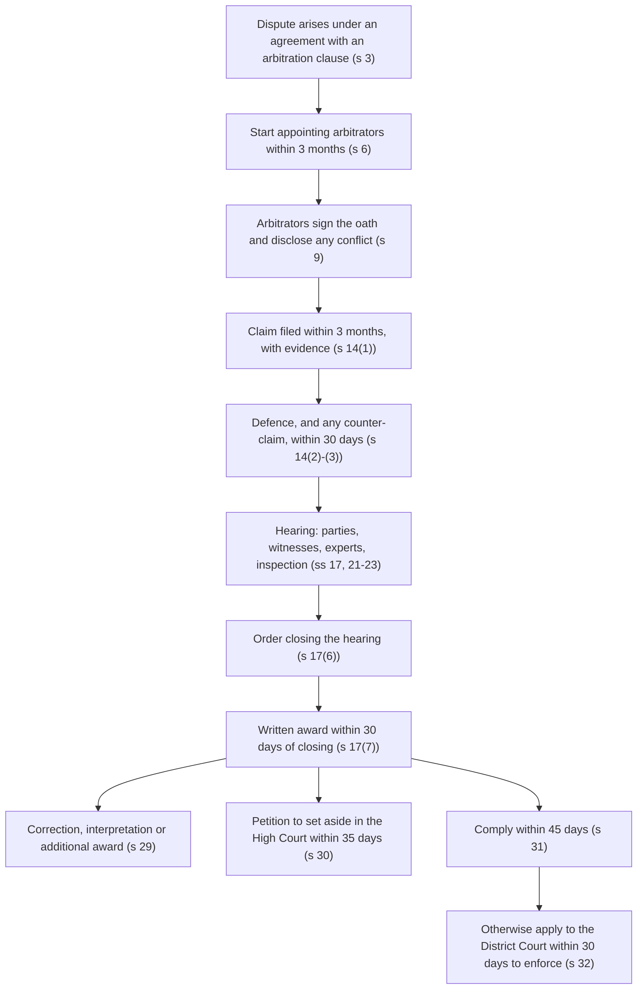
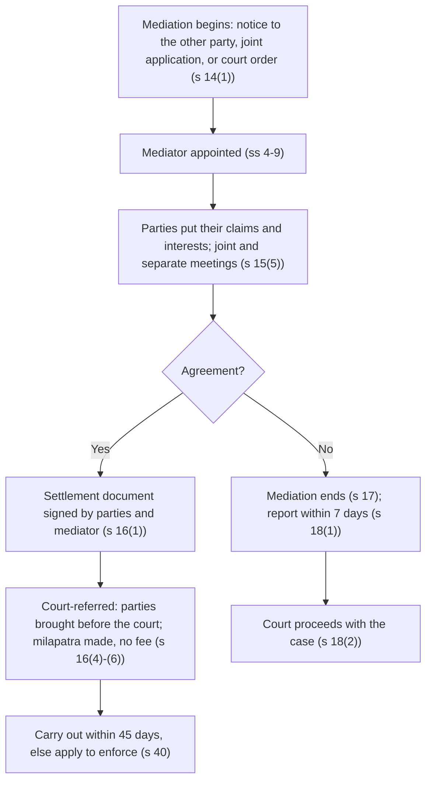

# Unit 5: Alternative Dispute Resolution

!!! abstract "In one line"
    Alternative dispute resolution (ADR) means settling a dispute without a full court trial. This unit covers the two main forms in Nepal: arbitration, where a private judge chosen by the parties gives a binding decision, and mediation, where a neutral helper guides the parties to their own settlement.

## Why it matters for the exam

- **Short note, new course:** 2077 Q7(a) "ADR".
- **Full question, old course:** 2078 Q1 "What do you mean by arbitration? Discuss qualification of arbitrator and its procedure."
- ADR came up in two of the five papers we have. A full question on arbitration or mediation is likely, and "ADR" is a favourite short note. Learn the steps of each procedure with the section numbers, the arbitrator's qualifications (Arbitration Act 2055 s 10), and the mediator's qualifications (Mediation Act 2068 s 22).
- Arbitration agreements in depth belong to Law of Contract (Unit 17). Here you only need what an agreement is and the procedure that follows from it.

## Key terms

| Term | Nepali | Plain meaning |
|---|---|---|
| Alternative dispute resolution (ADR) | वैकल्पिक विवाद समाधान | Ways of settling a dispute outside a full court trial |
| Arbitration | मध्यस्थता | Parties send their dispute to a private person (or panel) whose decision binds them |
| Arbitrator | मध्यस्थ | The person who hears and decides a dispute in arbitration |
| Arbitration agreement | सम्झौता | The parties' written agreement to send a dispute to arbitration (Arbitration Act s 2(क)) |
| Presiding arbitrator | मुख्य मध्यस्थ | The third arbitrator, chosen by the other two, who leads the panel |
| Claim, defence, counter-claim, reply | दावी, प्रतिवाद, प्रतिदावी, प्रत्युत्तर | The written pleadings in arbitration |
| Award | मध्यस्थको निर्णय | The arbitrator's final decision |
| Setting aside | निर्णय बदर | A High Court cancelling an award on limited grounds |
| Mediation | मेलमिलाप (melmilap) | A neutral person helps the parties talk and reach their own settlement |
| Mediator | मेलमिलापकर्ता | The neutral helper in mediation |
| Compromise deed | मिलापत्र (milapatra) | The written settlement that ends a case |
| Adjudicating body | मुद्दा हेर्ने निकाय | A court or quasi-judicial body hearing a case (Mediation Act s 2(छ)) |
| Mediation Council | मेलमिलाप परिषद् | The national body that certifies mediators and regulates mediation |
| Community mediation | समुदायमा आधारित मेलमिलाप | Mediation by a group of local people in the community |
| Judicial committee | न्यायिक समिति | The three-member committee of each rural municipality and municipality that settles local disputes |

!!! tip "Do not mix up the Nepali words"
    In everyday Nepali, मध्यस्थता is sometimes used loosely for any go-between. In law, **मध्यस्थता is arbitration** (the Arbitration Act 2055 is मध्यस्थता ऐन) and **मेलमिलाप is mediation** (the Mediation Act 2068 is मेलमिलाप सम्बन्धी ऐन). Use them correctly in the exam.

## Start here: settling a quarrel without a judge

Two neighbours quarrel about a water channel. Ram and Shyam's company quarrel about a delayed shipment. They can file a case in court. But a court case takes time, costs money and leaves one side the "loser". The two sides will probably never trust each other again.

There are other ways.

- They can **talk it out** themselves. That is negotiation.
- They can ask a respected **neutral person to help them talk**. The helper does not decide anything. If they agree, they sign a settlement. That is **mediation**.
- They can agree that a **private person they trust will decide**, and that they will accept the decision. That is **arbitration**.

All three are "alternatives" to a court trial, so together they are called **alternative dispute resolution (ADR)**. Nepal's Constitution asks the State to use them for ordinary disputes. Nepal has a separate Act for each of the two main forms. Courts and local judicial committees also send cases to mediation.

## ADR: meaning, forms and importance

### Meaning

ADR is a set of methods for settling disputes outside the ordinary court trial, usually with the help of a neutral third person. The word "alternative" means an alternative to **litigation** (a full court case). Some writers prefer "appropriate dispute resolution", because the aim is to choose the method that suits the dispute.

The idea is old. Village elders, panchas and community leaders settled most quarrels in Nepal long before modern courts existed. The old Muluki Ain also allowed parties to settle a pending case by a compromise deed (milapatra); the [Kallu Chaudhary](cases/9-6-kallu-chaudhary.md) brief reports a compromise made in 2031 under No. 182 of the Adalati Bandobasta. Modern ADR gives these practices a legal structure.

### Features of ADR

1. **Voluntary.** It usually rests on the parties' consent, given in an agreement or at the time of the dispute.
2. **A neutral third person.** A mediator, conciliator or arbitrator who has no stake in the dispute.
3. **Party autonomy.** The parties choose the person, the place, the language and much of the procedure.
4. **Informal and flexible.** No strict rules of pleading and evidence as in court.
5. **Private and confidential.** Hearings are not public.
6. **Speedy and cheaper** than a court case, in principle.
7. **Aims at settlement**, often keeping the relationship alive (especially in mediation).

### Forms of ADR

| Form | Who decides? | How it works |
|---|---|---|
| **Negotiation** | The parties themselves | Direct talks, with no third person |
| **Mediation** | The parties, helped by a mediator | The mediator facilitates talks; he cannot impose a decision |
| **Conciliation** | The parties, helped by a conciliator | Like mediation, but the conciliator may propose terms of settlement |
| **Arbitration** | The arbitrator | A private, binding decision after hearing both sides |
| **Hybrid forms** | Mixed | For example "med-arb": mediation first; if it fails, the same or another person arbitrates |
| **Community or traditional methods** | Local people | Elders, community mediators or local bodies help settle local disputes |

India's **Lok Adalat** ("people's court") is a well-known example from a neighbour: a body that settles pending and pre-litigation cases by compromise. Nepal's nearest equivalents are court-referred mediation and the judicial committees of local levels.

Moving from left to right, the parties lose control and the process becomes more formal and more binding.

### Why ADR matters

1. **Speed.** A dispute can be settled in weeks or months, not years.
2. **Cost.** Fewer formalities, fewer hearings, often no court fee (Mediation Act s 16(6)).
3. **Reduces court backlog.** Every case settled outside court frees time for the cases that need a judge.
4. **Access to justice.** The Mediation Act's preamble says its aim is to settle disputes by a speedy, simple and less costly process and so widen ordinary people's access to justice.
5. **Expertise.** Parties can choose an engineer for a construction dispute or a banker for a banking dispute.
6. **Confidentiality.** Business secrets and family matters stay private (Arbitration Act s 19; Mediation Act s 37).
7. **Keeps relationships.** Mediation produces a "win-win" result, so neighbours, family members and business partners can carry on dealing with each other.
8. **Finality.** An arbitral award has only limited grounds of challenge, and a mediated milapatra cannot be appealed except for non-performance (Civil Procedure Code s 193(5)).
9. **Party control.** People feel they own the result, so they are more likely to comply.

### Limits of ADR

- It does not suit **serious crimes, constitutional questions or public law disputes**, where society has a stake.
- It creates **no precedent**, so the law does not develop.
- A **weaker party** (a poor tenant against a landlord, a wife against a dominant husband) may be pressured into a bad settlement.
- Arbitration can become **costly and slow** when awards are challenged in court.
- Its quality depends on **trained, honest neutrals**, who are scarce in rural areas.
- An unwilling party can **walk away** from mediation.

### ADR in Nepal's law at a glance

| Source | What it provides |
|---|---|
| Constitution Article 51(k)(2) | A State policy to adopt alternative means such as mediation and arbitration for settling disputes of an ordinary nature |
| Constitution Article 127(2) | Besides the courts, judicial bodies may be formed at the local level to try cases, and other bodies may be formed to pursue alternative dispute resolution |
| Constitution Article 217 | A three-member judicial committee in each rural municipality and municipality |
| Constitution Schedule-8, item 12 | "Management of mediation and arbitration" is a local-level power |
| Constitution Article 135 | A retired Chief Justice or Supreme Court Justice may not do pleading, mediation or arbitration work before any office or court |
| Arbitration Act 2055 | The general law on arbitration, domestic and foreign awards |
| Mediation Act 2068 | The general law on mediation, mediators, the Mediation Council and community mediation |
| Civil Procedure Code 2074 ss 13, 193, 194, 195, 234 | Compromise and court-referred mediation in civil cases and in execution |
| Criminal Procedure Code 2074 ss 117-120 | Compromise and mediation in some criminal cases |
| Local Government Operation Act 2074 ss 46-53 | Disputes settled and mediated by the local judicial committee |
| Administration of Justice Act 2073 s 13 | A compromise may be made even while a review or revision application is pending |
| District Court Rules 2075 rr 49-60 | The court's list of mediators and the court-referred mediation procedure |

## 5.1 Arbitration and its procedures

### Meaning

Arbitration is a method in which the parties, by agreement, send their dispute to one or more impartial private persons (arbitrators) for a decision that binds them. It is a "private court" created by the parties' agreement. The arbitrator hears both sides in a judicial manner, takes evidence and gives a written decision called an **award**.

A widely used textbook description (from *Halsbury's Laws of England*) says, in substance: arbitration is the reference of a dispute between two or more parties for decision, after hearing both sides in a judicial manner, by a person or persons other than a court of competent jurisdiction.

The Arbitration Act 2055 (मध्यस्थता ऐन, २०५५) does not define arbitration itself. It defines its building blocks:

- **Agreement** (सम्झौता, s 2(क)): a written agreement between the parties to settle by arbitration a dispute that has arisen, or may arise, about a defined legal relationship, whether contractual or not. The explanation treats an agreement as written if it is (1) an arbitration clause in a contract or a separate agreement, (2) an exchange of letters, telex, telegram, telefax or other telecommunication that keeps a written record, or (3) a defence filed to an arbitration claim without objecting to arbitration.
- **Dispute** (विवाद, s 2(ङ)): a dispute that can be settled by arbitration under the Act.
- **Arbitrator** (मध्यस्थ, s 2(ज)): an arbitrator appointed to settle a dispute, including a panel of arbitrators.

It is Act No. 1 of 2056 and came into force at once (s 1(2)). It repealed the Arbitration Act 2038 (s 44(1)). It follows the pattern of the UNCITRAL Model Law on International Commercial Arbitration (1985). Where it says "High Court", the older text said "Appellate Court"; the Administration of Justice Act 2073 changed the words (note at the end of the Act).

### Features of arbitration

1. **Based on agreement.** No agreement, no arbitration (s 3(1)).
2. **Private judge.** The arbitrator is chosen by the parties, not appointed by the State (except where the High Court steps in).
3. **Adjudicative.** Unlike a mediator, the arbitrator **decides**.
4. **Binding award**, enforceable by the District Court like its own judgment (s 32(1)).
5. **Limited court role.** Courts have no jurisdiction over matters the Act governs, except as the Act provides (s 39).
6. **Confidential** hearing unless the parties want otherwise (s 19).
7. **Natural justice applies.** Each party gets an adequate and equal chance to present its case (s 22(1)). Acting against natural justice is a ground to remove the arbitrator (s 11(2)(ङ)).

### Kinds of arbitration

| Kind | Meaning |
|---|---|
| **Ad hoc** | Set up by the parties only for one dispute, run under the Act and their agreement |
| **Institutional** | Run under the rules of an arbitration institution, such as the Nepal Council of Arbitration (NEPCA) |
| **Domestic** | Between Nepali parties, seated in Nepal |
| **International / foreign** | Involving a foreign party or seated abroad; a foreign award is enforced under s 34 |
| **Voluntary (contractual)** | Based on an arbitration clause or agreement |
| **Court-annexed** | A commercial civil case pending in court is sent to arbitration on the parties' application (s 3(2)) |
| **Fast-track** (द्रुत मध्यस्थता) | A faster process the parties agree to use (s 13क, added in 2081) |

### When must a dispute go to arbitration?

- **Agreement.** If an agreement provides for arbitration, a dispute about that agreement, or a matter under it, must be settled by arbitration: by the procedure in the agreement, or else by the Act (s 3(1)).
- **Cases already in court.** Even without an earlier agreement, if the parties to a pending **civil case of a commercial nature** that can be compromised (milapatra) under the law apply to have it settled by arbitration, it must go to arbitration (s 3(2)). The court may then order the case to be struck off its register (मुद्दाको लगत काट्ने, s 4(1)).
- **When the court will not strike the case off** (s 4(2)): (a) the case also needs a decision on matters that cannot go to arbitration, or (b) there is another reasonable reason why arbitration cannot decide it.

### Appointment of arbitrators

| Point | Rule | Section |
|---|---|---|
| **Number** | As the agreement says; if it is silent, **normally three**. If the agreement produces an even number, the arbitrators add one person of their choice to make the number odd | s 5 |
| **Time to start** | Unless the agreement says otherwise, the appointment process must start within **three months** of the date the cause for arbitration arises | s 6(1) |
| **Named in the agreement** | The person named is deemed appointed | s 6(2) |
| **Agreement's own method** | Followed | s 6(3) |
| **Default method** | Each party appoints one arbitrator; the two appoint a third, who acts as **presiding arbitrator** (मुख्य मध्यस्थ) | s 6(4) |
| **Appointment by the High Court** | If the agreement's method fails, or the agreement says nothing on appointment, a party may apply to the High Court. The application names at least three possible arbitrators with name, address, occupation and area of expertise, with a copy of the agreement. The Court notifies all parties; it appoints the person they agree on, or else a person it thinks fit, within **60 days**. Its decision is final | s 7 |
| **Vacancy** | If an arbitrator resigns, refuses, dies or the post falls vacant, a new one is appointed generally within **30 days** by the original method. If not, a party may apply to the High Court within the next **15 days**, and the Court appoints generally within 15 days | s 8 |

The "High Court" is the one with territorial jurisdiction over the place of arbitration named in the agreement, or, if none, where the dispute arose, the proceedings were held, or a party normally lives (s 2(घ)). The "District Court" is defined in the same way (s 2(ग)).

### Qualifications of an arbitrator

The Act does not list positive qualifications such as a degree or years of practice. It sets **duties** that an arbitrator must be able to meet and lists **disqualifications**. The parties may add their own qualifications in the agreement.

**1. Impartiality and independence: the oath (s 9)**

- Before starting work, the arbitrator must sign, in two copies, an **oath of impartiality and honesty** in the form in the Schedule. One copy stays on the file and one goes to the High Court (s 9(1)). In the oath the arbitrator promises to work impartially and honestly, without leaning towards any party.
- Before taking the oath, he must tell the parties anything that could give reasonable doubt about his **impartiality or independence** in the dispute (s 9(2)). This is the duty of disclosure.

**2. Disqualifications (s 10).** A person is **not qualified** to be appointed arbitrator if he:

1. (क) is incompetent to make a contract under the law in force (for example, a minor or a person of unsound mind);
2. (ख) has been punished by a court for a criminal offence involving **moral turpitude** (नैतिक पतन);
3. (ग) is **insolvent** or bankrupt (साहूको दामासाहीमा परेको वा टाट उल्टेको);
4. (घ) has any **interest in the subject matter** of the dispute;
5. (ङ) lacks any **special qualification** the agreement requires for an arbitrator.

**3. Qualifications that follow from the Act**

- **Expertise.** An application to the High Court must state the area of expertise of each proposed arbitrator (s 7(2)), and the arbitrator may call experts (s 21(1)(ग)). Parties usually choose a lawyer, retired judge, engineer, accountant or other expert in the field.
- **Availability and diligence.** An arbitrator who misses more than three meetings without good reason, intending to delay, can be removed (s 11(2)(घ)).
- **Fairness.** Bias, misconduct, fraud, repeated errors or breach of natural justice are grounds of removal (s 11(2)).
- **Continuing qualification.** If the arbitrator lacks a qualification, or loses it later, he can be removed (s 11(2)(च)).
- **Persons barred elsewhere.** A retired Chief Justice or Supreme Court Justice may not do arbitration work before any office or court (Constitution Article 135). A person who acted as **mediator** in a dispute cannot later hear the same dispute between the same parties as arbitrator (Mediation Act 2068 s 19).

The Act does not require the arbitrator to be a lawyer or a Nepali citizen.

### Removal of an arbitrator (s 11)

1. The grounds and procedure in the agreement apply first (s 11(1)).
2. If the agreement is silent, a party may apply **to the arbitrator** within **15 days** of learning of the appointment or of the conduct, on these grounds (s 11(2)):
    - (क) clear bias towards a party;
    - (ख) improper conduct or fraud in the proceedings;
    - (ग) repeated mistakes or irregularities;
    - (घ) absence from more than three meetings, or refusal to take part, without good reason, intending to delay;
    - (ङ) acts against the principles or rules of natural justice;
    - (च) lack or loss of qualification.
3. If the arbitrator does not step down, or the other party does not agree to the removal, the arbitrator decides the application within **30 days** (s 11(3)).
4. A party may challenge that decision in the **High Court**, whose order is final (s 11(4)).

A removed arbitrator must refund all fees received (s 37, proviso).

### Seat and language

- **Place** (s 12): as the agreement says; else as the parties choose; if they do not choose within 15 days of appointment, as the arbitrator decides. The arbitrators may still meet elsewhere to hear witnesses, take expert opinion or inspect places.
- **Language** (s 13): as the agreement says; else as the parties decide; else the language of the agreement.

### The arbitral procedure, step by step

**Step 1: Claim (दावी), s 14(1).** The claimant files a written claim before the arbitrator within the time in the agreement. If none is fixed, within **three months** of the dispute arising (or of the arbitrator's appointment, if appointed after the dispute). The claim must say what the disagreement is and what relief is sought, with evidence. A copy goes to the other party.

**Step 2: Defence and counter-claim (प्रतिवाद, प्रतिदावी), s 14(2)-(3).** Unless the agreement says otherwise, the other party files a defence within **30 days** of receiving the claim, with any counter-claim. If there is a counter-claim, the claimant gets **15 days** to file a reply (प्रत्युत्तर).

**Step 3: Extension.** A party prevented by circumstances beyond its control may apply within **15 days** of the deadline for more time. The arbitrator may grant reasonable time if the reason is reasonable (s 14(4)).

**Step 4: Documents and witnesses.** All documents and supporting evidence go with the pleadings. A party who wants to prove a fact by witnesses must name them and bring them on the day the arbitrator fixes (s 14(5)). Every document filed must be copied to the other party (s 14(6)). Since 2082, a government employee who fails to file, files late or acts negligently on behalf of a government office faces departmental action (s 14(7)).

**Step 5: Default by a party (s 15).** Unless the parties agree otherwise:

- if the claimant does not file the claim in time, the proceedings **end** (s 15(क));
- if the respondent does not file a defence, that alone is **not an admission** of the claim. The arbitrator continues and weighs the claimant's evidence (s 15(ख));
- if a party is absent from the hearing or files no documents, the arbitrator may decide on the evidence before him, and must send a copy of the award to the absent party (s 15(ग)).

**Step 6: Procedure and hearing (s 17).**

- The arbitrator follows the procedure in the agreement; else the Act; where the Act is silent, the procedure set with the parties' consent, or else by the arbitrator himself (s 17(1)).
- Once the pleadings are in, the arbitrator must start at once (s 17(2)) and tell the parties what will happen, on what day and time, keeping a record (s 17(3)).
- With three or more arbitrators, the members present may carry on proceedings, except the final decision or final order (s 17(4)).
- If a notified party does not appear, the arbitrator may proceed and decide on the available evidence (s 17(5)). This is an ex parte decision.
- When the hearing is over, the arbitrator records an **order closing the hearing**. After that, no more evidence or hearing is allowed (s 17(6)).

**Step 7: Award.** Unless the agreement says otherwise, the written award is announced **generally within 30 days** of the closing order (s 17(7)). Overall, subject to s 17(7), the award should come **generally within 120 days** of the s 14 documents being filed (s 24).

### Jurisdiction of the arbitrator (s 16)

A party may claim that the arbitrator has no jurisdiction, or that the contract itself is illegal, voidable or of no effect. The arbitrator must decide this **before** going into the merits (s 16(1)). This is the idea known as **kompetenz-kompetenz**: the tribunal decides its own jurisdiction.

- A dissatisfied party may apply to the High Court within **30 days**; its decision is final (s 16(2)). Meanwhile the arbitrator may continue and decide (s 16(6)).
- **Separability.** An arbitration clause is treated as a separate agreement. Even if the arbitrator holds the main contract void, the clause does not fail for that reason alone (s 16(3)).
- The objection cannot be raised after the deadline for the defence (s 16(4)). Taking part in appointing the arbitrator does not stop a party from raising it (s 16(5)).

### Law the arbitrator applies (s 18)

- Unless agreed otherwise, the substantive law is **Nepal law** (s 18(1)).
- Only if the parties expressly authorise it may the arbitrator decide **ex aequo et bono** (by what is fair and good) or as **amiable compositeur** (a friendly settler) (s 18(2)).
- In every case the arbitrator decides by the **terms of the contract** and takes account of the **trade usages** of the transaction (s 18(3)).

### Powers of the arbitrator (s 21)

Unless the agreement says otherwise, the arbitrator may:

- (क) summon the parties, call for documents and take statements;
- (ख) take the depositions of witnesses;
- (ग) appoint an expert to examine a matter or give an opinion;
- (घ) take a bank guarantee or other security where the award may not be enforceable because a party is a foreign national;
- (ङ) inspect a place, goods, structure or process, and, after consulting the parties, sell perishable goods and hold the money in deposit;
- (च) use any special power the parties give;
- (छ) on a party's request, issue a preliminary order, an interim order or interlocutory order on the subject matter, or a conditional decision;
- (ज) give certified copies of documents;
- (झ) use other powers under the Act.

A party unhappy with an interim order under (छ) may apply to the High Court within **15 days**; its decision is final (s 21(2)).

Other procedural guarantees:

- **Equal opportunity** (s 22(1)) and the right to appear in person, through a representative, or with a lawyer (s 22(2)).
- **Court help with evidence.** The arbitrator, on his own or at a party's request, may ask the District Court for help in taking evidence, and the court must help (s 23).
- **Confidential hearing** unless the parties want otherwise (s 19).
- **Service of notice** directly, or by telex, telefax, telegram or other recorded means at the address given; registered post if by post (s 20).

### The award

| Point | Rule | Section |
|---|---|---|
| Non-arbitrable matter mixed in | The arbitrator must not decide it; he notifies the parties, who may go to court within 35 days | s 25 |
| Majority | With three or more arbitrators, the majority view is the award; if there is no majority, the presiding arbitrator's view prevails unless agreed otherwise | s 26(1)-(2) |
| Signature and dissent | Every arbitrator signs; if one cannot, the others sign and give the reason. A dissenting arbitrator may record a dissenting opinion | s 26(3)-(4) |
| Contents | A short statement of the matter referred; the grounds for holding jurisdiction, if challenged; the findings with reasons; the amount or relief to be paid; interest; and the place and date of the award | s 27 |
| Announcement | Read out to the parties; a copy to each; the receipt kept on file. An absent or refusing party is sent a notice with a copy | s 28 |
| No second award | Once decided, the arbitrator cannot decide the same matter again, except on a High Court order under s 30 | s 29(1) |
| Correction | Clerical, arithmetical, typing errors: a party applies within 30 days of the copy; correction within 15 days. The arbitrator may correct on his own within 30 days | s 29(2) |
| Additional award | For a claim left undecided: application within 30 days, with the other party's consent; additional award within 45 days | s 29(3) |
| Interpretation | With the parties' consent, a request within 30 days; clarification within 45 days | s 29(4) |
| Settlement during arbitration | If the parties settle, the arbitrator gives a consent award; no appeal except where it departs from the consent | s 40 |

### Challenging an award: setting aside (s 30)

A dissatisfied party may apply to the **High Court** within **35 days** of hearing the award or receiving notice of it, attaching the documents and a copy of the award, with copies to the arbitrator and the other party (s 30(1)).

The High Court may set aside the award, or order a fresh decision, if the applicant proves (s 30(2)):

- (क) a party was **incapable** of making the agreement, or the agreement is **invalid** under the law the parties chose (or Nepal law, if that is unclear);
- (ख) the applicant was **not given proper notice** of the appointment or of the proceedings;
- (ग) the award deals with a dispute **not referred**, goes against the terms of the reference, or goes **beyond its scope**;
- (घ) the **composition** of the tribunal or its procedure did not follow the agreement or, without one, the Act (unless the agreement itself was against Nepal law).

The High Court may also set aside an award on its own grounds (s 30(3)):

- (क) the dispute **cannot be arbitrated** under Nepal law;
- (ख) the award is **contrary to public policy**.

The High Court must **not re-examine the evidence** on which the arbitrator relied (s 30(4)). The challenge is not an appeal on the merits.

### Enforcement of the award

1. **Voluntary compliance.** The parties must carry out the award within **45 days** of receiving a copy (s 31).
2. **Enforcement by the District Court.** If not, the party may apply to the District Court within **30 days** after that period. The court enforces the award **as if it were its own judgment**, within **15 days** for a fast-track award and generally **30 days** for others (s 32(1)).
3. **Effect of a set-aside petition.** Filing a petition under s 30 does not by itself stop enforcement (s 32(2)). On a separate application, the High Court may stay enforcement until the petition is decided only if (a) the agreement or award appears **prima facie** tainted by corruption or fraud, or (b) the applicant shows he would suffer **irreparable loss** (s 32(3)).
4. **Interest.** Unless agreed otherwise, the arbitrator may fix interest not above the commercial bank rate. The amended s 33 excludes interest from the start of the arbitrator-appointment process through the statutory period for enforcing the award.
5. **Enforcement fee.** The party seeking enforcement pays the court 0.5 per cent of the amount recovered; Rs 500 if the value cannot be fixed. It can be recovered from the other side like court fee (s 41).

### Foreign awards (s 34)

- The party applies to the **High Court** with the original or certified award, the original or certified agreement, and an official Nepali translation if needed (s 34(1)).
- If Nepal is party to a treaty on recognising foreign awards, an award made in another treaty state is recognised and enforced subject to the treaty, if: the arbitrator was appointed and the award made under the agreed law and procedure; the parties had timely notice; the award stays within the reference; it is final and binding in the country where it was made; the law of the applicant's country, or of the place of arbitration, does not bar enforcing Nepali awards; and the application is made within **90 days** of the award (s 34(2)). Nepal is a party to the New York Convention (1958) on foreign arbitral awards.
- If satisfied, the High Court sends the award to the District Court to enforce (s 34(3)).
- An award will not be enforced if the dispute cannot be arbitrated under Nepal law or enforcement would be against public policy (s 34(4)).

### Costs, fees and records

- **Costs:** the parties deposit the amount the arbitrator fixes after consulting them, and share the costs in the proportion he fixes (s 35).
- **Fees:** as in the agreement; else as fixed by the arbitrator after consulting the parties, paid fully or partly in advance (s 36). Unused fees are refunded if the hearing cannot take place or the post falls vacant (s 37).
- **Death of a party:** rights and liabilities pass to the heirs (s 38).
- **Records:** the arbitrator keeps a file in order and hands it to the District Court at the end; the court keeps it like its own judgment file. Copies of the award go to no one but the parties without their consent (s 42).

### Role of courts in arbitration

| Court | Role | Section |
|---|---|---|
| Court where a case is pending | Strikes off a commercial case sent to arbitration | ss 3(2), 4 |
| High Court | Appoints arbitrators | ss 7, 8 |
| High Court | Hears challenge to removal decision | s 11(4) |
| High Court | Decides jurisdiction objections | s 16(2) |
| High Court | Hears challenge to interim orders | s 21(2) |
| District Court | Helps in taking evidence | s 23 |
| High Court | Sets aside awards; may stay enforcement | ss 30, 32(3) |
| District Court | Enforces awards | s 32(1) |
| High Court, then District Court | Recognises and enforces foreign awards | s 34 |
| All courts | No jurisdiction over matters the Act governs, except as the Act provides | s 39 |

### Critical view of arbitration in Nepal

- **Strengths.** The Act follows the international model, respects party autonomy and limits court interference (ss 30(4), 39). Recent amendments push for speed: fast-track arbitration (s 13क), enforcement not stopped merely by a set-aside petition (s 32(2)), and departmental action against officials who delay government cases (s 14(7)).
- **Weaknesses.** Awards are often challenged in the High Court, which delays enforcement. Government bodies, frequent parties in construction disputes, are slow to file and comply. Few trained arbitrators and institutions exist outside Kathmandu. Costs can be high for small disputes.

## 5.2 Mediation and its procedures

### Meaning

Mediation is a voluntary process in which a neutral third person, the mediator, helps the parties talk, understand each other and reach their **own** settlement. The mediator has **no power to decide**. Its result is a settlement the parties sign, which in court-referred cases becomes a milapatra.

The Mediation Act 2068 (मेलमिलाप सम्बन्धी ऐन, २०६८) defines:

- **Mediation** (मेलमिलाप, s 2(ज)): the process the parties adopt, with the help of a mediator, to settle a dispute or case.
- **Mediator** (मेलमिलापकर्ता, s 2(झ)): a person appointed under the Act who helps the parties discuss their dispute, creates a comfortable atmosphere and motivates them to reach agreement.
- **Adjudicating body** (मुद्दा हेर्ने निकाय, s 2(छ)): a court, including a quasi-judicial body.

The preamble states the Act's purpose: to settle disputes through mediation by a speedy, simple and easy process, make dispute settlement less costly, and widen ordinary people's access to justice. The Act was certified on 2068-01-26. It came into force from 2071-01-01 by notice in the Nepal Gazette (s 1(2) and its footnote).

### Features of mediation

1. **Voluntary.** The parties decide whether to settle and on what terms.
2. **Facilitative.** The mediator acts only as a **facilitator**, not as judge, arbitrator or legal adviser (s 41(3)).
3. **Neutral.** The mediator must be impartial and free from bias, pressure or inducement (s 12).
4. **Confidential.** The whole process is kept confidential (s 37); what a party says cannot be used as evidence in the case (s 38).
5. **Flexible.** The parties set the procedure (s 15(1)).
6. **Binding once signed.** The result binds the parties and they must carry it out (s 39).
7. **Free of court fee.** No fee is charged for the milapatra (s 16(6)), and the court fee paid on filing is refunded (s 16(6क)).

### Mediation, conciliation, compromise and arbitration

| Point | Mediation (मेलमिलाप) | Conciliation | Compromise (मिलापत्र) | Arbitration (मध्यस्थता) |
|---|---|---|---|---|
| Third person | Mediator | Conciliator | None needed; the court records it | Arbitrator |
| Role | Facilitates talks | Facilitates and may propose terms | Parties settle; judge certifies | Hears and decides |
| Decision by | Parties | Parties | Parties | Arbitrator |
| Binding? | Yes, once signed (s 39) | Once signed | Yes; no appeal except for non-performance (CPC s 193(5)) | Yes; limited challenge (s 30) |
| Nepal law | Mediation Act 2068; CPC s 194 | No separate Act | CPC s 193; CrPC ss 117-118 | Arbitration Act 2055 |

Mediation and milapatra go together. Mediation is the **process**; milapatra is the **document** that ends a court case when mediation succeeds.

### Which disputes can be mediated? (Mediation Act s 3)

- A dispute under an agreement that provides for mediation goes through the agreed procedure (s 3(1)).
- Any dispute that **can be settled by milapatra under the law**, whether or not filed in an adjudicating body, may be settled by mediation if the parties wish (s 3(2)).
- The parties to a pending case may at **any stage** apply jointly to the adjudicating body, which then orders mediation (s 3(3)).
- The adjudicating body may itself order mediation if it thinks the case suitable (s 3(4)).
- It will not order mediation if the dispute also needs a decision on a matter that cannot be mediated (s 3(5)).

### Appointment of mediators

| Point | Rule | Section |
|---|---|---|
| By agreement | As the agreement says; else under the Act, by the parties' mutual consent | s 4 |
| Number | As agreed; else one or three. For three, each party picks one, and the parties (or the two mediators) pick the third, who acts as **coordinator** | s 5 |
| Help from institutions | Parties may ask a mediation institution to recommend or appoint a mediator; it considers the nature of the dispute and the person's qualification, skill and impartiality | s 6(1)-(3) |
| Help from the local level | Parties may ask the rural municipality or municipality, which keeps a list of qualified mediators | s 6(4)-(5) |
| Court-referred | The court orders the parties to propose a name within a set time; it appoints the person they agree on; if they cannot agree, it appoints a qualified person with their consent | s 7 |
| From certified mediators | When a court orders mediation, it appoints, from persons holding a mediator's certificate, the person the party chooses | s 9 |
| Vacancy | Refilled by the original process; else by the court process in s 7 | s 8 |
| Refusal | A person who does not want to act must tell the adjudicating body in writing within 7 days of notice of appointment | s 10 |

### Qualifications of a mediator (s 22)

A person is qualified to be a mediator if he or she is:

1. (क) a Nepali citizen;
2. (ख) at least 25 years old;
3. (ग) a graduate (at least a bachelor's degree) from a recognised institution;
4. (घ) trained in mediation for the prescribed period;
5. (ङ) of sound mind;
6. (च) not punished by a court for a criminal offence involving moral turpitude;
7. (छ) not insolvent; and
8. (ज) not removed from the list of mediators for acting against the Act.

Two relaxations:

- If the **parties themselves propose** the mediator, a person who is 25 and can read and write is qualified even without the degree or training (s 22(2)).
- A **foreign citizen** may mediate a dispute involving a foreigner or a contract with a foreigner (s 22(3)).

**Certificate.** To act in court-referred mediation (ss 3(4) and 9(2)), a person applies to the **Mediation Council** with citizenship and qualification documents (s 20). The Council issues a certificate valid for **three years**, renewable (s 21(1)-(2)). It cancels the certificate if the holder loses a qualification or acts fraudulently or dishonestly (s 21(3)).

**Court's list.** Under the District Court Rules 2075, the court keeps a list of possible mediators, chosen for their training, experience, conduct, impartiality and integrity: former judges, lawyers, local office-holders, social workers, respected local people, retired officers, professors, teachers and mediation institutions. A person without mediation training, or convicted of an offence of moral turpitude, cannot be listed (r 49(1)). The list is updated every year (r 50).

### Duties of a mediator

- **Disclose** any reason he cannot act independently and impartially, in writing, to the parties and the court (s 11).
- **Code of conduct** (s 12): act impartially; show no bias, prejudice or favour; never use fear, threat, pressure or inducement; have no financial dealings with a party during the dispute; not act against the Act or Rules; avoid self-interested dealings; follow the code of conduct.
- **Act only as facilitator** (s 41): help the parties in a friendly, independent and impartial way, guided by fairness, objectivity, transparency and justice, and by trade practice or community tradition where relevant. He must not act as judge, arbitrator or legal adviser (s 41(3)).
- **Keep secrets** (s 42): not disclose information against a party's interest, except about a criminal offence before a competent court.
- **Not act later** as lawyer, arbitrator or judge in the same dispute between the same parties (s 19).
- He is protected for acts done **in good faith** (s 44). Fees are as agreed up to the prescribed limit, else as the Council fixes (s 43).

**Removal (s 13).** A mediator found not qualified under s 22 must be removed at once by whoever appointed him (s 13(1)). The adjudicating body may remove a mediator at any time on complaint or its own information if he breaches s 12, acts improperly or fraudulently, makes repeated mistakes, unnecessarily delays or shows no interest, or breaks confidentiality without the parties' consent (s 13(2)).

### Mediation procedure under the Mediation Act

**1. Start (s 14).** Mediation is deemed to begin when one party notifies the other (dispute not in court), when the parties apply to the adjudicating body (s 3(3)), or when the body orders mediation (s 3(4)). Community mediation begins when a party asks the community (s 14(1), proviso). After it begins, a party presents the dispute to the mediator (s 14(2)). Until it ends, no adjudicating body may interfere in the dispute (s 14(3)).

**2. Procedure (s 15).** The procedure is what the parties fix (s 15(1)); or the rules of a mediation institution if they agree (s 15(2)); or the procedure the court fixes in a court-referred case (s 15(3)). Failing all of these, the mediator adopts a suitable procedure with the parties' consent (s 15(4)). In doing so he may (s 15(5)):

- ask each party to put its claims and interests;
- meet the parties separately or together;
- ask for information, evidence or documents;
- let the other party see them;
- ask the parties to put forward alternative ways to settle.

The Mediation Council may issue a model procedure (s 15(6)).

**3. Settlement (s 16).** If the parties agree, the mediator writes the settlement document, has the parties sign it and signs it himself (s 16(1)). Each party gets a copy (s 16(2)), and the dispute is settled (s 16(3)). In a court-referred case, the mediator brings the parties with the document before the adjudicating body (s 16(4)), which has a milapatra made under the law (s 16(5)). No fee is charged (s 16(6)), and the court fee paid on filing is refunded (s 16(6क)). If the case is on appeal from a sentence of jail or fine, the court may waive or reduce the sentence (s 16(7)).

**4. End without settlement (s 17).** Mediation ends if the parties do not agree to settle, do not appear before the mediator on the date the body fixed, or a party's absence stops the process. It also ends when the settlement document is signed.

**5. Report (s 18).** In a court-referred case that fails, the mediator reports to the body within **7 days** (s 18(1)), and the body proceeds with the case under the law (s 18(2)). If a time limit was set, and neither a settlement nor a report arrives within 10 days after it, the body proceeds anyway (s 18(3)).

**6. Effect and enforcement.** The result **binds** the parties (s 39). In a court-referred dispute, a party must carry out the milapatra within **45 days**; if not, the other party may apply to the body concerned, which must enforce it under the law (s 40).

### The Mediation Council and institutions

- **Mediation Council** (मेलमिलाप परिषद्, s 26): chaired by a sitting Supreme Court Justice designated by the Chief Justice on the Judicial Council's recommendation. Members include the Secretary of the Ministry of Law, the Secretary of the ministry for federal affairs and local development, a Deputy Attorney General, the General Secretary of the Nepal Bar Association, a representative of industry and commerce, two women from mediators or mediation institutions, and two social workers or civil society representatives including at least one woman. The Registrar of the Supreme Court is member-secretary. Its secretariat is at the Supreme Court.
- **Functions** (s 27): promote mediation, advise the government on law reform, approve training curricula and trainers, monitor institutions and mediators, design community mediation structures, and act on breaches of the code of conduct. It may issue a code of conduct (s 47).
- **Mediation institutions** (ss 23-25): registered bodies need the Council's approval, publish a list of their mediators with qualifications and experience, and have their rules approved.
- **Monitoring:** a mediation monitoring committee at local level (s 29) and a fund under the Council (ss 30-32).

### Community mediation (ss 33-35)

- Any dispute that can be mediated under the Act may be settled through a **community-based mediation** mechanism (s 33(1)).
- A community may form a group of mediators, before or after a dispute arises (s 33(2)): respected local people, persons named by community organisations, local social workers, and school or college teachers (s 33(3)). Women must be represented in suitable numbers (s 33(4)).
- The mediators encourage the parties to reach a mutually acceptable agreement and **not to treat it as a win or loss** (s 34(3)). Local NGOs may help (s 34(4)). The result may be recorded in writing with the local level (s 34(6)).
- Rural municipalities and municipalities may give technical help, and the government may arrange training (s 35).

### Court-referred mediation in civil cases (Civil Procedure Code 2074)

The Muluki Civil Procedure Code 2074 makes compromise and mediation part of ordinary civil procedure.

**A general principle (s 13).** Before deciding **any** case, the court must give the parties a chance to make a milapatra, or to make one through mediation (s 13(1)). If they agree, this can happen at any level of the case (s 13(2)). (See Unit 2 on the principles of the Code.)

**Compromise (s 193).**

1. The parties may make a **joint application** to compromise a pending case at any level (s 193(1)).
2. The court explains to them the content, meaning and effect of the application (s 193(2)).
3. If they still agree, the court has three copies of a draft milapatra prepared (s 193(3)).
4. After it is read to them, both sign; the **judge certifies** it in his presence; one copy goes on the file and one to each side (s 193(4)).
5. **No appeal** lies against the milapatra, except a complaint that it has not been carried out (s 193(5)).
6. If land records must change (dakhil kharej, namsari, registration or plot division), the court writes to the office within **three days**, and the office acts within three days (s 193(6)-(7)).

**Mediation (s 194).**

1. The parties may **jointly apply** to the court at any level to settle the case by mediation (s 194(1)). If suitable, the judge orders mediation (s 194(2)).
2. The court may itself find the case suitable and, **if the parties agree** to go to mediation, order it (s 194(3)).
3. Mediation then starts under the law (s 194(4)), meaning the Mediation Act 2068 and the court Rules.
4. If it succeeds, the parties apply to the court, which has a milapatra made between them (s 194(5)-(6)). Section 193(3)-(6) applies with necessary changes (s 194(7)).
5. If it fails, the court fixes a tarikh for the parties and decides the case under the law (s 194(8)).

**Cases that cannot be compromised or mediated (s 195).** A case brought with the Government of Nepal as plaintiff concerning public, government or community property cannot be settled by milapatra or mediation. A milapatra that keeps the property public, government or community property is allowed (proviso).[^s195]

**During execution (s 234).** The parties may jointly apply to carry out a judgment through milapatra or mediation, except where government dues are being recovered (s 234(1)). The court gives them a reasonable time (s 234(2)). If they agree, the court or the officer acting as tahasildar has a milapatra made (s 234(3)); if not, the judgment is executed in the normal way (s 234(4)). (See Unit 8.)

**Pre-hearing discussion.** When the court holds a pre-hearing discussion under s 191 of the Code, one matter it may discuss is sending the dispute to mediation (Civil Procedure Rules 2075 r 34(4)(क)).

**Compromise after judgment.** Where a case can be compromised under the law, a milapatra may be made even while a review or revision application is pending (Administration of Justice Act 2073 s 13). In [Padam Bahadur Karki v Man Kumari Basnet](cases/9-7-padam-bahadur-karki.md), part of the plaintiffs' side made a milapatra with the appellants in the Supreme Court while the revision was pending, and only the remaining claim was decided.

### Court-referred mediation under the District Court Rules 2075

The District Court Rules 2075 (Chapter 7, rr 49-60) set out the practical steps:

1. **Encouragement on the first date.** On the first date both parties appear, the registrar (स्रेस्तेदार) must encourage them to mediate a case that can be compromised (r 51(1)). If both consent in writing, he sends the case to a listed mediator or institution, giving at most **one month** (r 51(2)).
2. **Referral by the bench.** If the bench thinks mediation suitable and the parties consent, it may refer the case (r 52(1)). The registrar may refer it if both sides ask (r 52(2)). A second referral is possible with all parties' consent (r 52(3)). The total time is at most **three months**, given at once or in parts (r 52(4)). Normally one mediator; up to three if needed (r 52(5)).
3. **Choice of mediator.** The person or institution both parties choose; if they cannot agree, the court appoints (r 53). A mediator can be changed only for limited reasons, such as death, mutual wish, loss of trust, conflict of interest or misconduct (r 54).
4. **The case stays alive.** The court keeps the case on its register and fixes a tarikh for the parties (r 55(3)).
5. **Process.** Talks are held at the place the court fixes or the mediator chooses with consent. The parties must attend (r 57(1)-(2)). The mediator may meet the parties, their lawyers, experts and respected local people jointly or separately, acting as a **facilitator** (r 57(3)). He may hold private one-to-one talks (r 57(5)) and use telephone or video (r 57(6)). If a party does not appear, he reports to the court after seven days (r 57(7)).
6. **Success.** The mediator sends the milapatra application and document to the court, which has the milapatra made (r 58).
7. **Failure.** The mediator reports within **seven days**; the court proceeds with the case; the parties must appear within seven days (r 59).
8. **Records.** The court keeps separate statistics of cases settled by mediation, without the facts (r 60).

### Mediation in criminal cases (Criminal Procedure Code 2074)

Crimes are wrongs against society, so most criminal cases cannot be compromised. The Code allows it only for listed offences.

- **Compromise (s 117).** In cases about offences in **Schedule-3 and Schedule-4**, the parties may make a milapatra at any stage with their consent (s 117(1)). Schedule-3 cases are filed by a government body or public authority as a complaint or report; Schedule-4 cases are filed by plaint by the person aggrieved (s 43(1)). Section 117(2) also lets the Attorney General allow a milapatra, on the accused and the victim's application, in some cases of public fraud, cheque dishonour, criminal breach of trust and foreign employment, even at the execution stage.
- **Procedure (s 118).** The parties file a joint application, signed by both, settling within the claim (s 118(1)). The court reads it out and asks whether they agree **of their own free will** (s 118(2)). If yes, the milapatra is written, signed by the parties and by the judge (s 118(3)).
- **Effect (s 119(2)).** No further case on the same matter between the same parties, except a complaint that a term has not been carried out.
- **Mediation (s 120).** In a case about a **Schedule-4** offence, if the parties consent, or the court thinks the case fit for mediation, the court asks the parties to choose a mediator (or appoints one if they do not) and sends the case to mediation at any time and stage (s 120(1)). The parties must appear before the mediator (s 120(2)). If they agree, the mediator prepares the milapatra and presents it to the court (s 120(3)), which certifies it (s 120(4)). Any punishment, fine or fee under a judgment in that case is struck off (s 120(5)).

### Mediation by local judicial committees (Local Government Operation Act 2074)

**Constitutional basis.** Article 217 creates a three-member **judicial committee** in each rural municipality and municipality. It is coordinated by the Vice-Chairperson (rural municipality) or Deputy Mayor (municipality), with two members elected by the assembly from among its members. Article 127(2) allows such local judicial bodies and other ADR bodies.

**The Act.**

- Each rural municipality and municipality has a judicial committee under Article 217 (s 46). "Local mediation and arbitration" and its management are among their functions (s 11(2)(ठ)(8)-(9)).
- **Disputes it decides** (s 47(1)): for example, sharing and use of field boundaries, dams, irrigation channels and water mills; damage to another's crops; pasture, grass and firewood; unpaid wages; lost or found domestic animals; failure to care for senior citizens; failure to maintain or educate minor children or a spouse; house rent up to Rs 25 lakh a year; trees or water harming a neighbour's property; and blocking traditional public paths and places.
- **Disputes it may settle only by mediation** (s 47(2)): for example, encroachment on private land; building on another's land; disputes between husband and wife (but no mediation that ends the marriage); assault punishable by up to one year without loss of limb; defamation; robbery (लुटपिट); stray or negligently kept animals; trespass into a home; using land in another's possession; noise and waste harming a neighbour; and other civil disputes, or criminal disputes punishable by up to one year, that can be mediated and are filed by an individual.
- For s 47(2) disputes, a party may go **directly to court** instead (s 47(3)). The application must be made within any limitation set by law, or else within **35 days** of the act (s 47(4)).
- **Conflict of interest.** A member with a personal interest, or whose relative is a party, cannot hear the dispute (s 48(5)).

**Procedure (s 49).**

1. The committee registers the application and gives the party a receipt (s 49(1)).
2. As far as possible, it **encourages mediation** and has a milapatra made with both parties' consent. If none is reached, it decides s 47(1) disputes under the law (s 49(2)).
3. Mediation is done by mediators **listed by the committee** (s 49(3)).
4. It must settle a dispute by mediation within **three months** of both parties appearing. If it fails in a s 47(2) dispute, the committee tells the parties to go to court and sends the file to the court (s 49(4)), which then decides the case (s 49(5)).
5. It may set up **mediation centres in each ward** and send disputes there (s 49(10)-(11)).
6. A certified copy of the final decision goes to the parties within **35 days** (s 50). An appeal lies to the **District Court** within **35 days** of notice (s 51). The executive must carry out the milapatra or decision at once (s 52).

### Critical view of mediation in Nepal

- **Strengths.** Mediation is cheap, quick and friendly. It reaches villages through community mediation and judicial committees, preserves relationships and reduces court backlog. The law builds it into every level: before filing, in court (CPC s 13), in criminal cases (CrPC s 120), on appeal (Mediation Act s 16(7)) and even in execution (CPC s 234).
- **Weaknesses.** Many parties see mediation as a formality and refuse to take part. Trained, impartial mediators are few outside cities. Power imbalance can produce unfair settlements, especially for women and poor people. Judicial committee members are elected politicians, not trained judges, which raises doubts about neutrality. Awareness of the process is low.

## Compare

### Arbitration, mediation and litigation

| Point | Arbitration | Mediation | Litigation |
|---|---|---|---|
| Basis | Agreement (s 3, Arbitration Act) | Consent or court referral (s 3, Mediation Act) | Law; one party can force the other into court |
| Third person | Arbitrator, chosen by parties | Mediator, chosen by parties or court | Judge, appointed by the State |
| Who decides | Arbitrator | The parties | Judge |
| Nature | Adjudicative | Facilitative | Adjudicative |
| Procedure | Flexible, but judicial in manner | Very informal | Formal, under the Codes |
| Privacy | Confidential (s 19) | Confidential (s 37) | Open court, as a rule |
| Result | Award, binding | Settlement / milapatra, binding (s 39) | Judgment |
| Challenge | Set aside by High Court on limited grounds (s 30) | No appeal except non-performance (CPC s 193(5)) | Appeal, review, revision |
| Relationship | Often adversarial | Preserved; win-win | Adversarial; win-lose |
| Best for | Commercial, technical disputes | Family, neighbour, small civil disputes | Crimes, public law, disputes needing precedent |

### Qualifications: arbitrator and mediator

| Point | Arbitrator (Arbitration Act s 10) | Mediator (Mediation Act s 22) |
|---|---|---|
| Form | Disqualifications | Positive list |
| Citizenship | Not required | Nepali citizen; foreigner allowed in disputes with foreigners |
| Age | Must be able to contract | 25 years |
| Education and training | Not required by the Act; agreement may require it | Bachelor's degree and training, unless the parties propose the person |
| Moral turpitude conviction | Disqualified | Disqualified |
| Insolvency | Disqualified | Disqualified |
| Interest in dispute | Disqualified (s 10(घ)) | Must disclose (s 11); the court may replace him (District Court Rules r 54(1)(घ)) |
| Oath / certificate | Written oath of impartiality (s 9) | Council certificate for court-referred work (ss 20-21) |

## Model answers

??? question "2077 Q7(a): ADR. (short note)"
    **Meaning.** Alternative dispute resolution (ADR) means methods of settling disputes outside a full court trial, usually with a neutral third person. "Alternative" means an alternative to litigation.

    **Forms.**

    1. Negotiation: the parties talk directly.
    2. Mediation (मेलमिलाप): a mediator helps the parties reach their own settlement.
    3. Conciliation: like mediation, but the conciliator may propose terms.
    4. Arbitration (मध्यस्थता): an arbitrator chosen by the parties gives a binding award.
    5. Hybrid and community methods: med-arb; community mediation; Lok Adalat in India.

    **Advantages.** Speedy, cheap, confidential, flexible, expert neutrals, keeps relationships, reduces court backlog, widens access to justice.

    **Limits.** Not for crimes or public law; no precedent; power imbalance; depends on skilled neutrals.

    **Nepal.** Constitution Article 51(k)(2) asks the State to adopt mediation and arbitration for ordinary disputes; Article 127(2) allows local judicial bodies and ADR bodies; Article 217 creates judicial committees. Arbitration Act 2055; Mediation Act 2068; Civil Procedure Code 2074 ss 13, 193-195; Criminal Procedure Code 2074 s 120; Local Government Operation Act 2074 ss 47-49.

    **Conclusion.** ADR does not replace courts; it supports them by settling suitable disputes faster and more cheaply.

??? question "Likely short note: Qualifications of an arbitrator"
    **Meaning.** An arbitrator (मध्यस्थ) is the person appointed to decide a dispute by arbitration (Arbitration Act 2055 s 2(ज)).

    **Disqualifications (s 10).** Not qualified if: (a) incompetent to contract; (b) punished for an offence involving moral turpitude; (c) insolvent; (d) has an interest in the dispute; (e) lacks a qualification the agreement requires.

    **Impartiality (s 9).** Signs a written oath of impartiality and honesty before starting; discloses anything that may raise reasonable doubt about impartiality or independence.

    **Other.** Expertise (s 7(2) asks for area of expertise); diligence (removal for repeated absence, s 11(2)(घ)); removable if qualification lacking or lost (s 11(2)(च)). Retired Supreme Court Justices are barred (Constitution Art 135). A mediator in the same dispute cannot act (Mediation Act s 19).

    **Conclusion.** The Act stresses integrity and neutrality over formal degrees, leaving parties free to choose an expert.

??? question "Likely short note: Setting aside an arbitral award"
    **Forum and time.** High Court, within 35 days of hearing or getting notice of the award (Arbitration Act s 30(1)).

    **Grounds the applicant proves (s 30(2)).** Incapacity of a party or invalid agreement; no proper notice of appointment or proceedings; award beyond the reference; composition or procedure not as agreed or under the Act.

    **Grounds the court applies (s 30(3)).** Dispute not arbitrable under Nepal law; award contrary to public policy.

    **Limits.** No re-examination of evidence (s 30(4)). The petition alone does not stop enforcement; stay only for prima facie fraud or corruption, or irreparable loss (s 32(2)-(3)).

    **Conclusion.** Review is limited to keep arbitration final.

??? question "Likely short note: Court-referred mediation"
    **Meaning.** A court sends a pending case to a mediator so the parties can settle.

    **Law.** CPC s 13: before deciding any case, the court gives a chance for milapatra or mediation. CPC s 194: joint application, or court's own view with parties' consent; if settled, milapatra; if not, a tarikh and normal trial. CPC s 195: no mediation in Government-plaintiff cases about public, government or community property. CrPC s 120: Schedule-4 offences. Mediation Act ss 3(3)-(4), 7, 9, 16, 18.

    **District Court Rules 2075.** Registrar encourages mediation on the first date (r 51); bench may refer (r 52); maximum three months (r 52(4)); report within seven days of failure (r 59).

    **Effect.** No court fee; filing fee refunded (Mediation Act s 16(6)-(6क)); no appeal except non-performance (CPC s 193(5)).

??? question "Likely short note: Judicial committee"
    **Constitution.** Article 217: a three-member committee in each rural municipality (coordinated by the Vice-Chairperson) and municipality (coordinated by the Deputy Mayor), with two members elected by the assembly.

    **Jurisdiction.** LGOA s 47(1): local disputes it decides (water, crops, wages, care of senior citizens, house rent up to Rs 25 lakh a year, etc.). s 47(2): disputes it settles only by mediation (land encroachment, husband-wife disputes, minor assault, defamation, etc.).

    **Procedure.** Encourage mediation and milapatra through listed mediators (s 49(2)-(3)); mediation within three months, else send s 47(2) disputes to court (s 49(4)); ward mediation centres (s 49(10)).

    **Appeal.** To the District Court within 35 days (s 51).

??? question "Likely short note: Community mediation"
    **Law.** Mediation Act 2068 ss 33-35.

    **Points.** Any mediable dispute may be settled by a community mechanism (s 33(1)); the community forms a group of respected local people, social workers and teachers, with women represented (s 33(2)-(4)); mediators help the parties reach an agreement not seen as win or loss (s 34(3)); result may be recorded at the local level (s 34(6)); local levels give technical help (s 35).

    **Value.** Cheap, local, close to tradition; reaches people far from courts.

## Full 20-mark answers

These are written the way you would write them in the exam. Each takes about 35 minutes by hand. Learn the structure and the key sections; you do not need to memorise every word.

??? example "Q1. What do you mean by arbitration? Discuss qualification of arbitrator and its procedure. (2078 Q1, old course, 20 marks)"
    **Introduction**

    Disputes need not always go to court. Parties can choose a trusted private person to decide their dispute and agree to accept the decision. This is **arbitration** (मध्यस्थता). It is the most formal method of alternative dispute resolution (ADR): unlike a mediator, the arbitrator actually decides.

    In substance, arbitration is the reference of a dispute between two or more parties for decision, after hearing both sides in a judicial manner, by a person or persons other than a court of competent jurisdiction. The decision is called an **award**. In Nepal, arbitration is governed by the **Arbitration Act 2055**, which follows the pattern of the UNCITRAL Model Law (1985). The Act defines an arbitration agreement as a written agreement to settle by arbitration a present or future dispute about a defined legal relationship, contractual or not (s 2(क)), and an arbitrator as the person appointed to settle the dispute, including a panel (s 2(ज)).

    **Features of arbitration**

    1. It rests on the parties' **agreement** (s 3(1)).
    2. The arbitrator is a **private judge** chosen by the parties.
    3. It is **adjudicative**: the arbitrator decides.
    4. The award is **binding** and enforceable like a court judgment (s 32(1)).
    5. Hearings are **confidential** (s 19).
    6. Courts play a **limited, supporting role** (s 39).
    7. **Natural justice** applies: each party gets an adequate and equal chance (s 22(1)).

    **Qualifications of an arbitrator**

    The Act does not prescribe a degree or profession. It secures quality in three ways.

    *(a) Disqualifications (s 10).* A person is not qualified to be an arbitrator if he:

    1. is incompetent to make a contract under the law (for example a minor or person of unsound mind);
    2. has been punished by a court for a criminal offence involving moral turpitude;
    3. is insolvent;
    4. has any interest in the subject matter of the dispute;
    5. does not have a special qualification that the agreement requires.

    *(b) Impartiality and independence (s 9).* Before starting work, the arbitrator signs, in two copies, a written oath in the Schedule that he will act impartially and honestly without leaning towards any party. One copy stays on the file and one goes to the High Court. Before the oath, he must disclose anything that could give reasonable doubt about his impartiality or independence.

    *(c) Qualities the Act expects.* An application to the High Court to appoint an arbitrator must state the proposed persons' occupation and **area of expertise** (s 7(2)). An arbitrator who is biased, commits misconduct or fraud, makes repeated mistakes, misses more than three meetings to delay, breaches natural justice, or lacks or loses a qualification can be **removed** (s 11(2)). So honesty, diligence and competence are implied qualifications. A retired Supreme Court Justice may not do arbitration work (Constitution Art 135), and a mediator in a dispute cannot later arbitrate it (Mediation Act 2068 s 19). The Act does not require the arbitrator to be a lawyer or a Nepali citizen.

    **Procedure of arbitration**

    *1. Reference.* A dispute under an agreement with an arbitration clause must go to arbitration (s 3(1)). A pending commercial civil case that can be compromised can also be sent to arbitration on the parties' application, and the court may strike it off (ss 3(2), 4).

    *2. Appointment.* The number is as agreed; otherwise normally three, and an even number is made odd (s 5). The appointment process starts within three months of the cause arising (s 6(1)). Each party appoints one arbitrator, and the two appoint a third who acts as presiding arbitrator (s 6(4)). If this fails, the High Court appoints within 60 days, and its decision is final (s 7). Vacancies are filled within 30 days, or by the High Court (s 8).

    *3. Oath and challenge.* Arbitrators take the oath (s 9). A party may seek removal within 15 days on the grounds in s 11(2); the arbitrator decides within 30 days, and the High Court's order on challenge is final (s 11(3)-(4)).

    *4. Pleadings.* The claim is filed within the agreed time, or within three months, with evidence and a copy to the other side (s 14(1)). The defence, with any counter-claim, follows within 30 days (s 14(2)-(3)). The claimant may reply to a counter-claim within 15 days. Time may be extended for reasons beyond a party's control (s 14(4)). Witnesses must be named and produced (s 14(5)).

    *5. Default.* If the claim is not filed in time, proceedings end; a missing defence is not an admission; an absent party may face a decision on the available evidence (s 15).

    *6. Jurisdiction.* Objections to jurisdiction or to the contract's validity are decided first; a party may go to the High Court within 30 days (s 16). The arbitration clause survives even if the main contract is void (s 16(3)).

    *7. Hearing.* The arbitrator follows the agreed procedure, else the Act, else his own (s 17(1)). He gives notice of dates (s 17(3)), may summon parties, take witness depositions, appoint experts, inspect, take security and issue interim orders (s 21). He may seek the District Court's help with evidence (s 23). Each party has equal opportunity and may be represented by a lawyer (s 22). He applies Nepal law unless agreed otherwise, the contract terms and trade usages (s 18).

    *8. Award.* After an order closing the hearing (s 17(6)), the award is given generally within 30 days (s 17(7)), and generally within 120 days of the pleadings (s 24). The majority decides, or else the presiding arbitrator (s 26). The award states the matter, reasons, the relief, interest, and the place and date (s 27). It is read out and copies given (s 28). Minor errors may be corrected and additional awards made (s 29).

    *9. Challenge.* A dissatisfied party may petition the High Court within 35 days to set aside the award on limited grounds: incapacity or invalid agreement, lack of notice, excess of reference, or improper composition or procedure, and also non-arbitrability and public policy (s 30). The Court does not re-examine the evidence (s 30(4)).

    *10. Enforcement.* The award must be carried out within 45 days (s 31). Otherwise the District Court, on application within 30 days, enforces it as its own judgment (s 32(1)). A set-aside petition alone does not stop enforcement; the High Court may stay it only for prima facie fraud or corruption, or irreparable loss (s 32(2)-(3)). Foreign awards are enforced through the High Court under s 34.

    **Critical view**

    The Act gives Nepal a modern, internationally recognised framework. It limits court interference and has been amended to speed things up: fast-track arbitration (s 13क), enforcement despite a pending set-aside petition (s 32(2)), and action against officials who delay government cases (s 14(7)). But in practice awards are frequently challenged, government agencies delay, and skilled arbitrators and institutions are few. The Act sets no positive professional standard for arbitrators, so quality depends on the parties' choice.

    **Conclusion**

    Arbitration is a binding, private method of settling disputes by an impartial person chosen by the parties. The Arbitration Act 2055 secures the arbitrator's fitness through disqualifications (s 10), an oath and duty of disclosure (s 9), and removal (s 11). Its procedure runs from appointment and pleadings through hearing to award, with limited High Court review and District Court enforcement. Used well, it gives fast, expert and final justice, especially in commercial disputes.

??? example "Q2. What is mediation? Explain the procedure of mediation under the laws of Nepal. (likely question, 20 marks)"
    **Introduction**

    Mediation (मेलमिलाप) is a voluntary process in which a neutral third person, the mediator, helps disputing parties communicate and reach their own settlement. The mediator does not decide. The Mediation Act 2068 defines mediation as the process the parties adopt, with the help of a mediator, to settle a dispute or case (s 2(ज)). It defines a mediator as a person who helps the parties discuss the dispute, creates a comfortable atmosphere and motivates them to agree (s 2(झ)).

    Its purpose, stated in the Act's preamble, is to settle disputes speedily, simply and cheaply and so widen access to justice. Article 51(k)(2) of the Constitution of Nepal directs the State to adopt alternative means such as mediation and arbitration for disputes of an ordinary nature.

    **Features**

    1. **Voluntary:** the parties decide whether and how to settle.
    2. **Facilitative:** the mediator acts only as facilitator, not judge, arbitrator or legal adviser (s 41(3)).
    3. **Neutral:** he must be impartial and must not use fear, threat or inducement (s 12).
    4. **Confidential:** the process is secret (s 37), and statements cannot be used as evidence (s 38).
    5. **Binding once settled** (s 39).
    6. **Cheap:** no fee for the milapatra, and the filing fee is refunded (s 16(6)-(6क)).

    **Scope**

    Any dispute that can be settled by milapatra under the law may be mediated, whether or not it is in court (s 3(2)). A pending case may be sent to mediation on the parties' joint application or on the court's own view (s 3(3)-(4)), but not where non-mediable issues are mixed in (s 3(5)). Under the Civil Procedure Code 2074, a case brought by the Government of Nepal about public, government or community property cannot be mediated (s 195).

    **Appointment and qualifications of the mediator**

    Mediators are appointed by agreement or mutual consent (s 4), one or three in number, the third acting as coordinator (s 5). Parties may seek help from an institution or the local level (s 6). In court-referred cases the court asks the parties to propose a name and appoints the agreed person, or else a qualified person with their consent (ss 7, 9).

    A mediator must be a Nepali citizen, at least 25, a graduate, trained in mediation, of sound mind, not convicted of an offence of moral turpitude, not insolvent, and not removed from the list (s 22(1)). Parties may choose a literate 25-year-old without training (s 22(2)), and a foreigner may mediate a dispute with a foreign element (s 22(3)). Court-referred mediators need a three-year certificate from the Mediation Council (ss 20-21).

    **Procedure under the Mediation Act**

    1. **Commencement (s 14).** Mediation begins on notice to the other party, a joint application to the court, or a court order. Community mediation begins on a party's request. Once it begins, no adjudicating body may interfere until it ends.
    2. **Disclosure.** The mediator discloses any reason he cannot act impartially (s 11). A person unwilling to act informs the court within 7 days (s 10).
    3. **Procedure (s 15).** The parties' chosen procedure applies; or an institution's rules; or the court's directions; or the mediator's procedure with consent. He may hear each side's claims and interests, meet them separately or jointly, call for information and documents, share them, and ask for alternative options (s 15(5)).
    4. **Settlement (s 16).** If they agree, the mediator writes a settlement document signed by the parties and himself. In a court case, he brings the parties before the court, which has a milapatra made (s 16(4)-(5)). The court may waive or reduce a sentence in an appeal case (s 16(7)).
    5. **Termination (s 17).** Mediation ends if the parties refuse to settle, fail to appear, or the process cannot go on, or when the settlement is signed.
    6. **Report (s 18).** On failure, the mediator reports to the court within 7 days, and the court proceeds with the case.
    7. **Enforcement (ss 39-40).** The result binds the parties. A court-referred milapatra must be carried out within 45 days; otherwise the body concerned enforces it.

    **Court-referred mediation under the Codes**

    *Civil cases.* Before deciding any case, the court must give the parties a chance for milapatra or mediation (Civil Procedure Code 2074 s 13). Under s 194, the parties may jointly apply, or the court, with their consent, may order mediation. If it succeeds, the court makes a milapatra; s 193(3)-(6) applies, including certification by the judge and no appeal except for non-performance. If it fails, the court fixes a tarikh and decides the case (s 194(8)). Mediation is also possible during execution (s 234).

    *District Court Rules 2075.* The registrar encourages mediation on the first date (r 51); the bench may refer with consent (r 52); the maximum time is three months (r 52(4)); the mediator acts as facilitator and may hold separate talks or use video (r 57); success leads to a milapatra (r 58), failure to a report within seven days (r 59).

    *Criminal cases.* For Schedule-4 offences, the court may, with consent or on its own view, send the case to a mediator chosen by the parties or appointed by it; a successful milapatra is certified by the court and the sentence is struck off (Criminal Procedure Code 2074 s 120).

    **Mediation by local bodies**

    Article 217 of the Constitution creates judicial committees in local levels. Under the Local Government Operation Act 2074, the committee must encourage mediation through its listed mediators (s 49(2)-(3)). Some disputes, such as land encroachment, husband-wife disputes and minor assault, can be settled by it **only through mediation** (s 47(2)). It must finish mediation within three months; if it fails, the file goes to court (s 49(4)). Ward-level mediation centres may be formed (s 49(10)). Communities may also run their own mediation (Mediation Act ss 33-35).

    **Institutional support**

    The Mediation Council, chaired by a sitting Supreme Court Justice, certifies mediators, approves training and institutions, and enforces the code of conduct (ss 26-27, 47).

    **Critical view**

    Mediation is cheap, quick and friendly, preserves relationships and reduces court backlog. Nepal's law builds it into every stage. But many parties treat referral as a formality; trained mediators are scarce outside cities; power imbalances can produce unfair results, especially for women and poor people; and judicial committees are run by elected politicians rather than trained adjudicators.

    **Conclusion**

    Mediation lets the parties solve their own dispute with a neutral facilitator. Nepal's Mediation Act 2068, the Civil and Criminal Procedure Codes, the District Court Rules and the Local Government Operation Act together provide a clear procedure: referral, appointment, facilitated talks, a signed settlement or milapatra, and enforcement. With better training and awareness, mediation can make justice in Nepal faster and closer to the people.

## Test yourself

??? question "1. What is the difference between mediation and arbitration?"
    A mediator only helps the parties reach their own settlement; he cannot decide (Mediation Act s 41(3)). An arbitrator hears both sides and gives a binding award (Arbitration Act ss 26-27).

??? question "2. If the arbitration agreement does not say how many arbitrators there will be, how many are there?"
    Normally three. If the agreement produces an even number, the arbitrators add one person to make the number odd (Arbitration Act s 5).

??? question "3. List the disqualifications of an arbitrator under s 10 of the Arbitration Act 2055."
    Incompetent to contract; punished for an offence involving moral turpitude; insolvent; has an interest in the dispute; lacks a special qualification required by the agreement.

??? question "4. Which court appoints an arbitrator when the agreed method fails, and how fast?"
    The High Court, within 60 days of the application; its decision is final (s 7(3)).

??? question "5. Within what time must a petition to set aside an award be filed, and where?"
    In the High Court, within 35 days of hearing the award or getting notice of it (s 30(1)).

??? question "6. Can the High Court re-examine the evidence when hearing a set-aside petition?"
    No (Arbitration Act s 30(4)).

??? question "7. Within how many days must an award be carried out, and what happens if it is not?"
    45 days (s 31). Then the party may apply to the District Court within 30 days, and the court enforces the award as its own judgment (s 32(1)).

??? question "8. Give four qualifications of a mediator under s 22 of the Mediation Act 2068."
    Any four of: Nepali citizen; at least 25 years old; a graduate; trained in mediation; sound mind; no conviction for moral turpitude; not insolvent; not removed from the list.

??? question "9. Which civil cases cannot be compromised or mediated?"
    A case brought by the Government of Nepal as plaintiff about public, government or community property (Civil Procedure Code s 195), though a compromise keeping the property public is allowed.

??? question "10. In which criminal cases can a court send the case to mediation?"
    Cases about Schedule-4 offences (Criminal Procedure Code s 120).

??? question "11. What happens if a judicial committee cannot settle a s 47(2) dispute by mediation within three months?"
    It tells the parties to go to court and sends the file to the court (Local Government Operation Act s 49(4)).

??? question "12. Can a mediator later act as the arbitrator in the same dispute?"
    No. A person who acted as mediator cannot hear the same dispute between the same parties as lawyer, arbitrator or judge (Mediation Act s 19).

## One-minute revision

- **ADR:** settling disputes outside a full trial; negotiation, mediation, conciliation, arbitration, hybrids. Constitution Arts 51(k)(2), 127(2), 217, Sch-8 item 12.
- **Arbitration Act 2055:** agreement s 2(क), s 3; number s 5 (three); appointment s 6, High Court s 7 (60 days, final); vacancy s 8; oath s 9; disqualifications s 10; removal s 11 (15 days, 30 days, High Court final).
- **Arbitral procedure:** claim 3 months, defence 30 days, reply 15 days (s 14); default s 15; jurisdiction and separability s 16; procedure s 17; Nepal law, ex aequo et bono only if authorised s 18; confidential s 19; powers s 21; equal opportunity s 22.
- **Award:** 30 days after closing (s 17(7)), 120 days overall (s 24); majority s 26; contents s 27; correction s 29; set aside in High Court in 35 days, limited grounds, no re-weighing of evidence (s 30); comply in 45 days (s 31); District Court enforces (s 32); foreign awards s 34.
- **Mediation Act 2068:** definitions s 2(ज), (झ); scope s 3; appointment ss 4-9; duties ss 11-12, 41-42; procedure ss 14-18; qualifications s 22; certificate ss 20-21; Council s 26; community mediation ss 33-35; confidential, not evidence, binding, enforce in 45 days (ss 37-40).
- **Court-referred:** CPC s 13 (chance before decision), s 193 (milapatra, no appeal), s 194 (mediation), s 195 (excluded), s 234 (execution); District Court Rules rr 49-60 (three months maximum). CrPC s 120 (Schedule-4).
- **Local level:** Art 217; LGOA s 47(1) decide, s 47(2) mediate only; s 49 three months, listed mediators, ward centres; appeal to District Court in 35 days (s 51).

## Sources

- Constitution of Nepal (2015), Articles 51(k)(2), 127(2), 135, 217; Schedule-8 item 12. Nepali text (lawcommission.gov.np/content/13437, PDF dated 2024-09-18) and the Commission's English text (PDF dated 2024-09-29). Checked 2026-11-12.
- Arbitration Act 2055 (मध्यस्थता ऐन, २०५५), ss 1, 2, 3, 4, 5, 6, 7, 8, 9, 10, 11, 12, 13, 13क, 14, 15, 16, 17, 18, 19, 20, 21, 22, 23, 24, 25, 26, 27, 28, 29, 30, 31, 32, 33, 34, 35, 36, 37, 38, 39, 40, 41, 42, 44 and the Schedule. lawcommission.gov.np/content/13367, PDF dated 2025-09-27, with amendments up to 2082. Checked 2026-11-12.
- Mediation Act 2068 (मेलमिलाप सम्बन्धी ऐन, २०६८), preamble and ss 1, 2, 3, 4, 5, 6, 7, 8, 9, 10, 11, 12, 13, 14, 15, 16, 17, 18, 19, 20, 21, 22, 23, 24, 25, 26, 27, 29, 30, 33, 34, 35, 37, 38, 39, 40, 41, 42, 43, 44, 47. lawcommission.gov.np/content/13372, PDF dated 2024-08-07. Checked 2026-11-12.
- Muluki Civil Procedure Code 2074, ss 13, 191 (by reference), 193, 194, 195, 234. lawcommission.gov.np/content/13456, amended 2076-01-02 and 2080-04-12. Checked 2026-11-12.
- Muluki Criminal Procedure Code 2074, ss 43(1), 117, 118, 119(2), 120. lawcommission.gov.np/content/13458, PDF dated 2025-04-15. Checked 2026-11-12.
- Local Government Operation Act 2074, ss 11(2)(ठ), 46, 47, 48(5), 49, 50, 51, 52, 121(1)(क). lawcommission.gov.np/content/12760, PDF dated 2025-04-15. Checked 2026-11-12.
- Administration of Justice Act 2073, s 13. lawcommission.gov.np/content/13376, PDF dated 2026-01-27. Checked 2026-11-12.
- District Court Rules 2075, rr 49-60. lawcommission.gov.np/content/12617, PDF dated 2026-10-08. Checked 2026-11-12.
- Muluki Civil Procedure Rules 2075, r 34(4)(क). lawcommission.gov.np/content/12813, PDF dated 2021-01-17. Checked 2026-11-12.
- Case briefs used: [Kallu Tharu (Kallu Chaudhary) v Appellate Court, Dipayal](cases/9-6-kallu-chaudhary.md) (compromise under No. 182 of the Adalati Bandobasta); [Padam Bahadur Karki v Man Kumari Basnet](cases/9-7-padam-bahadur-karki.md) (milapatra while revision pending).

[^s195]: The original 2017 text of s 195 barred compromise and mediation both in any case where the Government of Nepal is plaintiff and in any case about public, government or community property. The 2075 amendment (मुलुकी संहिता सम्बन्धी केही नेपाल ऐनलाई संशोधन गर्ने ऐन, २०७५) struck words out of the section. Read as it now stands, the bar covers cases brought by the Government of Nepal as plaintiff that concern public, government or community property. Criminal cases have their own rules in the Criminal Procedure Code ss 117-120.
