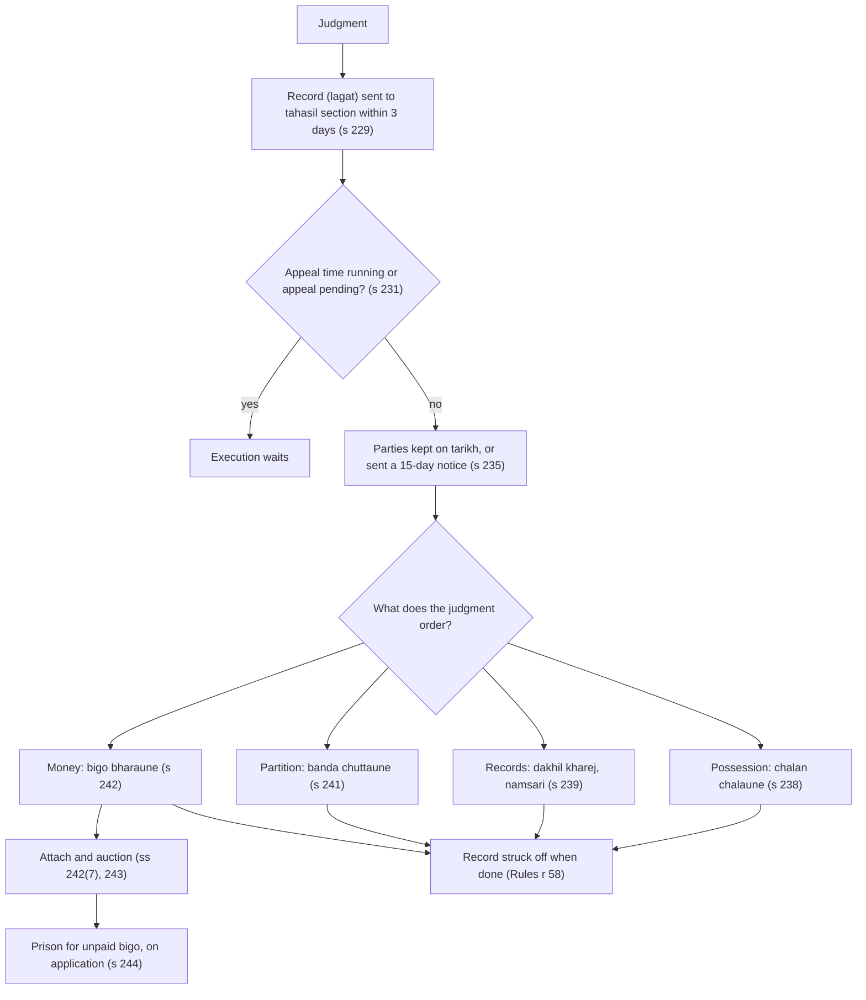

# Unit 8: Execution of Judgments

!!! abstract "In one line"
    A judgment is only paper until it is carried out. This unit covers how Nepal's courts carry out (execute) civil and criminal judgments. It asks who does it, how property is handed over or sold, and how money and fines are recovered. It also covers how a prison term is fixed, and what a party can do if the officer in charge gets it wrong.

## Why it matters for the exam

- **Asked as a full 20-mark question in two of the three new-course papers:** 2079 Q6 "Write in detail about the execution of criminal judgement." and 2077 Q6 "Execution of judgement is important to provide actual justice. Whether Nepalese laws on execution of judgement are able to provide such justice or not?"
- **Old course:** 2078 Q4 "What do you mean by execution of judgements in civil case? Critically examine."
- Expect one long question on execution: civil, criminal, or the "actual justice" question. All three are written out below.
- Two prescribed cases belong here: [Samir Khan v Kathmandu District Court](cases/9-8-samir-khan.md) (fixing the prison term) and [Pradip Kumar Prasad Shah Kalwar v Ram Bhajan Raya Yadav](cases/9-9-pradip-kumar-prasad-shah-kalwar.md) (execution after a properly served notice).

## Key terms

| Term | Nepali | Plain meaning |
|---|---|---|
| Execution of judgment | फैसला कार्यान्वयन | Carrying out what a judgment orders |
| Record (lagat) | लगत | The court's register entry of what a judgment orders: amount, fine, prison, property |
| Tahasil section | तहसिल शाखा | The court section that carries out judgments |
| tahasildar | तहसिलदार | The officer in charge of the tahasil section; also called the execution officer (फैसला कार्यान्वयन अधिकारी) |
| Bigo | बिगो | The amount a judgment orders to be paid, including compensation |
| bigo bharaune | बिगो भराउने | Recovering the bigo from the loser for the winner |
| chalan chalaune | चलन चलाउने | Putting the winner into actual possession of property |
| dakhil kharej | दाखिल खारेज | Entering the new owner's name in the land records and striking off the old one |
| namsari | नामसारी | Moving a record into a new name, such as an heir's |
| banda chuttaune | बण्डा छुट्याउने | Separating each person's share in a partition |
| likhat pass | लिखत पारित | Getting a deed approved and registered by the office concerned |
| Attachment | जायजात | Seizing a person's property so it can be sold to pay what he owes |
| Freezing | रोक्का | Stopping any transfer of a property until the court releases it |
| lilam | लिलाम | Public auction of seized property |
| Floor price | पञ्चकिर्ती मूल्य | The lowest price the property is expected to fetch, fixed before an auction |
| Court team | डोर | Court staff sent out to the spot to hand over, divide or seize property |
| prison slip | कैदीपुर्जी / कैदी पूर्जी | The court's order telling the prison to hold a convicted person, and until when |
| Fixing the term | कैद ठेक्नु | Working out from which date to which date a prisoner is held |
| Striking off the record | लगत कट्टा | Closing a record entry because the judgment has been carried out (or the law says to close it) |
| milapatra | मिलापत्र | A compromise deed made in court |
| Judgment Execution Directorate | फैसला कार्यान्वयन निर्देशनालय | The Supreme Court's central office for executing and monitoring judgments |

## Start here: winning is not the end

Suppose Sita sues her neighbour for a plot of land and wins in the District Court. The judgment says the land is hers. But the neighbour is still living on it and will not leave. Has Sita got justice?

Not yet. She has a paper that says she is right. She gets the land only when the court **executes** the judgment: it sends staff to the spot, measures the plot, removes the neighbour, and hands the land to her.

The same is true in other cases:

- A creditor who wins a loan case wants his **money**, not just a judgment.
- A daughter who wins a partition case wants her **share** separated.
- In a criminal case, the convict must actually go to **prison**, pay the **fine**, and pay the victim **compensation**.

Execution is the last stage of a case. Lawyers often say it brings the "fruits" of the judgment to the winner. If this stage fails, the whole case was wasted. That is why the exam asks whether Nepal's execution law gives "actual justice".

## 8.1 General procedure for the execution of judgment

### Meaning

**Execution** means enforcing a judgment or final order through the court's own machinery, so that the party who won actually gets what the judgment gives. It turns a declaration of rights into a real result.

Three features stand out:

1. **It follows the judgment.** The executing court carries out the judgment as written. It does not re-decide the case.
2. **It is done by the court of first instance.** Whichever court gave the final judgment, the District Court where the case began carries it out.
3. **It uses the state's force.** The court can use force, attach and sell property, and send a person to prison.

!!! info "The constitutional base"
    Article 126(2) of the Constitution of Nepal: "All shall abide by the orders or decisions made by courts in the course of hearing of lawsuit." Article 128(4) lets the Supreme Court punish for contempt anyone who obstructs justice or disregards a judgment or order of the Supreme Court or a court below it. Section 18(1) of the Administration of Justice Act 2073 adds that a decision made in a case is final and all parties concerned must accept it, unless the law provides otherwise.

### The laws that govern execution

| Kind of judgment | Main law | Where |
|---|---|---|
| Civil | Muluki Civil Procedure Code 2074 | Chapter 22, ss 229-253 (फैसला कार्यान्वयन सम्बन्धी व्यवस्था) |
| Civil (detail) | Muluki Civil Procedure Rules 2075 | Chapter 7, rr 51-59 |
| Criminal | Muluki Criminal Procedure Code 2074 | Chapter 15, ss 151-168; s 168क (complaint), s 178 (release) |
| Criminal (detail) | Muluki Criminal Procedure Rules 2075 | Chapter 8, rr 78-84 |
| Criminal sentences | Criminal Offences (Sentencing and Execution) Act 2074 | ss 11, 17, 20, 22-40, 41-45 |
| Fine in default | Muluki Criminal Code 2074 | s 46 |
| All courts | Supreme Court Rules 2074 | Chapter 15, rr 127-141 (the Directorate) |
| District Courts | District Court Rules 2075 | Chapter 10, rr 85-91 (the tahasil section) |
| Contempt, inspection | Administration of Justice Act 2073 | ss 17, 18, 21 |

### The general steps in a civil case

### Step 1: the record (lagat)

Execution starts with a record. Section 229(1) of the Civil Procedure Code lists the kinds of judgment that need a record: possession, dakhil kharej, namsari, enforcement of a right of pre-emption, partition, recovery of bigo, and recovery of a fine or court fee. The employee concerned must prepare the record **within three days** of the judgment being prepared. He sends it to the **tahasil section**. For this Chapter, "bigo" includes any compensation the judgment orders (Explanation to s 229(1)).

The tahasil section opens a separate execution file with a copy of the judgment (s 229(2)). If the appeal court prepared the record, it sends the file and record to the District Court within three days (s 229(3)). Rule 51 of the Civil Procedure Rules 2075 sets out how the record is entered in the record book.

In criminal cases, s 151(1) of the Criminal Procedure Code says the court must prepare a record of the punishment, fine, bigo or compensation after judgment. Rule 78(1) of the Criminal Procedure Rules gives three days for this.

### Step 2: which court executes

| Situation | Civil (CPC s 230) | Criminal (CrPC s 152) |
|---|---|---|
| Normal rule | The District Court where the plaint or complaint was filed, whichever court gave the judgment (s 230(1)) | The District Court where the charge sheet or complaint was filed (s 152(1)) |
| Appeal court tried the case itself | The District Court concerned (s 230(2)) | Same (s 152(2)) |
| Executing court unclear | The District Court the appeal court names (s 230(3)) | Same, e.g. because of the number of accused, where they live or where their property is (s 152(3)) |
| Judgment of a body that is not a regular court | That body executes it (s 230(4)), unless the law is silent, when the court uses the Code (s 230(5)) | Same (s 152(4)-(5)) |

A special rule covers judgments that put someone into a post or remove him from it. The court must write to the office concerned within three days (CPC s 230(6)). The office must carry it out within 30 days and tell the court. If it does not, the court may order departmental action against the head of that office (s 230(7)).

### Step 3: when execution must wait

Execution must not run ahead of the case. Under CPC s 231, the court must **stay** execution:

1. while the time to appeal has not run out, where an appeal lies;
2. while an appeal is pending, until it is finally decided;
3. where a re-hearing (revision) has been ordered under s 219, until it is decided;
4. where review has been ordered under s 220, until it is finally decided.

In criminal cases, CrPC s 153(1) stays execution while an appeal may be filed or is pending, and, in cases that must be sent up for confirmation (साधक), until that is settled. But s 153(3) says that where a person is sentenced to prison, he must be sent to prison at once, unless the Code says otherwise. So a prison sentence normally starts at once.

### When execution need not wait

CPC s 232 lists cases where execution goes ahead anyway:

1. A party has only **applied** for review or revision. The court will execute unless it orders otherwise.
2. Someone has filed a suit to annul the judgment or a milapatra. Again, the court will execute unless it orders otherwise.
3. The property in dispute would **spoil** if execution waited. Or, in a compensation case, the winner gives a written undertaking to compensate the other side if he later loses on appeal. The court may then execute before the appeal time ends or the appeal is decided.
4. The parties agree on one part of a pending case, and the court orders that part executed separately.

## 8.1.1 Application for execution of judgments in civil and criminal cases

### Civil cases: execution starts with the party

In a civil case the court does not run after the winner. The winner must come forward and pursue execution. The Code does this through tarikh and notices.

1. **Tarikh for execution.** If the parties were present at judgment, the trial court gives them a tarikh for execution, set after the appeal time ends (CPC s 235(1)).
2. **If an appeal is filed** before that date, the court breaks the tarikh and puts the file aside (तामेली) to await the High Court's judgment (s 235(2)).
3. **After the appeal is decided**, the appeal court sends the file back. The trial court keeps the parties who appear on tarikh for execution (s 235(3)-(4)).
4. **Parties not on tarikh.** Sometimes the parties are not on tarikh, or do not appear, or no appeal was filed and a party is absent. Then the trial court sends them a **15-day notice** in the form of Schedule 24 to appear for execution (s 235(5)). For a party not on tarikh, it must send the notice within three days of receiving the file (proviso to s 235(5)).
5. **No tarikh where none is needed** (s 235(6)).
6. **Agent.** A party who cannot appear may appoint an agent (वारिस) for execution (s 233).
7. **Death or missed tarikh.** If a party dies during execution, his heir may take over the case. A party who misses a tarikh may have it restored under the Code (s 237).

**Coming late.** A party may come after his notice or tarikh has lapsed and the time to restore it has passed. The court will still execute, but it charges extra fees: **10 percent** more if he comes within six months, and **25 percent** more if within one year (s 236(1)). If he does not come even within that time, the court puts the execution proceeding in tameli (s 236(2)). This is subject to the Chapter's exceptions, including later recovery from concealed property under s 242(13). Putting execution in tameli does not itself cancel the judgment.

**Application showing property.** In a money case, the winner often has to find the loser's property himself. If the loser does not pay, the winner may apply, pointing out the loser's other property (s 242(6)). Rule 55 of the Civil Procedure Rules lists what the application must show. For land: its location, plot number, area, registered owner, minimum sale value and who holds it. For movables such as cash, shares or bank balances: their location, nature, owner and value.

**Fees.** The winner pays fees for execution. He pays 3 percent of the bigo recovered (s 242(14)). For possession, he pays 3 percent of the value, or Rs 1,000 if no value is stated (s 238(1)). In a partition, the fee is 2.5 percent of the value divided (s 241(23)). Section 249(1) sets 5 percent on any other amount the court recovers, unless the Chapter says otherwise.

### Criminal cases: execution starts with the court

Criminal cases include both government prosecutions and private complaints. The court executes the punishment **on its own**, without requiring the victim to start execution.

1. **Record.** The court prepares the record of punishment, fine, bigo or compensation (CrPC s 151(1)). If an appeal court convicts, it sends a copy of the judgment to the District Court to execute (s 151(2)).
2. **Order to act.** The court executes the judgment and orders any office whose help is needed (s 151(3)).
3. **Prison.** If the convict is in court, the court sends him to prison. If he is absent, the court orders the police, in the form of Schedule 49, to arrest him and hand him to the prison (s 151(4)).
4. **Prison slip.** The prison holds the convict once a prison slip is issued (s 154(1)).

**Where the victim must apply.** Private bigo and compensation work more like a civil claim. The convict must pay within **six months** of the judgment (CrPC s 165(1)). If he does not, he faces a fine of up to Rs 10,000 (s 165(2)). The person entitled may apply **within three years** of the final judgment, pointing out the convict's property (s 165(3)). Rule 77 of the Criminal Procedure Rules requires the court to tell the plaintiff, victim or informant of the judgment within three days, where bigo or compensation is awarded.

## 8.1.2 Role of the Judgment Execution Directorate

### Legal basis

The Judgment Execution Directorate (फैसला कार्यान्वयन निर्देशनालय) is set up by **rule 129 of the Supreme Court Rules 2074**. The Supreme Court made these Rules using the power in s 11 of the Supreme Court Act 2048 (preamble of the Rules). So the Directorate rests on court rules, not on a separate Act of Parliament.

- **Rule 2(ङ)** defines "Directorate" as the Judgment Execution Directorate under r 129.
- **Rule 129(1):** there shall be a Judgment Execution Directorate to execute, or cause to be executed, the judgments of the Supreme Court and the courts under it, and to monitor that work.
- **Rule 129(2):** the Supreme Court designates a gazetted first-class officer of the Nepal Judicial Service (judicial group) to work as its Director General.

### Functions (rule 130)

The main functions are:

1. To act as the **central body** for executing judgments (r 130(क)).
2. To keep the **central record** of prison terms, fines and government bigo, including on a computer network (r 130(ख)).
3. To keep a record of cases the Supreme Court tried itself and write to the court or body concerned to recover them (r 130(ग)).
4. To classify the Supreme Court's **directive orders**, say which body must do what and by when, and send them through the Office of the Attorney General (r 130(घ)). It monitors them, and puts unexplained delays before the bench (r 130(ङ)-(च)).
5. To publish up-to-date lists of unpaid prison terms, fines and government bigo, and write to government bodies to recover them (r 130(छ)).
6. To help recover fines, prison terms and government bigo, and to help with recovering bigo, chalan chalaune, banda chuttaune and compensation to victims, and to monitor these (r 130(ज)).
7. To coordinate with government bodies, local levels and the police (r 130(झ)).
8. To monitor, inspect and evaluate execution by the courts below, and give them directions (r 130(ञ), (ड)).
9. To manage records of exhibits, deposits and bail (r 130).
10. To train staff, approve forms, suggest legal reform, and build software for execution (r 130, last clauses).

### Other powers around the Directorate

| Rule | What it says |
|---|---|
| r 127 | After a Supreme Court judgment, a party present who must pay a fine or government bigo pays it; if not, he is given a prison slip. A party sentenced to prison is sent to prison with a prison slip. Copies of directive orders go to the Directorate. |
| r 131 | The Director General settles doubts that lower courts refer to it, orders restoration of a record struck off on false grounds or against the law, and writes for action against a tahasildar found acting in bad faith |
| r 132-133 | A Central Record Section keeps the national record. A Judgment Execution Section arrests and recovers, and mobilises police |
| r 134 | A body that cannot carry out a directive order in time may ask, through the Attorney General, for more time |
| r 135-136 | A Central Record Clearance Committee may, after a public notice, give discounts on very old records: 75 percent on records more than 50 years old, 50 percent on 30-50 years, 25 percent on 20-30 years. It may also order old records closed where the person is 100 or older, or where small amounts (up to two years' prison, Rs 25,000 fine, Rs 25,000 government bigo) have stayed unrecovered for 20 years. Rule 135(1) says this is subject to s 246 of the Civil Procedure Code. |
| r 137 | A person may pay a fine or government bigo at the Directorate or at any court |
| r 139 | All tahasil section staff of the District Courts work under the Directorate |
| r 140 | Everyone must cooperate with execution staff. Police must promptly obey the Directorate's orders. On the Directorate's request, the bodies that supply water, electricity and telephone must stop service to a person who has not paid a fine or government bigo, until he pays. |
| r 141 | District Courts and quasi-judicial bodies must send execution details to the Directorate; each High Court reports the records it sends down |

At district level, rule 85(8) of the District Court Rules 2075 requires the monthly report of records cleared and pending to go to the Directorate, the appeal court and the Supreme Court. Rule 87 lets a District Court ask service bodies to stop services to people who have not paid fines.

!!! tip "Exam tip"
    In one line: the **tahasildar** executes in each District Court; the **Directorate** keeps the national record, supervises the tahasil sections, follows up the Supreme Court's directive orders, and chases unpaid fines and prison terms across the country.

## 8.1.3 Bigo bharaune, chalan chalaune, likhat pass, dakhil kharej, namsari and banda chuttaune

### (a) Bigo bharaune: recovering the money (CPC s 242)

1. **Does the winner want it?** If the winner is on tarikh, the court records in writing whether he wants the bigo recovered (s 242(1)). If he does not, the court explains the result, ends execution that day and strikes off the record (s 242(2)).
2. **Time to pay.** If he wants it and the loser is on tarikh, the court gives the loser **up to 35 days** to pay (s 242(3)). He may pay in cash, by a bank's good-for-payment cheque or by other means (s 242(4)). He may also ask that the bigo be recovered from a property of his own (s 242(5)).
3. **Winner points out property.** If the loser does not appear, does not pay, or offers property the winner does not accept, the winner may apply, pointing out other property (s 242(6)).
4. **Freeze and auction.** The court freezes the property and, if needed, auctions it (s 242(7)). Any surplus goes back to the loser (s 242(8)). If he does not take it, it is deposited, and after one year it goes to government revenue (s 242(9)-(10)).
5. **Property in another district.** The court writes to that district's court, which recovers the bigo and reports back (s 242(11)-(12)).
6. **Hidden property.** If the winner finds property the loser hid, while the loser is alive, the court auctions it and pays the winner up to the bigo (s 242(13)).
7. **Instalments.** If the loser files a commercial bank's guarantee and the winner agrees, the court may let him pay in instalments (s 242(15); Civil Procedure Rules r 56).
8. **Fee.** 3 percent of the bigo, paid by the winner (s 242(14)).

### (b) Chalan chalaune: handing over possession (CPC s 238)

1. **Deposit.** Before the court team goes out, the winner deposits 3 percent of the bigo of the property, or Rs 1,000 if no bigo is stated (s 238(1)).
2. **Date and notice.** On the day of deposit, the court fixes the day the team will go and gives the parties tarikh to be on the spot. A party not on tarikh gets notice within seven days (s 238(2)). If it is a house or land, the notice also asks the occupier to vacate it within seven days (s 238(3)). A third person in possession is also told to be present (s 238(4)). Civil Procedure Rules rr 52-53 give the forms.
3. **Handing over.** On the fixed day the team hands over the property as the judgment says (s 238(5)). If the judgment does not say which side of a house or land, the court divides it fairly in the parties' presence and draws lots (s 238(6)).
4. **Witnesses.** A local-level representative and at least two witnesses must be present (s 238(7)).
5. **Force.** If anyone resists, the court may use force as needed (s 238(8)).
6. **Locked house or shop.** If the occupier is present, he is told to open it. If not, a seven-day notice in the form of Schedule 25 is pasted on the door. After that the court breaks the lock and hands it over (s 238(9)-(10)). Goods found inside are listed and held. The owner gets a seven-day notice to collect them within 35 days. If he does not, they are auctioned (s 238(11)-(12)).
7. **Receipt.** The winner gets a receipt (निस्सा) for the possession (s 238(19)).
8. **Time limit.** The court must complete chalan within **six months** of the parties appearing (s 238(20)).
9. **Re-entry.** If anyone takes back property once handed over, the court may fine him up to Rs 25,000 or imprison him up to three months, **each time**. It hands the property back again without a new plaint or extra fee (s 238(16)).
10. **Property that cannot be divided.** Land or a building may be impossible to split by law. Then the court fixes its value by agreement, or else at the floor price, or auctions it. The winner gets its value (proviso to s 238(22)).
11. **Encroaching building.** A building put up on another's land is demolished at the builder's cost (s 238(23)). If the parties agree not to demolish it but cannot agree on compensation, the winner gets the floor price plus 25 percent (s 238(24)).

### (c) Dakhil kharej and namsari: changing the records (CPC s 239)

1. If the party who is to get the record changed is on tarikh, the court writes to the office concerned (usually the Land Revenue Office) with the details. It sends the party to that office to appear **within 21 days** (s 239(1)).
2. When the party appears, the office must make the change **within three days** (s 239(2)).
3. If the party comes after 21 days, the office still makes the change, but charges a fee of Rs 500 for each year of delay (s 239(3)).

### (d) Likhat pass: registering a deed

"Likhat pass" means getting a deed approved by the office concerned. Under s 463 of the Muluki Civil Code 2074, a deed is "passed" when that office approves it. Until the government names another office, this is the Land Revenue Office (Explanation to s 463). Section 464(1) lists deeds that **must** be passed: any deed transferring immovable property, certain kinds of mortgage deed, gifts of immovable property that take effect after the giver's death, exchange, partition, and others. A deed that must be passed but is not has no legal recognition (s 464(2)). Section 218 requires a partition deed to be passed in this way.

Chapter 22 of the Civil Procedure Code has no section headed "likhat pass". Section 229(1) lists possession, dakhil kharej, namsari, pre-emption, partition, bigo, fine and court fee. Where a judgment needs a deed to be registered, the closest Code rule is s 239: the court writes to the registering office.

!!! warning "Unverified"
    We found no section that sets a separate execution procedure for likhat pass. The link to s 239 is our reading, not stated in the Code.

### (e) Banda chuttaune: separating shares in a partition (CPC s 241)

1. **Time.** If the parties are on tarikh, the court must separate the shares **within six months** (s 241(1)).
2. **Absent coparceners.** If one of several coparceners is absent, he gets a 15-day notice (Schedule 26). If he still does not come, the court separates his share and divides the rest (s 241(2)-(4)). He cannot later complain about the division (s 241(5)).
3. **Court team.** Where needed, the court sends staff to divide on the spot (s 241(6)).
4. **Showing the property.** The person holding the property must show it as listed (फाँटवारी). If he cannot be found or does not show it all, he gets a 15-day notice (Schedule 27). If he still does not come, the court opens any locked property before a local representative and two witnesses and divides it (s 241(7)-(9)).
5. **Shortfall.** If listed property is missing, its value comes out of his share, and then from his other property (s 241(12)).
6. **Property that cannot be shared.** It goes to a coparcener at an agreed price or the floor price; if more than one wants it, by lots; if that fails, by auction open to outsiders, and the money is divided (s 241(14)-(16)). If the coparceners do not agree how to divide, the court balances the shares and draws lots (s 241(17)).
7. **Penalty.** A person who does not show or deposit property in his charge is fined 5 percent of its value (s 241(18)).
8. **Other coparceners.** Other defendants may also ask for their shares to be separated, on paying the court fee (s 241(19)).
9. **Changes during the case.** If property is transferred or coparceners increase or decrease before execution, no new plaint is needed; an application is enough (s 241(22)).
10. **Fee.** 2.5 percent of the value divided (s 241(23)).

Section 234(1) of the Muluki Civil Code says the trial court must deliver a share, maintenance or amount awarded by judgment as quickly as it can, on application. If it is not delivered, the court may also award reasonable compensation (s 234(2)).

### (f) Enforcing a right of pre-emption (निखनाई दिने, CPC s 240)

Section 229(1) also names "निखनाई दिने". This enforces a judgment allowing someone with a preferential right to take transferred property on paying the required price. The Civil Code treats this right under pre-emption (हकसफा, s 454). Under CPC s 240(1)-(2), the court sends the parties to the office holding the deposit. When both appear, the office pays the person required to transfer the property within seven days. It gives the deed and receipt to the person entitled under the judgment.

### Striking off the record

When the work is done, the officer strikes off the record and certifies it (Civil Procedure Rules r 58; r 51(9)).

## 8.1.4 Compromise between the parties in execution

A case can be settled even after judgment. Settling during execution saves time and may give both sides a better result than forced sale.

1. **Joint application.** Despite anything else in Chapter 22, the parties may jointly apply to carry out the judgment through milapatra or melmilap (CPC s 234(1)).
2. **Not for government money.** No such application lies for recovering **government bigo** (proviso to s 234(1)).
3. **Time.** The court must give the parties a reasonable period for it (s 234(2)).
4. **The deed.** If they agree in time, the court or the officer in charge of the tahasildar's work must have them make a milapatra under the law (s 234(3)).
5. **Failure.** If they do not agree, the court carries out the judgment under Chapter 22 (s 234(4)).

The District Court Rules 2075 add detail. The tahasildar may send an execution application to a mediator on the court's list, for up to **45 days**, if the parties agree (r 89). If they settle, the mediator prepares the milapatra and its application and presents them to the tahasildar, who has the milapatra made and collects the fee (r 90(1)-(2)).

**Carrying out a milapatra.** Where a milapatra requires a government office to do something, the court must write to that office within three days (CPC s 247(1)). If not all plaintiffs or defendants appear, the milapatra is still carried out after that time, protecting the interests of those who did not come (s 247(2)).

**Instalments by agreement.** The winner may agree to take the bigo in instalments against a bank guarantee (s 242(15); Rules r 56(2), where the tahasildar records the agreement).

**Criminal cases.** A victim and a convict may agree on compensation. If the agreement looks reasonable, the court may order compensation according to it (Sentencing Act s 44).

## 8.1.4(i) Seizing property and recovering fines

### Attachment (jayjat) in civil cases

**What can be seized.** CPC s 243(1) sets out whose shares in a property may be attached along with the debtor's, where family members use the property. Section 243(2) protects some things from attachment:

1. property that is someone else's private property;
2. up to three sets of clothes and shoes for the debtor and his household;
3. one set of cooking and eating utensils, bedding and a reasonable amount of furniture;
4. books the household needs for study;
5. medicine and health equipment bought before the attachment began;
6. food grain for up to three months;
7. one set of tools for the household's trade or job.

Items under clauses (2) to (7) are protected only up to **Rs 1 lakh** in total (s 243(3)). If the attachment still does not cover the bigo, other family members cannot be arrested for it (s 243(4)).

**Death of the debtor.** The bigo is recovered from his estate. If that is not enough, the shortfall comes from the heir who took his property, but never more than the heir received (s 245).

### Prison for unpaid bigo (civil imprisonment)

Where the auction does not cover the bigo, or no property is shown, or it cannot be auctioned, the winner may apply **within 15 days** to have the debtor imprisoned (CPC s 244(1)).

| Rule | Section |
|---|---|
| The unpaid bigo is turned into prison at **Rs 400 a day** | s 244(2) |
| Maximum **four years** for bigo owed to the government or a public body it owns or controls; **two years** for bigo owed to a private person or other body | s 244(3) |
| An amount under Rs 400 counts as one day | s 244(4) |
| The person asking for imprisonment pays the prisoner's living costs (सिदा खर्च) | s 244(5) |
| The debtor must get a reasonable chance to be heard first | s 244(7) |
| Once imprisoned for the unpaid bigo, the claim for that bigo cannot be brought again | s 244(8) |

### Fines in civil cases

A fine imposed in a civil judgment (for example, s 241(18) or s 238(16)) is recovered in the same way. A person who pays the fine at once, or within **60 days** of the judgment, gets a **20 percent** discount (CPC s 246). If the fine is not paid, prison is fixed at **Rs 200 a day**, up to four years (s 244(6)).

### Fines in criminal cases

1. **Pay at once.** The convict must pay the fine at once (Sentencing Act s 20(1); CrPC s 162(1)).
2. **Instalments.** If he cannot pay at once and gives property as security, the court may let him pay in up to **three instalments** within one year (Sentencing Act s 20(2); CrPC s 162(2)). Any deposit or bail he already gave is used first (CrPC s 162(3)).
3. **Judgment must say.** When fixing a fine, the judgment must state the amount, the date to pay, any instalments, and the prison that may follow if he does not pay (Sentencing Act s 17(ख)).
4. **Prison for unpaid fine.** If he does not pay after the final judgment, the court orders the prison to hold him for the unpaid fine (CrPC s 162(4)). If part is paid, or he has already spent time in jail, the prison term is reduced in proportion (s 162(5)).
5. **Limits.** Muluki Criminal Code s 46(1): a fine is recovered from the convict's property; if he has none, or it cannot be recovered, he may be imprisoned. Section 46(2) caps that prison. Where the offence carries both prison and fine, the cap is **ten years**. Where only a fine was imposed for an offence that could carry either, the cap is **half the upper prison limit**. For a fine-only offence, it is **two years**. Section 46(3) sets lower limits for children.
6. **Time already in custody.** Where only a fine is imposed, each day spent in detention during the investigation takes **Rs 300** off the fine (CrPC s 161(2)).

### Government bigo and private compensation in criminal cases

| Point | Rule | Section |
|---|---|---|
| Priority | Government bigo is recovered before private bigo, unless the private judgment came first | CrPC s 163(1) |
| Freeze | The convict's property is frozen as soon as possible after judgment | s 163(2) |
| Sale | Unpaid within 30 days of the final judgment: movables are taken from the bank or body holding them, immovables are auctioned | s 163(3) |
| Prison | Still unpaid: prison on a scale from one month (Rs 5,000-10,000) to one year (Rs 50,000-1 lakh), then six months for every further Rs 50,000. Below Rs 5,000, Rs 300 a day. Never more than **seven years** | ss 163(4), 164 |
| Private bigo and compensation | Pay within six months, or a fine up to Rs 10,000; victim applies within three years; property frozen and auctioned | s 165(1)-(4) |
| Prison for unpaid private bigo | Apply within 30 days; Rs 300 a day; maximum two years (individual) or four years (public body), and up to four years for compensation; the **Government of Nepal** pays the living costs | s 165(7)-(11) |
| Hidden property | Confiscated; 25 percent to the person who found it; the rest pays the victim | s 165(12) |
| Deposit or bail | Used first, in this order: fine, government bigo, compensation, bigo, other amounts | s 166(1)-(2) |
| Third person's surety | Gets 45 days' notice to pay before his property is auctioned | s 166(5) |
| Compensation | Paid at once or in up to three instalments in a year; if not, attachment, then prison at Rs 300 a day, maximum four years | Sentencing Act ss 42, 45 |
| Death of convict | Prison and fine abate; bigo and compensation are still recovered from his property, in the order government bigo, compensation, private compensation, bigo | CrPC s 158 |

### Help from other bodies

- The court team (डोर) must go out at least twice a year to where unpaid convicts live, and arrest those it cannot recover from. It may take help from the local level and the police (District Court Rules r 86(1)-(2)).
- A government employee who goes to recover a fine or government bigo and gives up his travel allowance gets **25 percent** of what he recovers. The tahasildar gets **5 percent** (CPC s 253; District Court Rules r 86(3)-(4)). A private person who recovers a fine or government bigo may be given the same amount as under s 253(2) (s 253(4)).
- A person who owes a fine can be arrested wherever court staff find him, including when he comes to court on other work (District Court Rules r 85(9)).
- Public services can be stopped until he pays (Supreme Court Rules r 140(4); District Court Rules r 87).

## 8.1.4(ii) Auction of attached property (lilam): "Foreclosure (Muitavi) and its procedure"

!!! note "About the syllabus wording"
    The syllabus heading reads "Foreclosure (Muitavi) and its procedure". The Nepali word is unclear. multavi (मुलतबी) means postponement, which does not match "foreclosure". In English law, foreclosure means a creditor taking a mortgaged property when the debt is not paid. The closest steps in Nepal's execution law are attachment (जायजात), freezing (रोक्का) and auction (लिलाम) of the debtor's property, while CPC s 240 deals separately with pre-emption rather than mortgage foreclosure. These notes therefore cover the auction procedure under this heading. Learn it as "auction of attached property".

### When property is auctioned

- To recover bigo in a civil case (CPC s 242(7)).
- Goods left in a house handed over under chalan, if not collected (s 238(12)).
- Perishable property in a partition, or property that cannot be shared (s 241(13), (16)).
- Property that cannot be subdivided in chalan (proviso to s 238(22)).
- To recover a fine, government bigo or compensation from a convict (CrPC ss 157, 163(3), 165(4), 166(4), (6)).
- Property of a convict who absconds for six months after an arrest order (CrPC s 157(1)).

### The procedure (Civil Procedure Rules r 57)

1. **Freeze.** If the property is not yet frozen, the court writes to the office concerned to freeze it (r 57(क)).
2. **Inventory.** Court staff go to make an inventory record (muchulka) of the property, its condition and its real and local market value (r 57(ख)). A local-level member or representative and two witnesses must be present (r 57(ग)).
3. **Floor price.** The court fixes the **floor price** (पञ्चकिर्ती मूल्य) with a local-level representative and a representative of a nearby office as witnesses (r 57(घ)). It may first have an expert valuer value the property; the plaintiff pays this cost but can recover it from the defendant (r 57(ङ)-(छ)). The bases include the value in the application or judgment, the value at the time of bail, the inventory value, the Land Revenue Office's registration value, the tax value, recent nearby sales, and the location (r 57(ज)). "Floor price" means the lowest price the property could fetch when sold (Explanation to r 57).
4. **Public notice.** At least **15 days** before the auction, a public notice (Schedule 20) is given to the person concerned. It is posted at the property, the local level, a busy office and the court's notice board, and published in local media if possible (r 57(ञ)).
5. **The auction.** Bidding takes place in the presence of representatives of the local level and of the Treasury and Accounts Controller Office. Their absence does not stop the auction (r 57(झ)).
6. **No buyer.** If no one bids the floor price, a second auction is held. If still no one bids, the applicant may take the property at the floor price. If he does not want it, the matter goes to tameli (r 57(ट)-(ड)).
7. **Payment.** The highest bidder pays **10 percent** at once and the rest within **seven days**. If he does not, his payment is forfeited and the property is auctioned again (r 57(ढ)).
8. **Possession.** The buyer gets a possession order (चलन पूर्जी) and is put in possession (r 57(ण)).
9. **Stop by paying.** If the debtor pays the amount and the auction costs before the final bid is accepted, the auction stops (r 57(त)).

Rule 84 of the Criminal Procedure Rules 2075 sets a similar procedure for auctions under Chapter 15 of the Criminal Procedure Code.

### Money from the auction

- Surplus after the bigo goes back to the debtor (CPC s 242(8)).
- A person entitled to auction money must take it within **six months** of the auction, or lose it to government revenue (s 248(3)-(4)).

### Case link: Pradip Kumar Prasad Shah Kalwar

In [Pradip Kumar Prasad Shah Kalwar v Ram Bhajan Raya Yadav](cases/9-9-pradip-kumar-prasad-shah-kalwar.md) (NKP 2073, No. 10, D.N. 9690), the creditor Ram Bhajan won a loan case in the Bara District Court on 2065/3/1. The debtor Pradip did not appeal. On 2066/2/25 Ram Bhajan applied for bigo bharaune. A 35-day notice was pasted on Pradip's door on 2066/6/22. Pradip's son and wife applied in the execution for their land to be released. They said they had separated from him by partition.

Pradip later said he had never received the notice of time to appeal, and asked for it to be cancelled. A Joint Bench of the Supreme Court dismissed his writ petition. The notice had been served the way the old law (Adalati Bandobasta No. 110) required, and the burden was on Pradip to show what step was missed. A properly served notice will not be cancelled without reason just to give a fresh chance. So the judgment was final and recovery could go ahead.

**Lessons for execution:**

- Execution follows a **final** judgment. Today, CPC s 231 says execution waits while the appeal time runs and while an appeal is pending.
- Once the appeal time has properly run out, a bare claim of "I did not know" will not stop execution.
- The case also shows how slow execution can be. Judgment came in 2065, recovery began in 2066, and the Supreme Court decided the writ only on 2072/12/22.
- Today the execution notice is 15 days (s 235(5)), and a debtor on tarikh gets up to 35 days to pay (s 242(3)).

## 8.1.4(iii) Determining the term of imprisonment and its enforcement

### Fixing the term

When a court sentences someone to prison, the judgment must state the length of the term, the date he was first held, and the date the term ends (Sentencing Act s 17(ग)). The tahasil section then "fixes the term" (कैद ठेक्नु). It works out from which date to which date he must be held, and issues a prison slip.

**Counting the term.** The term is counted from the date the convict was first held in custody or detention. If he was not held, it runs from the date he entered prison. Days on which he was out of custody do not count (Sentencing Act s 40(1)-(2)).

**Deducting time already spent.** Time a convict spent in custody or detention during the investigation is deducted from his prison term. He serves only the rest (CrPC s 161(1)).

**Life imprisonment.** Under s 41 of the Muluki Criminal Code, some offences (such as murder with cruel torture, or murder after rape) carry imprisonment for the rest of the convict's life. For other life sentences, life imprisonment is counted as **25 years** (Criminal Code s 42; see also Sentencing Act s 35).

### Several sentences

| Situation | Rule | Section |
|---|---|---|
| Several offences in one incident | A separate sentence is fixed for each | Sentencing Act s 11(1) |
| One act is an offence under different Acts | The heavier Act's punishment is carried out, but a separate sentence must be fixed for each | s 11(3) |
| One person, one case, different prison terms | Only the **heaviest** is carried out; if equal, only one | s 36(3)-(4) |
| A person serving a term gets another sentence | If the earlier term is as long or longer, only it is served; if the later one is longer, only the difference is added | s 36(1) |
| Sentence for another offence before the first term is served | It runs after the first term ends | s 36(2) |
| Repeat or combined offences | A separate punishment set by law prevails | s 36(5) |

For s 11, prison and fine count as separate punishments and are carried out separately (Explanation to s 11).

### Case link: Samir Khan v Kathmandu District Court

[Samir Khan v Kathmandu District Court](cases/9-8-samir-khan.md) (NKP 2071, No. 9, D.N. 9245, decided 2071/5/9) is the prescribed case on this point.

**Facts.** Three Bangladeshi men were prosecuted for forging Nepali citizenship and passports. They were held from 2070/3/18. On 2071/3/17 the Kathmandu District Court convicted them on three counts from one charge sheet: 13 months under the Citizenship Act, 6 months under the Passport Act and 1 year under the Forgery chapter of the Muluki Ain. When fixing the term, the District Court added the three, making 2 years 7 months each. Its letters told the prison to hold them until 2072/10/17.

**Decision.** A Joint Bench issued habeas corpus. Under Nos. 10 and 41 of the Punishment chapter of the old Muluki Ain, in a case brought by one charge sheet, prison terms under several Acts cannot be added up unless an Act says so. Only the longest, 13 months, applied. Counted from 2070/3/18, it had ended on 2071/4/17, so their further detention was unlawful. The Court ordered their immediate release.

**Lessons for execution:**

- Fixing the term is part of executing the judgment, and it must follow the law.
- Time already spent in jail counts. Both courts counted from 2070/3/18, the day they were first held.
- A prison slip does not make detention lawful once the lawful term is over. Habeas corpus will free the prisoner (today under Articles 133 and 144 of the Constitution).
- Today the same idea is in Sentencing Act s 36(3): in one case, only the heaviest prison term is carried out.

### Enforcing the term

1. **To prison.** If the convict is in court, he is sent to prison; if not, the police are ordered to arrest him (CrPC s 151(4)).
2. **Prison slip.** The prison holds him once a prison slip is issued. It must keep an up-to-date record of when he was first held and when his term ends (s 154(1)-(2)). The court sends a prison slip at once when the prison asks for one (Criminal Procedure Rules r 79).
3. **Children.** A convict under 18 is kept in a separate child reform home, not a prison (proviso to s 154(1)).
4. **Doubt.** If the prison is in doubt about carrying out a judgment, it writes to the District Court and follows its direction (s 151(5)).
5. **Release.** When a court orders release, it sends the prison an order giving the reason and details. The prison releases the person at once. If the person is in court, the court releases him on the spot and tells the prison (CrPC s 178).

### Paying instead of serving prison

- **First offenders.** A first offender sentenced to one year or less may ask to pay instead of going to prison. He signs an undertaking of good conduct and pays **Rs 300 a day**. If he commits an offence punishable with prison within three years, the earlier term is added (CrPC s 155(1)-(4)).
- **Foreigners.** A foreigner with one year or less may pay **Rs 500 a day** (except for listed serious offences). He must be sent out of Nepal within seven days (s 155(5)-(6)).
- Half of this money goes to the victim relief fund. Paying counts as serving the term (s 155(7)-(8)).

### Other ways of serving a sentence (Sentencing Act)

| Measure | Who | Section |
|---|---|---|
| Community service | Up to six months' prison, with consent | s 22 |
| Suspended sentence | First offender, under one year, not for listed serious offences; up to three years | s 24 |
| Reform home | Two years or less, on a probation officer's advice | s 25 |
| Rehabilitation centre | Drug users, people with physical or mental weakness | s 26 |
| Weekend or night prison | Up to one year | s 27 |
| Open prison | After two-thirds served, good conduct | s 28 |
| Parole | Over one year, after two-thirds served, good conduct; not for life, rape, corruption, trafficking and other listed offences | s 29 |
| Pre-release outings | Last six months of a term over one year | s 30 |
| Labour for public work | Three years or more; one extra day off for every three days of work | s 31 |

!!! warning "Unverified"
    Under s 1(2) of the Sentencing Act, ss 22 and 24-31 (and s 17(घ)-(छ) and s 49) start on a date the Government of Nepal fixes by notice in the Nepal Gazette. We did not check whether that notice has been published.

**Remission.** A prisoner whose conduct improves and who has served **50 percent** may have his term reduced by the prison, as prescribed (Sentencing Act s 37). This is not open to those serving life imprisonment, or convicted of rape, corruption, trafficking and other listed offences. A prisoner may also be taken to hospital, and that time counts as served (s 34).

**Pardon.** A convict may apply through the Ministry of Home Affairs to the President for pardon, postponement, change or reduction of his sentence (CrPC s 159(1)). It is not available for corruption, torture, rape, cruel murder, acid attacks, genocide, explosives, kidnapping, trafficking, money laundering, or drug trafficking punishable with more than three years (s 159(4)). It cannot be considered while an appeal or other proceeding is pending (s 159(5)). A pardon does not annul the judgment (s 159(10)).

**Absconding convicts.** If a convict is never found, his record is struck off after a long period (CrPC s 160(2)). The period runs from 50 years for life imprisonment down to 12 years for a term of up to one year. If found later, the sentence is still carried out (s 160(3)). Until he serves it, he cannot hold public office (s 160(5)).

## 8.1.4(iv) Filing a complaint against the proceedings of the execution officer

The tahasildar and court staff make many decisions in execution: which property to seize, its value, the date of auction, how to fix the term. A party who thinks a step was wrong has a quick remedy.

### Civil cases (CPC s 250)

1. **Complaint to the judge.** A person concerned who is not satisfied with any act of the employee in execution may complain to a judge of the **same court** within **15 days** (s 250(1)).
2. **Application to the appeal court.** A person not satisfied with the decision on that complaint may apply to the appeal court (s 250(2)). The section gives no time limit for this step.
3. **Time to decide.** The complaint must be decided within **one month** and the application within **two months** (s 250(3)).
4. **Bar.** A party who got notice to appear for execution but stayed away from his tarikh cannot complain or apply (s 250(4)).

### Criminal cases (CrPC s 168क)

1. A person concerned may complain against an act of a court employee to a judge of the same court within **15 days** (s 168क(1)).
2. A person not satisfied may apply to the appeal court within **15 days** of that decision (s 168क(2)).
3. One month for the complaint, two months for the application (s 168क(3)).
4. A party who got notice to appear for execution but stayed away cannot use it (s 168क(4)).

### Other checks on the execution officer

- **The Director General** of the Directorate may order a record restored if it was struck off on false details or against the law. He writes for action against a tahasildar who acted in bad faith (Supreme Court Rules r 131(ङ)-(च)).
- **The chief judge** of the District Court has final responsibility for keeping records correct and recovering fines and prison terms (District Court Rules r 91(1)).
- **Inspection.** The appeal court must inspect the courts below at least once a year. It checks whether execution was done on time (Administration of Justice Act s 21(1), (4)(क); District Court Rules r 88).
- **Absence of the local representative.** A step that is otherwise proper is not void just because the local-level representative did not come or sign (CPC s 251).
- **Writ.** Where an alternative remedy exists and has been used, a writ is not normally available. In *Pradip Kumar Prasad Shah Kalwar*, the Supreme Court refused to use its writ power to reopen a complaint that the courts had already examined under the alternative remedy of the old law. Where the detention itself is unlawful, habeas corpus lies, as in *Samir Khan*.

### Obstructing execution

Every party has a duty to cooperate with execution. A person who obstructs it may face contempt proceedings, or a fine up to Rs 1,000, or prison up to three months, or both (CPC s 252). Under s 17 of the Administration of Justice Act, any court may punish contempt, including disregard of its judgment (s 17(1)-(3)). The punishment is up to one year's prison, a fine up to Rs 10,000, or both (s 17(4)).

## Nepal's law at a glance

| Law | Section or rule | What it says |
|---|---|---|
| Constitution 2015 | Art 126(2) | All must abide by court orders and decisions |
| | Art 128(4) | Supreme Court may punish contempt, including disregard of judgments |
| | Art 21(2) | A victim of crime has the right to justice, including social rehabilitation and compensation, as provided by law |
| Administration of Justice Act 2073 | s 17 | Contempt: up to one year, Rs 10,000, or both |
| | s 18(1) | Decisions are final and binding on all parties, unless law says otherwise |
| | s 21(4)(क) | Inspection checks whether execution was done on time |
| Civil Procedure Code 2074 | s 229 | Record within three days |
| | s 230 | District Court of first instance executes |
| | ss 231-232 | When execution waits and when it does not |
| | s 234 | Compromise in execution (not for government bigo) |
| | ss 235-237 | Tarikh, 15-day notice, late fees, heirs |
| | s 238 | Chalan chalaune: within six months; force; re-entry fine |
| | s 239 | Dakhil kharej and namsari: 21 days, then three days |
| | s 241 | Partition: within six months |
| | s 242 | Bigo: 35 days to pay; freeze and auction; instalments |
| | s 243 | Exempt property |
| | s 244 | Prison for bigo (Rs 400/day; two or four years) and for fines (Rs 200/day; four years) |
| | s 246 | 20 percent off a fine paid within 60 days |
| | s 250 | Complaint against the employee: 15 days to the judge |
| | s 252 | Obstruction: Rs 1,000, three months or both |
| Criminal Procedure Code 2074 | ss 151-154 | Record, executing court, stay, prison slip |
| | s 155 | Paying instead of prison |
| | ss 156-157 | Freezing and auctioning an absconder's property |
| | ss 158-160 | Death, pardon, striking off |
| | s 161 | Time in custody deducted |
| | ss 162-166 | Fines, government bigo, private bigo and compensation, deposits |
| | s 168क | Complaint against court employee |
| | s 178 | Release |
| Sentencing Act 2074 | ss 11, 36, 40 | Several sentences; counting the term |
| | ss 20, 42, 45 | Fines and compensation; prison for unpaid compensation |
| | ss 22-31, 37 | Alternatives, parole, remission |
| Criminal Code 2074 | ss 41-42, 46 | Life imprisonment; prison for unpaid fine |
| Supreme Court Rules 2074 | rr 127-141 | Judgment Execution Directorate |
| District Court Rules 2075 | rr 85-91 | Tahasil section; mediation in execution |
| Civil Procedure Rules 2075 | rr 51-59 | Record, chalan, auction |
| Criminal Procedure Rules 2075 | rr 77-84 | Victim notice, record, prison slip, auction |

## Compare

### Civil and criminal execution

| Point | Civil execution | Criminal execution |
|---|---|---|
| Main law | CPC Chapter 22 (ss 229-253) | CrPC Chapter 15 (ss 151-168), Sentencing Act |
| Who starts it | The winning party (tarikh, notice, application) | The court itself; the victim applies only for private bigo and compensation |
| What is enforced | Money, possession, records, partition, pre-emption | Prison, fine, government bigo, compensation, private bigo |
| Executing court | District Court where plaint was filed (s 230) | District Court where charge sheet was filed (s 152) |
| Stay pending appeal | Yes (s 231), with exceptions (s 232) | Yes (s 153(1)), but prison starts at once (s 153(3)) |
| Prison as a means | For unpaid bigo, on the winner's application; Rs 400/day; max two or four years | For unpaid fine, government bigo, private bigo and compensation; various limits |
| Who pays prisoner's living costs | The person asking for imprisonment (s 244(5)) | Government of Nepal for private bigo prison (s 165(11)) |
| Compromise | Milapatra or melmilap, except government bigo (s 234) | Agreement on compensation (Sentencing Act s 44) |
| Complaint against officer | s 250: 15 days; appeal court, no fixed time | s 168क: 15 days; appeal court within 15 days |

### Chalan chalaune and bigo bharaune

| Point | Chalan chalaune | Bigo bharaune |
|---|---|---|
| What the winner gets | Possession of the property | Money |
| Section | CPC s 238 | CPC s 242 |
| Fee | 3 percent of value, or Rs 1,000 | 3 percent of bigo |
| Time limit | Six months from parties' appearance | Debtor gets up to 35 days to pay |
| If resisted | Force; fine or prison for re-entry | Freeze, auction, then prison on application |

## Model answers

??? question "2079 Q6: Write in detail about the execution of criminal judgement."
    See Full answer Q2 below. Outline:

    1. **Meaning:** carrying out the punishment and orders in a criminal judgment; done by the court itself.
    2. **Law:** CrPC Chapter 15 (ss 151-168), Sentencing Act 2074, Criminal Code s 46, Criminal Procedure Rules rr 77-84, Supreme Court Rules rr 127-141.
    3. **Record and court:** record (s 151); District Court where the charge sheet was filed (s 152); stay pending appeal but prison at once (s 153).
    4. **Prison:** arrest order (s 151(4)); prison slip (s 154); counting and deduction (Sentencing Act s 40; CrPC s 161); several sentences (Sentencing Act s 36); *Samir Khan*.
    5. **Fines and money:** fine (s 162; Criminal Code s 46); government bigo (ss 163-164); private bigo and compensation (s 165); deposits (s 166).
    6. **Alternatives:** paying instead of prison (s 155); community service, parole, open prison (Sentencing Act ss 22-31); remission (s 37); pardon (s 159).
    7. **Ending:** release (s 178); death (s 158); striking off (s 160).
    8. **Checks:** complaint (s 168क); Directorate; contempt.
    9. **Critical view and conclusion.**

??? question "2077 Q6: Execution of judgement is important to provide actual justice. Whether Nepalese laws on execution of judgement are able to provide such justice or not?"
    See Full answer Q3 below. Outline:

    1. **Introduction:** a judgment unexecuted is no justice; Art 126(2).
    2. **Why execution matters:** gives the fruits of the case; rule of law; trust in courts; victims' rights (Art 21).
    3. **What the law provides:** CPC Chapter 22 (time limits, force, auction, civil prison, compromise, complaint); CrPC Chapter 15; Sentencing Act; Directorate; contempt.
    4. **Strengths:** detailed procedure, time limits, force and contempt, protection of the poor (s 243), compromise, central record, service cut-off, victims' compensation.
    5. **Weaknesses:** burden on winner to find property; fees on the winner; prison ends the claim (s 244(8)); late-comers lose help (s 236); absconders struck off (s 160(2)); old unrecovered records (r 135); delay (*Pradip Kumar Prasad Shah Kalwar*); errors in fixing terms (*Samir Khan*); limits on time limits.
    6. **Suggestions.**
    7. **Conclusion:** the law is largely adequate on paper; actual justice depends on enforcing it.

??? question "2078 Q4 (old course): What do you mean by execution of judgements in civil case? Critically examine."
    See Full answer Q1 below. Outline:

    1. **Meaning and importance.**
    2. **Law:** CPC Chapter 22; Civil Procedure Rules rr 51-59; Supreme Court Rules; District Court Rules.
    3. **Procedure:** record (s 229); executing court (s 230); stay (ss 231-232); tarikh and notice (s 235); late fees (s 236).
    4. **Modes:** chalan (s 238), dakhil kharej and namsari (s 239), partition (s 241), bigo (s 242), attachment and auction (s 243; r 57), civil prison (s 244).
    5. **Compromise (s 234) and complaint (s 250).**
    6. **Critical examination:** strengths and weaknesses.
    7. **Conclusion.**

??? question "Likely short note: Judgment Execution Directorate"
    **Legal basis.** Supreme Court Rules 2074, r 129, made by the Supreme Court under s 11 of the Supreme Court Act 2048. It is headed by a Director General, a gazetted first-class officer of the Nepal Judicial Service (r 129(2)).

    **Functions (r 130).** Central body for execution; central record of prison, fine and government bigo; follow-up of directive orders through the Attorney General; publishing lists of unpaid amounts; helping recover bigo and compensation; coordinating with government, local levels and police; monitoring and directing lower courts; recommending reform.

    **Supporting powers.** Director General settles doubts and acts against a tahasildar in bad faith (r 131); tahasil staff work under the Directorate (r 139); police must obey; public services can be cut for unpaid fines (r 140); old records can be discounted or closed (rr 135-136).

    **Conclusion.** It gives execution a single national owner, which the scattered tahasil sections lacked.

??? question "Likely short note: Chalan chalaune"
    **Meaning.** Putting the winning party into actual possession of property under a judgment (CPC s 238).

    **Procedure.** Deposit 3 percent of value or Rs 1,000 (s 238(1)); date fixed and notice; seven days to vacate a house or land (s 238(2)-(3)); court team with a local representative and two witnesses (s 238(7)); force if resisted (s 238(8)); locked house opened after seven-day notice (s 238(9)-(10)); receipt (s 238(19)); complete within six months (s 238(20)).

    **Re-entry.** Fine up to Rs 25,000 or three months' prison each time, and possession restored without a new plaint (s 238(16)).

    **Conclusion.** Chalan turns a judgment on title into real enjoyment of the property.

??? question "Likely short note: Complaint against the execution officer"
    **Civil.** CPC s 250: complaint to a judge of the same court within 15 days; application to the appeal court against that decision; one month and two months to decide; not available to a party who stayed away after notice.

    **Criminal.** CrPC s 168क: the same, but the application to the appeal court must be made within 15 days.

    **Other checks.** Director General's power over wrongly struck-off records and bad-faith tahasildars (Supreme Court Rules r 131); inspection (Administration of Justice Act s 21).

    **Conclusion.** A short, cheap remedy that keeps the officer within the judgment and the law.

## Full 20-mark answers

These are written the way you would write them in the exam. Each takes about 35 minutes by hand. Learn the structure and the key sentences; you do not need to memorise every word.

??? example "Q1. What do you mean by execution of judgements in civil case? Critically examine. (2078 Q4, old course, 20 marks)"
    **Introduction**

    A civil case ends with a judgment, but the winner gains nothing until it is carried out. A person who wins his land must be put in possession. A creditor who wins must be paid. Carrying out a judgment through the court's own machinery is called **execution of judgment** (फैसला कार्यान्वयन). It is the last and, for the parties, the most practical stage of civil procedure.

    In simple terms, execution is the process by which a court enforces its judgment or final order, so that the winning party actually gets what the judgment gives. Execution does not re-decide the case. It carries out the judgment as written, using the authority of the state where needed. Article 126(2) of the Constitution of Nepal provides that all shall abide by the orders and decisions of courts. Execution gives this duty practical force.

    **Legal framework**

    In Nepal, civil execution is governed by Chapter 22 of the Muluki Civil Procedure Code 2074 (ss 229-253). Chapter 7 of the Muluki Civil Procedure Rules 2075 (rr 51-59) adds detail. The Supreme Court Rules 2074 (rr 127-141) create the Judgment Execution Directorate. The District Court Rules 2075 (rr 85-91) govern the tahasil section, which does the day-to-day work under the tahasildar.

    **The procedure**

    *1. Record.* Within three days of the judgment, the employee concerned prepares a record (lagat) of what the judgment orders and sends it to the tahasil section (s 229(1)). A separate execution file is opened (s 229(2)).

    *2. Executing court.* Whichever court gave the judgment, the District Court where the plaint was filed carries it out (s 230(1)). Judgments putting someone into a post or removing him must be sent to the office concerned within three days, and it must act within 30 days (s 230(6)-(7)).

    *3. Stay.* Execution waits while the appeal time runs, while an appeal is pending, and while an ordered re-hearing or review is pending (s 231). It is not stopped merely because someone has applied for review or revision, or has sued to annul the judgment, unless the court orders so. Perishable property may be dealt with at once (s 232).

    *4. Tarikh and notice.* The parties are kept on tarikh for execution after the appeal time. Absent parties get a 15-day notice (s 235). A party who comes late pays 10 or 25 percent more in fees, and after one year the proceeding is put aside (s 236).

    **Modes of execution**

    *Chalan chalaune (s 238).* The winner deposits a fee. The court fixes a date, tells the occupier to vacate within seven days, and sends a team with a local representative and two witnesses. It may use force. Possession must be given within six months of the parties appearing. Re-entry is punished with up to Rs 25,000 fine or three months' prison each time.

    *Dakhil kharej and namsari (s 239).* The court writes to the office and sends the party there within 21 days. The office must act within three days.

    *Partition (s 241).* Shares must be separated within six months. Absent coparceners get a 15-day notice. Property that cannot be shared goes at an agreed or floor price, by lots, or by auction.

    *Bigo bharaune (s 242).* The loser gets up to 35 days to pay. If he does not, the winner points out his property. The court freezes it and auctions it. Payment by instalments is possible against a bank guarantee, with the winner's consent.

    *Attachment and auction (s 243; Rules r 57).* Basic household needs are protected up to Rs 1 lakh. Before an auction, the court fixes a floor price and gives 15 days' public notice. The buyer pays 10 percent at once and the rest within seven days.

    *Civil imprisonment (s 244).* If the bigo is still unpaid, the winner may apply within 15 days to have the debtor imprisoned at Rs 400 a day: up to two years for a private bigo, four years for a government bigo. The debtor must be heard first.

    *Compromise (s 234) and complaint (s 250).* The parties may settle through milapatra or mediation, except for government bigo. A party unhappy with the employee's act may complain to the judge within 15 days.

    **Case illustration**

    In *Pradip Kumar Prasad Shah Kalwar v Ram Bhajan Raya Yadav* (NKP 2073), a creditor won a loan case in 2065 and applied for recovery in 2066. The debtor later claimed he never received the notice to appeal. The Supreme Court held that the notice had been served by the rules and the burden was on the debtor to prove otherwise. So the judgment stood and recovery could proceed. The case shows that execution rests on a final judgment, and that a bare denial will not stop it.

    **Critical examination**

    *Strengths.*

    1. The Code is detailed. It covers every common kind of civil judgment.
    2. It sets time limits: three days for the record, 35 days to pay, six months for chalan and partition, three days for the land office.
    3. It gives the court real power: force, attachment, auction, imprisonment, and punishment for obstruction (s 252).
    4. It protects the debtor's family from destitution (s 243) and gives him a hearing before prison (s 244(7)).
    5. It allows compromise and instalments, which often work better than forced sale.
    6. A national Directorate now monitors execution.

    *Weaknesses.*

    1. **The burden is on the winner.** He must keep coming to court, find the loser's property and pay fees: 3 percent for bigo or chalan, 2.5 percent for partition. A poor winner may give up.
    2. **Lapse.** If the winner does not appear within the period in s 236, execution is put in tameli, subject to the Chapter's exceptions. The judgment itself is not cancelled.
    3. **Prison ends the claim.** Once the debtor is imprisoned for the unpaid bigo, the claim cannot be brought again (s 244(8)). The creditor may end up with neither money nor remedy. The creditor also pays the prisoner's living costs (s 244(5)).
    4. **Time limits without consequences.** The Code sets limits on the court, such as six months for chalan, but says nothing about what happens when they are missed.
    5. **Hidden property.** Debtors can transfer or hide property before execution. Section 242(13) helps only if the winner finds it while the debtor is alive.
    6. **Delay.** As *Pradip Kumar Prasad Shah Kalwar* shows, side applications and writs can delay execution for years.
    7. **Dependence on other offices.** Land offices, local levels and police must cooperate. The Code can order them, but the court has few practical tools if they are slow.

    **Conclusion**

    Execution of a civil judgment is the stage at which a legal right becomes a real benefit. Nepal's Civil Procedure Code 2074 provides a complete and modern procedure for it, with time limits, force, auction, civil prison, compromise and a complaint route. But the system still places most of the effort and cost on the winning party, and it lacks consequences for delay. A judgment that is not executed is only a paper victory. Effective execution, monitored by the Directorate and supported by other state offices, is essential for justice in civil cases.

??? example "Q2. Write in detail about the execution of criminal judgement. (2079 Q6, 20 marks)"
    **Introduction**

    A criminal trial ends with a judgment of conviction or acquittal. If the accused is convicted, the judgment imposes punishment: prison, fine, compensation to the victim, or a combination. **Execution of a criminal judgment** means carrying out that punishment and the other orders in the judgment. Unlike civil execution, it does not wait for a party to apply. The state, through the court, carries it out on its own.

    The purpose is plain. Punishment deters, reforms and gives justice to victims only if it is actually carried out. Article 126(2) of the Constitution requires all to abide by court decisions. Article 21(2) gives a victim of crime the right to justice, including compensation, as provided by law.

    **Legal framework**

    The main law is Chapter 15 of the Muluki Criminal Procedure Code 2074 (ss 151-168). The Criminal Offences (Sentencing and Execution) Act 2074 governs how sentences are fixed and served. Section 46 of the Muluki Criminal Code 2074 sets limits on prison for unpaid fines. Chapter 8 of the Criminal Procedure Rules 2075 (rr 77-84) adds detail. The Supreme Court Rules 2074 (rr 127-141) set up the Judgment Execution Directorate.

    **1. Record and executing court**

    After judgment, the court prepares a record of the punishment, fine, bigo or compensation (s 151(1)), within three days (Rules r 78). If an appeal court convicts, it sends a copy to the District Court (s 151(2)). The District Court where the charge sheet was filed carries out the judgment, whichever court gave it (s 152(1)). The court may order any office to do what is needed (s 151(3)).

    **2. Stay**

    Execution waits while an appeal may be filed or is pending, and in confirmation cases until they are settled (s 153(1)). But a person sentenced to prison must be sent to prison at once, unless the Code provides otherwise (s 153(3)).

    **3. Execution of imprisonment**

    *Sending to prison.* A convict present in court is sent to prison. An absent one is arrested by the police on the court's order (s 151(4)). The prison holds him once a prison slip is issued, and keeps a record of when he was first held and when his term ends (s 154). A child is kept in a child reform home (proviso to s 154(1)).

    *Fixing the term.* The judgment states the term, the date he was held and the date it ends (Sentencing Act s 17(ग)). The term counts from the date of custody or detention (s 40). Time spent in custody during investigation is deducted (CrPC s 161(1)). Where one person in one case gets several prison terms, only the heaviest is carried out (Sentencing Act s 36(3)).

    *Samir Khan v Kathmandu District Court* (NKP 2071) shows why this matters. Three men convicted on three counts from one charge sheet had their terms added up to 2 years 7 months. The Supreme Court held that only the longest, 13 months, could apply. Since they had served it, it ordered their release by habeas corpus.

    *Alternatives.* A first offender with one year or less may pay Rs 300 a day instead of serving (CrPC s 155). The Sentencing Act provides community service, suspended sentence, reform homes, weekend prison, open prison and parole (ss 22-31), subject to the Gazette commencement requirement in s 1(2). That commencement has not been verified here. Remission is possible after half the term with good conduct, except for serious offences (s 37). The President may pardon or reduce a sentence on the government's recommendation, except for listed grave offences (CrPC s 159).

    *Release.* The court sends a release order to the prison, which must release the person at once (s 178).

    **4. Execution of fines**

    The fine must be paid at once (CrPC s 162(1)). If the convict gives security, he may pay in up to three instalments within a year (s 162(2)). Otherwise the court orders the prison to hold him for the unpaid fine (s 162(4)). Under s 46 of the Criminal Code, prison for an unpaid fine may not exceed ten years, half the upper prison limit, or two years, depending on the offence.

    **5. Government bigo, private bigo and compensation**

    Government bigo has priority (s 163(1)). The convict's property is frozen and, after 30 days, sold (s 163(2)-(3)). If it is still unpaid, he is imprisoned on a scale, never more than seven years (s 164). Private bigo and compensation must be paid within six months. The victim may apply within three years, pointing out the convict's property, which is frozen and auctioned (s 165(1)-(4)). The victim may then ask for prison at Rs 300 a day, and here the government bears the living costs (s 165(7)-(11)). A deposit is applied first, in the order: fine, government bigo, compensation, bigo (s 166). The Sentencing Act requires compensation to be paid at once, allows attachment, and sets prison up to four years for non-payment (ss 42, 45).

    **6. Absconding convicts, death and striking off**

    The property of a convict who cannot be arrested may be frozen and, after six months, auctioned (ss 156-157). If he is never found, the record is struck off after 12 to 50 years, depending on the sentence, but he cannot hold public office until he serves it (s 160(2)-(5)). On death, prison and fine abate, but bigo and compensation are recovered from his property (s 158).

    **7. Supervision and remedies**

    A person unhappy with a court employee's act in execution may complain to the judge within 15 days, and then to the appeal court within 15 days (s 168क). The Directorate keeps a national record of unpaid prison terms and fines, mobilises police, and may have public services stopped until a fine is paid (Supreme Court Rules rr 130, 133, 140).

    **Critical view**

    The law is detailed and modern. It respects liberty: time in custody counts, terms cannot be added up in one case, and release must be immediate. It also gives victims real rights to compensation. However, several problems remain. Many convicts abscond, and the law itself provides for striking off records after decades. The Supreme Court Rules allow large discounts on records 20 to 50 years old, which shows how many sentences go unexecuted. The victim must still find the convict's property and apply within time. The commencement of several statutory alternatives requires verification against Gazette notices. Errors in fixing terms, as in *Samir Khan*, can cost people their liberty.

    **Conclusion**

    Execution of a criminal judgment carries the punishment from the judgment into reality. Nepal's Criminal Procedure Code, Sentencing Act and Criminal Code together provide a complete scheme. It covers prison, fines, government and private money, alternatives to prison, pardon, release and remedies. The scheme balances the state's interest in punishment with the convict's liberty and the victim's right to compensation. Its success depends on tracing absconders, recovering money and correctly fixing terms. Without effective execution, a criminal judgment neither deters nor gives justice.

??? example "Q3. Execution of judgement is important to provide actual justice. Whether Nepalese laws on execution of judgement are able to provide such justice or not? (2077 Q6, 20 marks)"
    **Introduction**

    A court gives justice in two steps. First it declares who is right. Then it makes that declaration real. The second step is **execution of judgment** (फैसला कार्यान्वयन): enforcing a judgment so that the winning party actually gets what it gives, and the convicted person actually undergoes his punishment.

    A judgment that is not executed gives only "paper justice". The winner has spent time and money and still has nothing. This is why execution is said to provide **actual justice**. The familiar maxim "justice delayed is justice denied" applies with special force here, because execution is the stage that comes after years of trial and appeal.

    **Why execution is essential for actual justice**

    1. **It gives the fruits of the judgment.** Land, money, a share in property, or the punishment of an offender.
    2. **Rule of law.** Article 126(2) of the Constitution says all shall abide by court decisions. If judgments are ignored, the courts lose authority.
    3. **Public trust.** People turn to courts instead of force only if court decisions work.
    4. **Victims' rights.** Article 21(2) gives victims of crime the right to justice, including compensation, as provided by law. That right is meaningless unless compensation is collected.
    5. **Finality.** Execution ends the dispute, which is in the public interest.

    **What Nepal's laws provide**

    *Civil.* Chapter 22 of the Civil Procedure Code 2074 (ss 229-253) sets a full procedure. A record is made within three days (s 229). The District Court of first instance executes (s 230). It covers possession, with force if needed (s 238), and changes of land records within three days of the party appearing (s 239). It covers partition within six months (s 241) and recovery of money by freezing and auction (s 242). Prison for unpaid bigo is available (s 244). Compromise is allowed (s 234). A complaint lies against the execution officer (s 250). Obstruction is punishable (s 252).

    *Criminal.* Chapter 15 of the Criminal Procedure Code 2074 (ss 151-168) provides for immediate imprisonment (s 153(3)), prison slips (s 154) and deduction of time in custody (s 161). It sets priority rules for recovering fines, government bigo and compensation (ss 162-166), and governs release (s 178). The Sentencing Act 2074 adds alternatives to prison, such as community service and parole (ss 22-31).

    *Institutions.* The Supreme Court Rules 2074 create a Judgment Execution Directorate (r 129) to keep a national record, mobilise police, monitor lower courts and follow up the Supreme Court's directive orders (r 130). Public services may be stopped for unpaid fines (r 140(4)). Courts may punish contempt (Administration of Justice Act s 17; Constitution Art 128(4)).

    **Arguments that the laws can provide actual justice**

    1. **Complete coverage.** Almost every kind of judgment has a set procedure, with forms and time limits.
    2. **Real power.** Force, attachment, auction, prison for debt and contempt give the court teeth.
    3. **Balance.** The debtor keeps basic household needs up to Rs 1 lakh (s 243). He is heard before prison (s 244(7)). A convict's time in custody counts (CrPC s 161).
    4. **Flexibility.** Instalments, compromise and mediation (CPC ss 234, 242(15); District Court Rules r 89) allow practical solutions.
    5. **Victim-centred features.** Compensation must be paid within set times, deposits are used for it, hidden property can be confiscated, and the state pays prison costs for unpaid compensation (CrPC ss 165-166).
    6. **Central monitoring.** The Directorate and annual inspections (Administration of Justice Act s 21(4)(क)) check delays.

    **Arguments that they fall short**

    1. **The winner carries the burden.** In civil cases the winner must keep appearing, find the loser's property and pay fees on what he recovers (ss 238(1), 242(14), 241(23)). Failure to appear within the period in s 236 puts execution in tameli, subject to statutory exceptions. It does not cancel the judgment.
    2. **Prison may end the claim.** Once a debtor is imprisoned for unpaid bigo, the claim cannot be revived (s 244(8)). The creditor gets neither money nor further remedy, and he paid the prisoner's living costs (s 244(5)).
    3. **Absconders escape.** The law itself strikes off prison records after 12 to 50 years if the convict is not found (CrPC s 160(2)). The Supreme Court Rules allow discounts of 25 to 75 percent on records 20 to 50 years old (r 135). These provisions show that many judgments are never executed.
    4. **Delay through side proceedings.** In *Pradip Kumar Prasad Shah Kalwar v Ram Bhajan Raya Yadav*, judgment came in 2065 and the creditor applied for recovery in 2066. The debtor's challenge to the notice reached the Supreme Court, which decided only in 2072. The Court rightly refused to reopen the case, but the creditor waited years.
    5. **Errors in execution.** In *Samir Khan v Kathmandu District Court*, the District Court added three prison terms in a one-charge-sheet case. The prisoners would have stayed in jail for over a year more than the law allowed, had the Supreme Court not intervened by habeas corpus.
    6. **Time limits without consequences.** The Code tells the court to finish chalan and partition within six months, but provides no remedy if it does not.
    7. **Dependence on others.** Land offices, local levels and police must cooperate. Section 230(7) allows departmental action only in the case of judgments about posts.
    8. **Commencement requires checking.** Several Sentencing Act alternatives depend on a Gazette notice. Its publication was not verified for these notes.

    **Suggestions**

    1. Let the court trace the debtor's property through banks, land records and tax records, instead of leaving it to the winner.
    2. Remove or reduce fees charged to the winner.
    3. Attach consequences to missed time limits, and report execution performance publicly.
    4. Strengthen police support and use technology to track absconders.
    5. Bring all Sentencing Act alternatives into force.
    6. Train tahasildars in fixing prison terms, as *Samir Khan* shows is needed.

    **Conclusion**

    Execution is where justice becomes real. On paper, Nepal's laws are detailed and largely adequate. The Civil and Criminal Procedure Codes, the Sentencing Act and the Supreme Court Rules give courts the procedures and powers they need, and protect debtors, convicts and victims. In practice, the burden on winners, delay, absconding convicts and weak coordination mean that many judgments are executed late or not at all. So Nepal's execution laws are **capable** of giving actual justice, but they do so only when the courts, the Directorate and other state bodies enforce them actively and on time.

## Test yourself

??? question "1. Which court executes a civil judgment given by the Supreme Court on appeal?"
    The District Court where the plaint was filed (CPC s 230(1)). In criminal cases, the District Court where the charge sheet was filed (CrPC s 152(1)).

??? question "2. Within how many days must the record (lagat) be prepared and sent to the tahasil section?"
    Within three days of the judgment being prepared (CPC s 229(1)).

??? question "3. Name the four situations in which civil execution must be stayed."
    Appeal time not over; appeal pending; re-hearing ordered under s 219; review ordered under s 220 (CPC s 231).

??? question "4. What is the legal basis of the Judgment Execution Directorate?"
    Rule 129 of the Supreme Court Rules 2074, made by the Supreme Court under s 11 of the Supreme Court Act 2048. Its functions are in r 130.

??? question "5. At what rate is unpaid bigo converted into prison in a civil case, and what is the maximum?"
    Rs 400 a day; at most two years for a private bigo and four years for a government or public-body bigo (CPC s 244(2)-(3)).

??? question "6. Can parties compromise during execution? Is there any exception?"
    Yes, by joint application for milapatra or melmilap (CPC s 234(1)). Not for recovering government bigo (proviso).

??? question "7. What is the ratio of Samir Khan v Kathmandu District Court?"
    In a case brought by one charge sheet, prison terms under several Acts cannot be added up unless an Act says so. Only the longest applies. Today: Sentencing Act s 36(3).

??? question "8. How does a party challenge an act of the tahasildar in a civil execution?"
    By complaint to a judge of the same court within 15 days, and then by application to the appeal court (CPC s 250). Not available to a party who stayed away after notice (s 250(4)).

??? question "9. What protects the debtor's household in attachment?"
    CPC s 243(2): clothes, utensils, bedding, books, medicine, three months' food, tools of trade, up to Rs 1 lakh in total (s 243(3)).

??? question "10. From when is a prison term counted?"
    From the date the convict was first held in custody or detention, or else from the date he entered prison (Sentencing Act s 40(1)). Time in custody during investigation is deducted (CrPC s 161(1)).

## One-minute revision

- **Meaning:** execution carries out a judgment through the court's machinery; it does not re-decide. Constitution Art 126(2); contempt Art 128(4), AJA s 17.
- **Who executes:** the District Court of first instance (CPC s 230; CrPC s 152). Record within three days (CPC s 229). Stay pending appeal (CPC s 231; CrPC s 153(1)), but prison starts at once (CrPC s 153(3)).
- **Civil modes:** chalan (s 238: six months, force, re-entry fine); dakhil kharej and namsari (s 239: 21 days, three days); partition (s 241: six months); bigo (s 242: 35 days, freeze, auction); exempt property (s 243); civil prison (s 244: Rs 400/day, two or four years; claim ends).
- **Auction:** floor price, 15 days' notice, 10 percent then seven days, second auction (Civil Procedure Rules r 57). Syllabus "Muitavi" is unclear: learn auction.
- **Criminal:** prison slip (s 154); count from custody (Sentencing Act s 40); deduct investigation custody (CrPC s 161); heaviest term only in one case (s 36(3); *Samir Khan*); fines (CrPC s 162; Criminal Code s 46); government and private money (ss 163-166); pay instead of prison (s 155); pardon (s 159); release (s 178).
- **Compromise:** CPC s 234 (not government bigo); mediation up to 45 days (District Court Rules r 89).
- **Directorate:** Supreme Court Rules r 129-141: national record, police, directive orders, service cut-off, old-record discounts.
- **Complaint:** CPC s 250 and CrPC s 168क: 15 days to the judge, then the appeal court.

## Sources

- **Constitution of Nepal 2015**, Articles 21, 126, 128(4): the Law Commission's English text (PDF dated 2024-09-29, with the Second Amendment) and Nepali text (PDF dated 2024-09-18, with both amendments), lawcommission.gov.np/content/13437, checked 2026-11-12. Articles 133 and 144 as cited in the case briefs.
- **Muluki Civil Procedure Code 2074**, ss 219, 220, 229-253: Nepali text, lawcommission.gov.np/content/13456, amended 2076-01-02 and 2080-04-12 (PDF dated 2023-10-20), checked 2026-11-12.
- **Muluki Civil Procedure Rules 2075**, rr 2, 51-59: lawcommission.gov.np/content/12813 (PDF dated 2021-01-17), checked 2026-11-12.
- **Muluki Civil Code 2074**, ss 218, 234, 454, 463-464: lawcommission.gov.np/content/13455 (PDF dated 2023-10-20), checked 2026-11-12.
- **Muluki Criminal Procedure Code 2074**, ss 137, 151-168, 168क, 178: lawcommission.gov.np/content/13458 (PDF dated 2025-04-15), checked 2026-11-12.
- **Muluki Criminal Procedure Rules 2075**, rr 2, 77-84: lawcommission.gov.np/content/12815 (PDF dated 2021-01-17), checked 2026-11-12.
- **Muluki Criminal Code 2074**, ss 40-42, 46: lawcommission.gov.np/content/13454 (PDF dated 2026-08-18), checked 2026-11-12.
- **Criminal Offences (Sentencing and Execution) Act 2074**, ss 1(2), 11, 17, 20, 22, 24-31, 34-37, 40-45: lawcommission.gov.np/content/13380 (PDF dated 2024-08-07), checked 2026-11-12.
- **Administration of Justice Act 2073**, ss 17, 18, 21: lawcommission.gov.np/content/13376, amended 2075-11-19, 2079-03-31 and 2082-04-14 (PDF dated 2026-01-27), checked 2026-11-12.
- **Supreme Court Rules 2074**, preamble, rr 2(ङ), 127-141: lawcommission.gov.np/content/13041 (PDF dated 2026-04-15), checked 2026-11-12.
- **District Court Rules 2075**, rr 2(ङ), 85-91: lawcommission.gov.np/content/12617 (PDF dated 2026-10-08), checked 2026-11-12.
- **Case briefs:** [Samir Khan v Kathmandu District Court](cases/9-8-samir-khan.md) (NKP 2071, No. 9, D.N. 9245); [Pradip Kumar Prasad Shah Kalwar v Ram Bhajan Raya Yadav](cases/9-9-pradip-kumar-prasad-shah-kalwar.md) (NKP 2073, No. 10, D.N. 9690).
- **Syllabus:** TU LL.B. first year, new course, Law 302, Unit 8.
